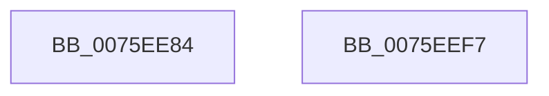

# PopSetAwayModeStatus

- RVA: `0x0075EE84`–`0x0075EEF8` (길이 `116` bytes)
- VA: `0x000000014075EE84`
- 실행 섹션: `PAGE`
- PDB 이름 있음: `예`; PDB Function 태그: `아니요`
- unwind 정보 RVA: `0x000606C0`
- 디코드: `29`개 명령, `116/116` bytes 표시
- 미해석 바이트: `0` (있으면 어셈블리에 `.byte`로 보존)

> 이 문서는 커널 이미지의 기계어와 PDB 기호를 분석해 생성했습니다. 4번과 5번은 함수 원형과 자료형을 바이너리 사용 방식에서 추정한 C 해석이며 원본 소스 복구 결과는 아닙니다.

## 1. Dependencies

- 직접 호출 지점: **3**; 고유 호출 대상: **3**
- 직접 호출자로 확인된 함수: **1**
- RIP 상대 이미지 참조: **3**

### Outgoing calls
- `0x0075EEC3` → [PopBroadcastSessionInfo](../91/PopBroadcastSessionInfo_function_00912598.md) (function, `0x00912598`)
- `0x0075EED9` → [PopSetPowerSettingValueAcDc](../91/PopSetPowerSettingValueAcDc_function_00914D6C.md) (function, `0x00914D6C`)
- `0x0075EEEC` → [_security_check_cookie](../../text/6A/_security_check_cookie_function_006AC640.md) (function, `0x006AC640`)

### Direct callers
- [PopSetSystemAwayMode](PopSetSystemAwayMode_function_0075EF00.md) at `0x0075EFD0`
- [PopSetSystemAwayMode](PopSetSystemAwayMode_function_0075EF00.md) at `0x0075EFE1`

### Static image references
- `0x0075EE8A` → RVA `0x00E0A740` (`.data`; read)
- `0x0075EE99` → RVA `0x00024828` (`.rdata`; read)
- `0x0075EEDE` → RVA `0x00F0CE11` (`.data`; write)

## 2. Other-region calls and transfers

- 다른 실행 섹션으로 향하는 call: **1**
  - `0x0075EEEC` → [_security_check_cookie](../../text/6A/_security_check_cookie_function_006AC640.md) (`PAGE` → `.text`)
- 별도 외부 분기/꼬리 이동을 확인하지 못했습니다.

## 3. Assembly (complete function range)

```asm
0075EE84  40 53                           push rbx
0075EE86  48 83 EC 50                     sub rsp, 0x50
0075EE8A  48 8B 05 AF B8 6A 00            mov rax, qword ptr [rip + 0x6ab8af]
0075EE91  48 33 C4                        xor rax, rsp
0075EE94  48 89 44 24 40                  mov qword ptr [rsp + 0x40], rax
0075EE99  0F 10 05 88 59 8C FF            movups xmm0, xmmword ptr [rip - 0x73a678]
0075EEA0  33 C0                           xor eax, eax
0075EEA2  4C 8D 44 24 28                  lea r8, [rsp + 0x28]
0075EEA7  84 C9                           test cl, cl
0075EEA9  8A D9                           mov bl, cl
0075EEAB  BA 14 00 00 00                  mov edx, 0x14
0075EEB0  0F 95 C0                        setne al
0075EEB3  33 C9                           xor ecx, ecx
0075EEB5  89 44 24 20                     mov dword ptr [rsp + 0x20], eax
0075EEB9  89 44 24 38                     mov dword ptr [rsp + 0x38], eax
0075EEBD  F3 0F 7F 44 24 28               movdqu xmmword ptr [rsp + 0x28], xmm0
0075EEC3  E8 D0 36 1B 00                  call 0x140912598
0075EEC8  4C 8D 44 24 20                  lea r8, [rsp + 0x20]
0075EECD  BA 04 00 00 00                  mov edx, 4
0075EED2  48 8D 0D 4F 59 8C FF            lea rcx, [rip - 0x73a6b1]
0075EED9  E8 8E 5E 1B 00                  call 0x140914d6c
0075EEDE  88 1D 2D DF 7A 00               mov byte ptr [rip + 0x7adf2d], bl
0075EEE4  48 8B 4C 24 40                  mov rcx, qword ptr [rsp + 0x40]
0075EEE9  48 33 CC                        xor rcx, rsp
0075EEEC  E8 4F D7 F4 FF                  call 0x1406ac640
0075EEF1  48 83 C4 50                     add rsp, 0x50
0075EEF5  5B                              pop rbx
0075EEF6  C3                              ret
0075EEF7  CC                              int3
```

## 4. C-style interpretation (structured pseudocode)

```c
__int64 __fastcall PopSetAwayModeStatus(int a1)
{
    __int64 result;
    __int64 v_rsp;
    unsigned __int64 v_stack_m18;
    unsigned int v_stack_m20;
    unsigned __int64 v_stack_m30;
    unsigned int v_stack_m38;

    v_rsp = (v_rsp) - (80);
    result = (*(unsigned __int64 *)(v_rip + 6994095)) ^ (v_rsp);
    v_stack_m18 = result;
    result = 0;
    result = ((unsigned __int8)(a1) != 0) ? 1 : 0;
    a1 = 0;
    v_stack_m38 = (unsigned int)(result);
    v_stack_m20 = (unsigned int)(result);
    v_stack_m30 = v_xmm0;
    result = PopBroadcastSessionInfo(a1, 20, v_stack_m30, a4);
    result = PopSetPowerSettingValueAcDc(v_rip - 7579313, 4, v_stack_m38, a4);
    *(unsigned __int8 *)(v_rip + 8052525) = (unsigned __int8)((unsigned __int8)(a1));
    a1 = (v_stack_m18) ^ (v_rsp);
    result = _security_check_cookie(a1, 4, v_stack_m38, a4);
    v_rsp = (v_rsp) + (80);
    return result;
}
```

## 5. (Beta) C Style

```c
int64_t PopSetAwayModeStatus(int32_t Arg1)
{
    int64_t result;
    int64_t local_rsp;
    uint64_t v_stack_m18;
    uint32_t v_stack_m20;
    uint64_t v_stack_m30;
    uint32_t v_stack_m38;

    local_rsp = (local_rsp) - (80);
    result = (*(uint64_t *)(v_rip + 0x6AB8AF)) ^ (local_rsp);
    v_stack_m18 = result;
    result = 0;
    result = ((uint8_t)(Arg1) != 0) ? 1 : 0;
    Arg1 = 0;
    v_stack_m38 = (uint32_t)(result);
    v_stack_m20 = (uint32_t)(result);
    v_stack_m30 = v_xmm0;
    result = PopBroadcastSessionInfo(Arg1, 20, v_stack_m30, a4);
    result = PopSetPowerSettingValueAcDc(v_rip - 7579313, 4, v_stack_m38, a4);
    *(uint8_t *)(v_rip + 0x7ADF2D) = (uint8_t)((uint8_t)(Arg1));
    Arg1 = (v_stack_m18) ^ (local_rsp);
    result = _security_check_cookie(Arg1, 4, v_stack_m38, a4);
    local_rsp = (local_rsp) + (80);
    return result;
}
```

## 6. Execution-region graph

[열기: 2D/3D 그래프와 함수 탐색 컨트롤 패널](../../../control-panel.html?section=page&rva=0x0075EE84&view=graph)

- 2D 그래프는 위에서 아래로 흐르고, 3D 그래프는 빈 공간을 드래그해 회전합니다. Shift+드래그는 이동, 휠은 확대·축소, 함수 노드 선택은 대상 보고서 이동입니다.

### Static fallback


