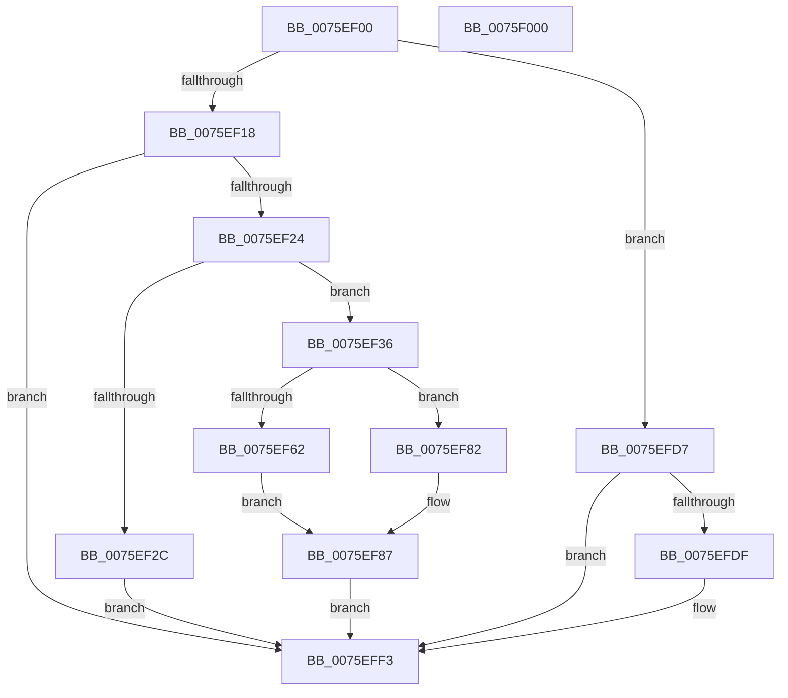

# PopSetSystemAwayMode

- RVA: `0x0075EF00`–`0x0075F001` (길이 `257` bytes)
- VA: `0x000000014075EF00`
- 실행 섹션: `PAGE`
- PDB 이름 있음: `예`; PDB Function 태그: `아니요`
- unwind 정보 RVA: `0x0008A658`
- 디코드: `59`개 명령, `257/257` bytes 표시
- 미해석 바이트: `0` (있으면 어셈블리에 `.byte`로 보존)

> 이 문서는 커널 이미지의 기계어와 PDB 기호를 분석해 생성했습니다. 4번과 5번은 함수 원형과 자료형을 바이너리 사용 방식에서 추정한 C 해석이며 원본 소스 복구 결과는 아닙니다.

## 1. Dependencies

- 직접 호출 지점: **11**; 고유 호출 대상: **9**
- 직접 호출자로 확인된 함수: **1**
- RIP 상대 이미지 참조: **11**

### Outgoing calls
- `0x0075EF3B` → [PopAcquireUserPresentSpinLock](../../text/4A/PopAcquireUserPresentSpinLock_function_004ADF98.md) (function, `0x004ADF98`)
- `0x0075EF47` → [KeResetEvent](../../text/24/KeResetEvent_function_00248350.md) (function, `0x00248350`)
- `0x0075EF62` → [PopReleaseUserPresentSpinLock](../../text/4B/PopReleaseUserPresentSpinLock_function_004B7A90.md) (function, `0x004B7A90`)
- `0x0075EF7B` → [KeWaitForSingleObject](../../text/20/KeWaitForSingleObject_function_0020E6B0.md) (function, `0x0020E6B0`)
- `0x0075EF82` → [PopReleaseUserPresentSpinLock](../../text/4B/PopReleaseUserPresentSpinLock_function_004B7A90.md) (function, `0x004B7A90`)
- `0x0075EF9F` → [KeInitializeDpc](../../text/45/KeInitializeDpc_function_0045BBD0.md) (function, `0x0045BBD0`)
- `0x0075EFBD` → [KiSetTimerEx](../../text/23/KiSetTimerEx_function_00232CB0.md) (function, `0x00232CB0`)
- `0x0075EFC9` → [PopDiagTraceEventNoPayload](../../text/49/PopDiagTraceEventNoPayload_function_004982F8.md) (function, `0x004982F8`)
- `0x0075EFD0` → [PopSetAwayModeStatus](PopSetAwayModeStatus_function_0075EE84.md) (function, `0x0075EE84`)
- `0x0075EFE1` → [PopSetAwayModeStatus](PopSetAwayModeStatus_function_0075EE84.md) (function, `0x0075EE84`)
- `0x0075EFEE` → [PopNotifyConsoleUserPresent](../91/PopNotifyConsoleUserPresent_function_00913C50.md) (function, `0x00913C50`)

### Direct callers
- [PopIssueActionRequest](../A9/PopIssueActionRequest_function_00A9CE54.md) at `0x00A9CF0B`

### Static image references
- `0x0075EF18` → RVA `0x00F0CE11` (`.data`; read)
- `0x0075EF24` → RVA `0x00F0CE10` (`.data`; read)
- `0x0075EF40` → RVA `0x00F0D160` (`.data`; read)
- `0x0075EF4C` → RVA `0x00E676E4` (`.data`; read)
- `0x0075EF56` → RVA `0x00F0CE14` (`.data`; write)
- `0x0075EF87` → RVA `0x00F0D0C0` (`.data`; read)
- `0x0075EF91` → RVA `0x00F0CE14` (`.data`; read)
- `0x0075EF98` → RVA `0x005D5190` (`PopAwayModeUserPresenceDpc`; read)
- `0x0075EFAF` → RVA `0x00E67730` (`.data`; read)
- `0x0075EFC2` → RVA `0x00021D48` (`.rdata`; read)
- `0x0075EFE6` → RVA `0x00F0C68C` (`.data`; read)

## 2. Other-region calls and transfers

- 다른 실행 섹션으로 향하는 call: **8**
  - `0x0075EF3B` → [PopAcquireUserPresentSpinLock](../../text/4A/PopAcquireUserPresentSpinLock_function_004ADF98.md) (`PAGE` → `.text`)
  - `0x0075EF47` → [KeResetEvent](../../text/24/KeResetEvent_function_00248350.md) (`PAGE` → `.text`)
  - `0x0075EF62` → [PopReleaseUserPresentSpinLock](../../text/4B/PopReleaseUserPresentSpinLock_function_004B7A90.md) (`PAGE` → `.text`)
  - `0x0075EF7B` → [KeWaitForSingleObject](../../text/20/KeWaitForSingleObject_function_0020E6B0.md) (`PAGE` → `.text`)
  - `0x0075EF82` → [PopReleaseUserPresentSpinLock](../../text/4B/PopReleaseUserPresentSpinLock_function_004B7A90.md) (`PAGE` → `.text`)
  - `0x0075EF9F` → [KeInitializeDpc](../../text/45/KeInitializeDpc_function_0045BBD0.md) (`PAGE` → `.text`)
  - `0x0075EFBD` → [KiSetTimerEx](../../text/23/KiSetTimerEx_function_00232CB0.md) (`PAGE` → `.text`)
  - `0x0075EFC9` → [PopDiagTraceEventNoPayload](../../text/49/PopDiagTraceEventNoPayload_function_004982F8.md) (`PAGE` → `.text`)
- 별도 외부 분기/꼬리 이동을 확인하지 못했습니다.

## 3. Assembly (complete function range)

```asm
0075EF00  48 89 5C 24 10                  mov qword ptr [rsp + 0x10], rbx
0075EF05  57                              push rdi
0075EF06  48 83 EC 30                     sub rsp, 0x30
0075EF0A  33 DB                           xor ebx, ebx
0075EF0C  88 5C 24 40                     mov byte ptr [rsp + 0x40], bl
0075EF10  85 C9                           test ecx, ecx
0075EF12  0F 84 BF 00 00 00               je 0x14075efd7
0075EF18  38 1D F3 DE 7A 00               cmp byte ptr [rip + 0x7adef3], bl
0075EF1E  0F 85 CF 00 00 00               jne 0x14075eff3
0075EF24  38 1D E6 DE 7A 00               cmp byte ptr [rip + 0x7adee6], bl
0075EF2A  75 0A                           jne 0x14075ef36
0075EF2C  BB 0D 00 00 C0                  mov ebx, 0xc000000d
0075EF31  E9 BD 00 00 00                  jmp 0x14075eff3
0075EF36  48 8D 4C 24 40                  lea rcx, [rsp + 0x40]
0075EF3B  E8 58 F0 D4 FF                  call 0x1404adf98
0075EF40  48 8D 0D 19 E2 7A 00            lea rcx, [rip + 0x7ae219]
0075EF47  E8 04 94 AE FF                  call 0x140248350
0075EF4C  39 1D 92 87 70 00               cmp dword ptr [rip + 0x708792], ebx
0075EF52  8A 4C 24 40                     mov cl, byte ptr [rsp + 0x40]
0075EF56  C7 05 B4 DE 7A 00 01 00 00 00   mov dword ptr [rip + 0x7adeb4], 1
0075EF60  74 20                           je 0x14075ef82
0075EF62  E8 29 8B D5 FF                  call 0x1404b7a90
0075EF67  45 33 C9                        xor r9d, r9d
0075EF6A  48 89 5C 24 20                  mov qword ptr [rsp + 0x20], rbx
0075EF6F  45 33 C0                        xor r8d, r8d
0075EF72  48 8D 0D E7 E1 7A 00            lea rcx, [rip + 0x7ae1e7]
0075EF79  33 D2                           xor edx, edx
0075EF7B  E8 30 F7 AA FF                  call 0x14020e6b0
0075EF80  EB 05                           jmp 0x14075ef87
0075EF82  E8 09 8B D5 FF                  call 0x1404b7a90
0075EF87  48 8D 3D 32 E1 7A 00            lea rdi, [rip + 0x7ae132]
0075EF8E  48 8B CF                        mov rcx, rdi
0075EF91  4C 8D 05 7C DE 7A 00            lea r8, [rip + 0x7ade7c]
0075EF98  48 8D 15 F1 61 E7 FF            lea rdx, [rip - 0x189e0f]
0075EF9F  E8 2C CC CF FF                  call 0x14045bbd0
0075EFA4  45 33 C9                        xor r9d, r9d
0075EFA7  48 89 7C 24 20                  mov qword ptr [rsp + 0x20], rdi
0075EFAC  45 33 C0                        xor r8d, r8d
0075EFAF  48 8D 0D 7A 87 70 00            lea rcx, [rip + 0x70877a]
0075EFB6  48 C7 C2 80 3C 36 FE            mov rdx, 0xfffffffffe363c80
0075EFBD  E8 EE 3C AD FF                  call 0x140232cb0
0075EFC2  48 8D 0D 7F 2D 8C FF            lea rcx, [rip - 0x73d281]
0075EFC9  E8 2A 93 D3 FF                  call 0x1404982f8
0075EFCE  B1 01                           mov cl, 1
0075EFD0  E8 AF FE FF FF                  call 0x14075ee84
0075EFD5  EB 1C                           jmp 0x14075eff3
0075EFD7  38 1D 34 DE 7A 00               cmp byte ptr [rip + 0x7ade34], bl
0075EFDD  74 14                           je 0x14075eff3
0075EFDF  33 C9                           xor ecx, ecx
0075EFE1  E8 9E FE FF FF                  call 0x14075ee84
0075EFE6  8B 15 A0 D6 7A 00               mov edx, dword ptr [rip + 0x7ad6a0]
0075EFEC  33 C9                           xor ecx, ecx
0075EFEE  E8 5D 4C 1B 00                  call 0x140913c50
0075EFF3  8B C3                           mov eax, ebx
0075EFF5  48 8B 5C 24 48                  mov rbx, qword ptr [rsp + 0x48]
0075EFFA  48 83 C4 30                     add rsp, 0x30
0075EFFE  5F                              pop rdi
0075EFFF  C3                              ret
0075F000  CC                              int3
```

## 4. C-style interpretation (structured pseudocode)

```c
__int64 __fastcall PopSetSystemAwayMode(int a1, int a2, int a3, int a4)
{
    __int64 result;
    __int64 v_rbx;
    __int64 v_rsp;
    unsigned __int64 v_stack_m18;
    unsigned __int64 v_stack_p10;
    unsigned __int8 v_stack_p8;

    v_stack_p10 = v_rbx;
    v_rsp = (v_rsp) - (48);
    v_rbx = 0;
    v_stack_p8 = 0;
    if (a1 == 0) goto loc_0075EFD7;
    if ((*(unsigned __int8 *)(v_rip + 8052467)) != 0) goto loc_0075EFF3;
    if ((*(unsigned __int8 *)(v_rip + 8052454)) != 0) goto loc_0075EF36;
    goto loc_0075EFF3;
loc_0075EF36:
    result = PopAcquireUserPresentSpinLock(v_stack_p8, a2, a3, a4);
    result = KeResetEvent(v_rip + 8053273, a2, a3, a4);
    *(unsigned int *)(v_rip + 8052404) = 1;
    if ((*(unsigned int *)(v_rip + 7374738)) == ((unsigned int)((unsigned int)(0xC000000DULL)))) goto loc_0075EF82;
    result = PopReleaseUserPresentSpinLock(v_stack_p8, a2, a3, a4);
    a4 = 0;
    v_stack_m18 = (unsigned int)(0xC000000DULL);
    a3 = 0;
    a2 = 0;
    result = KeWaitForSingleObject(v_rip + 8053223, a2, a3, a4);
    goto loc_0075EF87;
loc_0075EF82:
    result = PopReleaseUserPresentSpinLock(v_rip + 8053223, a2, a3, a4);
loc_0075EF87:
    result = KeInitializeDpc(v_rip + 8053042, v_rip - 1613327, v_rip + 8052348, a4);
    a4 = 0;
    v_stack_m18 = v_rip + 8053042;
    a3 = 0;
    result = KiSetTimerEx(v_rip + 7374714, 0xFFFFFFFFFE363C80ULL, a3, a4);
    result = PopDiagTraceEventNoPayload(v_rip - 7590529, 0xFFFFFFFFFE363C80ULL, a3, a4);
    result = PopSetAwayModeStatus(1, 0xFFFFFFFFFE363C80ULL, a3, a4);
    goto loc_0075EFF3;
loc_0075EFD7:
    if ((*(unsigned __int8 *)(v_rip + 8052276)) != ((unsigned __int8)((unsigned int)(0xC000000DULL)))) {
        a1 = 0;
        result = PopSetAwayModeStatus(a1, 0xFFFFFFFFFE363C80ULL, a3, a4);
        a2 = *(unsigned int *)(v_rip + 8050336);
        a1 = 0;
        result = PopNotifyConsoleUserPresent(a1, a2, a3, a4);
    }
    v_rsp = (v_rsp) + (48);
    return (unsigned int)((unsigned int)((unsigned int)(0xC000000DULL)));
}
```

## 5. (Beta) C Style

```c
int64_t PopSetSystemAwayMode(int32_t Arg1, int32_t Arg2, int32_t Arg3, int32_t Arg4)
{
    int64_t result;
    int64_t local_rbx;
    int64_t local_rsp;
    uint64_t v_stack_m18;
    uint64_t v_stack_p10;
    uint8_t v_stack_p8;

    v_stack_p10 = local_rbx;
    local_rsp = (local_rsp) - (48);
    local_rbx = 0;
    v_stack_p8 = 0;
    if (Arg1 == 0) goto loc_0075EFD7;
    if ((*(uint8_t *)(v_rip + 0x7ADEF3)) != 0) goto loc_0075EFF3;
    if ((*(uint8_t *)(v_rip + 0x7ADEE6)) != 0) goto loc_0075EF36;
    goto loc_0075EFF3;
loc_0075EF36:
    result = PopAcquireUserPresentSpinLock(v_stack_p8, Arg2, Arg3, Arg4);
    result = KeResetEvent(v_rip + 8053273, Arg2, Arg3, Arg4);
    *(uint32_t *)(v_rip + 0x7ADEB4) = 1;
    if ((*(uint32_t *)(v_rip + 0x708792)) == ((uint32_t)((uint32_t)(0xC000000DULL)))) goto loc_0075EF82;
    result = PopReleaseUserPresentSpinLock(v_stack_p8, Arg2, Arg3, Arg4);
    Arg4 = 0;
    v_stack_m18 = (uint32_t)(0xC000000DULL);
    Arg3 = 0;
    Arg2 = 0;
    result = KeWaitForSingleObject(v_rip + 8053223, Arg2, Arg3, Arg4);
    goto loc_0075EF87;
loc_0075EF82:
    result = PopReleaseUserPresentSpinLock(v_rip + 8053223, Arg2, Arg3, Arg4);
loc_0075EF87:
    result = KeInitializeDpc(v_rip + 8053042, v_rip - 1613327, v_rip + 8052348, Arg4);
    Arg4 = 0;
    v_stack_m18 = v_rip + 8053042;
    Arg3 = 0;
    result = KiSetTimerEx(v_rip + 7374714, 0xFFFFFFFFFE363C80ULL, Arg3, Arg4);
    result = PopDiagTraceEventNoPayload(v_rip - 7590529, 0xFFFFFFFFFE363C80ULL, Arg3, Arg4);
    result = PopSetAwayModeStatus(1, 0xFFFFFFFFFE363C80ULL, Arg3, Arg4);
    goto loc_0075EFF3;
loc_0075EFD7:
    if ((*(uint8_t *)(v_rip + 0x7ADE34)) != ((uint8_t)((uint32_t)(0xC000000DULL)))) {
        Arg1 = 0;
        result = PopSetAwayModeStatus(Arg1, 0xFFFFFFFFFE363C80ULL, Arg3, Arg4);
        Arg2 = *(uint32_t *)(v_rip + 0x7AD6A0);
        Arg1 = 0;
        result = PopNotifyConsoleUserPresent(Arg1, Arg2, Arg3, Arg4);
    }
    local_rsp = (local_rsp) + (48);
    return (uint32_t)((uint32_t)((uint32_t)(0xC000000DULL)));
}
```

## 6. Execution-region graph

[열기: 2D/3D 그래프와 함수 탐색 컨트롤 패널](../../../control-panel.html?section=page&rva=0x0075EF00&view=graph)

- 2D 그래프는 위에서 아래로 흐르고, 3D 그래프는 빈 공간을 드래그해 회전합니다. Shift+드래그는 이동, 휠은 확대·축소, 함수 노드 선택은 대상 보고서 이동입니다.

### Static fallback


