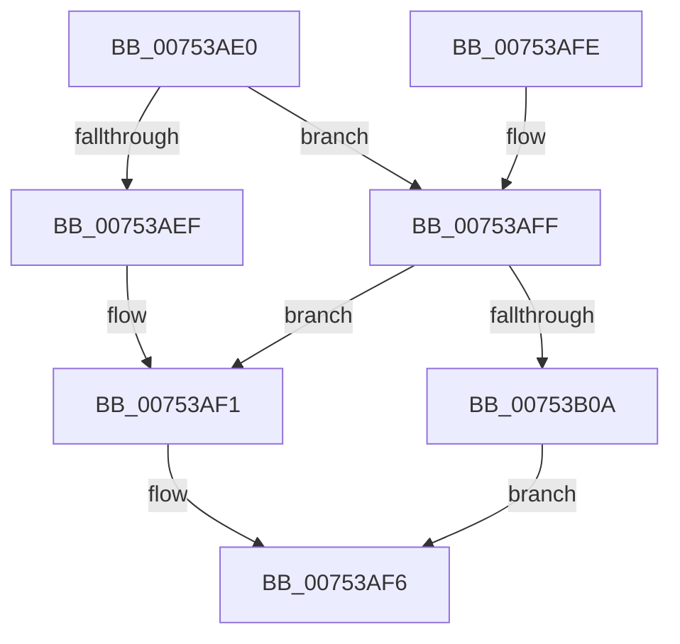

# PopSetupHighPerfPowerRequest

- RVA: `0x00753AE0`–`0x00753B13` (길이 `51` bytes)
- VA: `0x0000000140753AE0`
- 실행 섹션: `PAGE`
- PDB 이름 있음: `예`; PDB Function 태그: `아니요`
- unwind 정보 RVA: `0x00060A68`
- 디코드: `18`개 명령, `51/51` bytes 표시
- 미해석 바이트: `0` (있으면 어셈블리에 `.byte`로 보존)

> 이 문서는 커널 이미지의 기계어와 PDB 기호를 분석해 생성했습니다. 4번과 5번은 함수 원형과 자료형을 바이너리 사용 방식에서 추정한 C 해석이며 원본 소스 복구 결과는 아닙니다.

## 1. Dependencies

- 직접 호출 지점: **3**; 고유 호출 대상: **3**
- 직접 호출자로 확인된 함수: **1**
- RIP 상대 이미지 참조: **1**

### Outgoing calls
- `0x00753AF1` → [PpmPerfClearBootOverrides](../../text/4F/PpmPerfClearBootOverrides_function_004FCF44.md) (function, `0x004FCF44`)
- `0x00753AFF` → [PpmBeginHighPerfRequest](../../text/47/PpmBeginHighPerfRequest_function_004774FC.md) (function, `0x004774FC`)
- `0x00753B0C` → [PpmEndHighPerfRequest](../../text/47/PpmEndHighPerfRequest_function_00477490.md) (function, `0x00477490`)

### Direct callers
- [PoInitSystem](../../init/C7/PoInitSystem_function_00C72358.md) at `0x00C73173`

### Static image references
- `0x00753AE6` → RVA `0x00FC53A0` (`ALMOSTRO`; read)

## 2. Other-region calls and transfers

- 다른 실행 섹션으로 향하는 call: **3**
  - `0x00753AF1` → [PpmPerfClearBootOverrides](../../text/4F/PpmPerfClearBootOverrides_function_004FCF44.md) (`PAGE` → `.text`)
  - `0x00753AFF` → [PpmBeginHighPerfRequest](../../text/47/PpmBeginHighPerfRequest_function_004774FC.md) (`PAGE` → `.text`)
  - `0x00753B0C` → [PpmEndHighPerfRequest](../../text/47/PpmEndHighPerfRequest_function_00477490.md) (`PAGE` → `.text`)
- 별도 외부 분기/꼬리 이동을 확인하지 못했습니다.

## 3. Assembly (complete function range)

```asm
00753AE0  40 53                           push rbx
00753AE2  48 83 EC 20                     sub rsp, 0x20
00753AE6  83 3D B3 18 87 00 00            cmp dword ptr [rip + 0x8718b3], 0
00753AED  75 10                           jne 0x140753aff
00753AEF  33 DB                           xor ebx, ebx
00753AF1  E8 4E 94 DA FF                  call 0x1404fcf44
00753AF6  8B C3                           mov eax, ebx
00753AF8  48 83 C4 20                     add rsp, 0x20
00753AFC  5B                              pop rbx
00753AFD  C3                              ret
00753AFE  CC                              int3
00753AFF  E8 F8 39 D2 FF                  call 0x1404774fc
00753B04  8B D8                           mov ebx, eax
00753B06  85 C0                           test eax, eax
00753B08  78 E7                           js 0x140753af1
00753B0A  33 C9                           xor ecx, ecx
00753B0C  E8 7F 39 D2 FF                  call 0x140477490
00753B11  EB E3                           jmp 0x140753af6
```

## 4. C-style interpretation (structured pseudocode)

```c
__int64 __fastcall PopSetupHighPerfPowerRequest(int a1)
{
    __int64 result;
    __int64 v_rbx;
    __int64 v_rsp;

    v_rsp = (v_rsp) - (32);
    if ((*(unsigned int *)(v_rip + 8853683)) != 0) goto loc_00753AFF;
    v_rbx = 0;
loc_00753AF1:
    result = PpmPerfClearBootOverrides(a1, a2, a3, a4);
loc_00753AF6:
    v_rsp = (v_rsp) + (32);
    return 0;
loc_00753AFF:
    result = PpmBeginHighPerfRequest(a1, a2, a3, a4);
    if (sign_flag) goto loc_00753AF1;
    a1 = 0;
    result = PpmEndHighPerfRequest(a1, a2, a3, a4);
    goto loc_00753AF6;
}
```

## 5. (Beta) C Style

```c
int64_t PopSetupHighPerfPowerRequest(int32_t Arg1)
{
    int64_t result;
    int64_t local_rbx;
    int64_t local_rsp;

    local_rsp = (local_rsp) - (32);
    if ((*(uint32_t *)(v_rip + 0x8718B3)) != 0) goto loc_00753AFF;
    local_rbx = 0;
loc_00753AF1:
    result = PpmPerfClearBootOverrides(Arg1, a2, a3, a4);
loc_00753AF6:
    local_rsp = (local_rsp) + (32);
    return 0;
loc_00753AFF:
    result = PpmBeginHighPerfRequest(Arg1, a2, a3, a4);
    if (sign_flag) goto loc_00753AF1;
    Arg1 = 0;
    result = PpmEndHighPerfRequest(Arg1, a2, a3, a4);
    goto loc_00753AF6;
}
```

## 6. Execution-region graph

[열기: 2D/3D 그래프와 함수 탐색 컨트롤 패널](../../../control-panel.html?section=page&rva=0x00753AE0&view=graph)

- 2D 그래프는 위에서 아래로 흐르고, 3D 그래프는 빈 공간을 드래그해 회전합니다. Shift+드래그는 이동, 휠은 확대·축소, 함수 노드 선택은 대상 보고서 이동입니다.

### Static fallback


