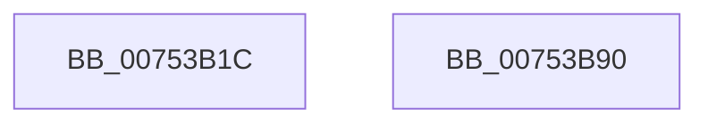

# PopSetupMixedRealitytNotification

- RVA: `0x00753B1C`–`0x00753B91` (길이 `117` bytes)
- VA: `0x0000000140753B1C`
- 실행 섹션: `PAGE`
- PDB 이름 있음: `예`; PDB Function 태그: `아니요`
- unwind 정보 RVA: `0x00063458`
- 디코드: `26`개 명령, `117/117` bytes 표시
- 미해석 바이트: `0` (있으면 어셈블리에 `.byte`로 보존)

> 이 문서는 커널 이미지의 기계어와 PDB 기호를 분석해 생성했습니다. 4번과 5번은 함수 원형과 자료형을 바이너리 사용 방식에서 추정한 C 해석이며 원본 소스 복구 결과는 아닙니다.

## 1. Dependencies

- 직접 호출 지점: **2**; 고유 호출 대상: **2**
- 직접 호출자로 확인된 함수: **1**
- RIP 상대 이미지 참조: **2**

### Outgoing calls
- `0x00753B5C` → [ZwUpdateWnfStateData](../../text/6B/ZwUpdateWnfStateData_function_006B0D10.md) (function, `0x006B0D10`)
- `0x00753B86` → [ExSubscribeWnfStateChange](../9D/ExSubscribeWnfStateChange_function_009D4BC0.md) (function, `0x009D4BC0`)

### Direct callers
- [PoInitSystem](../../init/C7/PoInitSystem_function_00C72358.md) at `0x00C731C8`

### Static image references
- `0x00753B2F` → RVA `0x00020B80` (`.rdata`; read)
- `0x00753B67` → RVA `0x007585B0` (`PopWnfMixedRealityCallback`; read)

## 2. Other-region calls and transfers

- 다른 실행 섹션으로 향하는 call: **1**
  - `0x00753B5C` → [ZwUpdateWnfStateData](../../text/6B/ZwUpdateWnfStateData_function_006B0D10.md) (`PAGE` → `.text`)
- 별도 외부 분기/꼬리 이동을 확인하지 못했습니다.

## 3. Assembly (complete function range)

```asm
00753B1C  48 83 EC 48                     sub rsp, 0x48
00753B20  48 83 64 24 50 00               and qword ptr [rsp + 0x50], 0
00753B26  48 8D 54 24 50                  lea rdx, [rsp + 0x50]
00753B2B  8B 44 24 50                     mov eax, dword ptr [rsp + 0x50]
00753B2F  48 8D 0D 4A D0 8C FF            lea rcx, [rip - 0x732fb6]
00753B36  83 64 24 30 00                  and dword ptr [rsp + 0x30], 0
00753B3B  45 33 C9                        xor r9d, r9d
00753B3E  83 64 24 28 00                  and dword ptr [rsp + 0x28], 0
00753B43  83 E0 FD                        and eax, 0xfffffffd
00753B46  83 4C 24 54 FF                  or dword ptr [rsp + 0x54], 0xffffffff
00753B4B  83 C8 01                        or eax, 1
00753B4E  48 83 64 24 20 00               and qword ptr [rsp + 0x20], 0
00753B54  45 8D 41 08                     lea r8d, [r9 + 8]
00753B58  89 44 24 50                     mov dword ptr [rsp + 0x50], eax
00753B5C  E8 AF D1 F5 FF                  call 0x1406b0d10
00753B61  48 83 64 24 28 00               and qword ptr [rsp + 0x28], 0
00753B67  48 8D 05 42 4A 00 00            lea rax, [rip + 0x4a42]
00753B6E  45 33 C9                        xor r9d, r9d
00753B71  48 89 44 24 20                  mov qword ptr [rsp + 0x20], rax
00753B76  48 8D 15 03 D0 8C FF            lea rdx, [rip - 0x732ffd]
00753B7D  48 8D 4C 24 58                  lea rcx, [rsp + 0x58]
00753B82  45 8D 41 01                     lea r8d, [r9 + 1]
00753B86  E8 35 10 28 00                  call 0x1409d4bc0
00753B8B  48 83 C4 48                     add rsp, 0x48
00753B8F  C3                              ret
00753B90  CC                              int3
```

## 4. C-style interpretation (structured pseudocode)

```c
__int64 __fastcall PopSetupMixedRealitytNotification(__int64 a1, __int64 a2, __int64 a3, int a4)
{
    __int64 result;
    __int64 v_rsp;
    unsigned int v_stack_m18;
    unsigned int v_stack_m20;
    unsigned __int64 v_stack_m28;
    unsigned __int64 v_stack_p10;
    unsigned __int64 v_stack_p8;
    unsigned int v_stack_pC;

    v_rsp = (v_rsp) - (72);
    a4 = 0;
    result = (unsigned int)(((unsigned int)(v_stack_p8)) & (0xFFFFFFFDULL));
    result = (unsigned int)((result) | (1));
    v_stack_p8 = (unsigned int)(result);
    result = ZwUpdateWnfStateData(v_rip - 7548854, v_stack_p8, a4 + 8, a4);
    a4 = 0;
    v_stack_m28 = v_rip + 19010;
    result = ExSubscribeWnfStateChange(v_stack_p10, v_rip - 7548925, a4 + 1, a4);
    v_rsp = (v_rsp) + (72);
    return result;
}
```

## 5. (Beta) C Style

```c
int64_t PopSetupMixedRealitytNotification(int64_t Arg1, int64_t Arg2, int64_t Arg3, int32_t Arg4)
{
    int64_t result;
    int64_t local_rsp;
    uint32_t v_stack_m18;
    uint32_t v_stack_m20;
    uint64_t v_stack_m28;
    uint64_t v_stack_p10;
    uint64_t v_stack_p8;
    uint32_t v_stack_pC;

    local_rsp = (local_rsp) - (72);
    Arg4 = 0;
    result = (uint32_t)(((uint32_t)(v_stack_p8)) & (0xFFFFFFFDULL));
    result = (uint32_t)((result) | (1));
    v_stack_p8 = (uint32_t)(result);
    result = ZwUpdateWnfStateData(v_rip - 7548854, v_stack_p8, Arg4 + 8, Arg4);
    Arg4 = 0;
    v_stack_m28 = v_rip + 19010;
    result = ExSubscribeWnfStateChange(v_stack_p10, v_rip - 7548925, Arg4 + 1, Arg4);
    local_rsp = (local_rsp) + (72);
    return result;
}
```

## 6. Execution-region graph

[열기: 2D/3D 그래프와 함수 탐색 컨트롤 패널](../../../control-panel.html?section=page&rva=0x00753B1C&view=graph)

- 2D 그래프는 위에서 아래로 흐르고, 3D 그래프는 빈 공간을 드래그해 회전합니다. Shift+드래그는 이동, 휠은 확대·축소, 함수 노드 선택은 대상 보고서 이동입니다.

### Static fallback


