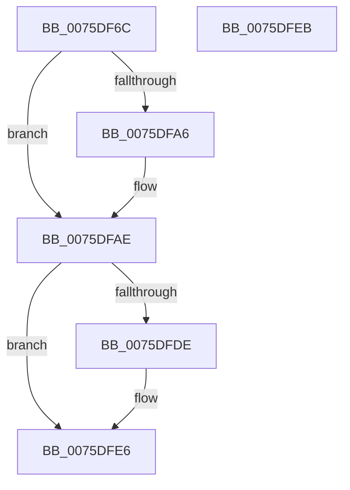

# PopSubscribeHibernatePolicyWnf

- RVA: `0x0075DF6C`–`0x0075DFEC` (길이 `128` bytes)
- VA: `0x000000014075DF6C`
- 실행 섹션: `PAGE`
- PDB 이름 있음: `예`; PDB Function 태그: `아니요`
- unwind 정보 RVA: `0x0005D2F4`
- 디코드: `27`개 명령, `128/128` bytes 표시
- 미해석 바이트: `0` (있으면 어셈블리에 `.byte`로 보존)

> 이 문서는 커널 이미지의 기계어와 PDB 기호를 분석해 생성했습니다. 4번과 5번은 함수 원형과 자료형을 바이너리 사용 방식에서 추정한 C 해석이며 원본 소스 복구 결과는 아닙니다.

## 1. Dependencies

- 직접 호출 지점: **2**; 고유 호출 대상: **1**
- 직접 호출자로 확인된 함수: **1**
- RIP 상대 이미지 참조: **9**

### Outgoing calls
- `0x0075DF9D` → [ExSubscribeWnfStateChange](../9D/ExSubscribeWnfStateChange_function_009D4BC0.md) (function, `0x009D4BC0`)
- `0x0075DFD5` → [ExSubscribeWnfStateChange](../9D/ExSubscribeWnfStateChange_function_009D4BC0.md) (function, `0x009D4BC0`)

### Direct callers
- [PoInitHiberServices](PoInitHiberServices_function_007537C4.md) at `0x00753894`

### Static image references
- `0x0075DF73` → RVA `0x00FC510C` (`ALMOSTRO`; read)
- `0x0075DF7F` → RVA `0x00020B48` (`.rdata`; read)
- `0x0075DF86` → RVA `0x0075E3C0` (`PopWnfHibernatePolicyCallback`; read)
- `0x0075DF8D` → RVA `0x00F0DE40` (`.data`; read)
- `0x0075DFA6` → RVA `0x00F0DE40` (`.data`; read/write)
- `0x0075DFB4` → RVA `0x0075E440` (`PopWnfHibernateRevocationCheckCallback`; read)
- `0x0075DFC3` → RVA `0x00020A98` (`.rdata`; read)
- `0x0075DFCA` → RVA `0x00F0DE48` (`.data`; read)
- `0x0075DFDE` → RVA `0x00F0DE48` (`.data`; read/write)

## 2. Other-region calls and transfers

- 다른 실행 섹션으로 향하는 call: **0**
- 별도 외부 분기/꼬리 이동을 확인하지 못했습니다.

## 3. Assembly (complete function range)

```asm
0075DF6C  48 83 EC 38                     sub rsp, 0x38
0075DF70  45 33 C9                        xor r9d, r9d
0075DF73  48 8D 05 92 71 86 00            lea rax, [rip + 0x867192]
0075DF7A  48 89 44 24 28                  mov qword ptr [rsp + 0x28], rax
0075DF7F  48 8D 15 C2 2B 8C FF            lea rdx, [rip - 0x73d43e]
0075DF86  48 8D 05 33 04 00 00            lea rax, [rip + 0x433]
0075DF8D  48 8D 0D AC FE 7A 00            lea rcx, [rip + 0x7afeac]
0075DF94  48 89 44 24 20                  mov qword ptr [rsp + 0x20], rax
0075DF99  45 8D 41 01                     lea r8d, [r9 + 1]
0075DF9D  E8 1E 6C 27 00                  call 0x1409d4bc0
0075DFA2  85 C0                           test eax, eax
0075DFA4  79 08                           jns 0x14075dfae
0075DFA6  48 83 25 92 FE 7A 00 00         and qword ptr [rip + 0x7afe92], 0
0075DFAE  48 83 64 24 28 00               and qword ptr [rsp + 0x28], 0
0075DFB4  48 8D 05 85 04 00 00            lea rax, [rip + 0x485]
0075DFBB  45 33 C9                        xor r9d, r9d
0075DFBE  48 89 44 24 20                  mov qword ptr [rsp + 0x20], rax
0075DFC3  48 8D 15 CE 2A 8C FF            lea rdx, [rip - 0x73d532]
0075DFCA  48 8D 0D 77 FE 7A 00            lea rcx, [rip + 0x7afe77]
0075DFD1  45 8D 41 01                     lea r8d, [r9 + 1]
0075DFD5  E8 E6 6B 27 00                  call 0x1409d4bc0
0075DFDA  85 C0                           test eax, eax
0075DFDC  79 08                           jns 0x14075dfe6
0075DFDE  48 83 25 62 FE 7A 00 00         and qword ptr [rip + 0x7afe62], 0
0075DFE6  48 83 C4 38                     add rsp, 0x38
0075DFEA  C3                              ret
0075DFEB  CC                              int3
```

## 4. C-style interpretation (structured pseudocode)

```c
__int64 __fastcall PopSubscribeHibernatePolicyWnf(__int64 a1, __int64 a2, __int64 a3, int a4)
{
    __int64 result;
    __int64 v_rsp;
    unsigned __int64 v_stack_m10;
    unsigned __int64 v_stack_m18;

    v_rsp = (v_rsp) - (56);
    a4 = 0;
    v_stack_m10 = v_rip + 8810898;
    v_stack_m18 = v_rip + 1075;
    result = ExSubscribeWnfStateChange(v_rip + 8060588, v_rip - 7590974, a4 + 1, a4);
    if (sign_flag) {
    }
    a4 = 0;
    v_stack_m18 = v_rip + 1157;
    result = ExSubscribeWnfStateChange(v_rip + 8060535, v_rip - 7591218, a4 + 1, a4);
    if (sign_flag) {
    }
    v_rsp = (v_rsp) + (56);
    return result;
}
```

## 5. (Beta) C Style

```c
int64_t PopSubscribeHibernatePolicyWnf(int64_t Arg1, int64_t Arg2, int64_t Arg3, int32_t Arg4)
{
    int64_t result;
    int64_t local_rsp;
    uint64_t v_stack_m10;
    uint64_t v_stack_m18;

    local_rsp = (local_rsp) - (56);
    Arg4 = 0;
    v_stack_m10 = v_rip + 8810898;
    v_stack_m18 = v_rip + 1075;
    result = ExSubscribeWnfStateChange(v_rip + 8060588, v_rip - 7590974, Arg4 + 1, Arg4);
    if (sign_flag) {
    }
    Arg4 = 0;
    v_stack_m18 = v_rip + 1157;
    result = ExSubscribeWnfStateChange(v_rip + 8060535, v_rip - 7591218, Arg4 + 1, Arg4);
    if (sign_flag) {
    }
    local_rsp = (local_rsp) + (56);
    return result;
}
```

## 6. Execution-region graph

[열기: 2D/3D 그래프와 함수 탐색 컨트롤 패널](../../../control-panel.html?section=page&rva=0x0075DF6C&view=graph)

- 2D 그래프는 위에서 아래로 흐르고, 3D 그래프는 빈 공간을 드래그해 회전합니다. Shift+드래그는 이동, 휠은 확대·축소, 함수 노드 선택은 대상 보고서 이동입니다.

### Static fallback


