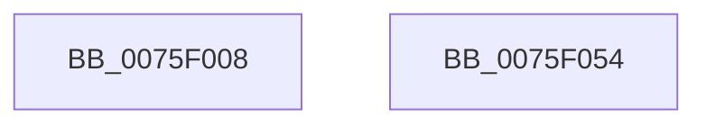

# PopSuspendApps

- RVA: `0x0075F008`–`0x0075F055` (길이 `77` bytes)
- VA: `0x000000014075F008`
- 실행 섹션: `PAGE`
- PDB 이름 있음: `예`; PDB Function 태그: `아니요`
- unwind 정보 RVA: `0x0005CF00`
- 디코드: `19`개 명령, `77/77` bytes 표시
- 미해석 바이트: `0` (있으면 어셈블리에 `.byte`로 보존)

> 이 문서는 커널 이미지의 기계어와 PDB 기호를 분석해 생성했습니다. 4번과 5번은 함수 원형과 자료형을 바이너리 사용 방식에서 추정한 C 해석이며 원본 소스 복구 결과는 아닙니다.

## 1. Dependencies

- 직접 호출 지점: **5**; 고유 호출 대상: **3**
- 직접 호출자로 확인된 함수: **1**
- RIP 상대 이미지 참조: **2**

### Outgoing calls
- `0x0075F018` → [PopDiagTraceEventNoPayload](../../text/49/PopDiagTraceEventNoPayload_function_004982F8.md) (function, `0x004982F8`)
- `0x0075F022` → [PopCheckpointSystemSleep](../../pagelk/B7/PopCheckpointSystemSleep_function_00B77C90.md) (function, `0x00B77C90`)
- `0x0075F033` → [PopDispatchStateCallout](../91/PopDispatchStateCallout_function_0091248C.md) (function, `0x0091248C`)
- `0x0075F03F` → [PopDiagTraceEventNoPayload](../../text/49/PopDiagTraceEventNoPayload_function_004982F8.md) (function, `0x004982F8`)
- `0x0075F049` → [PopCheckpointSystemSleep](../../pagelk/B7/PopCheckpointSystemSleep_function_00B77C90.md) (function, `0x00B77C90`)

### Direct callers
- [PopIssueActionRequest](../A9/PopIssueActionRequest_function_00A9CE54.md) at `0x00A9D161`

### Static image references
- `0x0075F011` → RVA `0x00022FD8` (`.rdata`; read)
- `0x0075F038` → RVA `0x000216B8` (`.rdata`; read)

## 2. Other-region calls and transfers

- 다른 실행 섹션으로 향하는 call: **4**
  - `0x0075F018` → [PopDiagTraceEventNoPayload](../../text/49/PopDiagTraceEventNoPayload_function_004982F8.md) (`PAGE` → `.text`)
  - `0x0075F022` → [PopCheckpointSystemSleep](../../pagelk/B7/PopCheckpointSystemSleep_function_00B77C90.md) (`PAGE` → `PAGELK`)
  - `0x0075F03F` → [PopDiagTraceEventNoPayload](../../text/49/PopDiagTraceEventNoPayload_function_004982F8.md) (`PAGE` → `.text`)
  - `0x0075F049` → [PopCheckpointSystemSleep](../../pagelk/B7/PopCheckpointSystemSleep_function_00B77C90.md) (`PAGE` → `PAGELK`)
- 별도 외부 분기/꼬리 이동을 확인하지 못했습니다.

## 3. Assembly (complete function range)

```asm
0075F008  40 53                           push rbx
0075F00A  48 83 EC 20                     sub rsp, 0x20
0075F00E  48 8B D9                        mov rbx, rcx
0075F011  48 8D 0D C0 3F 8C FF            lea rcx, [rip - 0x73c040]
0075F018  E8 DB 92 D3 FF                  call 0x1404982f8
0075F01D  B9 02 00 00 00                  mov ecx, 2
0075F022  E8 69 8C 41 00                  call 0x140b77c90
0075F027  33 D2                           xor edx, edx
0075F029  C7 43 20 02 00 00 00            mov dword ptr [rbx + 0x20], 2
0075F030  48 8B CB                        mov rcx, rbx
0075F033  E8 54 34 1B 00                  call 0x14091248c
0075F038  48 8D 0D 79 26 8C FF            lea rcx, [rip - 0x73d987]
0075F03F  E8 B4 92 D3 FF                  call 0x1404982f8
0075F044  B9 03 00 00 00                  mov ecx, 3
0075F049  E8 42 8C 41 00                  call 0x140b77c90
0075F04E  48 83 C4 20                     add rsp, 0x20
0075F052  5B                              pop rbx
0075F053  C3                              ret
0075F054  CC                              int3
```

## 4. C-style interpretation (structured pseudocode)

```c
__int64 __fastcall PopSuspendApps(__int64 a1, int a2)
{
    __int64 result;
    __int64 v_rsp;

    v_rsp = (v_rsp) - (32);
    result = PopDiagTraceEventNoPayload(v_rip - 7585856, a2, a3, a4);
    result = PopCheckpointSystemSleep(2, a2, a3, a4);
    a2 = 0;
    *(unsigned int *)(a1 + 32) = 2;
    result = PopDispatchStateCallout(a1, a2, a3, a4);
    result = PopDiagTraceEventNoPayload(v_rip - 7592327, a2, a3, a4);
    result = PopCheckpointSystemSleep(3, a2, a3, a4);
    v_rsp = (v_rsp) + (32);
    return result;
}
```

## 5. (Beta) C Style

```c
int64_t PopSuspendApps(void *Arg1, int32_t Arg2)
{
    uint8_t *arg1 = (uint8_t *)Arg1;

    int64_t result;
    int64_t local_rsp;

    local_rsp = (local_rsp) - (32);
    result = PopDiagTraceEventNoPayload(v_rip - 7585856, Arg2, a3, a4);
    result = PopCheckpointSystemSleep(2, Arg2, a3, a4);
    Arg2 = 0;
    *(uint32_t *)(arg1 + 0x20) = 2;
    result = PopDispatchStateCallout(Arg1, Arg2, a3, a4);
    result = PopDiagTraceEventNoPayload(v_rip - 7592327, Arg2, a3, a4);
    result = PopCheckpointSystemSleep(3, Arg2, a3, a4);
    local_rsp = (local_rsp) + (32);
    return result;
}
```

### 관측된 메모리 오프셋

구조체 형식이 확인되지 않은 접근은 인자 기준의 오프셋으로만 기록했습니다.

| 기준 인자 | 오프셋 표현 | 폭 (bit) | 접근 |
|---|---:|---:|---|
| `Arg1` | `+ 0x20` | `32` | `W` |

## 6. Execution-region graph

[열기: 2D/3D 그래프와 함수 탐색 컨트롤 패널](../../../control-panel.html?section=page&rva=0x0075F008&view=graph)

- 2D 그래프는 위에서 아래로 흐르고, 3D 그래프는 빈 공간을 드래그해 회전합니다. Shift+드래그는 이동, 휠은 확대·축소, 함수 노드 선택은 대상 보고서 이동입니다.

### Static fallback


