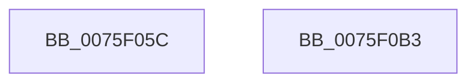

# PopSuspendServices

- RVA: `0x0075F05C`–`0x0075F0B4` (길이 `88` bytes)
- VA: `0x000000014075F05C`
- 실행 섹션: `PAGE`
- PDB 이름 있음: `예`; PDB Function 태그: `아니요`
- unwind 정보 RVA: `0x0008A2E0`
- 디코드: `21`개 명령, `88/88` bytes 표시
- 미해석 바이트: `0` (있으면 어셈블리에 `.byte`로 보존)

> 이 문서는 커널 이미지의 기계어와 PDB 기호를 분석해 생성했습니다. 4번과 5번은 함수 원형과 자료형을 바이너리 사용 방식에서 추정한 C 해석이며 원본 소스 복구 결과는 아닙니다.

## 1. Dependencies

- 직접 호출 지점: **5**; 고유 호출 대상: **3**
- 직접 호출자로 확인된 함수: **1**
- RIP 상대 이미지 참조: **2**

### Outgoing calls
- `0x0075F074` → [PopDiagTraceEventNoPayload](../../text/49/PopDiagTraceEventNoPayload_function_004982F8.md) (function, `0x004982F8`)
- `0x0075F07E` → [PopCheckpointSystemSleep](../../pagelk/B7/PopCheckpointSystemSleep_function_00B77C90.md) (function, `0x00B77C90`)
- `0x0075F092` → [PopDispatchStateCallout](../91/PopDispatchStateCallout_function_0091248C.md) (function, `0x0091248C`)
- `0x0075F09E` → [PopDiagTraceEventNoPayload](../../text/49/PopDiagTraceEventNoPayload_function_004982F8.md) (function, `0x004982F8`)
- `0x0075F0A8` → [PopCheckpointSystemSleep](../../pagelk/B7/PopCheckpointSystemSleep_function_00B77C90.md) (function, `0x00B77C90`)

### Direct callers
- [PopIssueActionRequest](../A9/PopIssueActionRequest_function_00A9CE54.md) at `0x00A9D16A`

### Static image references
- `0x0075F06D` → RVA `0x00021750` (`.rdata`; read)
- `0x0075F097` → RVA `0x000229E8` (`.rdata`; read)

## 2. Other-region calls and transfers

- 다른 실행 섹션으로 향하는 call: **4**
  - `0x0075F074` → [PopDiagTraceEventNoPayload](../../text/49/PopDiagTraceEventNoPayload_function_004982F8.md) (`PAGE` → `.text`)
  - `0x0075F07E` → [PopCheckpointSystemSleep](../../pagelk/B7/PopCheckpointSystemSleep_function_00B77C90.md) (`PAGE` → `PAGELK`)
  - `0x0075F09E` → [PopDiagTraceEventNoPayload](../../text/49/PopDiagTraceEventNoPayload_function_004982F8.md) (`PAGE` → `.text`)
  - `0x0075F0A8` → [PopCheckpointSystemSleep](../../pagelk/B7/PopCheckpointSystemSleep_function_00B77C90.md) (`PAGE` → `PAGELK`)
- 별도 외부 분기/꼬리 이동을 확인하지 못했습니다.

## 3. Assembly (complete function range)

```asm
0075F05C  88 54 24 10                     mov byte ptr [rsp + 0x10], dl
0075F060  53                              push rbx
0075F061  48 83 EC 20                     sub rsp, 0x20
0075F065  83 64 24 38 00                  and dword ptr [rsp + 0x38], 0
0075F06A  48 8B D9                        mov rbx, rcx
0075F06D  48 8D 0D DC 26 8C FF            lea rcx, [rip - 0x73d924]
0075F074  E8 7F 92 D3 FF                  call 0x1404982f8
0075F079  B9 04 00 00 00                  mov ecx, 4
0075F07E  E8 0D 8C 41 00                  call 0x140b77c90
0075F083  48 8D 54 24 38                  lea rdx, [rsp + 0x38]
0075F088  C7 43 20 03 00 00 00            mov dword ptr [rbx + 0x20], 3
0075F08F  48 8B CB                        mov rcx, rbx
0075F092  E8 F5 33 1B 00                  call 0x14091248c
0075F097  48 8D 0D 4A 39 8C FF            lea rcx, [rip - 0x73c6b6]
0075F09E  E8 55 92 D3 FF                  call 0x1404982f8
0075F0A3  B9 05 00 00 00                  mov ecx, 5
0075F0A8  E8 E3 8B 41 00                  call 0x140b77c90
0075F0AD  48 83 C4 20                     add rsp, 0x20
0075F0B1  5B                              pop rbx
0075F0B2  C3                              ret
0075F0B3  CC                              int3
```

## 4. C-style interpretation (structured pseudocode)

```c
__int64 __fastcall PopSuspendServices(__int64 a1, unsigned __int8 a2)
{
    __int64 result;
    __int64 v_rsp;
    unsigned __int8 v_stack_p10;

    v_stack_p10 = a2;
    v_rsp = (v_rsp) - (32);
    result = PopDiagTraceEventNoPayload(v_rip - 7592228, a2, a3, a4);
    result = PopCheckpointSystemSleep(4, a2, a3, a4);
    *(unsigned int *)(a1 + 32) = 3;
    result = PopDispatchStateCallout(a1, v_stack_p10, a3, a4);
    result = PopDiagTraceEventNoPayload(v_rip - 7587510, v_stack_p10, a3, a4);
    result = PopCheckpointSystemSleep(5, v_stack_p10, a3, a4);
    v_rsp = (v_rsp) + (32);
    return result;
}
```

## 5. (Beta) C Style

```c
int64_t PopSuspendServices(void *Arg1, uint8_t Arg2)
{
    uint8_t *arg1 = (uint8_t *)Arg1;

    int64_t result;
    int64_t local_rsp;
    uint8_t v_stack_p10;

    v_stack_p10 = Arg2;
    local_rsp = (local_rsp) - (32);
    result = PopDiagTraceEventNoPayload(v_rip - 7592228, Arg2, a3, a4);
    result = PopCheckpointSystemSleep(4, Arg2, a3, a4);
    *(uint32_t *)(arg1 + 0x20) = 3;
    result = PopDispatchStateCallout(Arg1, v_stack_p10, a3, a4);
    result = PopDiagTraceEventNoPayload(v_rip - 7587510, v_stack_p10, a3, a4);
    result = PopCheckpointSystemSleep(5, v_stack_p10, a3, a4);
    local_rsp = (local_rsp) + (32);
    return result;
}
```

### 관측된 메모리 오프셋

구조체 형식이 확인되지 않은 접근은 인자 기준의 오프셋으로만 기록했습니다.

| 기준 인자 | 오프셋 표현 | 폭 (bit) | 접근 |
|---|---:|---:|---|
| `Arg1` | `+ 0x20` | `32` | `W` |

## 6. Execution-region graph

[열기: 2D/3D 그래프와 함수 탐색 컨트롤 패널](../../../control-panel.html?section=page&rva=0x0075F05C&view=graph)

- 2D 그래프는 위에서 아래로 흐르고, 3D 그래프는 빈 공간을 드래그해 회전합니다. Shift+드래그는 이동, 휠은 확대·축소, 함수 노드 선택은 대상 보고서 이동입니다.

### Static fallback


