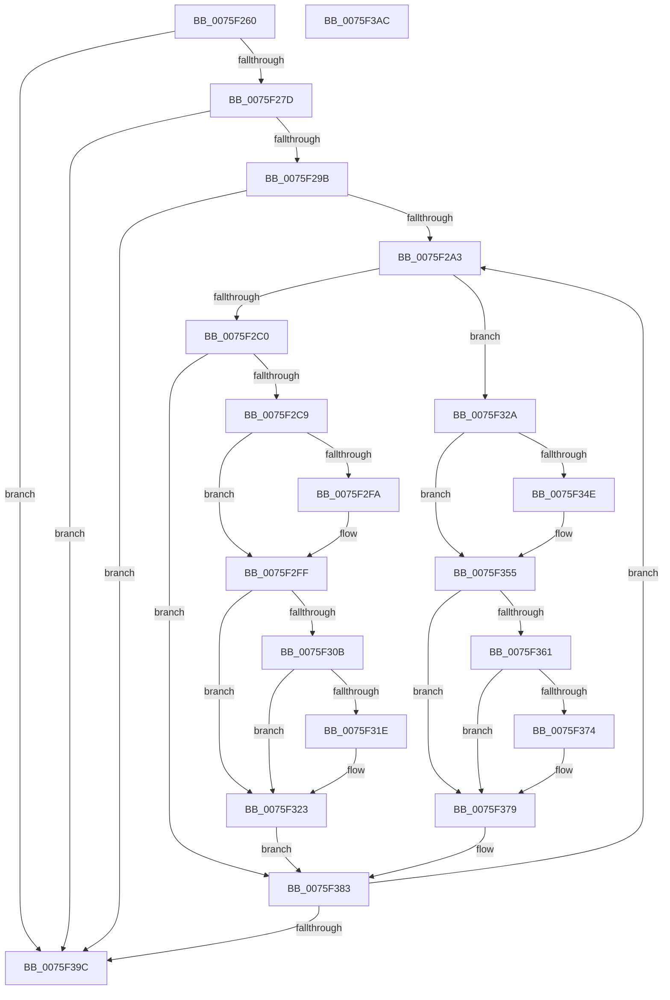

# PopSwitchUpdateUserShutdownScenarioState

- RVA: `0x0075F260`–`0x0075F3AD` (길이 `333` bytes)
- VA: `0x000000014075F260`
- 실행 섹션: `PAGE`
- PDB 이름 있음: `예`; PDB Function 태그: `아니요`
- unwind 정보 RVA: `0x0005CAAC`
- 디코드: `77`개 명령, `333/333` bytes 표시
- 미해석 바이트: `0` (있으면 어셈블리에 `.byte`로 보존)

> 이 문서는 커널 이미지의 기계어와 PDB 기호를 분석해 생성했습니다. 4번과 5번은 함수 원형과 자료형을 바이너리 사용 방식에서 추정한 C 해석이며 원본 소스 복구 결과는 아닙니다.

## 1. Dependencies

- 직접 호출 지점: **15**; 고유 호출 대상: **10**
- 직접 호출자로 확인된 함수: **2**
- RIP 상대 이미지 참조: **14**

### Outgoing calls
- `0x0075F26C` → [PopAcquirePolicyLock](../../pagelk/B7/PopAcquirePolicyLock_function_00B783C0.md) (function, `0x00B783C0`)
- `0x0075F2B4` → [PopReleasePolicyLock](../../pagelk/B7/PopReleasePolicyLock_function_00B78410.md) (function, `0x00B78410`)
- `0x0075F2CE` → [PopTransitionCheckpoint](../A8/PopTransitionCheckpoint_function_00A8F3E8.md) (function, `0x00A8F3E8`)
- `0x0075F2DF` → [PopQueueWorkItem](../../text/4A/PopQueueWorkItem_function_004A20F8.md) (function, `0x004A20F8`)
- `0x0075F2FA` → [guard_dispatch_icall](../../text/6B/guard_dispatch_icall_function_006BAAD0.md) (function, `0x006BAAD0`)
- `0x0075F30D` → [PdcTaskClientRequest](../AA/PdcTaskClientRequest_function_00AA37E4.md) (function, `0x00AA37E4`)
- `0x0075F31E` → [SleepstudyHelperBlockerActiveReference](../../text/45/SleepstudyHelperBlockerActiveReference_function_004538D0.md) (function, `0x004538D0`)
- `0x0075F323` → [PpmBeginHighPerfRequest](../../text/47/PpmBeginHighPerfRequest_function_004774FC.md) (function, `0x004774FC`)
- `0x0075F336` → [PopQueueWorkItem](../../text/4A/PopQueueWorkItem_function_004A20F8.md) (function, `0x004A20F8`)
- `0x0075F350` → [guard_dispatch_icall](../../text/6B/guard_dispatch_icall_function_006BAAD0.md) (function, `0x006BAAD0`)
- `0x0075F363` → [PdcTaskClientRequest](../AA/PdcTaskClientRequest_function_00AA37E4.md) (function, `0x00AA37E4`)
- `0x0075F374` → [SleepstudyHelperBlockerActiveDereference](../../text/45/SleepstudyHelperBlockerActiveDereference_function_00453830.md) (function, `0x00453830`)
- `0x0075F37E` → [PpmEndHighPerfRequest](../../text/47/PpmEndHighPerfRequest_function_00477490.md) (function, `0x00477490`)
- `0x0075F383` → [PopAcquirePolicyLock](../../pagelk/B7/PopAcquirePolicyLock_function_00B783C0.md) (function, `0x00B783C0`)
- `0x0075F39C` → [PopReleasePolicyLock](../../pagelk/B7/PopReleasePolicyLock_function_00B78410.md) (function, `0x00B78410`)

### Direct callers
- [PoUserShutdownCancelled](../70/PoUserShutdownCancelled_function_007051C0.md) at `0x007051D2`
- [PoUserShutdownInitiated](../AB/PoUserShutdownInitiated_function_00AB81D0.md) at `0x00AB81E8`

### Static image references
- `0x0075F271` → RVA `0x00E0B554` (`.data`; read)
- `0x0075F27D` → RVA `0x00E0B550` (`.data`; read)
- `0x0075F283` → RVA `0x00E0B554` (`.data`; write)
- `0x0075F289` → RVA `0x00F0CFF0` (`.data`; write)
- `0x0075F2A5` → RVA `0x00F0CFF0` (`.data`; read)
- `0x0075F2AE` → RVA `0x00E0B550` (`.data`; write)
- `0x0075F2D8` → RVA `0x00F0F180` (`.data`; read)
- `0x0075F2E4` → RVA `0x00E67778` (`.data`; read)
- `0x0075F2EB` → RVA `0x00E6755C` (`.data`; write)
- `0x0075F2FF` → RVA `0x00F0D0B0` (`.data`; read)
- `0x0075F312` → RVA `0x00F0CFE8` (`.data`; read)
- `0x0075F32F` → RVA `0x00F0F140` (`.data`; read)
- `0x0075F33B` → RVA `0x00E67780` (`.data`; read)
- `0x0075F342` → RVA `0x00E6755C` (`.data`; read/write)

## 2. Other-region calls and transfers

- 다른 실행 섹션으로 향하는 call: **12**
  - `0x0075F26C` → [PopAcquirePolicyLock](../../pagelk/B7/PopAcquirePolicyLock_function_00B783C0.md) (`PAGE` → `PAGELK`)
  - `0x0075F2B4` → [PopReleasePolicyLock](../../pagelk/B7/PopReleasePolicyLock_function_00B78410.md) (`PAGE` → `PAGELK`)
  - `0x0075F2DF` → [PopQueueWorkItem](../../text/4A/PopQueueWorkItem_function_004A20F8.md) (`PAGE` → `.text`)
  - `0x0075F2FA` → [guard_dispatch_icall](../../text/6B/guard_dispatch_icall_function_006BAAD0.md) (`PAGE` → `.text`)
  - `0x0075F31E` → [SleepstudyHelperBlockerActiveReference](../../text/45/SleepstudyHelperBlockerActiveReference_function_004538D0.md) (`PAGE` → `.text`)
  - `0x0075F323` → [PpmBeginHighPerfRequest](../../text/47/PpmBeginHighPerfRequest_function_004774FC.md) (`PAGE` → `.text`)
  - `0x0075F336` → [PopQueueWorkItem](../../text/4A/PopQueueWorkItem_function_004A20F8.md) (`PAGE` → `.text`)
  - `0x0075F350` → [guard_dispatch_icall](../../text/6B/guard_dispatch_icall_function_006BAAD0.md) (`PAGE` → `.text`)
  - `0x0075F374` → [SleepstudyHelperBlockerActiveDereference](../../text/45/SleepstudyHelperBlockerActiveDereference_function_00453830.md) (`PAGE` → `.text`)
  - `0x0075F37E` → [PpmEndHighPerfRequest](../../text/47/PpmEndHighPerfRequest_function_00477490.md) (`PAGE` → `.text`)
  - `0x0075F383` → [PopAcquirePolicyLock](../../pagelk/B7/PopAcquirePolicyLock_function_00B783C0.md) (`PAGE` → `PAGELK`)
  - `0x0075F39C` → [PopReleasePolicyLock](../../pagelk/B7/PopReleasePolicyLock_function_00B78410.md) (`PAGE` → `PAGELK`)
- 별도 외부 분기/꼬리 이동을 확인하지 못했습니다.

## 3. Assembly (complete function range)

```asm
0075F260  48 89 5C 24 08                  mov qword ptr [rsp + 8], rbx
0075F265  57                              push rdi
0075F266  48 83 EC 20                     sub rsp, 0x20
0075F26A  8B D9                           mov ebx, ecx
0075F26C  E8 4F 91 41 00                  call 0x140b783c0
0075F271  39 1D DD C2 6A 00               cmp dword ptr [rip + 0x6ac2dd], ebx
0075F277  0F 84 1F 01 00 00               je 0x14075f39c
0075F27D  8B 05 CD C2 6A 00               mov eax, dword ptr [rip + 0x6ac2cd]
0075F283  89 1D CB C2 6A 00               mov dword ptr [rip + 0x6ac2cb], ebx
0075F289  C6 05 60 DD 7A 00 01            mov byte ptr [rip + 0x7add60], 1
0075F290  A9 FD FF FF FF                  test eax, 0xfffffffd
0075F295  0F 84 01 01 00 00               je 0x14075f39c
0075F29B  3B C3                           cmp eax, ebx
0075F29D  0F 84 F9 00 00 00               je 0x14075f39c
0075F2A3  8B FB                           mov edi, ebx
0075F2A5  8A 1D 45 DD 7A 00               mov bl, byte ptr [rip + 0x7add45]
0075F2AB  8D 47 FF                        lea eax, [rdi - 1]
0075F2AE  89 05 9C C2 6A 00               mov dword ptr [rip + 0x6ac29c], eax
0075F2B4  E8 57 91 41 00                  call 0x140b78410
0075F2B9  8B CF                           mov ecx, edi
0075F2BB  83 E9 01                        sub ecx, 1
0075F2BE  74 6A                           je 0x14075f32a
0075F2C0  83 F9 02                        cmp ecx, 2
0075F2C3  0F 85 BA 00 00 00               jne 0x14075f383
0075F2C9  33 D2                           xor edx, edx
0075F2CB  8D 4A 07                        lea ecx, [rdx + 7]
0075F2CE  E8 15 01 33 00                  call 0x140a8f3e8
0075F2D3  BA 01 00 00 00                  mov edx, 1
0075F2D8  48 8D 0D A1 FE 7A 00            lea rcx, [rip + 0x7afea1]
0075F2DF  E8 14 2E D4 FF                  call 0x1404a20f8
0075F2E4  48 8B 05 8D 84 70 00            mov rax, qword ptr [rip + 0x70848d]
0075F2EB  C7 05 67 82 70 00 01 00 00 00   mov dword ptr [rip + 0x708267], 1
0075F2F5  48 85 C0                        test rax, rax
0075F2F8  74 05                           je 0x14075f2ff
0075F2FA  E8 D1 B7 F5 FF                  call 0x1406baad0
0075F2FF  48 8B 0D AA DD 7A 00            mov rcx, qword ptr [rip + 0x7addaa]
0075F306  48 85 C9                        test rcx, rcx
0075F309  74 18                           je 0x14075f323
0075F30B  B2 01                           mov dl, 1
0075F30D  E8 D2 44 34 00                  call 0x140aa37e4
0075F312  48 8B 0D CF DC 7A 00            mov rcx, qword ptr [rip + 0x7adccf]
0075F319  48 85 C9                        test rcx, rcx
0075F31C  74 05                           je 0x14075f323
0075F31E  E8 AD 45 CF FF                  call 0x1404538d0
0075F323  E8 D4 81 D1 FF                  call 0x1404774fc
0075F328  EB 59                           jmp 0x14075f383
0075F32A  BA 01 00 00 00                  mov edx, 1
0075F32F  48 8D 0D 0A FE 7A 00            lea rcx, [rip + 0x7afe0a]
0075F336  E8 BD 2D D4 FF                  call 0x1404a20f8
0075F33B  48 8B 05 3E 84 70 00            mov rax, qword ptr [rip + 0x70843e]
0075F342  83 25 13 82 70 00 00            and dword ptr [rip + 0x708213], 0
0075F349  48 85 C0                        test rax, rax
0075F34C  74 07                           je 0x14075f355
0075F34E  8A CB                           mov cl, bl
0075F350  E8 7B B7 F5 FF                  call 0x1406baad0
0075F355  48 8B 0D 54 DD 7A 00            mov rcx, qword ptr [rip + 0x7add54]
0075F35C  48 85 C9                        test rcx, rcx
0075F35F  74 18                           je 0x14075f379
0075F361  33 D2                           xor edx, edx
0075F363  E8 7C 44 34 00                  call 0x140aa37e4
0075F368  48 8B 0D 79 DC 7A 00            mov rcx, qword ptr [rip + 0x7adc79]
0075F36F  48 85 C9                        test rcx, rcx
0075F372  74 05                           je 0x14075f379
0075F374  E8 B7 44 CF FF                  call 0x140453830
0075F379  B9 03 00 00 00                  mov ecx, 3
0075F37E  E8 0D 81 D1 FF                  call 0x140477490
0075F383  E8 38 90 41 00                  call 0x140b783c0
0075F388  8B 1D C6 C1 6A 00               mov ebx, dword ptr [rip + 0x6ac1c6]
0075F38E  89 3D BC C1 6A 00               mov dword ptr [rip + 0x6ac1bc], edi
0075F394  3B FB                           cmp edi, ebx
0075F396  0F 85 07 FF FF FF               jne 0x14075f2a3
0075F39C  E8 6F 90 41 00                  call 0x140b78410
0075F3A1  48 8B 5C 24 30                  mov rbx, qword ptr [rsp + 0x30]
0075F3A6  48 83 C4 20                     add rsp, 0x20
0075F3AA  5F                              pop rdi
0075F3AB  C3                              ret
0075F3AC  CC                              int3
```

## 4. C-style interpretation (structured pseudocode)

```c
__int64 __fastcall PopSwitchUpdateUserShutdownScenarioState(int a1, int a2)
{
    __int64 result;
    __int64 v_rsp;
    unsigned __int64 v_stack_p8;

    v_stack_p8 = v_rbx;
    v_rsp = (v_rsp) - (32);
    result = PopAcquirePolicyLock(a1, a2, a3, a4);
    if ((*(unsigned int *)(v_rip + 6996701)) == ((unsigned int)((unsigned int)(a1)))) goto loc_0075F39C;
    *(unsigned int *)(v_rip + 6996683) = (unsigned int)((unsigned int)(a1));
    *(unsigned __int8 *)(v_rip + 8052064) = 1;
    if ((((unsigned int)((unsigned int)(*(unsigned int *)(v_rip + 6996685)))) & (0xFFFFFFFDULL)) == 0) goto loc_0075F39C;
    if (((unsigned int)((unsigned int)(*(unsigned int *)(v_rip + 6996685)))) == ((unsigned int)((unsigned int)(a1)))) goto loc_0075F39C;
loc_0075F2A3:
    *(unsigned int *)(v_rip + 6996636) = (unsigned int)((unsigned int)((unsigned int)((unsigned int)(a1))) - 1);
    result = PopReleasePolicyLock(a1, a2, a3, a4);
    a1 = (unsigned int)(((unsigned int)((unsigned int)((unsigned int)((unsigned int)((unsigned int)(a1)))))) - (1));
    if (condition_is_equal) goto loc_0075F32A;
    if (a1 != 2) goto loc_0075F383;
    a2 = 0;
    result = PopTransitionCheckpoint(a2 + 7, a2, a3, a4);
    result = PopQueueWorkItem(v_rip + 8060577, 1, a3, a4);
    *(unsigned int *)(v_rip + 7373415) = 1;
    result = *(unsigned __int64 *)(v_rip + 7373965);
    if (*(unsigned __int64 *)(v_rip + 7373965) != 0) {
        result = guard_dispatch_icall(v_rip + 8060577, 1, a3, a4);
    }
    if (*(unsigned __int64 *)(v_rip + 8052138) == 0) goto loc_0075F323;
    result = PdcTaskClientRequest(*(unsigned __int64 *)(v_rip + 8052138), 1, a3, a4);
    if (*(unsigned __int64 *)(v_rip + 8051919) != 0) {
        result = SleepstudyHelperBlockerActiveReference(*(unsigned __int64 *)(v_rip + 8051919), 1, a3, a4);
    }
    result = PpmBeginHighPerfRequest(*(unsigned __int64 *)(v_rip + 8051919), 1, a3, a4);
    goto loc_0075F383;
loc_0075F32A:
    result = PopQueueWorkItem(v_rip + 8060426, 1, a3, a4);
    result = *(unsigned __int64 *)(v_rip + 7373886);
    if (*(unsigned __int64 *)(v_rip + 7373886) != 0) {
        a1 = (unsigned __int8)(*(unsigned __int8 *)(v_rip + 8052037));
        result = guard_dispatch_icall(a1, 1, a3, a4);
    }
    if (*(unsigned __int64 *)(v_rip + 8052052) == 0) goto loc_0075F379;
    a2 = 0;
    result = PdcTaskClientRequest(*(unsigned __int64 *)(v_rip + 8052052), a2, a3, a4);
    if (*(unsigned __int64 *)(v_rip + 8051833) != 0) {
        result = SleepstudyHelperBlockerActiveDereference(*(unsigned __int64 *)(v_rip + 8051833), a2, a3, a4);
    }
    result = PpmEndHighPerfRequest(3, a2, a3, a4);
loc_0075F383:
    result = PopAcquirePolicyLock(3, a2, a3, a4);
    *(unsigned int *)(v_rip + 6996412) = (unsigned int)((unsigned int)((unsigned int)((unsigned int)(a1))));
    if (((unsigned int)((unsigned int)((unsigned int)((unsigned int)(a1))))) != ((unsigned int)((unsigned int)(*(unsigned int *)(v_rip + 6996422))))) goto loc_0075F2A3;
loc_0075F39C:
    result = PopReleasePolicyLock(3, a2, a3, a4);
    v_rsp = (v_rsp) + (32);
    return result;
}
```

## 5. (Beta) C Style

```c
int64_t PopSwitchUpdateUserShutdownScenarioState(int32_t Arg1, int32_t Arg2)
{
    int64_t result;
    int64_t local_rsp;
    uint64_t v_stack_p8;

    v_stack_p8 = local_rbx;
    local_rsp = (local_rsp) - (32);
    result = PopAcquirePolicyLock(Arg1, Arg2, a3, a4);
    if ((*(uint32_t *)(v_rip + 0x6AC2DD)) == ((uint32_t)((uint32_t)(Arg1)))) goto loc_0075F39C;
    *(uint32_t *)(v_rip + 0x6AC2CB) = (uint32_t)((uint32_t)(Arg1));
    *(uint8_t *)(v_rip + 0x7ADD60) = 1;
    if ((((uint32_t)((uint32_t)(*(uint32_t *)(v_rip + 0x6AC2CD)))) & (0xFFFFFFFDULL)) == 0) goto loc_0075F39C;
    if (((uint32_t)((uint32_t)(*(uint32_t *)(v_rip + 0x6AC2CD)))) == ((uint32_t)((uint32_t)(Arg1)))) goto loc_0075F39C;
loc_0075F2A3:
    *(uint32_t *)(v_rip + 0x6AC29C) = (uint32_t)((uint32_t)((uint32_t)((uint32_t)(Arg1))) - 1);
    result = PopReleasePolicyLock(Arg1, Arg2, a3, a4);
    Arg1 = (uint32_t)(((uint32_t)((uint32_t)((uint32_t)((uint32_t)((uint32_t)(Arg1)))))) - (1));
    if (condition_is_equal) goto loc_0075F32A;
    if (Arg1 != 2) goto loc_0075F383;
    Arg2 = 0;
    result = PopTransitionCheckpoint(Arg2 + 7, Arg2, a3, a4);
    result = PopQueueWorkItem(v_rip + 8060577, 1, a3, a4);
    *(uint32_t *)(v_rip + 0x708267) = 1;
    result = *(uint64_t *)(v_rip + 0x70848D);
    if (*(uint64_t *)(v_rip + 0x70848D) != 0) {
        result = guard_dispatch_icall(v_rip + 8060577, 1, a3, a4);
    }
    if (*(uint64_t *)(v_rip + 0x7ADDAA) == 0) goto loc_0075F323;
    result = PdcTaskClientRequest(*(uint64_t *)(v_rip + 0x7ADDAA), 1, a3, a4);
    if (*(uint64_t *)(v_rip + 0x7ADCCF) != 0) {
        result = SleepstudyHelperBlockerActiveReference(*(uint64_t *)(v_rip + 0x7ADCCF), 1, a3, a4);
    }
    result = PpmBeginHighPerfRequest(*(uint64_t *)(v_rip + 0x7ADCCF), 1, a3, a4);
    goto loc_0075F383;
loc_0075F32A:
    result = PopQueueWorkItem(v_rip + 8060426, 1, a3, a4);
    result = *(uint64_t *)(v_rip + 0x70843E);
    if (*(uint64_t *)(v_rip + 0x70843E) != 0) {
        Arg1 = (uint8_t)(*(uint8_t *)(v_rip + 0x7ADD45));
        result = guard_dispatch_icall(Arg1, 1, a3, a4);
    }
    if (*(uint64_t *)(v_rip + 0x7ADD54) == 0) goto loc_0075F379;
    Arg2 = 0;
    result = PdcTaskClientRequest(*(uint64_t *)(v_rip + 0x7ADD54), Arg2, a3, a4);
    if (*(uint64_t *)(v_rip + 0x7ADC79) != 0) {
        result = SleepstudyHelperBlockerActiveDereference(*(uint64_t *)(v_rip + 0x7ADC79), Arg2, a3, a4);
    }
    result = PpmEndHighPerfRequest(3, Arg2, a3, a4);
loc_0075F383:
    result = PopAcquirePolicyLock(3, Arg2, a3, a4);
    *(uint32_t *)(v_rip + 0x6AC1BC) = (uint32_t)((uint32_t)((uint32_t)((uint32_t)(Arg1))));
    if (((uint32_t)((uint32_t)((uint32_t)((uint32_t)(Arg1))))) != ((uint32_t)((uint32_t)(*(uint32_t *)(v_rip + 0x6AC1C6))))) goto loc_0075F2A3;
loc_0075F39C:
    result = PopReleasePolicyLock(3, Arg2, a3, a4);
    local_rsp = (local_rsp) + (32);
    return result;
}
```

## 6. Execution-region graph

[열기: 2D/3D 그래프와 함수 탐색 컨트롤 패널](../../../control-panel.html?section=page&rva=0x0075F260&view=graph)

- 2D 그래프는 위에서 아래로 흐르고, 3D 그래프는 빈 공간을 드래그해 회전합니다. Shift+드래그는 이동, 휠은 확대·축소, 함수 노드 선택은 대상 보고서 이동입니다.

### Static fallback


