# PopThermalHandlePreviousShutdown

- RVA: `0x0075F400`–`0x0075F816` (길이 `1,046` bytes)
- VA: `0x000000014075F400`
- 실행 섹션: `PAGE`
- PDB 이름 있음: `예`; PDB Function 태그: `아니요`
- unwind 정보 RVA: `0x000CC65C`
- 디코드: `250`개 명령, `1,046/1,046` bytes 표시
- 미해석 바이트: `0` (있으면 어셈블리에 `.byte`로 보존)

> 이 문서는 커널 이미지의 기계어와 PDB 기호를 분석해 생성했습니다. 4번과 5번은 함수 원형과 자료형을 바이너리 사용 방식에서 추정한 C 해석이며 원본 소스 복구 결과는 아닙니다.

## 1. Dependencies

- 직접 호출 지점: **27**; 고유 호출 대상: **13**
- 직접 호출자로 확인된 함수: **1**
- RIP 상대 이미지 참조: **9**

### Outgoing calls
- `0x0075F46C` → [PopOpenThermalLoggingKey](../../text/4C/PopOpenThermalLoggingKey_function_004CDBFC.md) (function, `0x004CDBFC`)
- `0x0075F484` → [RtlInitUnicodeString](../../text/42/RtlInitUnicodeString_function_0042A780.md) (function, `0x0042A780`)
- `0x0075F495` → [RtlInitUnicodeString](../../text/42/RtlInitUnicodeString_function_0042A780.md) (function, `0x0042A780`)
- `0x0075F4A6` → [RtlInitUnicodeString](../../text/42/RtlInitUnicodeString_function_0042A780.md) (function, `0x0042A780`)
- `0x0075F4B6` → [RtlInitUnicodeString](../../text/42/RtlInitUnicodeString_function_0042A780.md) (function, `0x0042A780`)
- `0x0075F4EE` → [ZwQueryValueKey](../../text/6A/ZwQueryValueKey_function_006AD3B0.md) (function, `0x006AD3B0`)
- `0x0075F52D` → [ZwQueryValueKey](../../text/6A/ZwQueryValueKey_function_006AD3B0.md) (function, `0x006AD3B0`)
- `0x0075F570` → [ZwQueryValueKey](../../text/6A/ZwQueryValueKey_function_006AD3B0.md) (function, `0x006AD3B0`)
- `0x0075F5C3` → [ZwQueryValueKey](../../text/6A/ZwQueryValueKey_function_006AD3B0.md) (function, `0x006AD3B0`)
- `0x0075F5E2` → [ExAllocatePool2](../../poolcode/B8/ExAllocatePool2_function_00B820F0.md) (function, `0x00B820F0`)
- `0x0075F610` → [ZwQueryValueKey](../../text/6A/ZwQueryValueKey_function_006AD3B0.md) (function, `0x006AD3B0`)
- `0x0075F62D` → [ZwDeleteValueKey](../../text/6A/ZwDeleteValueKey_function_006AECB0.md) (function, `0x006AECB0`)
- `0x0075F641` → [PopOpenThermalLoggingKey](../../text/4C/PopOpenThermalLoggingKey_function_004CDBFC.md) (function, `0x004CDBFC`)
- `0x0075F66D` → [ZwSetValueKey](../../text/6A/ZwSetValueKey_function_006ADCD0.md) (function, `0x006ADCD0`)
- `0x0075F69A` → [ZwSetValueKey](../../text/6A/ZwSetValueKey_function_006ADCD0.md) (function, `0x006ADCD0`)
- `0x0075F6C6` → [ZwSetValueKey](../../text/6A/ZwSetValueKey_function_006ADCD0.md) (function, `0x006ADCD0`)
- `0x0075F6CE` → [ZwClose](../../text/6A/ZwClose_function_006AD2B0.md) (function, `0x006AD2B0`)
- `0x0075F6F1` → [ZwUpdateWnfStateData](../../text/6B/ZwUpdateWnfStateData_function_006B0D10.md) (function, `0x006B0D10`)
- `0x0075F714` → [tlgKeywordOn](../../text/42/tlgKeywordOn_function_0042EAA0.md) (function, `0x0042EAA0`)
- `0x0075F728` → [tlgCreate1Sz_wchar_t](../../text/42/tlgCreate1Sz_wchar_t_function_00426198.md) (function, `0x00426198`)
- `0x0075F79E` → [tlgWriteTransfer_EtwWriteTransfer](../../text/42/tlgWriteTransfer_EtwWriteTransfer_function_004260E0.md) (function, `0x004260E0`)
- `0x0075F7AB` → [ZwDeleteValueKey](../../text/6A/ZwDeleteValueKey_function_006AECB0.md) (function, `0x006AECB0`)
- `0x0075F7B8` → [ZwDeleteValueKey](../../text/6A/ZwDeleteValueKey_function_006AECB0.md) (function, `0x006AECB0`)
- `0x0075F7C4` → [ZwDeleteValueKey](../../text/6A/ZwDeleteValueKey_function_006AECB0.md) (function, `0x006AECB0`)
- `0x0075F7D6` → [ExFreePoolWithTag](../../poolcode/B8/ExFreePoolWithTag_function_00B82870.md) (function, `0x00B82870`)
- `0x0075F7E3` → [ZwClose](../../text/6A/ZwClose_function_006AD2B0.md) (function, `0x006AD2B0`)
- `0x0075F7EF` → [_security_check_cookie](../../text/6A/_security_check_cookie_function_006AC640.md) (function, `0x006AC640`)

### Direct callers
- [PoInitSystem](../../init/C7/PoInitSystem_function_00C72358.md) at `0x00C731EB`

### Static image references
- `0x0075F423` → RVA `0x00E0A740` (`.data`; read)
- `0x0075F479` → RVA `0x00029498` (`.rdata`; read)
- `0x0075F489` → RVA `0x000293B0` (`.rdata`; read)
- `0x0075F49A` → RVA `0x000293D0` (`.rdata`; read)
- `0x0075F4AB` → RVA `0x00029388` (`.rdata`; read)
- `0x0075F5B5` → RVA `0x00AFE5E0` (` ?? ::NNGAKEGL::`string'`; read)
- `0x0075F6D8` → RVA `0x000209E8` (`.rdata`; read)
- `0x0075F6F6` → RVA `0x00E07710` (`.data`; read)
- `0x0075F73A` → RVA `0x0004917A` (`.rdata`; read)

## 2. Other-region calls and transfers

- 다른 실행 섹션으로 향하는 call: **27**
  - `0x0075F46C` → [PopOpenThermalLoggingKey](../../text/4C/PopOpenThermalLoggingKey_function_004CDBFC.md) (`PAGE` → `.text`)
  - `0x0075F484` → [RtlInitUnicodeString](../../text/42/RtlInitUnicodeString_function_0042A780.md) (`PAGE` → `.text`)
  - `0x0075F495` → [RtlInitUnicodeString](../../text/42/RtlInitUnicodeString_function_0042A780.md) (`PAGE` → `.text`)
  - `0x0075F4A6` → [RtlInitUnicodeString](../../text/42/RtlInitUnicodeString_function_0042A780.md) (`PAGE` → `.text`)
  - `0x0075F4B6` → [RtlInitUnicodeString](../../text/42/RtlInitUnicodeString_function_0042A780.md) (`PAGE` → `.text`)
  - `0x0075F4EE` → [ZwQueryValueKey](../../text/6A/ZwQueryValueKey_function_006AD3B0.md) (`PAGE` → `.text`)
  - `0x0075F52D` → [ZwQueryValueKey](../../text/6A/ZwQueryValueKey_function_006AD3B0.md) (`PAGE` → `.text`)
  - `0x0075F570` → [ZwQueryValueKey](../../text/6A/ZwQueryValueKey_function_006AD3B0.md) (`PAGE` → `.text`)
  - `0x0075F5C3` → [ZwQueryValueKey](../../text/6A/ZwQueryValueKey_function_006AD3B0.md) (`PAGE` → `.text`)
  - `0x0075F5E2` → [ExAllocatePool2](../../poolcode/B8/ExAllocatePool2_function_00B820F0.md) (`PAGE` → `POOLCODE`)
  - `0x0075F610` → [ZwQueryValueKey](../../text/6A/ZwQueryValueKey_function_006AD3B0.md) (`PAGE` → `.text`)
  - `0x0075F62D` → [ZwDeleteValueKey](../../text/6A/ZwDeleteValueKey_function_006AECB0.md) (`PAGE` → `.text`)
  - `0x0075F641` → [PopOpenThermalLoggingKey](../../text/4C/PopOpenThermalLoggingKey_function_004CDBFC.md) (`PAGE` → `.text`)
  - `0x0075F66D` → [ZwSetValueKey](../../text/6A/ZwSetValueKey_function_006ADCD0.md) (`PAGE` → `.text`)
  - `0x0075F69A` → [ZwSetValueKey](../../text/6A/ZwSetValueKey_function_006ADCD0.md) (`PAGE` → `.text`)
  - `0x0075F6C6` → [ZwSetValueKey](../../text/6A/ZwSetValueKey_function_006ADCD0.md) (`PAGE` → `.text`)
  - `0x0075F6CE` → [ZwClose](../../text/6A/ZwClose_function_006AD2B0.md) (`PAGE` → `.text`)
  - `0x0075F6F1` → [ZwUpdateWnfStateData](../../text/6B/ZwUpdateWnfStateData_function_006B0D10.md) (`PAGE` → `.text`)
  - `0x0075F714` → [tlgKeywordOn](../../text/42/tlgKeywordOn_function_0042EAA0.md) (`PAGE` → `.text`)
  - `0x0075F728` → [tlgCreate1Sz_wchar_t](../../text/42/tlgCreate1Sz_wchar_t_function_00426198.md) (`PAGE` → `.text`)
  - `0x0075F79E` → [tlgWriteTransfer_EtwWriteTransfer](../../text/42/tlgWriteTransfer_EtwWriteTransfer_function_004260E0.md) (`PAGE` → `.text`)
  - `0x0075F7AB` → [ZwDeleteValueKey](../../text/6A/ZwDeleteValueKey_function_006AECB0.md) (`PAGE` → `.text`)
  - `0x0075F7B8` → [ZwDeleteValueKey](../../text/6A/ZwDeleteValueKey_function_006AECB0.md) (`PAGE` → `.text`)
  - `0x0075F7C4` → [ZwDeleteValueKey](../../text/6A/ZwDeleteValueKey_function_006AECB0.md) (`PAGE` → `.text`)
  - `0x0075F7D6` → [ExFreePoolWithTag](../../poolcode/B8/ExFreePoolWithTag_function_00B82870.md) (`PAGE` → `POOLCODE`)
  - `0x0075F7E3` → [ZwClose](../../text/6A/ZwClose_function_006AD2B0.md) (`PAGE` → `.text`)
  - `0x0075F7EF` → [_security_check_cookie](../../text/6A/_security_check_cookie_function_006AC640.md) (`PAGE` → `.text`)
- 별도 외부 분기/꼬리 이동을 확인하지 못했습니다.

## 3. Assembly (complete function range)

```asm
0075F400  48 8B C4                        mov rax, rsp
0075F403  48 89 58 08                     mov qword ptr [rax + 8], rbx
0075F407  48 89 70 10                     mov qword ptr [rax + 0x10], rsi
0075F40B  48 89 78 18                     mov qword ptr [rax + 0x18], rdi
0075F40F  55                              push rbp
0075F410  41 54                           push r12
0075F412  41 55                           push r13
0075F414  41 56                           push r14
0075F416  41 57                           push r15
0075F418  48 8D 68 A8                     lea rbp, [rax - 0x58]
0075F41C  48 81 EC 30 01 00 00            sub rsp, 0x130
0075F423  48 8B 05 16 B3 6A 00            mov rax, qword ptr [rip + 0x6ab316]
0075F42A  48 33 C4                        xor rax, rsp
0075F42D  48 89 45 20                     mov qword ptr [rbp + 0x20], rax
0075F431  45 33 ED                        xor r13d, r13d
0075F434  48 8D 54 24 48                  lea rdx, [rsp + 0x48]
0075F439  0F 57 C0                        xorps xmm0, xmm0
0075F43C  4C 89 6C 24 48                  mov qword ptr [rsp + 0x48], r13
0075F441  0F 57 C9                        xorps xmm1, xmm1
0075F444  44 89 6C 24 40                  mov dword ptr [rsp + 0x40], r13d
0075F449  33 C9                           xor ecx, ecx
0075F44B  44 89 6C 24 44                  mov dword ptr [rsp + 0x44], r13d
0075F450  0F 11 45 98                     movups xmmword ptr [rbp - 0x68], xmm0
0075F454  4C 89 6C 24 58                  mov qword ptr [rsp + 0x58], r13
0075F459  0F 11 4C 24 60                  movups xmmword ptr [rsp + 0x60], xmm1
0075F45E  4C 89 6C 24 50                  mov qword ptr [rsp + 0x50], r13
0075F463  0F 11 44 24 70                  movups xmmword ptr [rsp + 0x70], xmm0
0075F468  0F 11 4D 80                     movups xmmword ptr [rbp - 0x80], xmm1
0075F46C  E8 8B E7 D6 FF                  call 0x1404cdbfc
0075F471  85 C0                           test eax, eax
0075F473  0F 88 6F 03 00 00               js 0x14075f7e8
0075F479  48 8D 15 18 A0 8C FF            lea rdx, [rip - 0x735fe8]
0075F480  48 8D 4D 98                     lea rcx, [rbp - 0x68]
0075F484  E8 F7 B2 CC FF                  call 0x14042a780
0075F489  48 8D 15 20 9F 8C FF            lea rdx, [rip - 0x7360e0]
0075F490  48 8D 4C 24 60                  lea rcx, [rsp + 0x60]
0075F495  E8 E6 B2 CC FF                  call 0x14042a780
0075F49A  48 8D 15 2F 9F 8C FF            lea rdx, [rip - 0x7360d1]
0075F4A1  48 8D 4C 24 70                  lea rcx, [rsp + 0x70]
0075F4A6  E8 D5 B2 CC FF                  call 0x14042a780
0075F4AB  48 8D 15 D6 9E 8C FF            lea rdx, [rip - 0x73612a]
0075F4B2  48 8D 4D 80                     lea rcx, [rbp - 0x80]
0075F4B6  E8 C5 B2 CC FF                  call 0x14042a780
0075F4BB  48 8B 5C 24 48                  mov rbx, qword ptr [rsp + 0x48]
0075F4C0  41 8D 7D 18                     lea edi, [r13 + 0x18]
0075F4C4  33 C0                           xor eax, eax
0075F4C6  4C 8D 4D A8                     lea r9, [rbp - 0x58]
0075F4CA  48 89 45 B8                     mov qword ptr [rbp - 0x48], rax
0075F4CE  45 8D 45 02                     lea r8d, [r13 + 2]
0075F4D2  48 8D 44 24 40                  lea rax, [rsp + 0x40]
0075F4D7  0F 57 C0                        xorps xmm0, xmm0
0075F4DA  48 89 44 24 28                  mov qword ptr [rsp + 0x28], rax
0075F4DF  48 8D 55 98                     lea rdx, [rbp - 0x68]
0075F4E3  48 8B CB                        mov rcx, rbx
0075F4E6  89 7C 24 20                     mov dword ptr [rsp + 0x20], edi
0075F4EA  0F 11 45 A8                     movups xmmword ptr [rbp - 0x58], xmm0
0075F4EE  E8 BD DE F4 FF                  call 0x1406ad3b0
0075F4F3  85 C0                           test eax, eax
0075F4F5  0F 88 E0 02 00 00               js 0x14075f7db
0075F4FB  83 7D AC 04                     cmp dword ptr [rbp - 0x54], 4
0075F4FF  0F 85 D6 02 00 00               jne 0x14075f7db
0075F505  83 7D B0 04                     cmp dword ptr [rbp - 0x50], 4
0075F509  0F 85 CC 02 00 00               jne 0x14075f7db
0075F50F  48 8D 44 24 40                  lea rax, [rsp + 0x40]
0075F514  48 8B CB                        mov rcx, rbx
0075F517  48 89 44 24 28                  mov qword ptr [rsp + 0x28], rax
0075F51C  4C 8D 4D A8                     lea r9, [rbp - 0x58]
0075F520  45 8D 45 02                     lea r8d, [r13 + 2]
0075F524  89 7C 24 20                     mov dword ptr [rsp + 0x20], edi
0075F528  48 8D 54 24 70                  lea rdx, [rsp + 0x70]
0075F52D  E8 7E DE F4 FF                  call 0x1406ad3b0
0075F532  85 C0                           test eax, eax
0075F534  78 18                           js 0x14075f54e
0075F536  83 7D AC 04                     cmp dword ptr [rbp - 0x54], 4
0075F53A  75 12                           jne 0x14075f54e
0075F53C  83 7D B0 04                     cmp dword ptr [rbp - 0x50], 4
0075F540  75 0C                           jne 0x14075f54e
0075F542  8B 45 B4                        mov eax, dword ptr [rbp - 0x4c]
0075F545  41 B7 01                        mov r15b, 1
0075F548  89 44 24 44                     mov dword ptr [rsp + 0x44], eax
0075F54C  EB 03                           jmp 0x14075f551
0075F54E  45 8A FD                        mov r15b, r13b
0075F551  48 8D 44 24 40                  lea rax, [rsp + 0x40]
0075F556  41 B8 02 00 00 00               mov r8d, 2
0075F55C  48 89 44 24 28                  mov qword ptr [rsp + 0x28], rax
0075F561  4C 8D 4D A8                     lea r9, [rbp - 0x58]
0075F565  48 8D 55 80                     lea rdx, [rbp - 0x80]
0075F569  89 7C 24 20                     mov dword ptr [rsp + 0x20], edi
0075F56D  48 8B CB                        mov rcx, rbx
0075F570  E8 3B DE F4 FF                  call 0x1406ad3b0
0075F575  85 C0                           test eax, eax
0075F577  78 1A                           js 0x14075f593
0075F579  83 7D AC 0B                     cmp dword ptr [rbp - 0x54], 0xb
0075F57D  75 14                           jne 0x14075f593
0075F57F  83 7D B0 08                     cmp dword ptr [rbp - 0x50], 8
0075F583  75 0E                           jne 0x14075f593
0075F585  48 8B 45 B4                     mov rax, qword ptr [rbp - 0x4c]
0075F589  41 B6 01                        mov r14b, 1
0075F58C  48 89 44 24 58                  mov qword ptr [rsp + 0x58], rax
0075F591  EB 03                           jmp 0x14075f596
0075F593  45 8A F5                        mov r14b, r13b
0075F596  48 8D 44 24 40                  lea rax, [rsp + 0x40]
0075F59B  BE 10 00 00 00                  mov esi, 0x10
0075F5A0  48 89 44 24 28                  mov qword ptr [rsp + 0x28], rax
0075F5A5  48 8D 54 24 60                  lea rdx, [rsp + 0x60]
0075F5AA  45 33 C9                        xor r9d, r9d
0075F5AD  44 89 6C 24 20                  mov dword ptr [rsp + 0x20], r13d
0075F5B2  48 8B CB                        mov rcx, rbx
0075F5B5  4C 8D 25 24 F0 39 00            lea r12, [rip + 0x39f024]
0075F5BC  44 8D 46 F2                     lea r8d, [rsi - 0xe]
0075F5C0  49 8B FD                        mov rdi, r13
0075F5C3  E8 E8 DD F4 FF                  call 0x1406ad3b0
0075F5C8  3D 23 00 00 C0                  cmp eax, 0xc0000023
0075F5CD  75 57                           jne 0x14075f626
0075F5CF  8B 54 24 40                     mov edx, dword ptr [rsp + 0x40]
0075F5D3  B9 00 01 00 00                  mov ecx, 0x100
0075F5D8  48 83 C2 02                     add rdx, 2
0075F5DC  41 B8 54 68 72 6D               mov r8d, 0x6d726854
0075F5E2  E8 09 2B 42 00                  call 0x140b820f0
0075F5E7  48 8B F8                        mov rdi, rax
0075F5EA  48 85 C0                        test rax, rax
0075F5ED  74 37                           je 0x14075f626
0075F5EF  8B 4C 24 40                     mov ecx, dword ptr [rsp + 0x40]
0075F5F3  48 8D 44 24 40                  lea rax, [rsp + 0x40]
0075F5F8  48 89 44 24 28                  mov qword ptr [rsp + 0x28], rax
0075F5FD  44 8D 46 F2                     lea r8d, [rsi - 0xe]
0075F601  89 4C 24 20                     mov dword ptr [rsp + 0x20], ecx
0075F605  48 8D 54 24 60                  lea rdx, [rsp + 0x60]
0075F60A  48 8B CB                        mov rcx, rbx
0075F60D  4C 8B CF                        mov r9, rdi
0075F610  E8 9B DD F4 FF                  call 0x1406ad3b0
0075F615  85 C0                           test eax, eax
0075F617  78 0D                           js 0x14075f626
0075F619  83 7F 04 01                     cmp dword ptr [rdi + 4], 1
0075F61D  75 07                           jne 0x14075f626
0075F61F  8B 77 08                        mov esi, dword ptr [rdi + 8]
0075F622  4C 8D 67 0C                     lea r12, [rdi + 0xc]
0075F626  48 8D 55 98                     lea rdx, [rbp - 0x68]
0075F62A  48 8B CB                        mov rcx, rbx
0075F62D  E8 7E F6 F4 FF                  call 0x1406aecb0
0075F632  85 C0                           test eax, eax
0075F634  0F 88 8F 01 00 00               js 0x14075f7c9
0075F63A  48 8D 54 24 50                  lea rdx, [rsp + 0x50]
0075F63F  B1 01                           mov cl, 1
0075F641  E8 B6 E5 D6 FF                  call 0x1404cdbfc
0075F646  85 C0                           test eax, eax
0075F648  0F 88 85 00 00 00               js 0x14075f6d3
0075F64E  89 74 24 28                     mov dword ptr [rsp + 0x28], esi
0075F652  48 8D 54 24 60                  lea rdx, [rsp + 0x60]
0075F657  48 8B 74 24 50                  mov rsi, qword ptr [rsp + 0x50]
0075F65C  41 B9 01 00 00 00               mov r9d, 1
0075F662  48 8B CE                        mov rcx, rsi
0075F665  4C 89 64 24 20                  mov qword ptr [rsp + 0x20], r12
0075F66A  45 33 C0                        xor r8d, r8d
0075F66D  E8 5E E6 F4 FF                  call 0x1406adcd0
0075F672  45 84 FF                        test r15b, r15b
0075F675  74 28                           je 0x14075f69f
0075F677  48 8D 44 24 44                  lea rax, [rsp + 0x44]
0075F67C  C7 44 24 28 04 00 00 00         mov dword ptr [rsp + 0x28], 4
0075F684  41 B9 04 00 00 00               mov r9d, 4
0075F68A  48 89 44 24 20                  mov qword ptr [rsp + 0x20], rax
0075F68F  45 33 C0                        xor r8d, r8d
0075F692  48 8D 54 24 70                  lea rdx, [rsp + 0x70]
0075F697  48 8B CE                        mov rcx, rsi
0075F69A  E8 31 E6 F4 FF                  call 0x1406adcd0
0075F69F  45 84 F6                        test r14b, r14b
0075F6A2  74 27                           je 0x14075f6cb
0075F6A4  48 8D 44 24 58                  lea rax, [rsp + 0x58]
0075F6A9  C7 44 24 28 08 00 00 00         mov dword ptr [rsp + 0x28], 8
0075F6B1  41 B9 0B 00 00 00               mov r9d, 0xb
0075F6B7  48 89 44 24 20                  mov qword ptr [rsp + 0x20], rax
0075F6BC  45 33 C0                        xor r8d, r8d
0075F6BF  48 8D 55 80                     lea rdx, [rbp - 0x80]
0075F6C3  48 8B CE                        mov rcx, rsi
0075F6C6  E8 05 E6 F4 FF                  call 0x1406adcd0
0075F6CB  48 8B CE                        mov rcx, rsi
0075F6CE  E8 DD DB F4 FF                  call 0x1406ad2b0
0075F6D3  44 89 6C 24 30                  mov dword ptr [rsp + 0x30], r13d
0075F6D8  48 8D 0D 09 13 8C FF            lea rcx, [rip - 0x73ecf7]
0075F6DF  44 89 6C 24 28                  mov dword ptr [rsp + 0x28], r13d
0075F6E4  45 33 C9                        xor r9d, r9d
0075F6E7  45 33 C0                        xor r8d, r8d
0075F6EA  4C 89 6C 24 20                  mov qword ptr [rsp + 0x20], r13
0075F6EF  33 D2                           xor edx, edx
0075F6F1  E8 1A 16 F5 FF                  call 0x1406b0d10
0075F6F6  83 3D 13 80 6A 00 05            cmp dword ptr [rip + 0x6a8013], 5
0075F6FD  0F 86 A0 00 00 00               jbe 0x14075f7a3
0075F703  48 BA 00 00 00 00 00 80 00 00   movabs rdx, 0x800000000000
0075F70D  48 8D 0D FC 7F 6A 00            lea rcx, [rip + 0x6a7ffc]
0075F714  E8 87 F3 CC FF                  call 0x14042eaa0
0075F719  84 C0                           test al, al
0075F71B  0F 84 82 00 00 00               je 0x14075f7a3
0075F721  49 8B D4                        mov rdx, r12
0075F724  48 8D 4D E0                     lea rcx, [rbp - 0x20]
0075F728  E8 6B 6A CC FF                  call 0x140426198
0075F72D  8B 4C 24 44                     mov ecx, dword ptr [rsp + 0x44]
0075F731  48 8D 44 24 48                  lea rax, [rsp + 0x48]
0075F736  48 89 45 F0                     mov qword ptr [rbp - 0x10], rax
0075F73A  48 8D 15 39 9A 8E FF            lea rdx, [rip - 0x7165c7]
0075F741  48 8B 44 24 58                  mov rax, qword ptr [rsp + 0x58]
0075F746  45 33 C9                        xor r9d, r9d
0075F749  48 89 44 24 50                  mov qword ptr [rsp + 0x50], rax
0075F74E  45 33 C0                        xor r8d, r8d
0075F751  48 8D 44 24 50                  lea rax, [rsp + 0x50]
0075F756  89 4C 24 48                     mov dword ptr [rsp + 0x48], ecx
0075F75A  48 89 45 00                     mov qword ptr [rbp], rax
0075F75E  48 8D 0D AB 7F 6A 00            lea rcx, [rip + 0x6a7fab]
0075F765  48 8D 45 90                     lea rax, [rbp - 0x70]
0075F769  48 C7 45 F8 04 00 00 00         mov qword ptr [rbp - 8], 4
0075F771  48 89 45 10                     mov qword ptr [rbp + 0x10], rax
0075F775  48 8D 45 C0                     lea rax, [rbp - 0x40]
0075F779  48 89 44 24 28                  mov qword ptr [rsp + 0x28], rax
0075F77E  C7 44 24 20 06 00 00 00         mov dword ptr [rsp + 0x20], 6
0075F786  48 C7 45 08 08 00 00 00         mov qword ptr [rbp + 8], 8
0075F78E  48 C7 45 90 00 00 00 01         mov qword ptr [rbp - 0x70], 0x1000000
0075F796  48 C7 45 18 08 00 00 00         mov qword ptr [rbp + 0x18], 8
0075F79E  E8 3D 69 CC FF                  call 0x1404260e0
0075F7A3  48 8D 54 24 70                  lea rdx, [rsp + 0x70]
0075F7A8  48 8B CB                        mov rcx, rbx
0075F7AB  E8 00 F5 F4 FF                  call 0x1406aecb0
0075F7B0  48 8D 54 24 60                  lea rdx, [rsp + 0x60]
0075F7B5  48 8B CB                        mov rcx, rbx
0075F7B8  E8 F3 F4 F4 FF                  call 0x1406aecb0
0075F7BD  48 8D 55 80                     lea rdx, [rbp - 0x80]
0075F7C1  48 8B CB                        mov rcx, rbx
0075F7C4  E8 E7 F4 F4 FF                  call 0x1406aecb0
0075F7C9  48 85 FF                        test rdi, rdi
0075F7CC  74 0D                           je 0x14075f7db
0075F7CE  BA 54 68 72 6D                  mov edx, 0x6d726854
0075F7D3  48 8B CF                        mov rcx, rdi
0075F7D6  E8 95 30 42 00                  call 0x140b82870
0075F7DB  48 85 DB                        test rbx, rbx
0075F7DE  74 08                           je 0x14075f7e8
0075F7E0  48 8B CB                        mov rcx, rbx
0075F7E3  E8 C8 DA F4 FF                  call 0x1406ad2b0
0075F7E8  48 8B 4D 20                     mov rcx, qword ptr [rbp + 0x20]
0075F7EC  48 33 CC                        xor rcx, rsp
0075F7EF  E8 4C CE F4 FF                  call 0x1406ac640
0075F7F4  4C 8D 9C 24 30 01 00 00         lea r11, [rsp + 0x130]
0075F7FC  49 8B 5B 30                     mov rbx, qword ptr [r11 + 0x30]
0075F800  49 8B 73 38                     mov rsi, qword ptr [r11 + 0x38]
0075F804  49 8B 7B 40                     mov rdi, qword ptr [r11 + 0x40]
0075F808  49 8B E3                        mov rsp, r11
0075F80B  41 5F                           pop r15
0075F80D  41 5E                           pop r14
0075F80F  41 5D                           pop r13
0075F811  41 5C                           pop r12
0075F813  5D                              pop rbp
0075F814  C3                              ret
0075F815  CC                              int3
```

## 4. C-style interpretation (structured pseudocode)

```c
__int64 __fastcall PopThermalHandlePreviousShutdown(int a1)
{
    __int64 result;
    __int64 v_r12;
    __int64 v_r13;
    __int64 v_rsi;
    __int64 v_rsp;
    unsigned __int64 v_stack_m100;
    unsigned __int64 v_stack_m108;
    unsigned __int64 v_stack_m110;
    unsigned int v_stack_m114;
    unsigned int v_stack_m118;
    unsigned int v_stack_m128;
    unsigned __int64 v_stack_m130;
    unsigned int v_stack_m138;
    unsigned __int64 v_stack_m28;
    unsigned __int64 v_stack_mE8;
    unsigned __int64 v_stack_mF8;

    *(unsigned __int64 *)(v_rsp + 8) = v_rbx;
    *(unsigned __int64 *)(v_rsp + 16) = v_rsi;
    *(unsigned __int64 *)(v_rsp + 24) = v_rdi;
    v_rsp = (v_rsp) - (304);
    result = (*(unsigned __int64 *)(v_rip + 6992662)) ^ (v_rsp);
    *(unsigned __int64 *)(v_rsp - 88 + 32) = result;
    v_r13 = 0;
    v_stack_m110 = 0;
    v_stack_m118 = 0;
    a1 = 0;
    v_stack_m114 = 0;
    *(unsigned __int64 *)(v_rsp - 88 - 104) = v_xmm0;
    v_stack_m100 = 0;
    v_stack_mF8 = v_xmm1;
    v_stack_m108 = 0;
    v_stack_mE8 = v_xmm0;
    *(unsigned __int64 *)(v_rsp - 88 - 128) = v_xmm1;
    result = PopOpenThermalLoggingKey(a1, v_stack_m110, a3, a4);
    if (sign_flag) goto loc_0075F7E8;
    result = RtlInitUnicodeString(v_rsp - 88 - 104, v_rip - 7561192, a3, a4);
    result = RtlInitUnicodeString(v_stack_mF8, v_rip - 7561440, a3, a4);
    result = RtlInitUnicodeString(v_stack_mE8, v_rip - 7561425, a3, a4);
    result = RtlInitUnicodeString(v_rsp - 88 - 128, v_rip - 7561514, a3, a4);
    result = 0;
    *(unsigned __int64 *)(v_rsp - 88 - 72) = 0;
    v_stack_m130 = v_stack_m118;
    v_stack_m138 = (unsigned int)(v_r13 + 24);
    *(unsigned __int64 *)(v_rsp - 88 - 88) = v_xmm0;
    result = ZwQueryValueKey(v_stack_m110, v_rsp - 88 - 104, v_r13 + 2, v_rsp - 88 - 88);
    if (sign_flag) goto loc_0075F7DB;
    if ((*(unsigned int *)(v_rsp - 88 - 84)) != 4) goto loc_0075F7DB;
    if ((*(unsigned int *)(v_rsp - 88 - 80)) != 4) goto loc_0075F7DB;
    v_stack_m130 = v_stack_m118;
    v_stack_m138 = (unsigned int)(v_r13 + 24);
    result = ZwQueryValueKey(v_stack_m110, v_stack_mE8, v_r13 + 2, v_rsp - 88 - 88);
    if (sign_flag) goto loc_0075F54E;
    if ((*(unsigned int *)(v_rsp - 88 - 84)) != 4) goto loc_0075F54E;
    if ((*(unsigned int *)(v_rsp - 88 - 80)) != 4) goto loc_0075F54E;
    v_stack_m114 = (unsigned int)((unsigned int)(*(unsigned int *)(v_rsp - 88 - 76)));
    goto loc_0075F551;
loc_0075F54E:
loc_0075F551:
    v_stack_m130 = v_stack_m118;
    v_stack_m138 = (unsigned int)(v_r13 + 24);
    result = ZwQueryValueKey(v_stack_m110, v_rsp - 88 - 128, 2, v_rsp - 88 - 88);
    if (sign_flag) goto loc_0075F593;
    if ((*(unsigned int *)(v_rsp - 88 - 84)) != 11) goto loc_0075F593;
    if ((*(unsigned int *)(v_rsp - 88 - 80)) != 8) goto loc_0075F593;
    v_stack_m100 = *(unsigned __int64 *)(v_rsp - 88 - 76);
    goto loc_0075F596;
loc_0075F593:
loc_0075F596:
    v_stack_m130 = v_stack_m118;
    a4 = 0;
    v_stack_m138 = 0;
    result = ZwQueryValueKey(v_stack_m110, v_stack_mF8, 16 - 14, a4);
    if (((unsigned int)(result)) != 0xC0000023ULL) goto loc_0075F626;
    a2 = ((unsigned int)(v_stack_m118)) + (2);
    result = ExAllocatePool2(256, a2, (unsigned int)(0x6D726854ULL), a4);
    if (result == 0) goto loc_0075F626;
    v_stack_m130 = v_stack_m118;
    v_stack_m138 = (unsigned int)((unsigned int)(v_stack_m118));
    result = ZwQueryValueKey(v_stack_m110, v_stack_mF8, 16 - 14, result);
    if (sign_flag) goto loc_0075F626;
    v_rsi = 16;
    v_r12 = v_rip + 3797028;
    if ((*(unsigned int *)(result + 4)) == 1) {
        v_rsi = *(unsigned int *)(result + 8);
        v_r12 = result + 12;
    }
    result = ZwDeleteValueKey(v_stack_m110, v_rsp - 88 - 104, 16 - 14, result);
    if (sign_flag) goto loc_0075F7C9;
    result = PopOpenThermalLoggingKey(1, v_stack_m108, 16 - 14, result);
    if (sign_flag) goto loc_0075F6D3;
    v_stack_m130 = (unsigned int)(v_rsi);
    v_stack_m138 = v_r12;
    a3 = 0;
    result = ZwSetValueKey(v_stack_m108, v_stack_mF8, a3, 1);
    if (0 != 0) {
        result = v_stack_m114;
        v_stack_m130 = 4;
        a4 = 4;
        v_stack_m138 = result;
        a3 = 0;
        a2 = v_stack_mE8;
        a1 = v_stack_m108;
        result = ZwSetValueKey(a1, a2, a3, a4);
    }
    if (0 != 0) {
        result = v_stack_m100;
        v_stack_m130 = 8;
        a4 = 11;
        v_stack_m138 = result;
        a3 = 0;
        a2 = v_rsp - 88 - 128;
        a1 = v_stack_m108;
        result = ZwSetValueKey(a1, a2, a3, a4);
    }
    result = ZwClose(v_stack_m108, a2, a3, a4);
loc_0075F6D3:
    v_stack_m128 = 0;
    v_stack_m130 = 0;
    a4 = 0;
    a3 = 0;
    v_stack_m138 = 0;
    a2 = 0;
    result = ZwUpdateWnfStateData(v_rip - 7597303, a2, a3, a4);
    if ((*(unsigned int *)(v_rip + 6979603)) <= 5) goto loc_0075F7A3;
    result = tlgKeywordOn(v_rip + 6979580, a2, a3, a4);
    if ((unsigned __int8)(result) != 0) {
        a2 = v_r12;
        a1 = v_rsp - 88 - 32;
        result = tlgCreate1Sz_wchar_t(a1, a2, a3, a4);
        a1 = v_stack_m114;
        result = v_stack_m110;
        *(unsigned __int64 *)(v_rsp - 88 - 16) = result;
        a2 = v_rip - 7431623;
        result = v_stack_m100;
        a4 = 0;
        v_stack_m108 = result;
        a3 = 0;
        result = v_stack_m108;
        v_stack_m110 = a1;
        *(unsigned __int64 *)(v_rsp - 88) = result;
        a1 = v_rip + 6979499;
        result = v_rsp - 88 - 112;
        *(unsigned __int64 *)(v_rsp - 88 - 8) = 4;
        *(unsigned __int64 *)(v_rsp - 88 + 16) = result;
        result = v_rsp - 88 - 64;
        v_stack_m130 = result;
        v_stack_m138 = 6;
        *(unsigned __int64 *)(v_rsp - 88 + 8) = 8;
        *(unsigned __int64 *)(v_rsp - 88 - 112) = 0x1000000ULL;
        *(unsigned __int64 *)(v_rsp - 88 + 24) = 8;
        result = tlgWriteTransfer_EtwWriteTransfer(a1, a2, a3, a4);
    }
    result = ZwDeleteValueKey(v_stack_m110, v_stack_mE8, a3, a4);
    result = ZwDeleteValueKey(v_stack_m110, v_stack_mF8, a3, a4);
    result = ZwDeleteValueKey(v_stack_m110, v_rsp - 88 - 128, a3, a4);
loc_0075F7C9:
    if (result != 0) {
        a2 = 0x6D726854ULL;
        a1 = result;
        result = ExFreePoolWithTag(a1, a2, a3, a4);
    }
    if (v_stack_m110 != 0) {
        a1 = v_stack_m110;
        result = ZwClose(a1, a2, a3, a4);
    }
    a1 = (*(unsigned __int64 *)(v_rsp - 88 + 32)) ^ (v_rsp);
    result = _security_check_cookie(a1, a2, a3, a4);
    return result;
}
```

## 5. (Beta) C Style

```c
int64_t PopThermalHandlePreviousShutdown(int32_t Arg1)
{
    int64_t result;
    int64_t local_r12;
    int64_t local_r13;
    int64_t local_rsi;
    int64_t local_rsp;
    uint64_t v_stack_m100;
    uint64_t v_stack_m108;
    uint64_t v_stack_m110;
    uint32_t v_stack_m114;
    uint32_t v_stack_m118;
    uint32_t v_stack_m128;
    uint64_t v_stack_m130;
    uint32_t v_stack_m138;
    uint64_t v_stack_m28;
    uint64_t v_stack_mE8;
    uint64_t v_stack_mF8;

    *(uint64_t *)(local_rsp + 0x8) = local_rbx;
    *(uint64_t *)(local_rsp + 0x10) = local_rsi;
    *(uint64_t *)(local_rsp + 0x18) = local_rdi;
    local_rsp = (local_rsp) - (304);
    result = (*(uint64_t *)(v_rip + 0x6AB316)) ^ (local_rsp);
    *(uint64_t *)(local_rsp - 0x58 + 0x20) = result;
    local_r13 = 0;
    v_stack_m110 = 0;
    v_stack_m118 = 0;
    Arg1 = 0;
    v_stack_m114 = 0;
    *(uint64_t *)(local_rsp - 0x58 - 0x68) = v_xmm0;
    v_stack_m100 = 0;
    v_stack_mF8 = v_xmm1;
    v_stack_m108 = 0;
    v_stack_mE8 = v_xmm0;
    *(uint64_t *)(local_rsp - 0x58 - 0x80) = v_xmm1;
    result = PopOpenThermalLoggingKey(Arg1, v_stack_m110, a3, a4);
    if (sign_flag) goto loc_0075F7E8;
    result = RtlInitUnicodeString(local_rsp - 88 - 104, v_rip - 7561192, a3, a4);
    result = RtlInitUnicodeString(v_stack_mF8, v_rip - 7561440, a3, a4);
    result = RtlInitUnicodeString(v_stack_mE8, v_rip - 7561425, a3, a4);
    result = RtlInitUnicodeString(local_rsp - 88 - 128, v_rip - 7561514, a3, a4);
    result = 0;
    *(uint64_t *)(local_rsp - 0x58 - 0x48) = 0;
    v_stack_m130 = v_stack_m118;
    v_stack_m138 = (uint32_t)(local_r13 + 24);
    *(uint64_t *)(local_rsp - 0x58 - 0x58) = v_xmm0;
    result = ZwQueryValueKey(v_stack_m110, local_rsp - 88 - 104, local_r13 + 2, local_rsp - 88 - 88);
    if (sign_flag) goto loc_0075F7DB;
    if ((*(uint32_t *)(local_rsp - 0x58 - 0x54)) != 4) goto loc_0075F7DB;
    if ((*(uint32_t *)(local_rsp - 0x58 - 0x50)) != 4) goto loc_0075F7DB;
    v_stack_m130 = v_stack_m118;
    v_stack_m138 = (uint32_t)(local_r13 + 24);
    result = ZwQueryValueKey(v_stack_m110, v_stack_mE8, local_r13 + 2, local_rsp - 88 - 88);
    if (sign_flag) goto loc_0075F54E;
    if ((*(uint32_t *)(local_rsp - 0x58 - 0x54)) != 4) goto loc_0075F54E;
    if ((*(uint32_t *)(local_rsp - 0x58 - 0x50)) != 4) goto loc_0075F54E;
    v_stack_m114 = (uint32_t)((uint32_t)(*(uint32_t *)(local_rsp - 0x58 - 0x4C)));
    goto loc_0075F551;
loc_0075F54E:
loc_0075F551:
    v_stack_m130 = v_stack_m118;
    v_stack_m138 = (uint32_t)(local_r13 + 24);
    result = ZwQueryValueKey(v_stack_m110, local_rsp - 88 - 128, 2, local_rsp - 88 - 88);
    if (sign_flag) goto loc_0075F593;
    if ((*(uint32_t *)(local_rsp - 0x58 - 0x54)) != 11) goto loc_0075F593;
    if ((*(uint32_t *)(local_rsp - 0x58 - 0x50)) != 8) goto loc_0075F593;
    v_stack_m100 = *(uint64_t *)(local_rsp - 0x58 - 0x4C);
    goto loc_0075F596;
loc_0075F593:
loc_0075F596:
    v_stack_m130 = v_stack_m118;
    a4 = 0;
    v_stack_m138 = 0;
    result = ZwQueryValueKey(v_stack_m110, v_stack_mF8, 16 - 14, a4);
    if (((uint32_t)(result)) != 0xC0000023ULL) goto loc_0075F626;
    a2 = ((uint32_t)(v_stack_m118)) + (2);
    result = ExAllocatePool2(256, a2, (uint32_t)(0x6D726854ULL), a4);
    if (result == 0) goto loc_0075F626;
    v_stack_m130 = v_stack_m118;
    v_stack_m138 = (uint32_t)((uint32_t)(v_stack_m118));
    result = ZwQueryValueKey(v_stack_m110, v_stack_mF8, 16 - 14, result);
    if (sign_flag) goto loc_0075F626;
    local_rsi = 16;
    local_r12 = v_rip + 3797028;
    if ((*(uint32_t *)(result + 0x4)) == 1) {
        local_rsi = *(uint32_t *)(result + 0x8);
        local_r12 = result + 12;
    }
    result = ZwDeleteValueKey(v_stack_m110, local_rsp - 88 - 104, 16 - 14, result);
    if (sign_flag) goto loc_0075F7C9;
    result = PopOpenThermalLoggingKey(1, v_stack_m108, 16 - 14, result);
    if (sign_flag) goto loc_0075F6D3;
    v_stack_m130 = (uint32_t)(local_rsi);
    v_stack_m138 = local_r12;
    a3 = 0;
    result = ZwSetValueKey(v_stack_m108, v_stack_mF8, a3, 1);
    if (0 != 0) {
        result = v_stack_m114;
        v_stack_m130 = 4;
        a4 = 4;
        v_stack_m138 = result;
        a3 = 0;
        a2 = v_stack_mE8;
        Arg1 = v_stack_m108;
        result = ZwSetValueKey(Arg1, a2, a3, a4);
    }
    if (0 != 0) {
        result = v_stack_m100;
        v_stack_m130 = 8;
        a4 = 11;
        v_stack_m138 = result;
        a3 = 0;
        a2 = local_rsp - 88 - 128;
        Arg1 = v_stack_m108;
        result = ZwSetValueKey(Arg1, a2, a3, a4);
    }
    result = ZwClose(v_stack_m108, a2, a3, a4);
loc_0075F6D3:
    v_stack_m128 = 0;
    v_stack_m130 = 0;
    a4 = 0;
    a3 = 0;
    v_stack_m138 = 0;
    a2 = 0;
    result = ZwUpdateWnfStateData(v_rip - 7597303, a2, a3, a4);
    if ((*(uint32_t *)(v_rip + 0x6A8013)) <= 5) goto loc_0075F7A3;
    result = tlgKeywordOn(v_rip + 6979580, a2, a3, a4);
    if ((uint8_t)(result) != 0) {
        a2 = local_r12;
        Arg1 = local_rsp - 88 - 32;
        result = tlgCreate1Sz_wchar_t(Arg1, a2, a3, a4);
        Arg1 = v_stack_m114;
        result = v_stack_m110;
        *(uint64_t *)(local_rsp - 0x58 - 0x10) = result;
        a2 = v_rip - 7431623;
        result = v_stack_m100;
        a4 = 0;
        v_stack_m108 = result;
        a3 = 0;
        result = v_stack_m108;
        v_stack_m110 = Arg1;
        *(uint64_t *)(local_rsp - 0x58) = result;
        Arg1 = v_rip + 6979499;
        result = local_rsp - 88 - 112;
        *(uint64_t *)(local_rsp - 0x58 - 0x8) = 4;
        *(uint64_t *)(local_rsp - 0x58 + 0x10) = result;
        result = local_rsp - 88 - 64;
        v_stack_m130 = result;
        v_stack_m138 = 6;
        *(uint64_t *)(local_rsp - 0x58 + 0x8) = 8;
        *(uint64_t *)(local_rsp - 0x58 - 0x70) = 0x1000000ULL;
        *(uint64_t *)(local_rsp - 0x58 + 0x18) = 8;
        result = tlgWriteTransfer_EtwWriteTransfer(Arg1, a2, a3, a4);
    }
    result = ZwDeleteValueKey(v_stack_m110, v_stack_mE8, a3, a4);
    result = ZwDeleteValueKey(v_stack_m110, v_stack_mF8, a3, a4);
    result = ZwDeleteValueKey(v_stack_m110, local_rsp - 88 - 128, a3, a4);
loc_0075F7C9:
    if (result != 0) {
        a2 = 0x6D726854ULL;
        Arg1 = result;
        result = ExFreePoolWithTag(Arg1, a2, a3, a4);
    }
    if (v_stack_m110 != 0) {
        Arg1 = v_stack_m110;
        result = ZwClose(Arg1, a2, a3, a4);
    }
    Arg1 = (*(uint64_t *)(local_rsp - 0x58 + 0x20)) ^ (local_rsp);
    result = _security_check_cookie(Arg1, a2, a3, a4);
    return result;
}
```

## 6. Execution-region graph

[열기: 2D/3D 그래프와 함수 탐색 컨트롤 패널](../../../control-panel.html?section=page&rva=0x0075F400&view=graph)

- 2D 그래프는 위에서 아래로 흐르고, 3D 그래프는 빈 공간을 드래그해 회전합니다. Shift+드래그는 이동, 휠은 확대·축소, 함수 노드 선택은 대상 보고서 이동입니다.

### Static fallback

```mermaid
flowchart TD
  bb_0075F400[BB_0075F400]
  bb_0075F479[BB_0075F479]
  bb_0075F4FB[BB_0075F4FB]
  bb_0075F505[BB_0075F505]
  bb_0075F50F[BB_0075F50F]
  bb_0075F536[BB_0075F536]
  bb_0075F53C[BB_0075F53C]
  bb_0075F542[BB_0075F542]
  bb_0075F54E[BB_0075F54E]
  bb_0075F551[BB_0075F551]
  bb_0075F579[BB_0075F579]
  bb_0075F57F[BB_0075F57F]
  bb_0075F585[BB_0075F585]
  bb_0075F593[BB_0075F593]
  bb_0075F596[BB_0075F596]
  bb_0075F5CF[BB_0075F5CF]
  bb_0075F5EF[BB_0075F5EF]
  bb_0075F619[BB_0075F619]
  bb_0075F61F[BB_0075F61F]
  bb_0075F626[BB_0075F626]
  bb_0075F63A[BB_0075F63A]
  bb_0075F64E[BB_0075F64E]
  bb_0075F677[BB_0075F677]
  bb_0075F69F[BB_0075F69F]
  bb_0075F6A4[BB_0075F6A4]
  bb_0075F6CB[BB_0075F6CB]
  bb_0075F6D3[BB_0075F6D3]
  bb_0075F703[BB_0075F703]
  bb_0075F721[BB_0075F721]
  bb_0075F7A3[BB_0075F7A3]
  bb_0075F7C9[BB_0075F7C9]
  bb_0075F7CE[BB_0075F7CE]
  bb_0075F7DB[BB_0075F7DB]
  bb_0075F7E0[BB_0075F7E0]
  bb_0075F7E8[BB_0075F7E8]
  bb_0075F815[BB_0075F815]
  bb_0075F400 -->|branch| bb_0075F7E8
  bb_0075F400 -->|fallthrough| bb_0075F479
  bb_0075F479 -->|branch| bb_0075F7DB
  bb_0075F479 -->|fallthrough| bb_0075F4FB
  bb_0075F4FB -->|branch| bb_0075F7DB
  bb_0075F4FB -->|fallthrough| bb_0075F505
  bb_0075F505 -->|branch| bb_0075F7DB
  bb_0075F505 -->|fallthrough| bb_0075F50F
  bb_0075F50F -->|branch| bb_0075F54E
  bb_0075F50F -->|fallthrough| bb_0075F536
  bb_0075F536 -->|branch| bb_0075F54E
  bb_0075F536 -->|fallthrough| bb_0075F53C
  bb_0075F53C -->|branch| bb_0075F54E
  bb_0075F53C -->|fallthrough| bb_0075F542
  bb_0075F542 -->|branch| bb_0075F551
  bb_0075F54E -->|flow| bb_0075F551
  bb_0075F551 -->|branch| bb_0075F593
  bb_0075F551 -->|fallthrough| bb_0075F579
  bb_0075F579 -->|branch| bb_0075F593
  bb_0075F579 -->|fallthrough| bb_0075F57F
  bb_0075F57F -->|branch| bb_0075F593
  bb_0075F57F -->|fallthrough| bb_0075F585
  bb_0075F585 -->|branch| bb_0075F596
  bb_0075F593 -->|flow| bb_0075F596
  bb_0075F596 -->|branch| bb_0075F626
  bb_0075F596 -->|fallthrough| bb_0075F5CF
  bb_0075F5CF -->|branch| bb_0075F626
  bb_0075F5CF -->|fallthrough| bb_0075F5EF
  bb_0075F5EF -->|branch| bb_0075F626
  bb_0075F5EF -->|fallthrough| bb_0075F619
  bb_0075F619 -->|branch| bb_0075F626
  bb_0075F619 -->|fallthrough| bb_0075F61F
  bb_0075F61F -->|flow| bb_0075F626
  bb_0075F626 -->|branch| bb_0075F7C9
  bb_0075F626 -->|fallthrough| bb_0075F63A
  bb_0075F63A -->|branch| bb_0075F6D3
  bb_0075F63A -->|fallthrough| bb_0075F64E
  bb_0075F64E -->|branch| bb_0075F69F
  bb_0075F64E -->|fallthrough| bb_0075F677
  bb_0075F677 -->|flow| bb_0075F69F
  bb_0075F69F -->|branch| bb_0075F6CB
  bb_0075F69F -->|fallthrough| bb_0075F6A4
  bb_0075F6A4 -->|flow| bb_0075F6CB
  bb_0075F6CB -->|flow| bb_0075F6D3
  bb_0075F6D3 -->|branch| bb_0075F7A3
  bb_0075F6D3 -->|fallthrough| bb_0075F703
  bb_0075F703 -->|branch| bb_0075F7A3
  bb_0075F703 -->|fallthrough| bb_0075F721
  bb_0075F721 -->|flow| bb_0075F7A3
  bb_0075F7A3 -->|flow| bb_0075F7C9
  bb_0075F7C9 -->|branch| bb_0075F7DB
  bb_0075F7C9 -->|fallthrough| bb_0075F7CE
  bb_0075F7CE -->|flow| bb_0075F7DB
  bb_0075F7DB -->|branch| bb_0075F7E8
  bb_0075F7DB -->|fallthrough| bb_0075F7E0
  bb_0075F7E0 -->|flow| bb_0075F7E8
```


