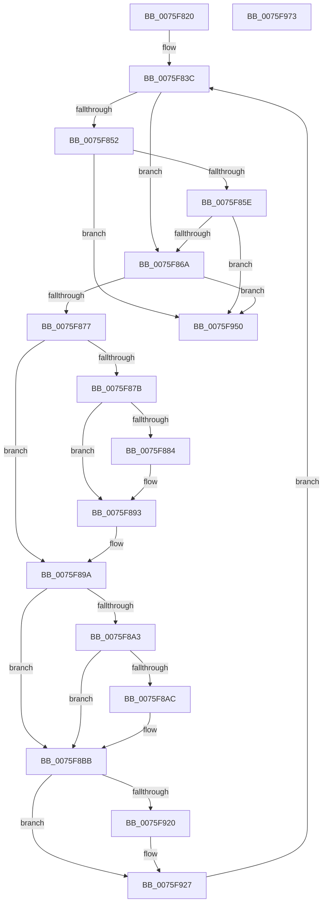

# PopThermalStateTransitionWorker

- RVA: `0x0075F820`–`0x0075F974` (길이 `340` bytes)
- VA: `0x000000014075F820`
- 실행 섹션: `PAGE`
- PDB 이름 있음: `예`; PDB Function 태그: `아니요`
- unwind 정보 RVA: `0x0007D148`
- 디코드: `71`개 명령, `340/340` bytes 표시
- 미해석 바이트: `0` (있으면 어셈블리에 `.byte`로 보존)

> 이 문서는 커널 이미지의 기계어와 PDB 기호를 분석해 생성했습니다. 4번과 5번은 함수 원형과 자료형을 바이너리 사용 방식에서 추정한 C 해석이며 원본 소스 복구 결과는 아닙니다.

## 1. Dependencies

- 직접 호출 지점: **10**; 고유 호출 대상: **7**
- 직접 호출자로 확인된 함수: **0**
- RIP 상대 이미지 참조: **12**

### Outgoing calls
- `0x0075F843` → [PopAcquireRwLockExclusive](../../text/43/PopAcquireRwLockExclusive_function_00430B44.md) (function, `0x00430B44`)
- `0x0075F8C2` → [PopReleaseRwLock](../../text/2D/PopReleaseRwLock_function_002DFBBC.md) (function, `0x002DFBBC`)
- `0x0075F8CE` → [PopAcquireRwLockExclusive](../../text/43/PopAcquireRwLockExclusive_function_00430B44.md) (function, `0x00430B44`)
- `0x0075F8D5` → [PopThermalStandbyEndTracking](../../text/4D/PopThermalStandbyEndTracking_function_004D1B2C.md) (function, `0x004D1B2C`)
- `0x0075F8E1` → [PopReleaseRwLock](../../text/2D/PopReleaseRwLock_function_002DFBBC.md) (function, `0x002DFBBC`)
- `0x0075F916` → [PopAcquirePolicyLock](../../pagelk/B7/PopAcquirePolicyLock_function_00B783C0.md) (function, `0x00B783C0`)
- `0x0075F941` → [PopExecutePowerAction](PopExecutePowerAction_function_0075E6B4.md) (function, `0x0075E6B4`)
- `0x0075F946` → [PopReleasePolicyLock](../../pagelk/B7/PopReleasePolicyLock_function_00B78410.md) (function, `0x00B78410`)
- `0x0075F957` → [PopOkayToQueueNextWorkItem](../../text/4A/PopOkayToQueueNextWorkItem_function_004AED54.md) (function, `0x004AED54`)
- `0x0075F963` → [PopReleaseRwLock](../../text/2D/PopReleaseRwLock_function_002DFBBC.md) (function, `0x002DFBBC`)

### Direct callers
- 이 함수 시작 RVA로 연결되는 직접 call은 확인되지 않았습니다. 간접 호출은 완전히 역산할 수 없습니다.

### Static image references
- `0x0075F83C` → RVA `0x00F0B980` (`.data`; read)
- `0x0075F848` → RVA `0x00F0B991` (`.data`; read)
- `0x0075F852` → RVA `0x00F0B993` (`.data`; read)
- `0x0075F85E` → RVA `0x00F0B994` (`.data`; read)
- `0x0075F86A` → RVA `0x00F0B990` (`.data`; read)
- `0x0075F87B` → RVA `0x00F0B992` (`.data`; read)
- `0x0075F889` → RVA `0x00F0B992` (`.data`; write)
- `0x0075F893` → RVA `0x00F0B991` (`.data`; write)
- `0x0075F8B1` → RVA `0x00F0B993` (`.data`; write)
- `0x0075F8C7` → RVA `0x00F0BB00` (`.data`; read)
- `0x0075F920` → RVA `0x00FC6AFE` (`ALMOSTRO`; write)
- `0x0075F950` → RVA `0x00F0B940` (`.data`; read)

## 2. Other-region calls and transfers

- 다른 실행 섹션으로 향하는 call: **9**
  - `0x0075F843` → [PopAcquireRwLockExclusive](../../text/43/PopAcquireRwLockExclusive_function_00430B44.md) (`PAGE` → `.text`)
  - `0x0075F8C2` → [PopReleaseRwLock](../../text/2D/PopReleaseRwLock_function_002DFBBC.md) (`PAGE` → `.text`)
  - `0x0075F8CE` → [PopAcquireRwLockExclusive](../../text/43/PopAcquireRwLockExclusive_function_00430B44.md) (`PAGE` → `.text`)
  - `0x0075F8D5` → [PopThermalStandbyEndTracking](../../text/4D/PopThermalStandbyEndTracking_function_004D1B2C.md) (`PAGE` → `.text`)
  - `0x0075F8E1` → [PopReleaseRwLock](../../text/2D/PopReleaseRwLock_function_002DFBBC.md) (`PAGE` → `.text`)
  - `0x0075F916` → [PopAcquirePolicyLock](../../pagelk/B7/PopAcquirePolicyLock_function_00B783C0.md) (`PAGE` → `PAGELK`)
  - `0x0075F946` → [PopReleasePolicyLock](../../pagelk/B7/PopReleasePolicyLock_function_00B78410.md) (`PAGE` → `PAGELK`)
  - `0x0075F957` → [PopOkayToQueueNextWorkItem](../../text/4A/PopOkayToQueueNextWorkItem_function_004AED54.md) (`PAGE` → `.text`)
  - `0x0075F963` → [PopReleaseRwLock](../../text/2D/PopReleaseRwLock_function_002DFBBC.md) (`PAGE` → `.text`)
- 별도 외부 분기/꼬리 이동을 확인하지 못했습니다.

## 3. Assembly (complete function range)

```asm
0075F820  48 89 5C 24 08                  mov qword ptr [rsp + 8], rbx
0075F825  57                              push rdi
0075F826  48 83 EC 60                     sub rsp, 0x60
0075F82A  0F 57 C0                        xorps xmm0, xmm0
0075F82D  33 DB                           xor ebx, ebx
0075F82F  0F 11 44 24 40                  movups xmmword ptr [rsp + 0x40], xmm0
0075F834  0F 11 44 24 50                  movups xmmword ptr [rsp + 0x50], xmm0
0075F839  8D 7B 02                        lea edi, [rbx + 2]
0075F83C  48 8D 0D 3D C1 7A 00            lea rcx, [rip + 0x7ac13d]
0075F843  E8 FC 12 CD FF                  call 0x140430b44
0075F848  8A 05 43 C1 7A 00               mov al, byte ptr [rip + 0x7ac143]
0075F84E  84 C0                           test al, al
0075F850  75 18                           jne 0x14075f86a
0075F852  38 05 3B C1 7A 00               cmp byte ptr [rip + 0x7ac13b], al
0075F858  0F 84 F2 00 00 00               je 0x14075f950
0075F85E  38 05 30 C1 7A 00               cmp byte ptr [rip + 0x7ac130], al
0075F864  0F 84 E6 00 00 00               je 0x14075f950
0075F86A  80 3D 1F C1 7A 00 00            cmp byte ptr [rip + 0x7ac11f], 0
0075F871  0F 84 D9 00 00 00               je 0x14075f950
0075F877  84 C0                           test al, al
0075F879  74 1F                           je 0x14075f89a
0075F87B  80 3D 10 C1 7A 00 00            cmp byte ptr [rip + 0x7ac110], 0
0075F882  75 0F                           jne 0x14075f893
0075F884  BB 03 00 00 00                  mov ebx, 3
0075F889  C6 05 02 C1 7A 00 01            mov byte ptr [rip + 0x7ac102], 1
0075F890  8D 7B FF                        lea edi, [rbx - 1]
0075F893  C6 05 F7 C0 7A 00 00            mov byte ptr [rip + 0x7ac0f7], 0
0075F89A  80 3D F2 C0 7A 00 00            cmp byte ptr [rip + 0x7ac0f2], 0
0075F8A1  74 18                           je 0x14075f8bb
0075F8A3  80 3D EA C0 7A 00 00            cmp byte ptr [rip + 0x7ac0ea], 0
0075F8AA  74 0F                           je 0x14075f8bb
0075F8AC  BB 06 00 00 00                  mov ebx, 6
0075F8B1  C6 05 DB C0 7A 00 00            mov byte ptr [rip + 0x7ac0db], 0
0075F8B8  8D 7B FD                        lea edi, [rbx - 3]
0075F8BB  48 8D 0D BE C0 7A 00            lea rcx, [rip + 0x7ac0be]
0075F8C2  E8 F5 02 B8 FF                  call 0x1402dfbbc
0075F8C7  48 8D 0D 32 C2 7A 00            lea rcx, [rip + 0x7ac232]
0075F8CE  E8 71 12 CD FF                  call 0x140430b44
0075F8D3  8B CF                           mov ecx, edi
0075F8D5  E8 52 22 D7 FF                  call 0x1404d1b2c
0075F8DA  48 8D 0D 1F C2 7A 00            lea rcx, [rip + 0x7ac21f]
0075F8E1  E8 D6 02 B8 FF                  call 0x1402dfbbc
0075F8E6  83 64 24 38 00                  and dword ptr [rsp + 0x38], 0
0075F8EB  0F 57 C0                        xorps xmm0, xmm0
0075F8EE  48 83 64 24 58 00               and qword ptr [rsp + 0x58], 0
0075F8F4  F3 0F 7F 44 24 48               movdqu xmmword ptr [rsp + 0x48], xmm0
0075F8FA  89 5C 24 30                     mov dword ptr [rsp + 0x30], ebx
0075F8FE  C7 44 24 34 04 00 00 C0         mov dword ptr [rsp + 0x34], 0xc0000004
0075F906  C7 44 24 40 01 00 00 00         mov dword ptr [rsp + 0x40], 1
0075F90E  C7 44 24 44 80 00 00 00         mov dword ptr [rsp + 0x44], 0x80
0075F916  E8 A5 8A 41 00                  call 0x140b783c0
0075F91B  83 FB 06                        cmp ebx, 6
0075F91E  75 07                           jne 0x14075f927
0075F920  C6 05 D7 71 86 00 01            mov byte ptr [rip + 0x8671d7], 1
0075F927  41 B9 05 00 00 00               mov r9d, 5
0075F92D  C7 44 24 20 01 00 00 00         mov dword ptr [rsp + 0x20], 1
0075F935  4C 8D 44 24 30                  lea r8, [rsp + 0x30]
0075F93A  33 D2                           xor edx, edx
0075F93C  48 8D 4C 24 40                  lea rcx, [rsp + 0x40]
0075F941  E8 6E ED FF FF                  call 0x14075e6b4
0075F946  E8 C5 8A 41 00                  call 0x140b78410
0075F94B  E9 EC FE FF FF                  jmp 0x14075f83c
0075F950  48 8D 0D E9 BF 7A 00            lea rcx, [rip + 0x7abfe9]
0075F957  E8 F8 F3 D4 FF                  call 0x1404aed54
0075F95C  48 8D 0D 1D C0 7A 00            lea rcx, [rip + 0x7ac01d]
0075F963  E8 54 02 B8 FF                  call 0x1402dfbbc
0075F968  48 8B 5C 24 70                  mov rbx, qword ptr [rsp + 0x70]
0075F96D  48 83 C4 60                     add rsp, 0x60
0075F971  5F                              pop rdi
0075F972  C3                              ret
0075F973  CC                              int3
```

## 4. C-style interpretation (structured pseudocode)

```c
__int64 __fastcall PopThermalStateTransitionWorker(__int64 a1, int a2)
{
    __int64 result;
    __int64 v_rbx;
    __int64 v_rdi;
    __int64 v_rsp;
    unsigned __int64 v_stack_m10;
    unsigned __int64 v_stack_m18;
    unsigned __int64 v_stack_m20;
    unsigned int v_stack_m24;
    unsigned __int64 v_stack_m28;
    unsigned int v_stack_m30;
    unsigned int v_stack_m34;
    unsigned int v_stack_m38;
    unsigned int v_stack_m48;
    unsigned __int64 v_stack_p8;

    v_stack_p8 = v_rbx;
    v_rsp = (v_rsp) - (96);
    v_rbx = 0;
    v_stack_m28 = v_xmm0;
    v_stack_m18 = v_xmm0;
loc_0075F83C:
    result = PopAcquireRwLockExclusive(v_rip + 8044861, a2, a3, a4);
    if ((unsigned __int8)(*(unsigned __int8 *)(v_rip + 8044867)) != 0) goto loc_0075F86A;
    if ((*(unsigned __int8 *)(v_rip + 8044859)) == ((unsigned __int8)(*(unsigned __int8 *)(v_rip + 8044867)))) goto loc_0075F950;
    if ((*(unsigned __int8 *)(v_rip + 8044848)) == ((unsigned __int8)(*(unsigned __int8 *)(v_rip + 8044867)))) goto loc_0075F950;
loc_0075F86A:
    if ((*(unsigned __int8 *)(v_rip + 8044831)) == 0) goto loc_0075F950;
    if ((unsigned __int8)(*(unsigned __int8 *)(v_rip + 8044867)) == 0) goto loc_0075F89A;
    v_rdi = v_rbx + 2;
    if ((*(unsigned __int8 *)(v_rip + 8044816)) == 0) {
        v_rbx = 3;
        *(unsigned __int8 *)(v_rip + 8044802) = 1;
        v_rdi = v_rbx - 1;
    }
    *(unsigned __int8 *)(v_rip + 8044791) = 0;
loc_0075F89A:
    if ((*(unsigned __int8 *)(v_rip + 8044786)) == 0) goto loc_0075F8BB;
    if ((*(unsigned __int8 *)(v_rip + 8044778)) != 0) {
        v_rbx = 6;
        *(unsigned __int8 *)(v_rip + 8044763) = 0;
        v_rdi = v_rbx - 3;
    }
    result = PopReleaseRwLock(v_rip + 8044734, a2, a3, a4);
    result = PopAcquireRwLockExclusive(v_rip + 8045106, a2, a3, a4);
    result = PopThermalStandbyEndTracking((unsigned int)((unsigned int)(v_rdi)), a2, a3, a4);
    result = PopReleaseRwLock(v_rip + 8045087, a2, a3, a4);
    v_stack_m20 = v_xmm0;
    v_stack_m38 = (unsigned int)(v_rbx);
    v_stack_m34 = 0xC0000004ULL;
    v_stack_m28 = 1;
    v_stack_m24 = 128;
    result = PopAcquirePolicyLock(v_rip + 8045087, a2, a3, a4);
    if (((unsigned int)(v_rbx)) == 6) {
        *(unsigned __int8 *)(v_rip + 8810967) = 1;
    }
    v_stack_m48 = 1;
    a2 = 0;
    result = PopExecutePowerAction(v_stack_m28, a2, v_stack_m38, 5);
    result = PopReleasePolicyLock(v_stack_m28, a2, v_stack_m38, 5);
    goto loc_0075F83C;
loc_0075F950:
    result = PopOkayToQueueNextWorkItem(v_rip + 8044521, a2, v_stack_m38, 5);
    result = PopReleaseRwLock(v_rip + 8044573, a2, v_stack_m38, 5);
    v_rsp = (v_rsp) + (96);
    return result;
}
```

## 5. (Beta) C Style

```c
int64_t PopThermalStateTransitionWorker(int64_t Arg1, int32_t Arg2)
{
    int64_t result;
    int64_t local_rbx;
    int64_t local_rdi;
    int64_t local_rsp;
    uint64_t v_stack_m10;
    uint64_t v_stack_m18;
    uint64_t v_stack_m20;
    uint32_t v_stack_m24;
    uint64_t v_stack_m28;
    uint32_t v_stack_m30;
    uint32_t v_stack_m34;
    uint32_t v_stack_m38;
    uint32_t v_stack_m48;
    uint64_t v_stack_p8;

    v_stack_p8 = local_rbx;
    local_rsp = (local_rsp) - (96);
    local_rbx = 0;
    v_stack_m28 = v_xmm0;
    v_stack_m18 = v_xmm0;
loc_0075F83C:
    result = PopAcquireRwLockExclusive(v_rip + 8044861, Arg2, a3, a4);
    if ((uint8_t)(*(uint8_t *)(v_rip + 0x7AC143)) != 0) goto loc_0075F86A;
    if ((*(uint8_t *)(v_rip + 0x7AC13B)) == ((uint8_t)(*(uint8_t *)(v_rip + 0x7AC143)))) goto loc_0075F950;
    if ((*(uint8_t *)(v_rip + 0x7AC130)) == ((uint8_t)(*(uint8_t *)(v_rip + 0x7AC143)))) goto loc_0075F950;
loc_0075F86A:
    if ((*(uint8_t *)(v_rip + 0x7AC11F)) == 0) goto loc_0075F950;
    if ((uint8_t)(*(uint8_t *)(v_rip + 0x7AC143)) == 0) goto loc_0075F89A;
    local_rdi = local_rbx + 2;
    if ((*(uint8_t *)(v_rip + 0x7AC110)) == 0) {
        local_rbx = 3;
        *(uint8_t *)(v_rip + 0x7AC102) = 1;
        local_rdi = local_rbx - 1;
    }
    *(uint8_t *)(v_rip + 0x7AC0F7) = 0;
loc_0075F89A:
    if ((*(uint8_t *)(v_rip + 0x7AC0F2)) == 0) goto loc_0075F8BB;
    if ((*(uint8_t *)(v_rip + 0x7AC0EA)) != 0) {
        local_rbx = 6;
        *(uint8_t *)(v_rip + 0x7AC0DB) = 0;
        local_rdi = local_rbx - 3;
    }
    result = PopReleaseRwLock(v_rip + 8044734, Arg2, a3, a4);
    result = PopAcquireRwLockExclusive(v_rip + 8045106, Arg2, a3, a4);
    result = PopThermalStandbyEndTracking((uint32_t)((uint32_t)(local_rdi)), Arg2, a3, a4);
    result = PopReleaseRwLock(v_rip + 8045087, Arg2, a3, a4);
    v_stack_m20 = v_xmm0;
    v_stack_m38 = (uint32_t)(local_rbx);
    v_stack_m34 = 0xC0000004ULL;
    v_stack_m28 = 1;
    v_stack_m24 = 128;
    result = PopAcquirePolicyLock(v_rip + 8045087, Arg2, a3, a4);
    if (((uint32_t)(local_rbx)) == 6) {
        *(uint8_t *)(v_rip + 0x8671D7) = 1;
    }
    v_stack_m48 = 1;
    Arg2 = 0;
    result = PopExecutePowerAction(v_stack_m28, Arg2, v_stack_m38, 5);
    result = PopReleasePolicyLock(v_stack_m28, Arg2, v_stack_m38, 5);
    goto loc_0075F83C;
loc_0075F950:
    result = PopOkayToQueueNextWorkItem(v_rip + 8044521, Arg2, v_stack_m38, 5);
    result = PopReleaseRwLock(v_rip + 8044573, Arg2, v_stack_m38, 5);
    local_rsp = (local_rsp) + (96);
    return result;
}
```

## 6. Execution-region graph

[열기: 2D/3D 그래프와 함수 탐색 컨트롤 패널](../../../control-panel.html?section=page&rva=0x0075F820&view=graph)

- 2D 그래프는 위에서 아래로 흐르고, 3D 그래프는 빈 공간을 드래그해 회전합니다. Shift+드래그는 이동, 휠은 확대·축소, 함수 노드 선택은 대상 보고서 이동입니다.

### Static fallback


