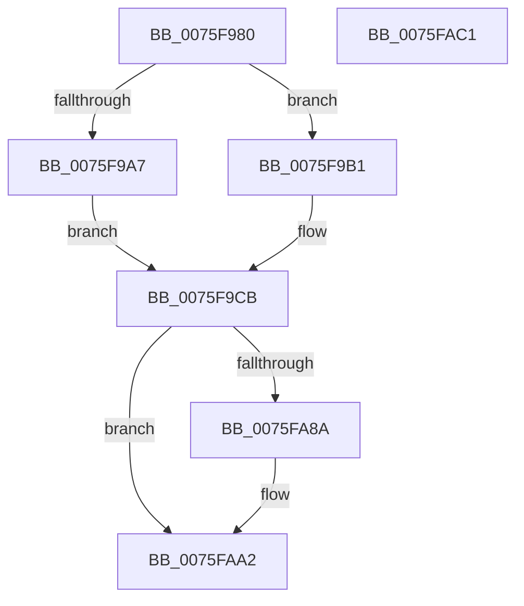

# PopThermalZoneAdd

- RVA: `0x0075F980`–`0x0075FAC2` (길이 `322` bytes)
- VA: `0x000000014075F980`
- 실행 섹션: `PAGE`
- PDB 이름 있음: `예`; PDB Function 태그: `아니요`
- unwind 정보 RVA: `0x0008A658`
- 디코드: `69`개 명령, `322/322` bytes 표시
- 미해석 바이트: `0` (있으면 어셈블리에 `.byte`로 보존)

> 이 문서는 커널 이미지의 기계어와 PDB 기호를 분석해 생성했습니다. 4번과 5번은 함수 원형과 자료형을 바이너리 사용 방식에서 추정한 C 해석이며 원본 소스 복구 결과는 아닙니다.

## 1. Dependencies

- 직접 호출 지점: **9**; 고유 호출 대상: **8**
- 직접 호출자로 확인된 함수: **0**
- RIP 상대 이미지 참조: **8**

### Outgoing calls
- `0x0075F9AA` → [KeInitializeTimer2](../../text/3A/KeInitializeTimer2_function_003A30B0.md) (function, `0x003A30B0`)
- `0x0075F9C6` → [KeInitializeIRTimer](../../text/3A/KeInitializeIRTimer_function_003A4204.md) (function, `0x003A4204`)
- `0x0075FA1C` → [KeInitializeEvent](../../text/40/KeInitializeEvent_function_0040DD10.md) (function, `0x0040DD10`)
- `0x0075FA2D` → [KeInitializeEvent](../../text/40/KeInitializeEvent_function_0040DD10.md) (function, `0x0040DD10`)
- `0x0075FA8A` → [PopAcquirePolicyLock](../../pagelk/B7/PopAcquirePolicyLock_function_00B783C0.md) (function, `0x00B783C0`)
- `0x0075FA98` → [PopChangeCapability](../90/PopChangeCapability_function_0090FF48.md) (function, `0x0090FF48`)
- `0x0075FA9D` → [PopReleasePolicyLock](../../pagelk/B7/PopReleasePolicyLock_function_00B78410.md) (function, `0x00B78410`)
- `0x0075FAA4` → [PopThermalUpdateTelemetryClientCount](../../text/5D/PopThermalUpdateTelemetryClientCount_function_005D58C4.md) (function, `0x005D58C4`)
- `0x0075FAB1` → [ExQueueWorkItem](../../text/2F/ExQueueWorkItem_function_002F9520.md) (function, `0x002F9520`)

### Direct callers
- 이 함수 시작 RVA로 연결되는 직접 call은 확인되지 않았습니다. 간접 호출은 완전히 역산할 수 없습니다.

### Static image references
- `0x0075F98D` → RVA `0x004B9050` (`PopThermalZoneTimerCallback`; read)
- `0x0075F99E` → RVA `0x00F0C960` (`.data`; read)
- `0x0075F9FB` → RVA `0x00F0C95C` (`.data`; read)
- `0x0075FA16` → RVA `0x00F0C95C` (`.data`; write)
- `0x0075FA3D` → RVA `0x00A4E200` (`PopThermalWorker`; read)
- `0x0075FA6F` → RVA `0x00F0C958` (`.data`; read)
- `0x0075FA7F` → RVA `0x00F0C958` (`.data`; write)
- `0x0075FA91` → RVA `0x00F0CECD` (`.data`; read)

## 2. Other-region calls and transfers

- 다른 실행 섹션으로 향하는 call: **8**
  - `0x0075F9AA` → [KeInitializeTimer2](../../text/3A/KeInitializeTimer2_function_003A30B0.md) (`PAGE` → `.text`)
  - `0x0075F9C6` → [KeInitializeIRTimer](../../text/3A/KeInitializeIRTimer_function_003A4204.md) (`PAGE` → `.text`)
  - `0x0075FA1C` → [KeInitializeEvent](../../text/40/KeInitializeEvent_function_0040DD10.md) (`PAGE` → `.text`)
  - `0x0075FA2D` → [KeInitializeEvent](../../text/40/KeInitializeEvent_function_0040DD10.md) (`PAGE` → `.text`)
  - `0x0075FA8A` → [PopAcquirePolicyLock](../../pagelk/B7/PopAcquirePolicyLock_function_00B783C0.md) (`PAGE` → `PAGELK`)
  - `0x0075FA9D` → [PopReleasePolicyLock](../../pagelk/B7/PopReleasePolicyLock_function_00B78410.md) (`PAGE` → `PAGELK`)
  - `0x0075FAA4` → [PopThermalUpdateTelemetryClientCount](../../text/5D/PopThermalUpdateTelemetryClientCount_function_005D58C4.md) (`PAGE` → `.text`)
  - `0x0075FAB1` → [ExQueueWorkItem](../../text/2F/ExQueueWorkItem_function_002F9520.md) (`PAGE` → `.text`)
- 별도 외부 분기/꼬리 이동을 확인하지 못했습니다.

## 3. Assembly (complete function range)

```asm
0075F980  48 89 5C 24 10                  mov qword ptr [rsp + 0x10], rbx
0075F985  57                              push rdi
0075F986  48 83 EC 30                     sub rsp, 0x30
0075F98A  48 8B D9                        mov rbx, rcx
0075F98D  48 8D 15 BC 96 D5 FF            lea rdx, [rip - 0x2a6944]
0075F994  48 81 C1 28 01 00 00            add rcx, 0x128
0075F99B  4C 8B C3                        mov r8, rbx
0075F99E  83 3D BB CF 7A 00 00            cmp dword ptr [rip + 0x7acfbb], 0
0075F9A5  75 0A                           jne 0x14075f9b1
0075F9A7  45 33 C9                        xor r9d, r9d
0075F9AA  E8 01 37 C4 FF                  call 0x1403a30b0
0075F9AF  EB 1A                           jmp 0x14075f9cb
0075F9B1  4C 8D 4C 24 40                  lea r9, [rsp + 0x40]
0075F9B6  C7 44 24 40 08 00 04 00         mov dword ptr [rsp + 0x40], 0x40008
0075F9BE  C7 44 24 20 02 00 00 00         mov dword ptr [rsp + 0x20], 2
0075F9C6  E8 39 48 C4 FF                  call 0x1403a4204
0075F9CB  48 8B 43 38                     mov rax, qword ptr [rbx + 0x38]
0075F9CF  B9 64 00 00 00                  mov ecx, 0x64
0075F9D4  66 81 4B 45 FF FF               or word ptr [rbx + 0x45], 0xffff
0075F9DA  45 33 C0                        xor r8d, r8d
0075F9DD  89 4B 50                        mov dword ptr [rbx + 0x50], ecx
0075F9E0  33 D2                           xor edx, edx
0075F9E2  89 4B 54                        mov dword ptr [rbx + 0x54], ecx
0075F9E5  C6 43 40 06                     mov byte ptr [rbx + 0x40], 6
0075F9E9  C6 43 43 02                     mov byte ptr [rbx + 0x43], 2
0075F9ED  C7 43 4C E8 03 00 00            mov dword ptr [rbx + 0x4c], 0x3e8
0075F9F4  C7 40 30 9D 00 00 C0            mov dword ptr [rax + 0x30], 0xc000009d
0075F9FB  8B 05 5B CF 7A 00               mov eax, dword ptr [rip + 0x7acf5b]
0075FA01  89 83 F0 01 00 00               mov dword ptr [rbx + 0x1f0], eax
0075FA07  FF C0                           inc eax
0075FA09  89 8B D8 00 00 00               mov dword ptr [rbx + 0xd8], ecx
0075FA0F  48 8D 8B C0 01 00 00            lea rcx, [rbx + 0x1c0]
0075FA16  89 05 40 CF 7A 00               mov dword ptr [rip + 0x7acf40], eax
0075FA1C  E8 EF E2 CA FF                  call 0x14040dd10
0075FA21  48 8D 8B D8 01 00 00            lea rcx, [rbx + 0x1d8]
0075FA28  45 33 C0                        xor r8d, r8d
0075FA2B  33 D2                           xor edx, edx
0075FA2D  E8 DE E2 CA FF                  call 0x14040dd10
0075FA32  48 8D BB 08 01 00 00            lea rdi, [rbx + 0x108]
0075FA39  48 83 27 00                     and qword ptr [rdi], 0
0075FA3D  48 8D 05 BC E7 2E 00            lea rax, [rip + 0x2ee7bc]
0075FA44  48 89 47 10                     mov qword ptr [rdi + 0x10], rax
0075FA48  48 B8 08 00 00 00 80 F7 FF FF   movabs rax, 0xfffff78000000008
0075FA52  48 89 5F 18                     mov qword ptr [rdi + 0x18], rbx
0075FA56  48 8B 00                        mov rax, qword ptr [rax]
0075FA59  48 89 83 00 02 00 00            mov qword ptr [rbx + 0x200], rax
0075FA60  48 89 83 08 02 00 00            mov qword ptr [rbx + 0x208], rax
0075FA67  48 83 A3 B8 01 00 00 00         and qword ptr [rbx + 0x1b8], 0
0075FA6F  8B 05 E3 CE 7A 00               mov eax, dword ptr [rip + 0x7acee3]
0075FA75  48 83 A3 B0 01 00 00 00         and qword ptr [rbx + 0x1b0], 0
0075FA7D  FF C0                           inc eax
0075FA7F  89 05 D3 CE 7A 00               mov dword ptr [rip + 0x7aced3], eax
0075FA85  83 F8 01                        cmp eax, 1
0075FA88  75 18                           jne 0x14075faa2
0075FA8A  E8 31 89 41 00                  call 0x140b783c0
0075FA8F  B2 01                           mov dl, 1
0075FA91  48 8D 0D 35 D4 7A 00            lea rcx, [rip + 0x7ad435]
0075FA98  E8 AB 04 1B 00                  call 0x14090ff48
0075FA9D  E8 6E 89 41 00                  call 0x140b78410
0075FAA2  B1 01                           mov cl, 1
0075FAA4  E8 1B 5E E7 FF                  call 0x1405d58c4
0075FAA9  BA 01 00 00 00                  mov edx, 1
0075FAAE  48 8B CF                        mov rcx, rdi
0075FAB1  E8 6A 9A B9 FF                  call 0x1402f9520
0075FAB6  48 8B 5C 24 48                  mov rbx, qword ptr [rsp + 0x48]
0075FABB  48 83 C4 30                     add rsp, 0x30
0075FABF  5F                              pop rdi
0075FAC0  C3                              ret
0075FAC1  CC                              int3
```

## 4. C-style interpretation (structured pseudocode)

```c
__int64 __fastcall PopThermalZoneAdd(__int64 a1, __int64 a2, __int64 a3, int a4)
{
    __int64 result;
    __int64 v_rsp;
    unsigned int v_stack_m18;
    unsigned __int64 v_stack_p10;
    unsigned __int64 v_stack_p8;

    v_stack_p10 = v_rbx;
    v_rsp = (v_rsp) - (48);
    a1 = (a1) + (296);
    if ((*(unsigned int *)(v_rip + 8048571)) != 0) goto loc_0075F9B1;
    a4 = 0;
    result = KeInitializeTimer2(a1, v_rip - 2779460, a1, a4);
    goto loc_0075F9CB;
loc_0075F9B1:
    v_stack_p8 = 0x40008ULL;
    v_stack_m18 = 2;
    result = KeInitializeIRTimer(a1, v_rip - 2779460, a1, v_stack_p8);
loc_0075F9CB:
    a3 = 0;
    *(unsigned int *)(a1 + 80) = 100;
    a2 = 0;
    *(unsigned int *)(a1 + 84) = 100;
    *(unsigned __int8 *)(a1 + 64) = 6;
    *(unsigned __int8 *)(a1 + 67) = 2;
    *(unsigned int *)(a1 + 76) = 1000;
    *(unsigned int *)(*(unsigned __int64 *)(a1 + 56) + 48) = 0xC000009DULL;
    *(unsigned int *)(a1 + 496) = (unsigned int)((unsigned int)(*(unsigned int *)(v_rip + 8048475)));
    result = (unsigned int)(((unsigned int)(*(unsigned int *)(v_rip + 8048475))) + 1);
    *(unsigned int *)(a1 + 216) = 100;
    *(unsigned int *)(v_rip + 8048448) = (unsigned int)(result);
    result = KeInitializeEvent(a1 + 448, a2, a3, v_stack_p8);
    a3 = 0;
    a2 = 0;
    result = KeInitializeEvent(a1 + 472, a2, a3, v_stack_p8);
    *(unsigned __int64 *)(a1 + 264 + 16) = v_rip + 3073980;
    *(unsigned __int64 *)(a1 + 264 + 24) = a1;
    *(unsigned __int64 *)(a1 + 512) = *(unsigned __int64 *)(v_rip + 3073980);
    *(unsigned __int64 *)(a1 + 520) = *(unsigned __int64 *)(v_rip + 3073980);
    result = (unsigned int)(((unsigned int)(*(unsigned int *)(v_rip + 8048355))) + 1);
    *(unsigned int *)(v_rip + 8048339) = (unsigned int)(result);
    if (((unsigned int)(result)) == 1) {
        result = PopAcquirePolicyLock(a1 + 472, a2, a3, v_stack_p8);
        a2 = 1;
        a1 = v_rip + 8049717;
        result = PopChangeCapability(a1, a2, a3, v_stack_p8);
        result = PopReleasePolicyLock(a1, a2, a3, v_stack_p8);
    }
    result = PopThermalUpdateTelemetryClientCount(1, a2, a3, v_stack_p8);
    result = ExQueueWorkItem(a1 + 264, 1, a3, v_stack_p8);
    v_rsp = (v_rsp) + (48);
    return result;
}
```

## 5. (Beta) C Style

```c
int64_t PopThermalZoneAdd(void *Arg1, int64_t Arg2, int64_t Arg3, int32_t Arg4)
{
    uint8_t *arg1 = (uint8_t *)Arg1;

    int64_t result;
    int64_t local_rsp;
    uint32_t v_stack_m18;
    uint64_t v_stack_p10;
    uint64_t v_stack_p8;

    v_stack_p10 = local_rbx;
    local_rsp = (local_rsp) - (48);
    Arg1 = (Arg1) + (296);
    if ((*(uint32_t *)(v_rip + 0x7ACFBB)) != 0) goto loc_0075F9B1;
    Arg4 = 0;
    result = KeInitializeTimer2(Arg1, v_rip - 2779460, Arg1, Arg4);
    goto loc_0075F9CB;
loc_0075F9B1:
    v_stack_p8 = 0x40008ULL;
    v_stack_m18 = 2;
    result = KeInitializeIRTimer(Arg1, v_rip - 2779460, Arg1, v_stack_p8);
loc_0075F9CB:
    Arg3 = 0;
    *(uint32_t *)(arg1 + 0x50) = 100;
    Arg2 = 0;
    *(uint32_t *)(arg1 + 0x54) = 100;
    *(uint8_t *)(arg1 + 0x40) = 6;
    *(uint8_t *)(arg1 + 0x43) = 2;
    *(uint32_t *)(arg1 + 0x4C) = 1000;
    *(uint32_t *)(*(uint64_t *)(arg1 + 0x38) + 0x30) = 0xC000009DULL;
    *(uint32_t *)(arg1 + 0x1F0) = (uint32_t)((uint32_t)(*(uint32_t *)(v_rip + 0x7ACF5B)));
    result = (uint32_t)(((uint32_t)(*(uint32_t *)(v_rip + 0x7ACF5B))) + 1);
    *(uint32_t *)(arg1 + 0xD8) = 100;
    *(uint32_t *)(v_rip + 0x7ACF40) = (uint32_t)(result);
    result = KeInitializeEvent(Arg1 + 448, Arg2, Arg3, v_stack_p8);
    Arg3 = 0;
    Arg2 = 0;
    result = KeInitializeEvent(Arg1 + 472, Arg2, Arg3, v_stack_p8);
    *(uint64_t *)(arg1 + 0x108 + 0x10) = v_rip + 3073980;
    *(void **)(arg1 + 0x108 + 0x18) = Arg1;
    *(uint64_t *)(arg1 + 0x200) = *(uint64_t *)(v_rip + 0x2EE7BC);
    *(uint64_t *)(arg1 + 0x208) = *(uint64_t *)(v_rip + 0x2EE7BC);
    result = (uint32_t)(((uint32_t)(*(uint32_t *)(v_rip + 0x7ACEE3))) + 1);
    *(uint32_t *)(v_rip + 0x7ACED3) = (uint32_t)(result);
    if (((uint32_t)(result)) == 1) {
        result = PopAcquirePolicyLock(Arg1 + 472, Arg2, Arg3, v_stack_p8);
        Arg2 = 1;
        Arg1 = v_rip + 8049717;
        result = PopChangeCapability(Arg1, Arg2, Arg3, v_stack_p8);
        result = PopReleasePolicyLock(Arg1, Arg2, Arg3, v_stack_p8);
    }
    result = PopThermalUpdateTelemetryClientCount(1, Arg2, Arg3, v_stack_p8);
    result = ExQueueWorkItem(Arg1 + 264, 1, Arg3, v_stack_p8);
    local_rsp = (local_rsp) + (48);
    return result;
}
```

### 관측된 메모리 오프셋

구조체 형식이 확인되지 않은 접근은 인자 기준의 오프셋으로만 기록했습니다.

| 기준 인자 | 오프셋 표현 | 폭 (bit) | 접근 |
|---|---:|---:|---|
| `Arg1` | `+ 0x0` | `64` | `R/W` |
| `Arg1` | `+ 0x10` | `64` | `W` |
| `Arg1` | `+ 0x18` | `64` | `W` |
| `Arg1` | `+ 0x38` | `64` | `R` |
| `Arg1` | `+ 0x40` | `8` | `W` |
| `Arg1` | `+ 0x43` | `8` | `W` |
| `Arg1` | `+ 0x45` | `16` | `R/W` |
| `Arg1` | `+ 0x4C` | `32` | `W` |
| `Arg1` | `+ 0x50` | `32` | `W` |
| `Arg1` | `+ 0x54` | `32` | `W` |
| `Arg1` | `+ 0xD8` | `32` | `W` |
| `Arg1` | `+ 0x108` | `64` | `R` |
| `Arg1` | `+ 0x1B0` | `64` | `R/W` |
| `Arg1` | `+ 0x1B8` | `64` | `R/W` |
| `Arg1` | `+ 0x1C0` | `64` | `R` |
| `Arg1` | `+ 0x1D8` | `64` | `R` |
| `Arg1` | `+ 0x1F0` | `32` | `W` |
| `Arg1` | `+ 0x200` | `64` | `W` |
| `Arg1` | `+ 0x208` | `64` | `W` |

## 6. Execution-region graph

[열기: 2D/3D 그래프와 함수 탐색 컨트롤 패널](../../../control-panel.html?section=page&rva=0x0075F980&view=graph)

- 2D 그래프는 위에서 아래로 흐르고, 3D 그래프는 빈 공간을 드래그해 회전합니다. Shift+드래그는 이동, 휠은 확대·축소, 함수 노드 선택은 대상 보고서 이동입니다.

### Static fallback


