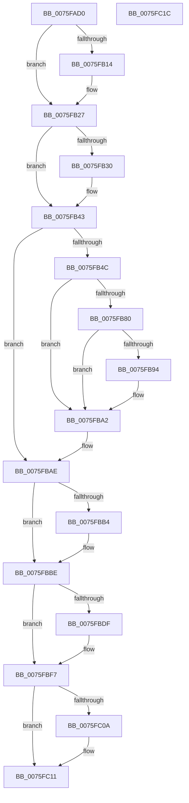

# PopThermalZoneRemove

- RVA: `0x0075FAD0`–`0x0075FC1D` (길이 `333` bytes)
- VA: `0x000000014075FAD0`
- 실행 섹션: `PAGE`
- PDB 이름 있음: `예`; PDB Function 태그: `아니요`
- unwind 정보 RVA: `0x0006E5F8`
- 디코드: `81`개 명령, `333/333` bytes 표시
- 미해석 바이트: `0` (있으면 어셈블리에 `.byte`로 보존)

> 이 문서는 커널 이미지의 기계어와 PDB 기호를 분석해 생성했습니다. 4번과 5번은 함수 원형과 자료형을 바이너리 사용 방식에서 추정한 C 해석이며 원본 소스 복구 결과는 아닙니다.

## 1. Dependencies

- 직접 호출 지점: **19**; 고유 호출 대상: **19**
- 직접 호출자로 확인된 함수: **0**
- RIP 상대 이미지 참조: **8**

### Outgoing calls
- `0x0075FAE5` → [IoCancelIrp](../../text/27/IoCancelIrp_function_002720E0.md) (function, `0x002720E0`)
- `0x0075FAFF` → [KeWaitForSingleObject](../../text/20/KeWaitForSingleObject_function_0020E6B0.md) (function, `0x0020E6B0`)
- `0x0075FB1A` → [PopThermalUpdatePassiveTimeTracking](../AA/PopThermalUpdatePassiveTimeTracking_function_00AA15EC.md) (function, `0x00AA15EC`)
- `0x0075FB22` → [PopTraceThermalZonePassiveHistogram](../../text/4D/PopTraceThermalZonePassiveHistogram_function_004DDD10.md) (function, `0x004DDD10`)
- `0x0075FB36` → [PopThermalUpdateActiveTimeTracking](../AB/PopThermalUpdateActiveTimeTracking_function_00ABA79C.md) (function, `0x00ABA79C`)
- `0x0075FB3E` → [PopTraceThermalZoneActiveActivity](../../text/5D/PopTraceThermalZoneActiveActivity_function_005D7FE0.md) (function, `0x005D7FE0`)
- `0x0075FB52` → [PopDiagTraceThermalStandbyState](../../text/5D/PopDiagTraceThermalStandbyState_function_005D7010.md) (function, `0x005D7010`)
- `0x0075FB5E` → [PopAcquireRwLockExclusive](../../text/43/PopAcquireRwLockExclusive_function_00430B44.md) (function, `0x00430B44`)
- `0x0075FB72` → [PopTraceZoneCr3Mitigated](../../text/5D/PopTraceZoneCr3Mitigated_function_005D81B4.md) (function, `0x005D81B4`)
- `0x0075FB86` → [PopTraceCr3Mitigated](../../text/5D/PopTraceCr3Mitigated_function_005D7860.md) (function, `0x005D7860`)
- `0x0075FB96` → [PopThermalStandbyNotify](../../text/5D/PopThermalStandbyNotify_function_005D55A0.md) (function, `0x005D55A0`)
- `0x0075FBA9` → [PopReleaseRwLock](../../text/2D/PopReleaseRwLock_function_002DFBBC.md) (function, `0x002DFBBC`)
- `0x0075FBB9` → [PopUpdateOverThrottledCount](PopUpdateOverThrottledCount_function_0075FC24.md) (function, `0x0075FC24`)
- `0x0075FBCE` → [KeDisableTimer2](../../text/39/KeDisableTimer2_function_0039FD58.md) (function, `0x0039FD58`)
- `0x0075FBDF` → [PopAcquirePolicyLock](../../pagelk/B7/PopAcquirePolicyLock_function_00B783C0.md) (function, `0x00B783C0`)
- `0x0075FBED` → [PopChangeCapability](../90/PopChangeCapability_function_0090FF48.md) (function, `0x0090FF48`)
- `0x0075FBF2` → [PopReleasePolicyLock](../../pagelk/B7/PopReleasePolicyLock_function_00B78410.md) (function, `0x00B78410`)
- `0x0075FBF9` → [PopThermalUpdateTelemetryClientCount](../../text/5D/PopThermalUpdateTelemetryClientCount_function_005D58C4.md) (function, `0x005D58C4`)
- `0x0075FC0C` → [ExFreePoolWithTag](../../poolcode/B8/ExFreePoolWithTag_function_00B82870.md) (function, `0x00B82870`)

### Direct callers
- 이 함수 시작 RVA로 연결되는 직접 call은 확인되지 않았습니다. 간접 호출은 완전히 역산할 수 없습니다.

### Static image references
- `0x0075FB57` → RVA `0x00F0BB00` (`.data`; read)
- `0x0075FB63` → RVA `0x00F0BB18` (`.data`; read)
- `0x0075FB6C` → RVA `0x00F0BB14` (`.data`; read/write)
- `0x0075FB77` → RVA `0x00F0BB14` (`.data`; read)
- `0x0075FB8B` → RVA `0x00F0BB11` (`.data`; read)
- `0x0075FB9B` → RVA `0x00F0BB11` (`.data`; write)
- `0x0075FBD7` → RVA `0x00F0C958` (`.data`; read/write)
- `0x0075FBE6` → RVA `0x00F0CECD` (`.data`; read)

## 2. Other-region calls and transfers

- 다른 실행 섹션으로 향하는 call: **15**
  - `0x0075FAE5` → [IoCancelIrp](../../text/27/IoCancelIrp_function_002720E0.md) (`PAGE` → `.text`)
  - `0x0075FAFF` → [KeWaitForSingleObject](../../text/20/KeWaitForSingleObject_function_0020E6B0.md) (`PAGE` → `.text`)
  - `0x0075FB22` → [PopTraceThermalZonePassiveHistogram](../../text/4D/PopTraceThermalZonePassiveHistogram_function_004DDD10.md) (`PAGE` → `.text`)
  - `0x0075FB3E` → [PopTraceThermalZoneActiveActivity](../../text/5D/PopTraceThermalZoneActiveActivity_function_005D7FE0.md) (`PAGE` → `.text`)
  - `0x0075FB52` → [PopDiagTraceThermalStandbyState](../../text/5D/PopDiagTraceThermalStandbyState_function_005D7010.md) (`PAGE` → `.text`)
  - `0x0075FB5E` → [PopAcquireRwLockExclusive](../../text/43/PopAcquireRwLockExclusive_function_00430B44.md) (`PAGE` → `.text`)
  - `0x0075FB72` → [PopTraceZoneCr3Mitigated](../../text/5D/PopTraceZoneCr3Mitigated_function_005D81B4.md) (`PAGE` → `.text`)
  - `0x0075FB86` → [PopTraceCr3Mitigated](../../text/5D/PopTraceCr3Mitigated_function_005D7860.md) (`PAGE` → `.text`)
  - `0x0075FB96` → [PopThermalStandbyNotify](../../text/5D/PopThermalStandbyNotify_function_005D55A0.md) (`PAGE` → `.text`)
  - `0x0075FBA9` → [PopReleaseRwLock](../../text/2D/PopReleaseRwLock_function_002DFBBC.md) (`PAGE` → `.text`)
  - `0x0075FBCE` → [KeDisableTimer2](../../text/39/KeDisableTimer2_function_0039FD58.md) (`PAGE` → `.text`)
  - `0x0075FBDF` → [PopAcquirePolicyLock](../../pagelk/B7/PopAcquirePolicyLock_function_00B783C0.md) (`PAGE` → `PAGELK`)
  - `0x0075FBF2` → [PopReleasePolicyLock](../../pagelk/B7/PopReleasePolicyLock_function_00B78410.md) (`PAGE` → `PAGELK`)
  - `0x0075FBF9` → [PopThermalUpdateTelemetryClientCount](../../text/5D/PopThermalUpdateTelemetryClientCount_function_005D58C4.md) (`PAGE` → `.text`)
  - `0x0075FC0C` → [ExFreePoolWithTag](../../poolcode/B8/ExFreePoolWithTag_function_00B82870.md) (`PAGE` → `POOLCODE`)
- 별도 외부 분기/꼬리 이동을 확인하지 못했습니다.

## 3. Assembly (complete function range)

```asm
0075FAD0  48 89 5C 24 08                  mov qword ptr [rsp + 8], rbx
0075FAD5  57                              push rdi
0075FAD6  48 83 EC 30                     sub rsp, 0x30
0075FADA  48 8B D9                        mov rbx, rcx
0075FADD  C6 41 42 01                     mov byte ptr [rcx + 0x42], 1
0075FAE1  48 8B 49 38                     mov rcx, qword ptr [rcx + 0x38]
0075FAE5  E8 F6 25 B1 FF                  call 0x1402720e0
0075FAEA  48 83 64 24 20 00               and qword ptr [rsp + 0x20], 0
0075FAF0  48 8D 8B C0 01 00 00            lea rcx, [rbx + 0x1c0]
0075FAF7  45 33 C9                        xor r9d, r9d
0075FAFA  45 33 C0                        xor r8d, r8d
0075FAFD  33 D2                           xor edx, edx
0075FAFF  E8 AC EB AA FF                  call 0x14020e6b0
0075FB04  80 BB 91 00 00 00 00            cmp byte ptr [rbx + 0x91], 0
0075FB0B  48 8D BB F8 01 00 00            lea rdi, [rbx + 0x1f8]
0075FB12  74 13                           je 0x14075fb27
0075FB14  8A 53 50                        mov dl, byte ptr [rbx + 0x50]
0075FB17  48 8B CF                        mov rcx, rdi
0075FB1A  E8 CD 1A 34 00                  call 0x140aa15ec
0075FB1F  48 8B CB                        mov rcx, rbx
0075FB22  E8 E9 E1 D7 FF                  call 0x1404ddd10
0075FB27  80 BB F9 01 00 00 00            cmp byte ptr [rbx + 0x1f9], 0
0075FB2E  76 13                           jbe 0x14075fb43
0075FB30  8A 53 45                        mov dl, byte ptr [rbx + 0x45]
0075FB33  48 8B CF                        mov rcx, rdi
0075FB36  E8 61 AC 35 00                  call 0x140aba79c
0075FB3B  48 8B CB                        mov rcx, rbx
0075FB3E  E8 9D 84 E7 FF                  call 0x1405d7fe0
0075FB43  83 CF FF                        or edi, 0xffffffff
0075FB46  80 7B 48 00                     cmp byte ptr [rbx + 0x48], 0
0075FB4A  74 62                           je 0x14075fbae
0075FB4C  48 8B 4B 30                     mov rcx, qword ptr [rbx + 0x30]
0075FB50  33 D2                           xor edx, edx
0075FB52  E8 B9 74 E7 FF                  call 0x1405d7010
0075FB57  48 8D 0D A2 BF 7A 00            lea rcx, [rip + 0x7abfa2]
0075FB5E  E8 E1 0F CD FF                  call 0x140430b44
0075FB63  8B 0D AF BF 7A 00               mov ecx, dword ptr [rip + 0x7abfaf]
0075FB69  48 8B D3                        mov rdx, rbx
0075FB6C  01 3D A2 BF 7A 00               add dword ptr [rip + 0x7abfa2], edi
0075FB72  E8 3D 86 E7 FF                  call 0x1405d81b4
0075FB77  83 3D 96 BF 7A 00 00            cmp dword ptr [rip + 0x7abf96], 0
0075FB7E  75 22                           jne 0x14075fba2
0075FB80  8B 0D 92 BF 7A 00               mov ecx, dword ptr [rip + 0x7abf92]
0075FB86  E8 D5 7C E7 FF                  call 0x1405d7860
0075FB8B  80 3D 7F BF 7A 00 01            cmp byte ptr [rip + 0x7abf7f], 1
0075FB92  75 0E                           jne 0x14075fba2
0075FB94  33 C9                           xor ecx, ecx
0075FB96  E8 05 5A E7 FF                  call 0x1405d55a0
0075FB9B  C6 05 6F BF 7A 00 00            mov byte ptr [rip + 0x7abf6f], 0
0075FBA2  48 8D 0D 57 BF 7A 00            lea rcx, [rip + 0x7abf57]
0075FBA9  E8 0E 00 B8 FF                  call 0x1402dfbbc
0075FBAE  80 7B 49 00                     cmp byte ptr [rbx + 0x49], 0
0075FBB2  74 0A                           je 0x14075fbbe
0075FBB4  33 D2                           xor edx, edx
0075FBB6  48 8B CB                        mov rcx, rbx
0075FBB9  E8 66 00 00 00                  call 0x14075fc24
0075FBBE  41 B0 01                        mov r8b, 1
0075FBC1  48 8D 8B 28 01 00 00            lea rcx, [rbx + 0x128]
0075FBC8  41 8A D0                        mov dl, r8b
0075FBCB  45 33 C9                        xor r9d, r9d
0075FBCE  E8 85 01 C4 FF                  call 0x14039fd58
0075FBD3  80 4B 41 80                     or byte ptr [rbx + 0x41], 0x80
0075FBD7  01 3D 7B CD 7A 00               add dword ptr [rip + 0x7acd7b], edi
0075FBDD  75 18                           jne 0x14075fbf7
0075FBDF  E8 DC 87 41 00                  call 0x140b783c0
0075FBE4  33 D2                           xor edx, edx
0075FBE6  48 8D 0D E0 D2 7A 00            lea rcx, [rip + 0x7ad2e0]
0075FBED  E8 56 03 1B 00                  call 0x14090ff48
0075FBF2  E8 19 88 41 00                  call 0x140b78410
0075FBF7  33 C9                           xor ecx, ecx
0075FBF9  E8 C6 5C E7 FF                  call 0x1405d58c4
0075FBFE  48 8B 8B 18 04 00 00            mov rcx, qword ptr [rbx + 0x418]
0075FC05  48 85 C9                        test rcx, rcx
0075FC08  74 07                           je 0x14075fc11
0075FC0A  33 D2                           xor edx, edx
0075FC0C  E8 5F 2C 42 00                  call 0x140b82870
0075FC11  48 8B 5C 24 40                  mov rbx, qword ptr [rsp + 0x40]
0075FC16  48 83 C4 30                     add rsp, 0x30
0075FC1A  5F                              pop rdi
0075FC1B  C3                              ret
0075FC1C  CC                              int3
```

## 4. C-style interpretation (structured pseudocode)

```c
__int64 __fastcall PopThermalZoneRemove(__int64 a1, int a2, int a3, int a4)
{
    __int64 result;
    __int64 v_rdi;
    __int64 v_rsp;
    unsigned __int64 v_stack_m18;
    unsigned __int64 v_stack_p8;

    v_stack_p8 = v_rbx;
    v_rsp = (v_rsp) - (48);
    *(unsigned __int8 *)(a1 + 66) = 1;
    result = IoCancelIrp(*(unsigned __int64 *)(a1 + 56), a2, a3, a4);
    a4 = 0;
    a3 = 0;
    a2 = 0;
    result = KeWaitForSingleObject(a1 + 448, a2, a3, a4);
    if ((*(unsigned __int8 *)(a1 + 145)) != 0) {
        a2 = *(unsigned __int8 *)(a1 + 80);
        a1 = a1 + 504;
        result = PopThermalUpdatePassiveTimeTracking(a1, a2, a3, a4);
        a1 = a1;
        result = PopTraceThermalZonePassiveHistogram(a1, a2, a3, a4);
    }
    if ((*(unsigned __int8 *)(a1 + 505)) >= = 0) {
        a2 = *(unsigned __int8 *)(a1 + 69);
        a1 = a1 + 504;
        result = PopThermalUpdateActiveTimeTracking(a1, a2, a3, a4);
        a1 = a1;
        result = PopTraceThermalZoneActiveActivity(a1, a2, a3, a4);
    }
    v_rdi = (unsigned int)((a1 + 504) | (0xFFFFFFFFULL));
    if ((*(unsigned __int8 *)(a1 + 72)) == 0) goto loc_0075FBAE;
    a2 = 0;
    result = PopDiagTraceThermalStandbyState(*(unsigned __int64 *)(a1 + 48), a2, a3, a4);
    result = PopAcquireRwLockExclusive(v_rip + 8044450, a2, a3, a4);
    result = PopTraceZoneCr3Mitigated((unsigned int)(*(unsigned int *)(v_rip + 8044463)), a1, a3, a4);
    if ((*(unsigned int *)(v_rip + 8044438)) != 0) goto loc_0075FBA2;
    result = PopTraceCr3Mitigated((unsigned int)(*(unsigned int *)(v_rip + 8044434)), a1, a3, a4);
    if ((*(unsigned __int8 *)(v_rip + 8044415)) == 1) {
        a1 = 0;
        result = PopThermalStandbyNotify(a1, a1, a3, a4);
        *(unsigned __int8 *)(v_rip + 8044399) = 0;
    }
    result = PopReleaseRwLock(v_rip + 8044375, a1, a3, a4);
loc_0075FBAE:
    if ((*(unsigned __int8 *)(a1 + 73)) != 0) {
        a2 = 0;
        a1 = 0;
        result = PopUpdateOverThrottledCount(a1, a2, a3, a4);
    }
    a4 = 0;
    result = KeDisableTimer2(a1 + 296, 1, 1, a4);
    if (!(condition_is_not_equal)) {
        result = PopAcquirePolicyLock(a1 + 296, 1, 1, a4);
        a2 = 0;
        a1 = v_rip + 8049376;
        result = PopChangeCapability(a1, a2, 1, a4);
        result = PopReleasePolicyLock(a1, a2, 1, a4);
    }
    a1 = 0;
    result = PopThermalUpdateTelemetryClientCount(a1, a2, 1, a4);
    if (*(unsigned __int64 *)(a1 + 1048) != 0) {
        a2 = 0;
        result = ExFreePoolWithTag(*(unsigned __int64 *)(a1 + 1048), a2, 1, a4);
    }
    v_rsp = (v_rsp) + (48);
    return result;
}
```

## 5. (Beta) C Style

```c
int64_t PopThermalZoneRemove(void *Arg1, int32_t Arg2, int32_t Arg3, int32_t Arg4)
{
    uint8_t *arg1 = (uint8_t *)Arg1;

    int64_t result;
    int64_t local_rdi;
    int64_t local_rsp;
    uint64_t v_stack_m18;
    uint64_t v_stack_p8;

    v_stack_p8 = local_rbx;
    local_rsp = (local_rsp) - (48);
    *(uint8_t *)(arg1 + 0x42) = 1;
    result = IoCancelIrp(*(uint64_t *)(arg1 + 0x38), Arg2, Arg3, Arg4);
    Arg4 = 0;
    Arg3 = 0;
    Arg2 = 0;
    result = KeWaitForSingleObject(Arg1 + 448, Arg2, Arg3, Arg4);
    if ((*(uint8_t *)(arg1 + 0x91)) != 0) {
        Arg2 = *(uint8_t *)(arg1 + 0x50);
        Arg1 = Arg1 + 504;
        result = PopThermalUpdatePassiveTimeTracking(Arg1, Arg2, Arg3, Arg4);
        Arg1 = Arg1;
        result = PopTraceThermalZonePassiveHistogram(Arg1, Arg2, Arg3, Arg4);
    }
    if ((*(uint8_t *)(arg1 + 0x1F9)) >= = 0) {
        Arg2 = *(uint8_t *)(arg1 + 0x45);
        Arg1 = Arg1 + 504;
        result = PopThermalUpdateActiveTimeTracking(Arg1, Arg2, Arg3, Arg4);
        Arg1 = Arg1;
        result = PopTraceThermalZoneActiveActivity(Arg1, Arg2, Arg3, Arg4);
    }
    local_rdi = (uint32_t)((Arg1 + 504) | (0xFFFFFFFFULL));
    if ((*(uint8_t *)(arg1 + 0x48)) == 0) goto loc_0075FBAE;
    Arg2 = 0;
    result = PopDiagTraceThermalStandbyState(*(uint64_t *)(arg1 + 0x30), Arg2, Arg3, Arg4);
    result = PopAcquireRwLockExclusive(v_rip + 8044450, Arg2, Arg3, Arg4);
    result = PopTraceZoneCr3Mitigated((uint32_t)(*(uint32_t *)(v_rip + 0x7ABFAF)), Arg1, Arg3, Arg4);
    if ((*(uint32_t *)(v_rip + 0x7ABF96)) != 0) goto loc_0075FBA2;
    result = PopTraceCr3Mitigated((uint32_t)(*(uint32_t *)(v_rip + 0x7ABF92)), Arg1, Arg3, Arg4);
    if ((*(uint8_t *)(v_rip + 0x7ABF7F)) == 1) {
        Arg1 = 0;
        result = PopThermalStandbyNotify(Arg1, Arg1, Arg3, Arg4);
        *(uint8_t *)(v_rip + 0x7ABF6F) = 0;
    }
    result = PopReleaseRwLock(v_rip + 8044375, Arg1, Arg3, Arg4);
loc_0075FBAE:
    if ((*(uint8_t *)(arg1 + 0x49)) != 0) {
        Arg2 = 0;
        Arg1 = 0;
        result = PopUpdateOverThrottledCount(Arg1, Arg2, Arg3, Arg4);
    }
    Arg4 = 0;
    result = KeDisableTimer2(Arg1 + 296, 1, 1, Arg4);
    if (!(condition_is_not_equal)) {
        result = PopAcquirePolicyLock(Arg1 + 296, 1, 1, Arg4);
        Arg2 = 0;
        Arg1 = v_rip + 8049376;
        result = PopChangeCapability(Arg1, Arg2, 1, Arg4);
        result = PopReleasePolicyLock(Arg1, Arg2, 1, Arg4);
    }
    Arg1 = 0;
    result = PopThermalUpdateTelemetryClientCount(Arg1, Arg2, 1, Arg4);
    if (*(uint64_t *)(arg1 + 0x418) != 0) {
        Arg2 = 0;
        result = ExFreePoolWithTag(*(uint64_t *)(arg1 + 0x418), Arg2, 1, Arg4);
    }
    local_rsp = (local_rsp) + (48);
    return result;
}
```

### 관측된 메모리 오프셋

구조체 형식이 확인되지 않은 접근은 인자 기준의 오프셋으로만 기록했습니다.

| 기준 인자 | 오프셋 표현 | 폭 (bit) | 접근 |
|---|---:|---:|---|
| `Arg1` | `+ 0x30` | `64` | `R` |
| `Arg1` | `+ 0x38` | `64` | `R` |
| `Arg1` | `+ 0x41` | `8` | `R/W` |
| `Arg1` | `+ 0x42` | `8` | `W` |
| `Arg1` | `+ 0x45` | `8` | `R` |
| `Arg1` | `+ 0x48` | `8` | `R` |
| `Arg1` | `+ 0x49` | `8` | `R` |
| `Arg1` | `+ 0x50` | `8` | `R` |
| `Arg1` | `+ 0x91` | `8` | `R` |
| `Arg1` | `+ 0x128` | `64` | `R` |
| `Arg1` | `+ 0x1C0` | `64` | `R` |
| `Arg1` | `+ 0x1F8` | `64` | `R` |
| `Arg1` | `+ 0x1F9` | `8` | `R` |
| `Arg1` | `+ 0x418` | `64` | `R` |

## 6. Execution-region graph

[열기: 2D/3D 그래프와 함수 탐색 컨트롤 패널](../../../control-panel.html?section=page&rva=0x0075FAD0&view=graph)

- 2D 그래프는 위에서 아래로 흐르고, 3D 그래프는 빈 공간을 드래그해 회전합니다. Shift+드래그는 이동, 휠은 확대·축소, 함수 노드 선택은 대상 보고서 이동입니다.

### Static fallback


