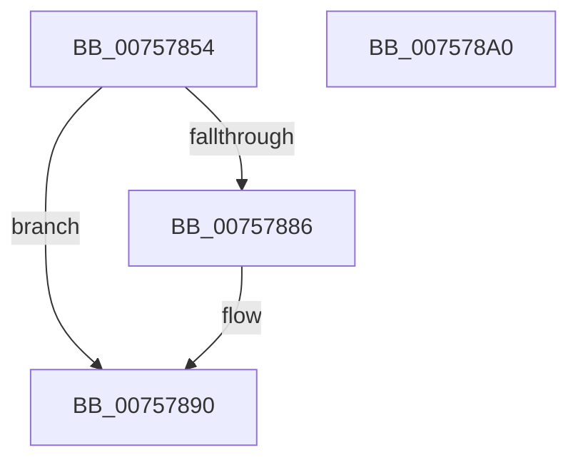

# PopUnregisterCoolingNotification

- RVA: `0x00757854`–`0x007578A1` (길이 `77` bytes)
- VA: `0x0000000140757854`
- 실행 섹션: `PAGE`
- PDB 이름 있음: `예`; PDB Function 태그: `아니요`
- unwind 정보 RVA: `0x00060BC4`
- 디코드: `22`개 명령, `77/77` bytes 표시
- 미해석 바이트: `0` (있으면 어셈블리에 `.byte`로 보존)

> 이 문서는 커널 이미지의 기계어와 PDB 기호를 분석해 생성했습니다. 4번과 5번은 함수 원형과 자료형을 바이너리 사용 방식에서 추정한 C 해석이며 원본 소스 복구 결과는 아닙니다.

## 1. Dependencies

- 직접 호출 지점: **3**; 고유 호출 대상: **3**
- 직접 호출자로 확인된 함수: **2**
- RIP 상대 이미지 참조: **0**

### Outgoing calls
- `0x0075786A` → [PopAcquireRwLockExclusive](../../text/43/PopAcquireRwLockExclusive_function_00430B44.md) (function, `0x00430B44`)
- `0x0075787C` → [PopReleaseRwLock](../../text/2D/PopReleaseRwLock_function_002DFBBC.md) (function, `0x002DFBBC`)
- `0x0075788B` → [PnpUnregisterPlugPlayNotification](../../text/47/PnpUnregisterPlugPlayNotification_function_0047AFAC.md) (function, `0x0047AFAC`)

### Direct callers
- [PopCoolingExtensionPnpNotification](PopCoolingExtensionPnpNotification_function_00757110.md) at `0x0075716F`
- [PopCleanCoolingExtension](../AD/PopCleanCoolingExtension_function_00ADF580.md) at `0x00ADF595`

### Static image references
- 디코드된 RIP-relative 메모리 참조가 없습니다.

## 2. Other-region calls and transfers

- 다른 실행 섹션으로 향하는 call: **3**
  - `0x0075786A` → [PopAcquireRwLockExclusive](../../text/43/PopAcquireRwLockExclusive_function_00430B44.md) (`PAGE` → `.text`)
  - `0x0075787C` → [PopReleaseRwLock](../../text/2D/PopReleaseRwLock_function_002DFBBC.md) (`PAGE` → `.text`)
  - `0x0075788B` → [PnpUnregisterPlugPlayNotification](../../text/47/PnpUnregisterPlugPlayNotification_function_0047AFAC.md) (`PAGE` → `.text`)
- 별도 외부 분기/꼬리 이동을 확인하지 못했습니다.

## 3. Assembly (complete function range)

```asm
00757854  48 89 5C 24 08                  mov qword ptr [rsp + 8], rbx
00757859  48 89 74 24 10                  mov qword ptr [rsp + 0x10], rsi
0075785E  57                              push rdi
0075785F  48 83 EC 20                     sub rsp, 0x20
00757863  48 8B F9                        mov rdi, rcx
00757866  48 83 C1 20                     add rcx, 0x20
0075786A  E8 D5 92 CD FF                  call 0x140430b44
0075786F  48 8B 77 48                     mov rsi, qword ptr [rdi + 0x48]
00757873  48 8D 4F 20                     lea rcx, [rdi + 0x20]
00757877  48 83 67 48 00                  and qword ptr [rdi + 0x48], 0
0075787C  E8 3B 83 B8 FF                  call 0x1402dfbbc
00757881  48 85 F6                        test rsi, rsi
00757884  74 0A                           je 0x140757890
00757886  B2 01                           mov dl, 1
00757888  48 8B CE                        mov rcx, rsi
0075788B  E8 1C 37 D2 FF                  call 0x14047afac
00757890  48 8B 5C 24 30                  mov rbx, qword ptr [rsp + 0x30]
00757895  48 8B 74 24 38                  mov rsi, qword ptr [rsp + 0x38]
0075789A  48 83 C4 20                     add rsp, 0x20
0075789E  5F                              pop rdi
0075789F  C3                              ret
007578A0  CC                              int3
```

## 4. C-style interpretation (structured pseudocode)

```c
__int64 __fastcall PopUnregisterCoolingNotification(__int64 a1)
{
    __int64 result;
    __int64 v_rsp;
    unsigned __int64 v_stack_p10;
    unsigned __int64 v_stack_p8;

    v_stack_p8 = v_rbx;
    v_stack_p10 = v_rsi;
    v_rsp = (v_rsp) - (32);
    a1 = (a1) + (32);
    result = PopAcquireRwLockExclusive(a1, a2, a3, a4);
    result = PopReleaseRwLock(a1 + 32, a2, a3, a4);
    if (*(unsigned __int64 *)(a1 + 72) != 0) {
        a2 = 1;
        a1 = *(unsigned __int64 *)(a1 + 72);
        result = PnpUnregisterPlugPlayNotification(a1, a2, a3, a4);
    }
    v_rsp = (v_rsp) + (32);
    return result;
}
```

## 5. (Beta) C Style

```c
int64_t PopUnregisterCoolingNotification(void *Arg1)
{
    uint8_t *arg1 = (uint8_t *)Arg1;

    int64_t result;
    int64_t local_rsp;
    uint64_t v_stack_p10;
    uint64_t v_stack_p8;

    v_stack_p8 = local_rbx;
    v_stack_p10 = local_rsi;
    local_rsp = (local_rsp) - (32);
    Arg1 = (Arg1) + (32);
    result = PopAcquireRwLockExclusive(Arg1, a2, a3, a4);
    result = PopReleaseRwLock(Arg1 + 32, a2, a3, a4);
    if (*(uint64_t *)(arg1 + 0x48) != 0) {
        a2 = 1;
        Arg1 = *(uint64_t *)(arg1 + 0x48);
        result = PnpUnregisterPlugPlayNotification(Arg1, a2, a3, a4);
    }
    local_rsp = (local_rsp) + (32);
    return result;
}
```

### 관측된 메모리 오프셋

구조체 형식이 확인되지 않은 접근은 인자 기준의 오프셋으로만 기록했습니다.

| 기준 인자 | 오프셋 표현 | 폭 (bit) | 접근 |
|---|---:|---:|---|
| `Arg1` | `+ 0x20` | `64` | `R` |
| `Arg1` | `+ 0x48` | `64` | `R` |
| `Arg1` | `+ 0x48` | `64` | `R/W` |

## 6. Execution-region graph

[열기: 2D/3D 그래프와 함수 탐색 컨트롤 패널](../../../control-panel.html?section=page&rva=0x00757854&view=graph)

- 2D 그래프는 위에서 아래로 흐르고, 3D 그래프는 빈 공간을 드래그해 회전합니다. Shift+드래그는 이동, 휠은 확대·축소, 함수 노드 선택은 대상 보고서 이동입니다.

### Static fallback


