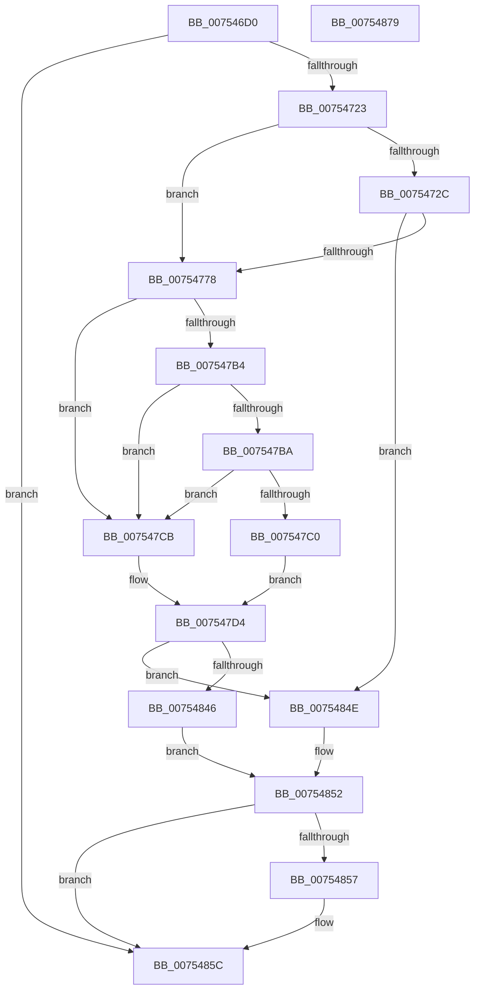

# PopUpdateDeviceFamily

- RVA: `0x007546D0`–`0x0075487A` (길이 `426` bytes)
- VA: `0x00000001407546D0`
- 실행 섹션: `PAGE`
- PDB 이름 있음: `예`; PDB Function 태그: `아니요`
- unwind 정보 RVA: `0x000CBE18`
- 디코드: `99`개 명령, `426/426` bytes 표시
- 미해석 바이트: `0` (있으면 어셈블리에 `.byte`로 보존)

> 이 문서는 커널 이미지의 기계어와 PDB 기호를 분석해 생성했습니다. 4번과 5번은 함수 원형과 자료형을 바이너리 사용 방식에서 추정한 C 해석이며 원본 소스 복구 결과는 아닙니다.

## 1. Dependencies

- 직접 호출 지점: **9**; 고유 호출 대상: **8**
- 직접 호출자로 확인된 함수: **1**
- RIP 상대 이미지 참조: **11**

### Outgoing calls
- `0x00754716` → [Feature_Servicing_GamingHandheldPowBtnFilter__private_IsEnabledDeviceUsageNoInline](../../text/5C/Feature_Servicing_GamingHandheldPowBtnFilter__private_IsEnabledDeviceUsageNoInline_function_005CE2F4.md) (function, `0x005CE2F4`)
- `0x00754737` → [RtlInitUnicodeString](../../text/42/RtlInitUnicodeString_function_0042A780.md) (function, `0x0042A780`)
- `0x0075476B` → [ZwOpenKey](../../text/6A/ZwOpenKey_function_006AD310.md) (function, `0x006AD310`)
- `0x00754783` → [RtlInitUnicodeString](../../text/42/RtlInitUnicodeString_function_0042A780.md) (function, `0x0042A780`)
- `0x007547AB` → [ZwQueryValueKey](../../text/6A/ZwQueryValueKey_function_006AD3B0.md) (function, `0x006AD3B0`)
- `0x007547DF` → [PopPowerButtonSuppressionUpdateDisableReason](../76/PopPowerButtonSuppressionUpdateDisableReason_function_00765AD8.md) (function, `0x00765AD8`)
- `0x0075483D` → [ZwNotifyChangeKey](../../text/6A/ZwNotifyChangeKey_function_006AF550.md) (function, `0x006AF550`)
- `0x00754857` → [ZwClose](../../text/6A/ZwClose_function_006AD2B0.md) (function, `0x006AD2B0`)
- `0x00754863` → [_security_check_cookie](../../text/6A/_security_check_cookie_function_006AC640.md) (function, `0x006AC640`)

### Direct callers
- [PoInitHiberServices](PoInitHiberServices_function_007537C4.md) at `0x007538BA`

### Static image references
- `0x007546E2` → RVA `0x00E0A740` (`.data`; read)
- `0x0075472C` → RVA `0x00B01B00` (` ?? ::NNGAKEGL::`string'`; read)
- `0x00754778` → RVA `0x00B01AE0` (` ?? ::NNGAKEGL::`string'`; read)
- `0x007547C3` → RVA `0x00F0F040` (`.data`; write)
- `0x007547CB` → RVA `0x00F0F040` (`.data`; read/write)
- `0x007547E8` → RVA `0x007546D0` (`PopUpdateDeviceFamily`; read)
- `0x007547EF` → RVA `0x00F0F060` (`.data`; read/write)
- `0x007547F7` → RVA `0x00F0F060` (`.data`; read)
- `0x00754816` → RVA `0x00F0F070` (`.data`; write)
- `0x0075481D` → RVA `0x00F0F050` (`.data`; read)
- `0x00754836` → RVA `0x00F0F078` (`.data`; write)

## 2. Other-region calls and transfers

- 다른 실행 섹션으로 향하는 call: **8**
  - `0x00754716` → [Feature_Servicing_GamingHandheldPowBtnFilter__private_IsEnabledDeviceUsageNoInline](../../text/5C/Feature_Servicing_GamingHandheldPowBtnFilter__private_IsEnabledDeviceUsageNoInline_function_005CE2F4.md) (`PAGE` → `.text`)
  - `0x00754737` → [RtlInitUnicodeString](../../text/42/RtlInitUnicodeString_function_0042A780.md) (`PAGE` → `.text`)
  - `0x0075476B` → [ZwOpenKey](../../text/6A/ZwOpenKey_function_006AD310.md) (`PAGE` → `.text`)
  - `0x00754783` → [RtlInitUnicodeString](../../text/42/RtlInitUnicodeString_function_0042A780.md) (`PAGE` → `.text`)
  - `0x007547AB` → [ZwQueryValueKey](../../text/6A/ZwQueryValueKey_function_006AD3B0.md) (`PAGE` → `.text`)
  - `0x0075483D` → [ZwNotifyChangeKey](../../text/6A/ZwNotifyChangeKey_function_006AF550.md) (`PAGE` → `.text`)
  - `0x00754857` → [ZwClose](../../text/6A/ZwClose_function_006AD2B0.md) (`PAGE` → `.text`)
  - `0x00754863` → [_security_check_cookie](../../text/6A/_security_check_cookie_function_006AC640.md) (`PAGE` → `.text`)
- 별도 외부 분기/꼬리 이동을 확인하지 못했습니다.

## 3. Assembly (complete function range)

```asm
007546D0  48 89 5C 24 10                  mov qword ptr [rsp + 0x10], rbx
007546D5  55                              push rbp
007546D6  48 8D 6C 24 A9                  lea rbp, [rsp - 0x57]
007546DB  48 81 EC C0 00 00 00            sub rsp, 0xc0
007546E2  48 8B 05 57 60 6B 00            mov rax, qword ptr [rip + 0x6b6057]
007546E9  48 33 C4                        xor rax, rsp
007546EC  48 89 45 4F                     mov qword ptr [rbp + 0x4f], rax
007546F0  83 65 EF 00                     and dword ptr [rbp - 0x11], 0
007546F4  0F 57 C0                        xorps xmm0, xmm0
007546F7  33 C0                           xor eax, eax
007546F9  48 8B D9                        mov rbx, rcx
007546FC  48 89 45 27                     mov qword ptr [rbp + 0x27], rax
00754700  89 45 2F                        mov dword ptr [rbp + 0x2f], eax
00754703  89 45 47                        mov dword ptr [rbp + 0x47], eax
00754706  0F 11 45 07                     movups xmmword ptr [rbp + 7], xmm0
0075470A  0F 11 45 17                     movups xmmword ptr [rbp + 0x17], xmm0
0075470E  0F 11 45 37                     movups xmmword ptr [rbp + 0x37], xmm0
00754712  0F 11 45 F7                     movups xmmword ptr [rbp - 9], xmm0
00754716  E8 D9 9B E7 FF                  call 0x1405ce2f4
0075471B  85 C0                           test eax, eax
0075471D  0F 84 39 01 00 00               je 0x14075485c
00754723  48 89 5D E7                     mov qword ptr [rbp - 0x19], rbx
00754727  48 85 DB                        test rbx, rbx
0075472A  75 4C                           jne 0x140754778
0075472C  48 8D 15 CD D3 3A 00            lea rdx, [rip + 0x3ad3cd]
00754733  48 8D 4D F7                     lea rcx, [rbp - 9]
00754737  E8 44 60 CD FF                  call 0x14042a780
0075473C  48 21 5D 0F                     and qword ptr [rbp + 0xf], rbx
00754740  48 8D 45 F7                     lea rax, [rbp - 9]
00754744  0F 57 C0                        xorps xmm0, xmm0
00754747  48 89 45 17                     mov qword ptr [rbp + 0x17], rax
0075474B  4C 8D 45 07                     lea r8, [rbp + 7]
0075474F  C7 45 07 30 00 00 00            mov dword ptr [rbp + 7], 0x30
00754756  BA 19 01 02 00                  mov edx, 0x20119
0075475B  C7 45 1F 40 02 00 00            mov dword ptr [rbp + 0x1f], 0x240
00754762  48 8D 4D E7                     lea rcx, [rbp - 0x19]
00754766  F3 0F 7F 45 27                  movdqu xmmword ptr [rbp + 0x27], xmm0
0075476B  E8 A0 8B F5 FF                  call 0x1406ad310
00754770  85 C0                           test eax, eax
00754772  0F 88 D6 00 00 00               js 0x14075484e
00754778  48 8D 15 61 D3 3A 00            lea rdx, [rip + 0x3ad361]
0075477F  48 8D 4D F7                     lea rcx, [rbp - 9]
00754783  E8 F8 5F CD FF                  call 0x14042a780
00754788  48 8B 4D E7                     mov rcx, qword ptr [rbp - 0x19]
0075478C  48 8D 45 EF                     lea rax, [rbp - 0x11]
00754790  48 89 44 24 28                  mov qword ptr [rsp + 0x28], rax
00754795  4C 8D 4D 37                     lea r9, [rbp + 0x37]
00754799  41 B8 02 00 00 00               mov r8d, 2
0075479F  C7 44 24 20 14 00 00 00         mov dword ptr [rsp + 0x20], 0x14
007547A7  48 8D 55 F7                     lea rdx, [rbp - 9]
007547AB  E8 00 8C F5 FF                  call 0x1406ad3b0
007547B0  85 C0                           test eax, eax
007547B2  78 17                           js 0x1407547cb
007547B4  83 7D 3B 04                     cmp dword ptr [rbp + 0x3b], 4
007547B8  75 11                           jne 0x1407547cb
007547BA  83 7D 3F 04                     cmp dword ptr [rbp + 0x3f], 4
007547BE  75 0B                           jne 0x1407547cb
007547C0  8B 45 43                        mov eax, dword ptr [rbp + 0x43]
007547C3  89 05 77 A8 7B 00               mov dword ptr [rip + 0x7ba877], eax
007547C9  EB 09                           jmp 0x1407547d4
007547CB  83 25 6E A8 7B 00 00            and dword ptr [rip + 0x7ba86e], 0
007547D2  33 C0                           xor eax, eax
007547D4  83 F8 2E                        cmp eax, 0x2e
007547D7  B9 06 00 00 00                  mov ecx, 6
007547DC  0F 94 C2                        sete dl
007547DF  E8 F4 12 01 00                  call 0x140765ad8
007547E4  48 8B 4D E7                     mov rcx, qword ptr [rbp - 0x19]
007547E8  48 8D 05 E1 FE FF FF            lea rax, [rip - 0x11f]
007547EF  48 83 25 69 A8 7B 00 00         and qword ptr [rip + 0x7ba869], 0
007547F7  4C 8D 05 62 A8 7B 00            lea r8, [rip + 0x7ba862]
007547FE  C6 44 24 48 01                  mov byte ptr [rsp + 0x48], 1
00754803  41 B9 01 00 00 00               mov r9d, 1
00754809  83 64 24 40 00                  and dword ptr [rsp + 0x40], 0
0075480E  33 D2                           xor edx, edx
00754810  48 83 64 24 38 00               and qword ptr [rsp + 0x38], 0
00754816  48 89 05 53 A8 7B 00            mov qword ptr [rip + 0x7ba853], rax
0075481D  48 8D 05 2C A8 7B 00            lea rax, [rip + 0x7ba82c]
00754824  C6 44 24 30 00                  mov byte ptr [rsp + 0x30], 0
00754829  C7 44 24 28 04 00 00 00         mov dword ptr [rsp + 0x28], 4
00754831  48 89 44 24 20                  mov qword ptr [rsp + 0x20], rax
00754836  48 89 0D 3B A8 7B 00            mov qword ptr [rip + 0x7ba83b], rcx
0075483D  E8 0E AD F5 FF                  call 0x1406af550
00754842  85 C0                           test eax, eax
00754844  78 08                           js 0x14075484e
00754846  33 C9                           xor ecx, ecx
00754848  48 89 4D E7                     mov qword ptr [rbp - 0x19], rcx
0075484C  EB 04                           jmp 0x140754852
0075484E  48 8B 4D E7                     mov rcx, qword ptr [rbp - 0x19]
00754852  48 85 C9                        test rcx, rcx
00754855  74 05                           je 0x14075485c
00754857  E8 54 8A F5 FF                  call 0x1406ad2b0
0075485C  48 8B 4D 4F                     mov rcx, qword ptr [rbp + 0x4f]
00754860  48 33 CC                        xor rcx, rsp
00754863  E8 D8 7D F5 FF                  call 0x1406ac640
00754868  48 8B 9C 24 D8 00 00 00         mov rbx, qword ptr [rsp + 0xd8]
00754870  48 81 C4 C0 00 00 00            add rsp, 0xc0
00754877  5D                              pop rbp
00754878  C3                              ret
00754879  CC                              int3
```

## 4. C-style interpretation (structured pseudocode)

```c
__int64 __fastcall PopUpdateDeviceFamily(__int64 a1)
{
    __int64 result;
    __int64 v_rsp;
    unsigned __int64 v_stack_m10;
    unsigned int v_stack_m18;
    unsigned int v_stack_m1C;
    unsigned int v_stack_m20;
    unsigned int v_stack_m24;
    unsigned __int64 v_stack_m28;
    unsigned int v_stack_m30;
    unsigned __int64 v_stack_m38;
    unsigned int v_stack_m40;
    unsigned __int64 v_stack_m48;
    unsigned __int64 v_stack_m50;
    unsigned __int64 v_stack_m58;
    unsigned __int64 v_stack_m5F;
    unsigned __int64 v_stack_m68;
    unsigned int v_stack_m70;
    unsigned __int64 v_stack_m78;
    unsigned __int8 v_stack_m80;
    unsigned int v_stack_m88;
    unsigned __int64 v_stack_m90;
    unsigned __int8 v_stack_m98;
    unsigned __int64 v_stack_mA0;
    unsigned int v_stack_mA8;
    unsigned __int64 v_stack_p10;

    v_stack_p10 = v_rbx;
    v_rsp = (v_rsp) - (192);
    result = (*(unsigned __int64 *)(v_rip + 7037015)) ^ (v_rsp);
    v_stack_m10 = result;
    result = 0;
    v_stack_m38 = 0;
    v_stack_m30 = 0;
    v_stack_m18 = 0;
    v_stack_m58 = v_xmm0;
    v_stack_m48 = v_xmm0;
    v_stack_m28 = v_xmm0;
    v_stack_m68 = v_xmm0;
    result = Feature_Servicing_GamingHandheldPowBtnFilter__private_IsEnabledDeviceUsageNoInline(a1, a2, a3, a4);
    if ((unsigned int)(result) == 0) goto loc_0075485C;
    v_stack_m78 = a1;
    if (a1 != 0) goto loc_00754778;
    result = RtlInitUnicodeString(v_stack_m68, v_rip + 3855309, a3, a4);
    v_stack_m48 = v_stack_m68;
    v_stack_m58 = 48;
    v_stack_m40 = 576;
    v_stack_m38 = v_xmm0;
    result = ZwOpenKey(v_stack_m78, (unsigned int)(0x20119ULL), v_stack_m58, a4);
    if (sign_flag) goto loc_0075484E;
loc_00754778:
    result = RtlInitUnicodeString(v_stack_m68, v_rip + 3855201, v_stack_m58, a4);
    v_stack_mA0 = v_stack_m70;
    v_stack_mA8 = 20;
    result = ZwQueryValueKey(v_stack_m78, v_stack_m68, 2, v_stack_m28);
    if (sign_flag) goto loc_007547CB;
    if (v_stack_m24 != 4) goto loc_007547CB;
    if (v_stack_m20 != 4) goto loc_007547CB;
    *(unsigned int *)(v_rip + 8104055) = (unsigned int)((unsigned int)(v_stack_m1C));
    goto loc_007547D4;
loc_007547CB:
    result = 0;
loc_007547D4:
    a2 = (0 == 46) ? 1 : 0;
    result = PopPowerButtonSuppressionUpdateDisableReason(6, a2, 2, v_stack_m28);
    v_stack_m80 = 1;
    a2 = 0;
    *(unsigned __int64 *)(v_rip + 8104019) = v_rip - 287;
    v_stack_m98 = 0;
    v_stack_mA0 = 4;
    v_stack_mA8 = v_rip + 8103980;
    *(unsigned __int64 *)(v_rip + 8103995) = v_stack_m78;
    result = ZwNotifyChangeKey(v_stack_m78, a2, v_rip + 8104034, 1);
    if (sign_flag) goto loc_0075484E;
    a1 = 0;
    v_stack_m78 = 0;
    goto loc_00754852;
loc_0075484E:
loc_00754852:
    if (v_stack_m78 != 0) {
        result = ZwClose(v_stack_m78, a2, v_rip + 8104034, 1);
    }
    a1 = (v_stack_m10) ^ (v_rsp);
    result = _security_check_cookie(a1, a2, v_rip + 8104034, 1);
    v_rsp = (v_rsp) + (192);
    return result;
}
```

## 5. (Beta) C Style

```c
int64_t PopUpdateDeviceFamily(int64_t Arg1)
{
    int64_t result;
    int64_t local_rsp;
    uint64_t v_stack_m10;
    uint32_t v_stack_m18;
    uint32_t v_stack_m1C;
    uint32_t v_stack_m20;
    uint32_t v_stack_m24;
    uint64_t v_stack_m28;
    uint32_t v_stack_m30;
    uint64_t v_stack_m38;
    uint32_t v_stack_m40;
    uint64_t v_stack_m48;
    uint64_t v_stack_m50;
    uint64_t v_stack_m58;
    uint64_t v_stack_m5F;
    uint64_t v_stack_m68;
    uint32_t v_stack_m70;
    uint64_t v_stack_m78;
    uint8_t v_stack_m80;
    uint32_t v_stack_m88;
    uint64_t v_stack_m90;
    uint8_t v_stack_m98;
    uint64_t v_stack_mA0;
    uint32_t v_stack_mA8;
    uint64_t v_stack_p10;

    v_stack_p10 = local_rbx;
    local_rsp = (local_rsp) - (192);
    result = (*(uint64_t *)(v_rip + 0x6B6057)) ^ (local_rsp);
    v_stack_m10 = result;
    result = 0;
    v_stack_m38 = 0;
    v_stack_m30 = 0;
    v_stack_m18 = 0;
    v_stack_m58 = v_xmm0;
    v_stack_m48 = v_xmm0;
    v_stack_m28 = v_xmm0;
    v_stack_m68 = v_xmm0;
    result = Feature_Servicing_GamingHandheldPowBtnFilter__private_IsEnabledDeviceUsageNoInline(Arg1, a2, a3, a4);
    if ((uint32_t)(result) == 0) goto loc_0075485C;
    v_stack_m78 = Arg1;
    if (Arg1 != 0) goto loc_00754778;
    result = RtlInitUnicodeString(v_stack_m68, v_rip + 3855309, a3, a4);
    v_stack_m48 = v_stack_m68;
    v_stack_m58 = 48;
    v_stack_m40 = 576;
    v_stack_m38 = v_xmm0;
    result = ZwOpenKey(v_stack_m78, (uint32_t)(0x20119ULL), v_stack_m58, a4);
    if (sign_flag) goto loc_0075484E;
loc_00754778:
    result = RtlInitUnicodeString(v_stack_m68, v_rip + 3855201, v_stack_m58, a4);
    v_stack_mA0 = v_stack_m70;
    v_stack_mA8 = 20;
    result = ZwQueryValueKey(v_stack_m78, v_stack_m68, 2, v_stack_m28);
    if (sign_flag) goto loc_007547CB;
    if (v_stack_m24 != 4) goto loc_007547CB;
    if (v_stack_m20 != 4) goto loc_007547CB;
    *(uint32_t *)(v_rip + 0x7BA877) = (uint32_t)((uint32_t)(v_stack_m1C));
    goto loc_007547D4;
loc_007547CB:
    result = 0;
loc_007547D4:
    a2 = (0 == 46) ? 1 : 0;
    result = PopPowerButtonSuppressionUpdateDisableReason(6, a2, 2, v_stack_m28);
    v_stack_m80 = 1;
    a2 = 0;
    *(uint64_t *)(v_rip + 0x7BA853) = v_rip - 287;
    v_stack_m98 = 0;
    v_stack_mA0 = 4;
    v_stack_mA8 = v_rip + 8103980;
    *(uint64_t *)(v_rip + 0x7BA83B) = v_stack_m78;
    result = ZwNotifyChangeKey(v_stack_m78, a2, v_rip + 8104034, 1);
    if (sign_flag) goto loc_0075484E;
    Arg1 = 0;
    v_stack_m78 = 0;
    goto loc_00754852;
loc_0075484E:
loc_00754852:
    if (v_stack_m78 != 0) {
        result = ZwClose(v_stack_m78, a2, v_rip + 8104034, 1);
    }
    Arg1 = (v_stack_m10) ^ (local_rsp);
    result = _security_check_cookie(Arg1, a2, v_rip + 8104034, 1);
    local_rsp = (local_rsp) + (192);
    return result;
}
```

## 6. Execution-region graph

[열기: 2D/3D 그래프와 함수 탐색 컨트롤 패널](../../../control-panel.html?section=page&rva=0x007546D0&view=graph)

- 2D 그래프는 위에서 아래로 흐르고, 3D 그래프는 빈 공간을 드래그해 회전합니다. Shift+드래그는 이동, 휠은 확대·축소, 함수 노드 선택은 대상 보고서 이동입니다.

### Static fallback


