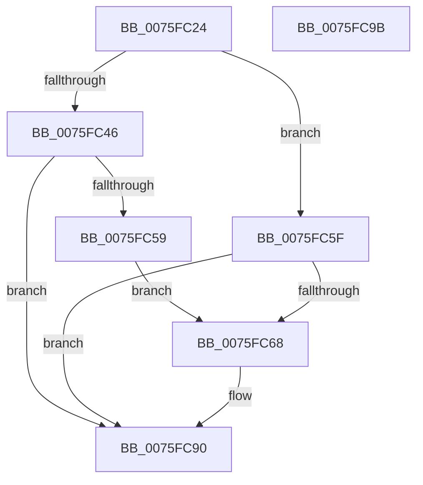

# PopUpdateOverThrottledCount

- RVA: `0x0075FC24`–`0x0075FC9C` (길이 `120` bytes)
- VA: `0x000000014075FC24`
- 실행 섹션: `PAGE`
- PDB 이름 있음: `예`; PDB Function 태그: `아니요`
- unwind 정보 RVA: `0x000697A4`
- 디코드: `32`개 명령, `120/120` bytes 표시
- 미해석 바이트: `0` (있으면 어셈블리에 `.byte`로 보존)

> 이 문서는 커널 이미지의 기계어와 PDB 기호를 분석해 생성했습니다. 4번과 5번은 함수 원형과 자료형을 바이너리 사용 방식에서 추정한 C 해석이며 원본 소스 복구 결과는 아닙니다.

## 1. Dependencies

- 직접 호출 지점: **4**; 고유 호출 대상: **4**
- 직접 호출자로 확인된 함수: **2**
- RIP 상대 이미지 참조: **4**

### Outgoing calls
- `0x0075FC38` → [PopDiagTraceThermalOverthrottleState](../../text/5D/PopDiagTraceThermalOverthrottleState_function_005D6FF4.md) (function, `0x005D6FF4`)
- `0x0075FC3D` → [PopAcquirePolicyLock](../../pagelk/B7/PopAcquirePolicyLock_function_00B783C0.md) (function, `0x00B783C0`)
- `0x0075FC8B` → [ZwUpdateWnfStateData](../../text/6B/ZwUpdateWnfStateData_function_006B0D10.md) (function, `0x006B0D10`)
- `0x0075FC90` → [PopReleasePolicyLock](../../pagelk/B7/PopReleasePolicyLock_function_00B78410.md) (function, `0x00B78410`)

### Direct callers
- [PopCheckAndHandleThermalConditions](../../text/4A/PopCheckAndHandleThermalConditions_function_004A8C00.md) at `0x004A8D19`
- [PopThermalZoneRemove](PopThermalZoneRemove_function_0075FAD0.md) at `0x0075FBB9`

### Static image references
- `0x0075FC46` → RVA `0x00F0BB28` (`.data`; read)
- `0x0075FC4E` → RVA `0x00F0BB28` (`.data`; write)
- `0x0075FC5F` → RVA `0x00F0BB28` (`.data`; read/write)
- `0x0075FC77` → RVA `0x000208F8` (`.rdata`; read)

## 2. Other-region calls and transfers

- 다른 실행 섹션으로 향하는 call: **4**
  - `0x0075FC38` → [PopDiagTraceThermalOverthrottleState](../../text/5D/PopDiagTraceThermalOverthrottleState_function_005D6FF4.md) (`PAGE` → `.text`)
  - `0x0075FC3D` → [PopAcquirePolicyLock](../../pagelk/B7/PopAcquirePolicyLock_function_00B783C0.md) (`PAGE` → `PAGELK`)
  - `0x0075FC8B` → [ZwUpdateWnfStateData](../../text/6B/ZwUpdateWnfStateData_function_006B0D10.md) (`PAGE` → `.text`)
  - `0x0075FC90` → [PopReleasePolicyLock](../../pagelk/B7/PopReleasePolicyLock_function_00B78410.md) (`PAGE` → `PAGELK`)
- 별도 외부 분기/꼬리 이동을 확인하지 못했습니다.

## 3. Assembly (complete function range)

```asm
0075FC24  40 53                           push rbx
0075FC26  48 83 EC 40                     sub rsp, 0x40
0075FC2A  48 8B 49 30                     mov rcx, qword ptr [rcx + 0x30]
0075FC2E  83 64 24 58 00                  and dword ptr [rsp + 0x58], 0
0075FC33  0F B6 DA                        movzx ebx, dl
0075FC36  8B D3                           mov edx, ebx
0075FC38  E8 B7 73 E7 FF                  call 0x1405d6ff4
0075FC3D  E8 7E 87 41 00                  call 0x140b783c0
0075FC42  84 DB                           test bl, bl
0075FC44  74 19                           je 0x14075fc5f
0075FC46  8B 05 DC BE 7A 00               mov eax, dword ptr [rip + 0x7abedc]
0075FC4C  FF C0                           inc eax
0075FC4E  89 05 D4 BE 7A 00               mov dword ptr [rip + 0x7abed4], eax
0075FC54  83 F8 01                        cmp eax, 1
0075FC57  75 37                           jne 0x14075fc90
0075FC59  89 44 24 58                     mov dword ptr [rsp + 0x58], eax
0075FC5D  EB 09                           jmp 0x14075fc68
0075FC5F  83 05 C2 BE 7A 00 FF            add dword ptr [rip + 0x7abec2], -1
0075FC66  75 28                           jne 0x14075fc90
0075FC68  83 64 24 30 00                  and dword ptr [rsp + 0x30], 0
0075FC6D  48 8D 54 24 58                  lea rdx, [rsp + 0x58]
0075FC72  83 64 24 28 00                  and dword ptr [rsp + 0x28], 0
0075FC77  48 8D 0D 7A 0C 8C FF            lea rcx, [rip - 0x73f386]
0075FC7E  48 83 64 24 20 00               and qword ptr [rsp + 0x20], 0
0075FC84  45 33 C9                        xor r9d, r9d
0075FC87  45 8D 41 04                     lea r8d, [r9 + 4]
0075FC8B  E8 80 10 F5 FF                  call 0x1406b0d10
0075FC90  E8 7B 87 41 00                  call 0x140b78410
0075FC95  48 83 C4 40                     add rsp, 0x40
0075FC99  5B                              pop rbx
0075FC9A  C3                              ret
0075FC9B  CC                              int3
```

## 4. C-style interpretation (structured pseudocode)

```c
__int64 __fastcall PopUpdateOverThrottledCount(__int64 a1, unsigned __int8 a2, __int64 a3, int a4)
{
    __int64 result;
    __int64 v_rsp;
    unsigned int v_stack_m18;
    unsigned int v_stack_m20;
    unsigned __int64 v_stack_m28;
    unsigned int v_stack_p10;

    v_rsp = (v_rsp) - (64);
    result = PopDiagTraceThermalOverthrottleState(*(unsigned __int64 *)(a1 + 48), (unsigned int)(a2), a3, a4);
    result = PopAcquirePolicyLock(*(unsigned __int64 *)(a1 + 48), (unsigned int)(a2), a3, a4);
    if (a2 == 0) goto loc_0075FC5F;
    result = (unsigned int)(((unsigned int)(*(unsigned int *)(v_rip + 8044252))) + 1);
    *(unsigned int *)(v_rip + 8044244) = (unsigned int)(result);
    if (((unsigned int)(result)) != 1) goto loc_0075FC90;
    v_stack_p10 = (unsigned int)(result);
    goto loc_0075FC68;
loc_0075FC5F:
    if (((unsigned int)(result)) == 1) {
        a2 = v_stack_p10;
        a1 = v_rip - 7598982;
        a4 = 0;
        a3 = a4 + 4;
        result = ZwUpdateWnfStateData(a1, a2, a3, a4);
    }
    result = PopReleasePolicyLock(a1, a2, a3, a4);
    v_rsp = (v_rsp) + (64);
    return result;
}
```

## 5. (Beta) C Style

```c
int64_t PopUpdateOverThrottledCount(void *Arg1, uint8_t Arg2, int64_t Arg3, int32_t Arg4)
{
    uint8_t *arg1 = (uint8_t *)Arg1;

    int64_t result;
    int64_t local_rsp;
    uint32_t v_stack_m18;
    uint32_t v_stack_m20;
    uint64_t v_stack_m28;
    uint32_t v_stack_p10;

    local_rsp = (local_rsp) - (64);
    result = PopDiagTraceThermalOverthrottleState(*(uint64_t *)(arg1 + 0x30), (uint32_t)(Arg2), Arg3, Arg4);
    result = PopAcquirePolicyLock(*(uint64_t *)(arg1 + 0x30), (uint32_t)(Arg2), Arg3, Arg4);
    if (Arg2 == 0) goto loc_0075FC5F;
    result = (uint32_t)(((uint32_t)(*(uint32_t *)(v_rip + 0x7ABEDC))) + 1);
    *(uint32_t *)(v_rip + 0x7ABED4) = (uint32_t)(result);
    if (((uint32_t)(result)) != 1) goto loc_0075FC90;
    v_stack_p10 = (uint32_t)(result);
    goto loc_0075FC68;
loc_0075FC5F:
    if (((uint32_t)(result)) == 1) {
        Arg2 = v_stack_p10;
        Arg1 = v_rip - 7598982;
        Arg4 = 0;
        Arg3 = Arg4 + 4;
        result = ZwUpdateWnfStateData(Arg1, Arg2, Arg3, Arg4);
    }
    result = PopReleasePolicyLock(Arg1, Arg2, Arg3, Arg4);
    local_rsp = (local_rsp) + (64);
    return result;
}
```

### 관측된 메모리 오프셋

구조체 형식이 확인되지 않은 접근은 인자 기준의 오프셋으로만 기록했습니다.

| 기준 인자 | 오프셋 표현 | 폭 (bit) | 접근 |
|---|---:|---:|---|
| `Arg1` | `+ 0x30` | `64` | `R` |

## 6. Execution-region graph

[열기: 2D/3D 그래프와 함수 탐색 컨트롤 패널](../../../control-panel.html?section=page&rva=0x0075FC24&view=graph)

- 2D 그래프는 위에서 아래로 흐르고, 3D 그래프는 빈 공간을 드래그해 회전합니다. Shift+드래그는 이동, 휠은 확대·축소, 함수 노드 선택은 대상 보고서 이동입니다.

### Static fallback


