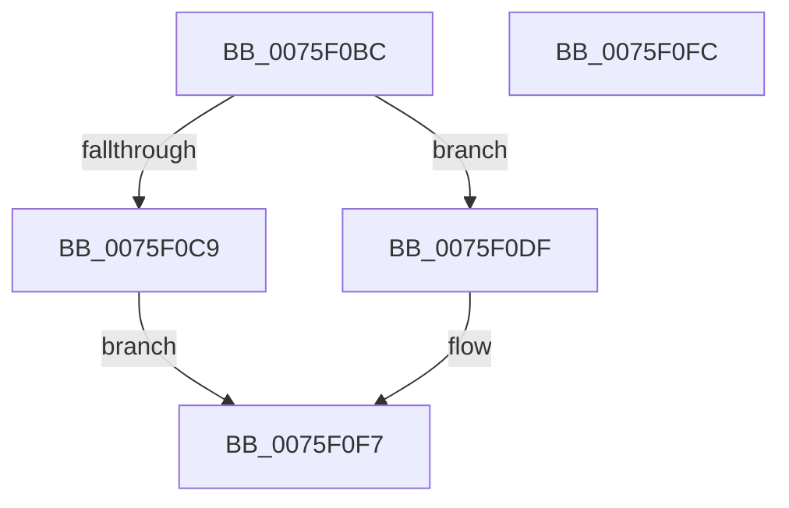

# PopUpdatePowerActionWatchdogTimeouts

- RVA: `0x0075F0BC`–`0x0075F0FD` (길이 `65` bytes)
- VA: `0x000000014075F0BC`
- 실행 섹션: `PAGE`
- PDB 이름 있음: `예`; PDB Function 태그: `아니요`
- unwind 정보 RVA: `0x0005C788`
- 디코드: `14`개 명령, `65/65` bytes 표시
- 미해석 바이트: `0` (있으면 어셈블리에 `.byte`로 보존)

> 이 문서는 커널 이미지의 기계어와 PDB 기호를 분석해 생성했습니다. 4번과 5번은 함수 원형과 자료형을 바이너리 사용 방식에서 추정한 C 해석이며 원본 소스 복구 결과는 아닙니다.

## 1. Dependencies

- 직접 호출 지점: **1**; 고유 호출 대상: **1**
- 직접 호출자로 확인된 함수: **1**
- RIP 상대 이미지 참조: **4**

### Outgoing calls
- `0x0075F0C0` → [PopIsDetailedSleepReliabilityDiagEnabled](../AC/PopIsDetailedSleepReliabilityDiagEnabled_function_00ACEEA4.md) (function, `0x00ACEEA4`)

### Direct callers
- [PopSetPowerActionWatchdogState](../../text/4C/PopSetPowerActionWatchdogState_function_004C86B8.md) at `0x004C86D2`

### Static image references
- `0x0075F0C9` → RVA `0x00FC6E44` (`ALMOSTRO`; write)
- `0x0075F0D3` → RVA `0x00FC6E48` (`ALMOSTRO`; write)
- `0x0075F0DF` → RVA `0x00FC5354` (`ALMOSTRO`; read)
- `0x0075F0EB` → RVA `0x00FC5358` (`ALMOSTRO`; read)

## 2. Other-region calls and transfers

- 다른 실행 섹션으로 향하는 call: **0**
- 별도 외부 분기/꼬리 이동을 확인하지 못했습니다.

## 3. Assembly (complete function range)

```asm
0075F0BC  48 83 EC 28                     sub rsp, 0x28
0075F0C0  E8 DF FD 36 00                  call 0x140aceea4
0075F0C5  84 C0                           test al, al
0075F0C7  74 16                           je 0x14075f0df
0075F0C9  C7 05 71 7D 86 00 4A 01 00 00   mov dword ptr [rip + 0x867d71], 0x14a
0075F0D3  C7 05 6B 7D 86 00 96 00 00 00   mov dword ptr [rip + 0x867d6b], 0x96
0075F0DD  EB 18                           jmp 0x14075f0f7
0075F0DF  8B 05 6F 62 86 00               mov eax, dword ptr [rip + 0x86626f]
0075F0E5  89 05 59 7D 86 00               mov dword ptr [rip + 0x867d59], eax
0075F0EB  8B 05 67 62 86 00               mov eax, dword ptr [rip + 0x866267]
0075F0F1  89 05 51 7D 86 00               mov dword ptr [rip + 0x867d51], eax
0075F0F7  48 83 C4 28                     add rsp, 0x28
0075F0FB  C3                              ret
0075F0FC  CC                              int3
```

## 4. C-style interpretation (structured pseudocode)

```c
__int64 __fastcall PopUpdatePowerActionWatchdogTimeouts(void)
{
    __int64 result;
    __int64 v_rsp;

    v_rsp = (v_rsp) - (40);
    result = PopIsDetailedSleepReliabilityDiagEnabled(a1, a2, a3, a4);
    if ((unsigned __int8)(result) == 0) goto loc_0075F0DF;
    *(unsigned int *)(v_rip + 8813937) = 330;
    *(unsigned int *)(v_rip + 8813931) = 150;
    goto loc_0075F0F7;
loc_0075F0DF:
    *(unsigned int *)(v_rip + 8813913) = (unsigned int)((unsigned int)(*(unsigned int *)(v_rip + 8807023)));
    *(unsigned int *)(v_rip + 8813905) = (unsigned int)((unsigned int)(*(unsigned int *)(v_rip + 8807015)));
loc_0075F0F7:
    v_rsp = (v_rsp) + (40);
    return (unsigned int)(*(unsigned int *)(v_rip + 8807015));
}
```

## 5. (Beta) C Style

```c
void PopUpdatePowerActionWatchdogTimeouts(void)
{
    int64_t result;
    int64_t local_rsp;

    local_rsp = (local_rsp) - (40);
    result = PopIsDetailedSleepReliabilityDiagEnabled(a1, a2, a3, a4);
    if ((uint8_t)(result) == 0) goto loc_0075F0DF;
    *(uint32_t *)(v_rip + 0x867D71) = 330;
    *(uint32_t *)(v_rip + 0x867D6B) = 150;
    goto loc_0075F0F7;
loc_0075F0DF:
    *(uint32_t *)(v_rip + 0x867D59) = (uint32_t)((uint32_t)(*(uint32_t *)(v_rip + 0x86626F)));
    *(uint32_t *)(v_rip + 0x867D51) = (uint32_t)((uint32_t)(*(uint32_t *)(v_rip + 0x866267)));
loc_0075F0F7:
    local_rsp = (local_rsp) + (40);
    return (uint32_t)(*(uint32_t *)(v_rip + 0x866267));
}
```

## 6. Execution-region graph

[열기: 2D/3D 그래프와 함수 탐색 컨트롤 패널](../../../control-panel.html?section=page&rva=0x0075F0BC&view=graph)

- 2D 그래프는 위에서 아래로 흐르고, 3D 그래프는 빈 공간을 드래그해 회전합니다. Shift+드래그는 이동, 휠은 확대·축소, 함수 노드 선택은 대상 보고서 이동입니다.

### Static fallback


