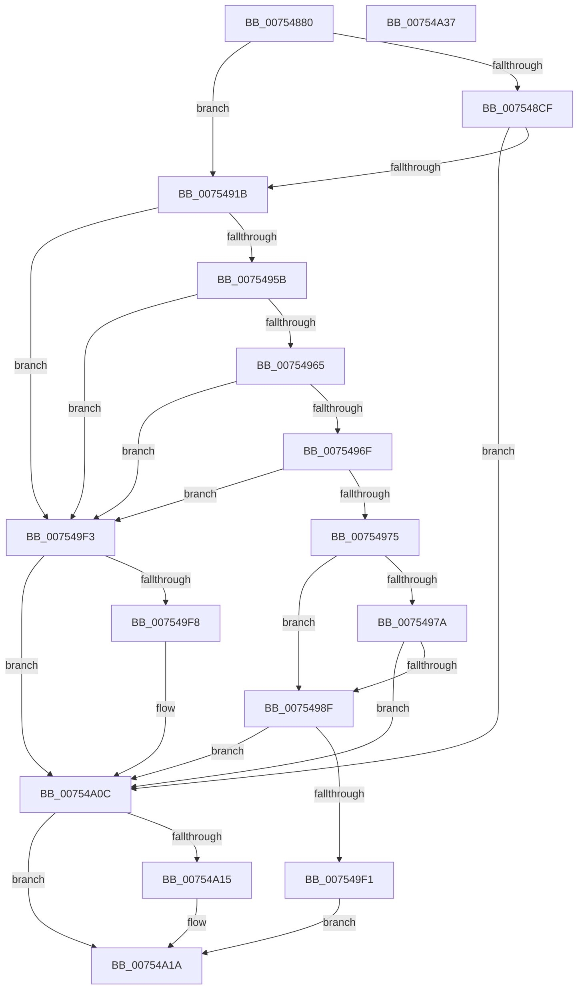

# PopUpdateUpgradeInProgress

- RVA: `0x00754880`–`0x00754A38` (길이 `440` bytes)
- VA: `0x0000000140754880`
- 실행 섹션: `PAGE`
- PDB 이름 있음: `예`; PDB Function 태그: `아니요`
- unwind 정보 RVA: `0x000CBE18`
- 디코드: `102`개 명령, `440/440` bytes 표시
- 미해석 바이트: `0` (있으면 어셈블리에 `.byte`로 보존)

> 이 문서는 커널 이미지의 기계어와 PDB 기호를 분석해 생성했습니다. 4번과 5번은 함수 원형과 자료형을 바이너리 사용 방식에서 추정한 C 해석이며 원본 소스 복구 결과는 아닙니다.

## 1. Dependencies

- 직접 호출 지점: **11**; 고유 호출 대상: **10**
- 직접 호출자로 확인된 함수: **1**
- RIP 상대 이미지 참조: **9**

### Outgoing calls
- `0x007548DA` → [RtlInitUnicodeString](../../text/42/RtlInitUnicodeString_function_0042A780.md) (function, `0x0042A780`)
- `0x0075490E` → [ZwOpenKey](../../text/6A/ZwOpenKey_function_006AD310.md) (function, `0x006AD310`)
- `0x00754926` → [RtlInitUnicodeString](../../text/42/RtlInitUnicodeString_function_0042A780.md) (function, `0x0042A780`)
- `0x0075494E` → [ZwQueryValueKey](../../text/6A/ZwQueryValueKey_function_006AD3B0.md) (function, `0x006AD3B0`)
- `0x00754986` → [PopLogSleepDisabled](../91/PopLogSleepDisabled_function_009102D8.md) (function, `0x009102D8`)
- `0x007549E8` → [ZwNotifyChangeKey](../../text/6A/ZwNotifyChangeKey_function_006AF550.md) (function, `0x006AF550`)
- `0x007549F8` → [PopAcquirePolicyLock](../../pagelk/B7/PopAcquirePolicyLock_function_00B783C0.md) (function, `0x00B783C0`)
- `0x00754A02` → [PopRemoveReasonRecordByReasonCode](../91/PopRemoveReasonRecordByReasonCode_function_00911B30.md) (function, `0x00911B30`)
- `0x00754A07` → [PopReleasePolicyLock](../../pagelk/B7/PopReleasePolicyLock_function_00B78410.md) (function, `0x00B78410`)
- `0x00754A15` → [ZwClose](../../text/6A/ZwClose_function_006AD2B0.md) (function, `0x006AD2B0`)
- `0x00754A21` → [_security_check_cookie](../../text/6A/_security_check_cookie_function_006AC640.md) (function, `0x006AC640`)

### Direct callers
- [PoInitSystem](../../init/C7/PoInitSystem_function_00C72358.md) at `0x00C72FEA`

### Static image references
- `0x00754892` → RVA `0x00E0A740` (`.data`; read)
- `0x007548CF` → RVA `0x00AFD440` (` ?? ::NNGAKEGL::`string'`; read)
- `0x0075491B` → RVA `0x00AFD190` (` ?? ::NNGAKEGL::`string'`; read)
- `0x00754993` → RVA `0x00754880` (`PopUpdateUpgradeInProgress`; read)
- `0x0075499A` → RVA `0x00F0F020` (`.data`; read/write)
- `0x007549A2` → RVA `0x00F0F020` (`.data`; read)
- `0x007549C1` → RVA `0x00F0F030` (`.data`; write)
- `0x007549C8` → RVA `0x00F0F000` (`.data`; read)
- `0x007549E1` → RVA `0x00F0F038` (`.data`; write)

## 2. Other-region calls and transfers

- 다른 실행 섹션으로 향하는 call: **9**
  - `0x007548DA` → [RtlInitUnicodeString](../../text/42/RtlInitUnicodeString_function_0042A780.md) (`PAGE` → `.text`)
  - `0x0075490E` → [ZwOpenKey](../../text/6A/ZwOpenKey_function_006AD310.md) (`PAGE` → `.text`)
  - `0x00754926` → [RtlInitUnicodeString](../../text/42/RtlInitUnicodeString_function_0042A780.md) (`PAGE` → `.text`)
  - `0x0075494E` → [ZwQueryValueKey](../../text/6A/ZwQueryValueKey_function_006AD3B0.md) (`PAGE` → `.text`)
  - `0x007549E8` → [ZwNotifyChangeKey](../../text/6A/ZwNotifyChangeKey_function_006AF550.md) (`PAGE` → `.text`)
  - `0x007549F8` → [PopAcquirePolicyLock](../../pagelk/B7/PopAcquirePolicyLock_function_00B783C0.md) (`PAGE` → `PAGELK`)
  - `0x00754A07` → [PopReleasePolicyLock](../../pagelk/B7/PopReleasePolicyLock_function_00B78410.md) (`PAGE` → `PAGELK`)
  - `0x00754A15` → [ZwClose](../../text/6A/ZwClose_function_006AD2B0.md) (`PAGE` → `.text`)
  - `0x00754A21` → [_security_check_cookie](../../text/6A/_security_check_cookie_function_006AC640.md) (`PAGE` → `.text`)
- 별도 외부 분기/꼬리 이동을 확인하지 못했습니다.

## 3. Assembly (complete function range)

```asm
00754880  48 89 5C 24 10                  mov qword ptr [rsp + 0x10], rbx
00754885  55                              push rbp
00754886  48 8D 6C 24 A9                  lea rbp, [rsp - 0x57]
0075488B  48 81 EC C0 00 00 00            sub rsp, 0xc0
00754892  48 8B 05 A7 5E 6B 00            mov rax, qword ptr [rip + 0x6b5ea7]
00754899  48 33 C4                        xor rax, rsp
0075489C  48 89 45 4F                     mov qword ptr [rbp + 0x4f], rax
007548A0  83 65 EF 00                     and dword ptr [rbp - 0x11], 0
007548A4  33 C0                           xor eax, eax
007548A6  48 89 45 27                     mov qword ptr [rbp + 0x27], rax
007548AA  0F 57 C0                        xorps xmm0, xmm0
007548AD  89 45 2F                        mov dword ptr [rbp + 0x2f], eax
007548B0  48 8B D9                        mov rbx, rcx
007548B3  89 45 47                        mov dword ptr [rbp + 0x47], eax
007548B6  48 89 4D E7                     mov qword ptr [rbp - 0x19], rcx
007548BA  0F 11 45 07                     movups xmmword ptr [rbp + 7], xmm0
007548BE  0F 11 45 17                     movups xmmword ptr [rbp + 0x17], xmm0
007548C2  0F 11 45 37                     movups xmmword ptr [rbp + 0x37], xmm0
007548C6  0F 11 45 F7                     movups xmmword ptr [rbp - 9], xmm0
007548CA  48 85 C9                        test rcx, rcx
007548CD  75 4C                           jne 0x14075491b
007548CF  48 8D 15 6A 8B 3A 00            lea rdx, [rip + 0x3a8b6a]
007548D6  48 8D 4D F7                     lea rcx, [rbp - 9]
007548DA  E8 A1 5E CD FF                  call 0x14042a780
007548DF  48 21 5D 0F                     and qword ptr [rbp + 0xf], rbx
007548E3  48 8D 45 F7                     lea rax, [rbp - 9]
007548E7  0F 57 C0                        xorps xmm0, xmm0
007548EA  48 89 45 17                     mov qword ptr [rbp + 0x17], rax
007548EE  4C 8D 45 07                     lea r8, [rbp + 7]
007548F2  C7 45 07 30 00 00 00            mov dword ptr [rbp + 7], 0x30
007548F9  BA 19 00 02 00                  mov edx, 0x20019
007548FE  C7 45 1F 40 02 00 00            mov dword ptr [rbp + 0x1f], 0x240
00754905  48 8D 4D E7                     lea rcx, [rbp - 0x19]
00754909  F3 0F 7F 45 27                  movdqu xmmword ptr [rbp + 0x27], xmm0
0075490E  E8 FD 89 F5 FF                  call 0x1406ad310
00754913  85 C0                           test eax, eax
00754915  0F 88 F1 00 00 00               js 0x140754a0c
0075491B  48 8D 15 6E 88 3A 00            lea rdx, [rip + 0x3a886e]
00754922  48 8D 4D F7                     lea rcx, [rbp - 9]
00754926  E8 55 5E CD FF                  call 0x14042a780
0075492B  48 8B 4D E7                     mov rcx, qword ptr [rbp - 0x19]
0075492F  48 8D 45 EF                     lea rax, [rbp - 0x11]
00754933  48 89 44 24 28                  mov qword ptr [rsp + 0x28], rax
00754938  4C 8D 4D 37                     lea r9, [rbp + 0x37]
0075493C  41 B8 02 00 00 00               mov r8d, 2
00754942  C7 44 24 20 14 00 00 00         mov dword ptr [rsp + 0x20], 0x14
0075494A  48 8D 55 F7                     lea rdx, [rbp - 9]
0075494E  E8 5D 8A F5 FF                  call 0x1406ad3b0
00754953  85 C0                           test eax, eax
00754955  0F 88 98 00 00 00               js 0x1407549f3
0075495B  83 7D 3B 04                     cmp dword ptr [rbp + 0x3b], 4
0075495F  0F 85 8E 00 00 00               jne 0x1407549f3
00754965  83 7D 3F 04                     cmp dword ptr [rbp + 0x3f], 4
00754969  0F 85 84 00 00 00               jne 0x1407549f3
0075496F  83 7D 43 00                     cmp dword ptr [rbp + 0x43], 0
00754973  74 7E                           je 0x1407549f3
00754975  48 85 DB                        test rbx, rbx
00754978  75 15                           jne 0x14075498f
0075497A  45 33 C9                        xor r9d, r9d
0075497D  8D 53 08                        lea edx, [rbx + 8]
00754980  45 33 C0                        xor r8d, r8d
00754983  8D 4B 0F                        lea ecx, [rbx + 0xf]
00754986  E8 4D B9 1B 00                  call 0x1409102d8
0075498B  85 C0                           test eax, eax
0075498D  78 7D                           js 0x140754a0c
0075498F  48 8B 4D E7                     mov rcx, qword ptr [rbp - 0x19]
00754993  48 8D 05 E6 FE FF FF            lea rax, [rip - 0x11a]
0075499A  48 83 25 7E A6 7B 00 00         and qword ptr [rip + 0x7ba67e], 0
007549A2  4C 8D 05 77 A6 7B 00            lea r8, [rip + 0x7ba677]
007549A9  C6 44 24 48 01                  mov byte ptr [rsp + 0x48], 1
007549AE  41 B9 01 00 00 00               mov r9d, 1
007549B4  83 64 24 40 00                  and dword ptr [rsp + 0x40], 0
007549B9  33 D2                           xor edx, edx
007549BB  48 83 64 24 38 00               and qword ptr [rsp + 0x38], 0
007549C1  48 89 05 68 A6 7B 00            mov qword ptr [rip + 0x7ba668], rax
007549C8  48 8D 05 31 A6 7B 00            lea rax, [rip + 0x7ba631]
007549CF  C6 44 24 30 00                  mov byte ptr [rsp + 0x30], 0
007549D4  C7 44 24 28 04 00 00 00         mov dword ptr [rsp + 0x28], 4
007549DC  48 89 44 24 20                  mov qword ptr [rsp + 0x20], rax
007549E1  48 89 0D 50 A6 7B 00            mov qword ptr [rip + 0x7ba650], rcx
007549E8  E8 63 AB F5 FF                  call 0x1406af550
007549ED  85 C0                           test eax, eax
007549EF  78 1B                           js 0x140754a0c
007549F1  EB 27                           jmp 0x140754a1a
007549F3  48 85 DB                        test rbx, rbx
007549F6  74 14                           je 0x140754a0c
007549F8  E8 C3 39 42 00                  call 0x140b783c0
007549FD  B9 0F 00 00 00                  mov ecx, 0xf
00754A02  E8 29 D1 1B 00                  call 0x140911b30
00754A07  E8 04 3A 42 00                  call 0x140b78410
00754A0C  48 8B 4D E7                     mov rcx, qword ptr [rbp - 0x19]
00754A10  48 85 C9                        test rcx, rcx
00754A13  74 05                           je 0x140754a1a
00754A15  E8 96 88 F5 FF                  call 0x1406ad2b0
00754A1A  48 8B 4D 4F                     mov rcx, qword ptr [rbp + 0x4f]
00754A1E  48 33 CC                        xor rcx, rsp
00754A21  E8 1A 7C F5 FF                  call 0x1406ac640
00754A26  48 8B 9C 24 D8 00 00 00         mov rbx, qword ptr [rsp + 0xd8]
00754A2E  48 81 C4 C0 00 00 00            add rsp, 0xc0
00754A35  5D                              pop rbp
00754A36  C3                              ret
00754A37  CC                              int3
```

## 4. C-style interpretation (structured pseudocode)

```c
__int64 __fastcall PopUpdateUpgradeInProgress(__int64 a1)
{
    __int64 result;
    __int64 v_rsp;
    unsigned __int64 v_stack_m10;
    unsigned int v_stack_m18;
    unsigned int v_stack_m1C;
    unsigned int v_stack_m20;
    unsigned int v_stack_m24;
    unsigned __int64 v_stack_m28;
    unsigned int v_stack_m30;
    unsigned __int64 v_stack_m38;
    unsigned int v_stack_m40;
    unsigned __int64 v_stack_m48;
    unsigned __int64 v_stack_m50;
    unsigned __int64 v_stack_m58;
    unsigned __int64 v_stack_m5F;
    unsigned __int64 v_stack_m68;
    unsigned int v_stack_m70;
    unsigned __int64 v_stack_m78;
    unsigned __int8 v_stack_m80;
    unsigned int v_stack_m88;
    unsigned __int64 v_stack_m90;
    unsigned __int8 v_stack_m98;
    unsigned __int64 v_stack_mA0;
    unsigned int v_stack_mA8;
    unsigned __int64 v_stack_p10;

    v_stack_p10 = v_rbx;
    v_rsp = (v_rsp) - (192);
    result = (*(unsigned __int64 *)(v_rip + 7036583)) ^ (v_rsp);
    v_stack_m10 = result;
    result = 0;
    v_stack_m38 = 0;
    v_stack_m30 = 0;
    v_stack_m18 = 0;
    v_stack_m78 = a1;
    v_stack_m58 = v_xmm0;
    v_stack_m48 = v_xmm0;
    v_stack_m28 = v_xmm0;
    v_stack_m68 = v_xmm0;
    if (a1 != 0) goto loc_0075491B;
    result = RtlInitUnicodeString(v_stack_m68, v_rip + 3836778, a3, a4);
    v_stack_m48 = v_stack_m68;
    v_stack_m58 = 48;
    v_stack_m40 = 576;
    v_stack_m38 = v_xmm0;
    result = ZwOpenKey(v_stack_m78, (unsigned int)(0x20019ULL), v_stack_m58, a4);
    if (sign_flag) goto loc_00754A0C;
loc_0075491B:
    result = RtlInitUnicodeString(v_stack_m68, v_rip + 3836014, v_stack_m58, a4);
    v_stack_mA0 = v_stack_m70;
    v_stack_mA8 = 20;
    result = ZwQueryValueKey(v_stack_m78, v_stack_m68, 2, v_stack_m28);
    if (sign_flag) goto loc_007549F3;
    if (v_stack_m24 != 4) goto loc_007549F3;
    if (v_stack_m20 != 4) goto loc_007549F3;
    if (v_stack_m1C == 0) goto loc_007549F3;
    if (a1 != 0) goto loc_0075498F;
    a4 = 0;
    a3 = 0;
    result = PopLogSleepDisabled(a1 + 15, a1 + 8, a3, a4);
    if (sign_flag) goto loc_00754A0C;
loc_0075498F:
    v_stack_m80 = 1;
    a2 = 0;
    *(unsigned __int64 *)(v_rip + 8103528) = v_rip - 282;
    v_stack_m98 = 0;
    v_stack_mA0 = 4;
    v_stack_mA8 = v_rip + 8103473;
    *(unsigned __int64 *)(v_rip + 8103504) = v_stack_m78;
    result = ZwNotifyChangeKey(v_stack_m78, a2, v_rip + 8103543, 1);
    if (sign_flag) goto loc_00754A0C;
    goto loc_00754A1A;
loc_007549F3:
    if (a1 != 0) {
        result = PopAcquirePolicyLock(v_stack_m78, a2, v_rip + 8103543, 1);
        a1 = 15;
        result = PopRemoveReasonRecordByReasonCode(a1, a2, v_rip + 8103543, 1);
        result = PopReleasePolicyLock(a1, a2, v_rip + 8103543, 1);
    }
    if (v_stack_m78 != 0) {
        result = ZwClose(v_stack_m78, a2, v_rip + 8103543, 1);
    }
    a1 = (v_stack_m10) ^ (v_rsp);
    result = _security_check_cookie(a1, a2, v_rip + 8103543, 1);
    v_rsp = (v_rsp) + (192);
    return result;
}
```

## 5. (Beta) C Style

```c
int64_t PopUpdateUpgradeInProgress(int64_t Arg1)
{
    int64_t result;
    int64_t local_rsp;
    uint64_t v_stack_m10;
    uint32_t v_stack_m18;
    uint32_t v_stack_m1C;
    uint32_t v_stack_m20;
    uint32_t v_stack_m24;
    uint64_t v_stack_m28;
    uint32_t v_stack_m30;
    uint64_t v_stack_m38;
    uint32_t v_stack_m40;
    uint64_t v_stack_m48;
    uint64_t v_stack_m50;
    uint64_t v_stack_m58;
    uint64_t v_stack_m5F;
    uint64_t v_stack_m68;
    uint32_t v_stack_m70;
    uint64_t v_stack_m78;
    uint8_t v_stack_m80;
    uint32_t v_stack_m88;
    uint64_t v_stack_m90;
    uint8_t v_stack_m98;
    uint64_t v_stack_mA0;
    uint32_t v_stack_mA8;
    uint64_t v_stack_p10;

    v_stack_p10 = local_rbx;
    local_rsp = (local_rsp) - (192);
    result = (*(uint64_t *)(v_rip + 0x6B5EA7)) ^ (local_rsp);
    v_stack_m10 = result;
    result = 0;
    v_stack_m38 = 0;
    v_stack_m30 = 0;
    v_stack_m18 = 0;
    v_stack_m78 = Arg1;
    v_stack_m58 = v_xmm0;
    v_stack_m48 = v_xmm0;
    v_stack_m28 = v_xmm0;
    v_stack_m68 = v_xmm0;
    if (Arg1 != 0) goto loc_0075491B;
    result = RtlInitUnicodeString(v_stack_m68, v_rip + 3836778, a3, a4);
    v_stack_m48 = v_stack_m68;
    v_stack_m58 = 48;
    v_stack_m40 = 576;
    v_stack_m38 = v_xmm0;
    result = ZwOpenKey(v_stack_m78, (uint32_t)(0x20019ULL), v_stack_m58, a4);
    if (sign_flag) goto loc_00754A0C;
loc_0075491B:
    result = RtlInitUnicodeString(v_stack_m68, v_rip + 3836014, v_stack_m58, a4);
    v_stack_mA0 = v_stack_m70;
    v_stack_mA8 = 20;
    result = ZwQueryValueKey(v_stack_m78, v_stack_m68, 2, v_stack_m28);
    if (sign_flag) goto loc_007549F3;
    if (v_stack_m24 != 4) goto loc_007549F3;
    if (v_stack_m20 != 4) goto loc_007549F3;
    if (v_stack_m1C == 0) goto loc_007549F3;
    if (Arg1 != 0) goto loc_0075498F;
    a4 = 0;
    a3 = 0;
    result = PopLogSleepDisabled(Arg1 + 15, Arg1 + 8, a3, a4);
    if (sign_flag) goto loc_00754A0C;
loc_0075498F:
    v_stack_m80 = 1;
    a2 = 0;
    *(uint64_t *)(v_rip + 0x7BA668) = v_rip - 282;
    v_stack_m98 = 0;
    v_stack_mA0 = 4;
    v_stack_mA8 = v_rip + 8103473;
    *(uint64_t *)(v_rip + 0x7BA650) = v_stack_m78;
    result = ZwNotifyChangeKey(v_stack_m78, a2, v_rip + 8103543, 1);
    if (sign_flag) goto loc_00754A0C;
    goto loc_00754A1A;
loc_007549F3:
    if (Arg1 != 0) {
        result = PopAcquirePolicyLock(v_stack_m78, a2, v_rip + 8103543, 1);
        Arg1 = 15;
        result = PopRemoveReasonRecordByReasonCode(Arg1, a2, v_rip + 8103543, 1);
        result = PopReleasePolicyLock(Arg1, a2, v_rip + 8103543, 1);
    }
    if (v_stack_m78 != 0) {
        result = ZwClose(v_stack_m78, a2, v_rip + 8103543, 1);
    }
    Arg1 = (v_stack_m10) ^ (local_rsp);
    result = _security_check_cookie(Arg1, a2, v_rip + 8103543, 1);
    local_rsp = (local_rsp) + (192);
    return result;
}
```

## 6. Execution-region graph

[열기: 2D/3D 그래프와 함수 탐색 컨트롤 패널](../../../control-panel.html?section=page&rva=0x00754880&view=graph)

- 2D 그래프는 위에서 아래로 흐르고, 3D 그래프는 빈 공간을 드래그해 회전합니다. Shift+드래그는 이동, 휠은 확대·축소, 함수 노드 선택은 대상 보고서 이동입니다.

### Static fallback


