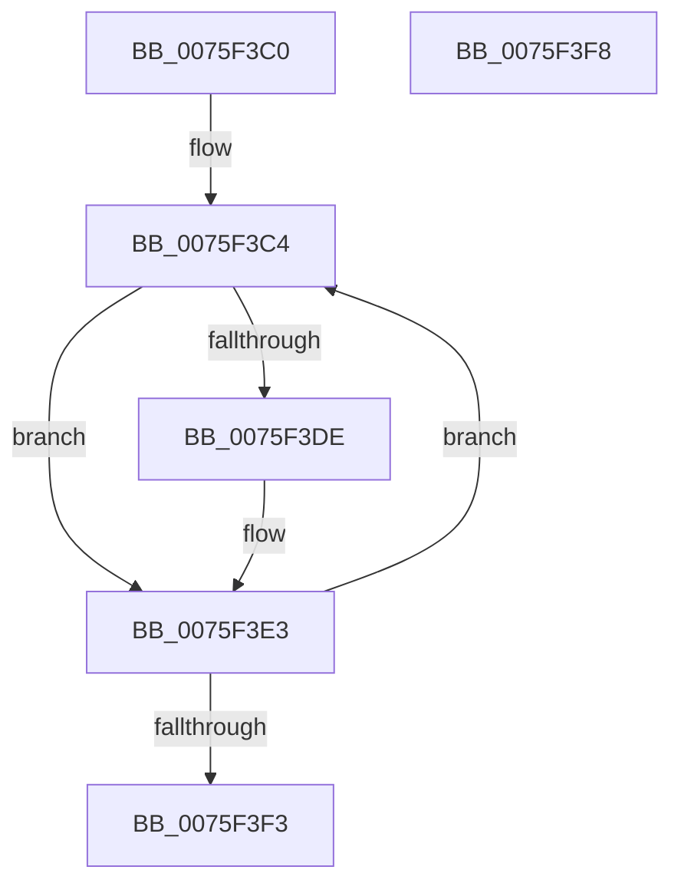

# PopUserShutdownCalloutDelayTimerWorker

- RVA: `0x0075F3C0`–`0x0075F3F9` (길이 `57` bytes)
- VA: `0x000000014075F3C0`
- 실행 섹션: `PAGE`
- PDB 이름 있음: `예`; PDB Function 태그: `아니요`
- unwind 정보 RVA: `0x0005C788`
- 디코드: `15`개 명령, `57/57` bytes 표시
- 미해석 바이트: `0` (있으면 어셈블리에 `.byte`로 보존)

> 이 문서는 커널 이미지의 기계어와 PDB 기호를 분석해 생성했습니다. 4번과 5번은 함수 원형과 자료형을 바이너리 사용 방식에서 추정한 C 해석이며 원본 소스 복구 결과는 아닙니다.

## 1. Dependencies

- 직접 호출 지점: **2**; 고유 호출 대상: **2**
- 직접 호출자로 확인된 함수: **0**
- RIP 상대 이미지 참조: **3**

### Outgoing calls
- `0x0075F3CD` → [PdcTaskClientRequest](../AA/PdcTaskClientRequest_function_00AA37E4.md) (function, `0x00AA37E4`)
- `0x0075F3DE` → [SleepstudyHelperBlockerActiveDereference](../../text/45/SleepstudyHelperBlockerActiveDereference_function_00453830.md) (function, `0x00453830`)

### Direct callers
- 이 함수 시작 RVA로 연결되는 직접 call은 확인되지 않았습니다. 간접 호출은 완전히 역산할 수 없습니다.

### Static image references
- `0x0075F3C4` → RVA `0x00F0D0B0` (`.data`; read)
- `0x0075F3D2` → RVA `0x00F0CFE0` (`.data`; read)
- `0x0075F3E6` → RVA `0x00F0D0A8` (`.data`; read/write)

## 2. Other-region calls and transfers

- 다른 실행 섹션으로 향하는 call: **1**
  - `0x0075F3DE` → [SleepstudyHelperBlockerActiveDereference](../../text/45/SleepstudyHelperBlockerActiveDereference_function_00453830.md) (`PAGE` → `.text`)
- 별도 외부 분기/꼬리 이동을 확인하지 못했습니다.

## 3. Assembly (complete function range)

```asm
0075F3C0  48 83 EC 28                     sub rsp, 0x28
0075F3C4  48 8B 0D E5 DC 7A 00            mov rcx, qword ptr [rip + 0x7adce5]
0075F3CB  33 D2                           xor edx, edx
0075F3CD  E8 12 44 34 00                  call 0x140aa37e4
0075F3D2  48 8B 0D 07 DC 7A 00            mov rcx, qword ptr [rip + 0x7adc07]
0075F3D9  48 85 C9                        test rcx, rcx
0075F3DC  74 05                           je 0x14075f3e3
0075F3DE  E8 4D 44 CF FF                  call 0x140453830
0075F3E3  83 C8 FF                        or eax, 0xffffffff
0075F3E6  F0 0F C1 05 BA DC 7A 00         lock xadd dword ptr [rip + 0x7adcba], eax
0075F3EE  83 E8 01                        sub eax, 1
0075F3F1  7F D1                           jg 0x14075f3c4
0075F3F3  48 83 C4 28                     add rsp, 0x28
0075F3F7  C3                              ret
0075F3F8  CC                              int3
```

## 4. C-style interpretation (structured pseudocode)

```c
__int64 __fastcall PopUserShutdownCalloutDelayTimerWorker(__int64 a1, int a2)
{
    __int64 result;
    __int64 v_rsp;

    v_rsp = (v_rsp) - (40);
loc_0075F3C4:
    a2 = 0;
    result = PdcTaskClientRequest(*(unsigned __int64 *)(v_rip + 8051941), a2, a3, a4);
    if (*(unsigned __int64 *)(v_rip + 8051719) != 0) {
        result = SleepstudyHelperBlockerActiveDereference(*(unsigned __int64 *)(v_rip + 8051719), a2, a3, a4);
    }
    result = (unsigned int)((result) | (0xFFFFFFFFULL));
    result = (unsigned int)((result) - (1));
    if (condition_is_greater) goto loc_0075F3C4;
    v_rsp = (v_rsp) + (40);
    return result;
}
```

## 5. (Beta) C Style

```c
int64_t PopUserShutdownCalloutDelayTimerWorker(int64_t Arg1, int32_t Arg2)
{
    int64_t result;
    int64_t local_rsp;

    local_rsp = (local_rsp) - (40);
loc_0075F3C4:
    Arg2 = 0;
    result = PdcTaskClientRequest(*(uint64_t *)(v_rip + 0x7ADCE5), Arg2, a3, a4);
    if (*(uint64_t *)(v_rip + 0x7ADC07) != 0) {
        result = SleepstudyHelperBlockerActiveDereference(*(uint64_t *)(v_rip + 0x7ADC07), Arg2, a3, a4);
    }
    result = (uint32_t)((result) | (0xFFFFFFFFULL));
    result = (uint32_t)((result) - (1));
    if (condition_is_greater) goto loc_0075F3C4;
    local_rsp = (local_rsp) + (40);
    return result;
}
```

## 6. Execution-region graph

[열기: 2D/3D 그래프와 함수 탐색 컨트롤 패널](../../../control-panel.html?section=page&rva=0x0075F3C0&view=graph)

- 2D 그래프는 위에서 아래로 흐르고, 3D 그래프는 빈 공간을 드래그해 회전합니다. Shift+드래그는 이동, 휠은 확대·축소, 함수 노드 선택은 대상 보고서 이동입니다.

### Static fallback


