# PopValidateWinresume

- RVA: `0x0075DFF4`–`0x0075E3BA` (길이 `966` bytes)
- VA: `0x000000014075DFF4`
- 실행 섹션: `PAGE`
- PDB 이름 있음: `예`; PDB Function 태그: `아니요`
- unwind 정보 RVA: `0x000B1698`
- 디코드: `258`개 명령, `966/966` bytes 표시
- 미해석 바이트: `0` (있으면 어셈블리에 `.byte`로 보존)

> 이 문서는 커널 이미지의 기계어와 PDB 기호를 분석해 생성했습니다. 4번과 5번은 함수 원형과 자료형을 바이너리 사용 방식에서 추정한 C 해석이며 원본 소스 복구 결과는 아닙니다.

## 1. Dependencies

- 직접 호출 지점: **22**; 고유 호출 대상: **14**
- 직접 호출자로 확인된 함수: **2**
- RIP 상대 이미지 참조: **5**

### Outgoing calls
- `0x0075E081` → [ExAllocatePool2](../../poolcode/B8/ExAllocatePool2_function_00B820F0.md) (function, `0x00B820F0`)
- `0x0075E0A8` → [ZwQuerySystemInformation](../../text/6A/ZwQuerySystemInformation_function_006AD790.md) (function, `0x006AD790`)
- `0x0075E0C2` → [RtlInitUnicodeString](../../text/42/RtlInitUnicodeString_function_0042A780.md) (function, `0x0042A780`)
- `0x0075E0E2` → [ExAllocatePool2](../../poolcode/B8/ExAllocatePool2_function_00B820F0.md) (function, `0x00B820F0`)
- `0x0075E0F7` → [RtlAppendUnicodeStringToString](../../text/40/RtlAppendUnicodeStringToString_function_0040FA50.md) (function, `0x0040FA50`)
- `0x0075E104` → [RtlAppendUnicodeStringToString](../../text/40/RtlAppendUnicodeStringToString_function_0040FA50.md) (function, `0x0040FA50`)
- `0x0075E115` → [PopLoadFileInMemory](PopLoadFileInMemory_function_007540E4.md) (function, `0x007540E4`)
- `0x0075E144` → [MinCrypK_ParseRevocationList](../../text/6A/MinCrypK_ParseRevocationList_function_006A602C.md) (function, `0x006A602C`)
- `0x0075E15C` → [BcdOpenStore](../A4/BcdOpenStore_function_00A4116C.md) (function, `0x00A4116C`)
- `0x0075E176` → [PopBcdGetApplicationPathFromResumeObject](../77/PopBcdGetApplicationPathFromResumeObject_function_007702AC.md) (function, `0x007702AC`)
- `0x0075E192` → [PopLoadFileInMemory](PopLoadFileInMemory_function_007540E4.md) (function, `0x007540E4`)
- `0x0075E1F6` → [LdrResSearchResource](../98/LdrResSearchResource_function_0098F7A0.md) (function, `0x0098F7A0`)
- `0x0075E257` → [MinCryptK_GetBootAppSvnFromRevocationList](../../text/6A/MinCryptK_GetBootAppSvnFromRevocationList_function_006A6154.md) (function, `0x006A6154`)
- `0x0075E2B9` → [LdrResSearchResource](../98/LdrResSearchResource_function_0098F7A0.md) (function, `0x0098F7A0`)
- `0x0075E316` → [PopDiagTraceHibernateRevoked](../76/PopDiagTraceHibernateRevoked_function_00761A18.md) (function, `0x00761A18`)
- `0x0075E32A` → [ExFreePoolWithTag](../../poolcode/B8/ExFreePoolWithTag_function_00B82870.md) (function, `0x00B82870`)
- `0x0075E33A` → [ExFreePoolWithTag](../../poolcode/B8/ExFreePoolWithTag_function_00B82870.md) (function, `0x00B82870`)
- `0x0075E347` → [BcdCloseStore](../A3/BcdCloseStore_function_00A3C68C.md) (function, `0x00A3C68C`)
- `0x0075E35B` → [I_MincryptFreeChainInfo](../83/I_MincryptFreeChainInfo_function_008395E8.md) (function, `0x008395E8`)
- `0x0075E379` → [ExFreePoolWithTag](../../poolcode/B8/ExFreePoolWithTag_function_00B82870.md) (function, `0x00B82870`)
- `0x0075E38C` → [ExFreePoolWithTag](../../poolcode/B8/ExFreePoolWithTag_function_00B82870.md) (function, `0x00B82870`)
- `0x0075E39E` → [ExFreePoolWithTag](../../poolcode/B8/ExFreePoolWithTag_function_00B82870.md) (function, `0x00B82870`)

### Direct callers
- [PopInitializeHibernateGlobals](PopInitializeHibernateGlobals_function_0075DA64.md) at `0x0075DAFB`
- [PopWnfHibernateRevocationCheckCallback](PopWnfHibernateRevocationCheckCallback_function_0075E440.md) at `0x0075E44E`

### Static image references
- `0x0075E0B7` → RVA `0x00B01F20` (` ?? ::NNGAKEGL::`string'`; read)
- `0x0075E1A6` → RVA `0x00B01F60` (` ?? ::NNGAKEGL::`string'`; read)
- `0x0075E23E` → RVA `0x00F0DE70` (`.data`; read)
- `0x0075E247` → RVA `0x00F0DE78` (`.data`; read)
- `0x0075E278` → RVA `0x00B01FA0` (` ?? ::NNGAKEGL::`string'`; read)

## 2. Other-region calls and transfers

- 다른 실행 섹션으로 향하는 call: **13**
  - `0x0075E081` → [ExAllocatePool2](../../poolcode/B8/ExAllocatePool2_function_00B820F0.md) (`PAGE` → `POOLCODE`)
  - `0x0075E0A8` → [ZwQuerySystemInformation](../../text/6A/ZwQuerySystemInformation_function_006AD790.md) (`PAGE` → `.text`)
  - `0x0075E0C2` → [RtlInitUnicodeString](../../text/42/RtlInitUnicodeString_function_0042A780.md) (`PAGE` → `.text`)
  - `0x0075E0E2` → [ExAllocatePool2](../../poolcode/B8/ExAllocatePool2_function_00B820F0.md) (`PAGE` → `POOLCODE`)
  - `0x0075E0F7` → [RtlAppendUnicodeStringToString](../../text/40/RtlAppendUnicodeStringToString_function_0040FA50.md) (`PAGE` → `.text`)
  - `0x0075E104` → [RtlAppendUnicodeStringToString](../../text/40/RtlAppendUnicodeStringToString_function_0040FA50.md) (`PAGE` → `.text`)
  - `0x0075E144` → [MinCrypK_ParseRevocationList](../../text/6A/MinCrypK_ParseRevocationList_function_006A602C.md) (`PAGE` → `.text`)
  - `0x0075E257` → [MinCryptK_GetBootAppSvnFromRevocationList](../../text/6A/MinCryptK_GetBootAppSvnFromRevocationList_function_006A6154.md) (`PAGE` → `.text`)
  - `0x0075E32A` → [ExFreePoolWithTag](../../poolcode/B8/ExFreePoolWithTag_function_00B82870.md) (`PAGE` → `POOLCODE`)
  - `0x0075E33A` → [ExFreePoolWithTag](../../poolcode/B8/ExFreePoolWithTag_function_00B82870.md) (`PAGE` → `POOLCODE`)
  - `0x0075E379` → [ExFreePoolWithTag](../../poolcode/B8/ExFreePoolWithTag_function_00B82870.md) (`PAGE` → `POOLCODE`)
  - `0x0075E38C` → [ExFreePoolWithTag](../../poolcode/B8/ExFreePoolWithTag_function_00B82870.md) (`PAGE` → `POOLCODE`)
  - `0x0075E39E` → [ExFreePoolWithTag](../../poolcode/B8/ExFreePoolWithTag_function_00B82870.md) (`PAGE` → `POOLCODE`)
- 별도 외부 분기/꼬리 이동을 확인하지 못했습니다.

## 3. Assembly (complete function range)

```asm
0075DFF4  40 55                           push rbp
0075DFF6  53                              push rbx
0075DFF7  56                              push rsi
0075DFF8  57                              push rdi
0075DFF9  41 54                           push r12
0075DFFB  41 55                           push r13
0075DFFD  41 56                           push r14
0075DFFF  41 57                           push r15
0075E001  48 8D 6C 24 E1                  lea rbp, [rsp - 0x1f]
0075E006  48 81 EC F8 00 00 00            sub rsp, 0xf8
0075E00D  33 DB                           xor ebx, ebx
0075E00F  0F 57 C0                        xorps xmm0, xmm0
0075E012  88 19                           mov byte ptr [rcx], bl
0075E014  48 8B F9                        mov rdi, rcx
0075E017  B9 00 01 00 00                  mov ecx, 0x100
0075E01C  48 89 5D 97                     mov qword ptr [rbp - 0x69], rbx
0075E020  BA 18 02 00 00                  mov edx, 0x218
0075E025  48 89 5D BF                     mov qword ptr [rbp - 0x41], rbx
0075E029  41 B8 68 69 62 72               mov r8d, 0x72626968
0075E02F  89 5D 67                        mov dword ptr [rbp + 0x67], ebx
0075E032  0F 11 45 A7                     movups xmmword ptr [rbp - 0x59], xmm0
0075E036  48 89 5D C7                     mov qword ptr [rbp - 0x39], rbx
0075E03A  44 8B F3                        mov r14d, ebx
0075E03D  89 5D 77                        mov dword ptr [rbp + 0x77], ebx
0075E040  8B F3                           mov esi, ebx
0075E042  48 89 5D CF                     mov qword ptr [rbp - 0x31], rbx
0075E046  44 8B FB                        mov r15d, ebx
0075E049  48 89 5D 87                     mov qword ptr [rbp - 0x79], rbx
0075E04D  44 8B E3                        mov r12d, ebx
0075E050  89 5C 24 48                     mov dword ptr [rsp + 0x48], ebx
0075E054  48 89 5D 9F                     mov qword ptr [rbp - 0x61], rbx
0075E058  89 5D 6F                        mov dword ptr [rbp + 0x6f], ebx
0075E05B  48 89 5C 24 58                  mov qword ptr [rsp + 0x58], rbx
0075E060  89 5D 7F                        mov dword ptr [rbp + 0x7f], ebx
0075E063  48 89 5C 24 40                  mov qword ptr [rsp + 0x40], rbx
0075E068  48 89 5D 8F                     mov qword ptr [rbp - 0x71], rbx
0075E06C  48 89 5C 24 50                  mov qword ptr [rsp + 0x50], rbx
0075E071  48 89 5D D7                     mov qword ptr [rbp - 0x29], rbx
0075E075  0F 11 45 DF                     movups xmmword ptr [rbp - 0x21], xmm0
0075E079  0F 11 45 EF                     movups xmmword ptr [rbp - 0x11], xmm0
0075E07D  0F 11 45 FF                     movups xmmword ptr [rbp - 1], xmm0
0075E081  E8 6A 40 42 00                  call 0x140b820f0
0075E086  4C 8B E8                        mov r13, rax
0075E089  48 85 C0                        test rax, rax
0075E08C  75 0A                           jne 0x14075e098
0075E08E  BB 9A 00 00 C0                  mov ebx, 0xc000009a
0075E093  E9 6F 02 00 00                  jmp 0x14075e307
0075E098  45 33 C9                        xor r9d, r9d
0075E09B  41 B8 18 02 00 00               mov r8d, 0x218
0075E0A1  49 8B D5                        mov rdx, r13
0075E0A4  41 8D 49 62                     lea ecx, [r9 + 0x62]
0075E0A8  E8 E3 F6 F4 FF                  call 0x1406ad790
0075E0AD  8B D8                           mov ebx, eax
0075E0AF  85 C0                           test eax, eax
0075E0B1  0F 88 50 02 00 00               js 0x14075e307
0075E0B7  48 8D 15 62 3E 3A 00            lea rdx, [rip + 0x3a3e62]
0075E0BE  48 8D 4D A7                     lea rcx, [rbp - 0x59]
0075E0C2  E8 B9 C6 CC FF                  call 0x14042a780
0075E0C7  0F B7 45 A7                     movzx eax, word ptr [rbp - 0x59]
0075E0CB  B9 00 01 00 00                  mov ecx, 0x100
0075E0D0  66 41 03 45 00                  add ax, word ptr [r13]
0075E0D5  41 B8 68 69 62 72               mov r8d, 0x72626968
0075E0DB  0F B7 D0                        movzx edx, ax
0075E0DE  66 89 55 99                     mov word ptr [rbp - 0x67], dx
0075E0E2  E8 09 40 42 00                  call 0x140b820f0
0075E0E7  48 89 45 9F                     mov qword ptr [rbp - 0x61], rax
0075E0EB  48 85 C0                        test rax, rax
0075E0EE  74 9E                           je 0x14075e08e
0075E0F0  49 8B D5                        mov rdx, r13
0075E0F3  48 8D 4D 97                     lea rcx, [rbp - 0x69]
0075E0F7  E8 54 19 CB FF                  call 0x14040fa50
0075E0FC  48 8D 55 A7                     lea rdx, [rbp - 0x59]
0075E100  48 8D 4D 97                     lea rcx, [rbp - 0x69]
0075E104  E8 47 19 CB FF                  call 0x14040fa50
0075E109  4C 8D 45 77                     lea r8, [rbp + 0x77]
0075E10D  48 8D 55 8F                     lea rdx, [rbp - 0x71]
0075E111  48 8D 4D 97                     lea rcx, [rbp - 0x69]
0075E115  E8 CA 5F FF FF                  call 0x1407540e4
0075E11A  4C 8B 65 8F                     mov r12, qword ptr [rbp - 0x71]
0075E11E  8B D8                           mov ebx, eax
0075E120  85 C0                           test eax, eax
0075E122  0F 88 DF 01 00 00               js 0x14075e307
0075E128  8B 55 77                        mov edx, dword ptr [rbp + 0x77]
0075E12B  48 8D 45 BF                     lea rax, [rbp - 0x41]
0075E12F  48 89 44 24 28                  mov qword ptr [rsp + 0x28], rax
0075E134  4C 8D 4D C7                     lea r9, [rbp - 0x39]
0075E138  48 8D 45 DF                     lea rax, [rbp - 0x21]
0075E13C  49 8B CC                        mov rcx, r12
0075E13F  48 89 44 24 20                  mov qword ptr [rsp + 0x20], rax
0075E144  E8 E3 7E F4 FF                  call 0x1406a602c
0075E149  8B D8                           mov ebx, eax
0075E14B  85 C0                           test eax, eax
0075E14D  0F 88 B4 01 00 00               js 0x14075e307
0075E153  4C 8D 45 87                     lea r8, [rbp - 0x79]
0075E157  BA 02 00 00 00                  mov edx, 2
0075E15C  E8 0B 30 2E 00                  call 0x140a4116c
0075E161  4C 8B 75 87                     mov r14, qword ptr [rbp - 0x79]
0075E165  8B D8                           mov ebx, eax
0075E167  85 C0                           test eax, eax
0075E169  0F 88 98 01 00 00               js 0x14075e307
0075E16F  48 8D 55 CF                     lea rdx, [rbp - 0x31]
0075E173  49 8B CE                        mov rcx, r14
0075E176  E8 31 21 01 00                  call 0x1407702ac
0075E17B  8B D8                           mov ebx, eax
0075E17D  85 C0                           test eax, eax
0075E17F  0F 88 82 01 00 00               js 0x14075e307
0075E185  4C 8D 45 67                     lea r8, [rbp + 0x67]
0075E189  48 8D 54 24 58                  lea rdx, [rsp + 0x58]
0075E18E  48 8D 4D CF                     lea rcx, [rbp - 0x31]
0075E192  E8 4D 5F FF FF                  call 0x1407540e4
0075E197  8B D8                           mov ebx, eax
0075E199  85 C0                           test eax, eax
0075E19B  0F 88 61 01 00 00               js 0x14075e302
0075E1A1  4C 89 7C 24 38                  mov qword ptr [rsp + 0x38], r15
0075E1A6  48 8D 05 B3 3D 3A 00            lea rax, [rip + 0x3a3db3]
0075E1AD  48 89 45 AF                     mov qword ptr [rbp - 0x51], rax
0075E1B1  48 8D 55 A7                     lea rdx, [rbp - 0x59]
0075E1B5  8B 45 67                        mov eax, dword ptr [rbp + 0x67]
0075E1B8  41 B9 00 12 00 00               mov r9d, 0x1200
0075E1BE  48 89 44 24 40                  mov qword ptr [rsp + 0x40], rax
0075E1C3  41 B8 03 00 00 00               mov r8d, 3
0075E1C9  4C 89 7C 24 30                  mov qword ptr [rsp + 0x30], r15
0075E1CE  48 8D 44 24 40                  lea rax, [rsp + 0x40]
0075E1D3  48 89 44 24 28                  mov qword ptr [rsp + 0x28], rax
0075E1D8  48 8D 44 24 50                  lea rax, [rsp + 0x50]
0075E1DD  4C 89 7D B7                     mov qword ptr [rbp - 0x49], r15
0075E1E1  4C 8B 7C 24 58                  mov r15, qword ptr [rsp + 0x58]
0075E1E6  49 8B CF                        mov rcx, r15
0075E1E9  48 89 44 24 20                  mov qword ptr [rsp + 0x20], rax
0075E1EE  48 C7 45 A7 0A 00 00 00         mov qword ptr [rbp - 0x59], 0xa
0075E1F6  E8 A5 15 23 00                  call 0x14098f7a0
0075E1FB  8B D8                           mov ebx, eax
0075E1FD  85 C0                           test eax, eax
0075E1FF  79 08                           jns 0x14075e209
0075E201  C6 07 01                        mov byte ptr [rdi], 1
0075E204  E9 03 01 00 00                  jmp 0x14075e30c
0075E209  48 8B 44 24 50                  mov rax, qword ptr [rsp + 0x50]
0075E20E  48 85 C0                        test rax, rax
0075E211  0F 84 E1 00 00 00               je 0x14075e2f8
0075E217  48 83 7C 24 40 04               cmp qword ptr [rsp + 0x40], 4
0075E21D  0F 85 D5 00 00 00               jne 0x14075e2f8
0075E223  8B 18                           mov ebx, dword ptr [rax]
0075E225  41 B8 10 00 00 0A               mov r8d, 0xa000010
0075E22B  89 5D 7F                        mov dword ptr [rbp + 0x7f], ebx
0075E22E  41 3B D8                        cmp ebx, r8d
0075E231  74 07                           je 0x14075e23a
0075E233  BB 04 A0 00 C0                  mov ebx, 0xc000a004
0075E238  EB C7                           jmp 0x14075e201
0075E23A  48 8B 45 BF                     mov rax, qword ptr [rbp - 0x41]
0075E23E  48 39 05 2B FC 7A 00            cmp qword ptr [rip + 0x7afc2b], rax
0075E245  7C 08                           jl 0x14075e24f
0075E247  8B 35 2B FC 7A 00               mov esi, dword ptr [rip + 0x7afc2b]
0075E24D  EB 1A                           jmp 0x14075e269
0075E24F  48 8B 4D C7                     mov rcx, qword ptr [rbp - 0x39]
0075E253  4C 8D 4D 6F                     lea r9, [rbp + 0x6f]
0075E257  E8 F8 7E F4 FF                  call 0x1406a6154
0075E25C  8B 75 6F                        mov esi, dword ptr [rbp + 0x6f]
0075E25F  8B D8                           mov ebx, eax
0075E261  85 C0                           test eax, eax
0075E263  0F 88 9E 00 00 00               js 0x14075e307
0075E269  33 DB                           xor ebx, ebx
0075E26B  48 C7 45 A7 0A 00 00 00         mov qword ptr [rbp - 0x59], 0xa
0075E273  48 89 5C 24 38                  mov qword ptr [rsp + 0x38], rbx
0075E278  48 8D 05 21 3D 3A 00            lea rax, [rip + 0x3a3d21]
0075E27F  48 89 45 AF                     mov qword ptr [rbp - 0x51], rax
0075E283  48 8D 55 A7                     lea rdx, [rbp - 0x59]
0075E287  8B 45 67                        mov eax, dword ptr [rbp + 0x67]
0075E28A  41 B9 00 12 00 00               mov r9d, 0x1200
0075E290  48 89 44 24 40                  mov qword ptr [rsp + 0x40], rax
0075E295  44 8D 43 03                     lea r8d, [rbx + 3]
0075E299  48 8D 44 24 40                  lea rax, [rsp + 0x40]
0075E29E  48 89 5C 24 30                  mov qword ptr [rsp + 0x30], rbx
0075E2A3  48 89 44 24 28                  mov qword ptr [rsp + 0x28], rax
0075E2A8  49 8B CF                        mov rcx, r15
0075E2AB  48 8D 44 24 50                  lea rax, [rsp + 0x50]
0075E2B0  48 89 5D B7                     mov qword ptr [rbp - 0x49], rbx
0075E2B4  48 89 44 24 20                  mov qword ptr [rsp + 0x20], rax
0075E2B9  E8 E2 14 23 00                  call 0x14098f7a0
0075E2BE  8B D8                           mov ebx, eax
0075E2C0  85 C0                           test eax, eax
0075E2C2  0F 88 39 FF FF FF               js 0x14075e201
0075E2C8  48 8B 44 24 50                  mov rax, qword ptr [rsp + 0x50]
0075E2CD  48 85 C0                        test rax, rax
0075E2D0  74 1C                           je 0x14075e2ee
0075E2D2  48 83 7C 24 40 04               cmp qword ptr [rsp + 0x40], 4
0075E2D8  75 14                           jne 0x14075e2ee
0075E2DA  8B 00                           mov eax, dword ptr [rax]
0075E2DC  89 44 24 48                     mov dword ptr [rsp + 0x48], eax
0075E2E0  3B C6                           cmp eax, esi
0075E2E2  73 23                           jae 0x14075e307
0075E2E4  C6 07 01                        mov byte ptr [rdi], 1
0075E2E7  BB 22 00 00 C0                  mov ebx, 0xc0000022
0075E2EC  EB 1E                           jmp 0x14075e30c
0075E2EE  C6 07 01                        mov byte ptr [rdi], 1
0075E2F1  BB 89 00 00 C0                  mov ebx, 0xc0000089
0075E2F6  EB 14                           jmp 0x14075e30c
0075E2F8  BB 89 00 00 C0                  mov ebx, 0xc0000089
0075E2FD  C6 07 01                        mov byte ptr [rdi], 1
0075E300  EB 05                           jmp 0x14075e307
0075E302  4C 8B 7C 24 58                  mov r15, qword ptr [rsp + 0x58]
0075E307  80 3F 00                        cmp byte ptr [rdi], 0
0075E30A  74 0F                           je 0x14075e31b
0075E30C  44 8B 45 7F                     mov r8d, dword ptr [rbp + 0x7f]
0075E310  8B CE                           mov ecx, esi
0075E312  8B 54 24 48                     mov edx, dword ptr [rsp + 0x48]
0075E316  E8 FD 36 00 00                  call 0x140761a18
0075E31B  BF 4D 65 6D 20                  mov edi, 0x206d654d
0075E320  4D 85 FF                        test r15, r15
0075E323  74 0A                           je 0x14075e32f
0075E325  8B D7                           mov edx, edi
0075E327  49 8B CF                        mov rcx, r15
0075E32A  E8 41 45 42 00                  call 0x140b82870
0075E32F  48 8B 4D D7                     mov rcx, qword ptr [rbp - 0x29]
0075E333  48 85 C9                        test rcx, rcx
0075E336  74 07                           je 0x14075e33f
0075E338  33 D2                           xor edx, edx
0075E33A  E8 31 45 42 00                  call 0x140b82870
0075E33F  4D 85 F6                        test r14, r14
0075E342  74 08                           je 0x14075e34c
0075E344  49 8B CE                        mov rcx, r14
0075E347  E8 40 E3 2D 00                  call 0x140a3c68c
0075E34C  48 8B 4D EF                     mov rcx, qword ptr [rbp - 0x11]
0075E350  48 85 C9                        test rcx, rcx
0075E353  74 1A                           je 0x14075e36f
0075E355  83 7D DF 00                     cmp dword ptr [rbp - 0x21], 0
0075E359  74 14                           je 0x14075e36f
0075E35B  E8 88 B2 0D 00                  call 0x1408395e8
0075E360  0F 57 C0                        xorps xmm0, xmm0
0075E363  0F 11 45 DF                     movups xmmword ptr [rbp - 0x21], xmm0
0075E367  0F 11 45 EF                     movups xmmword ptr [rbp - 0x11], xmm0
0075E36B  0F 11 45 FF                     movups xmmword ptr [rbp - 1], xmm0
0075E36F  4D 85 E4                        test r12, r12
0075E372  74 0A                           je 0x14075e37e
0075E374  8B D7                           mov edx, edi
0075E376  49 8B CC                        mov rcx, r12
0075E379  E8 F2 44 42 00                  call 0x140b82870
0075E37E  48 8B 4D 9F                     mov rcx, qword ptr [rbp - 0x61]
0075E382  48 85 C9                        test rcx, rcx
0075E385  74 0A                           je 0x14075e391
0075E387  BA 68 69 62 72                  mov edx, 0x72626968
0075E38C  E8 DF 44 42 00                  call 0x140b82870
0075E391  4D 85 ED                        test r13, r13
0075E394  74 0D                           je 0x14075e3a3
0075E396  BA 68 69 62 72                  mov edx, 0x72626968
0075E39B  49 8B CD                        mov rcx, r13
0075E39E  E8 CD 44 42 00                  call 0x140b82870
0075E3A3  8B C3                           mov eax, ebx
0075E3A5  48 81 C4 F8 00 00 00            add rsp, 0xf8
0075E3AC  41 5F                           pop r15
0075E3AE  41 5E                           pop r14
0075E3B0  41 5D                           pop r13
0075E3B2  41 5C                           pop r12
0075E3B4  5F                              pop rdi
0075E3B5  5E                              pop rsi
0075E3B6  5B                              pop rbx
0075E3B7  5D                              pop rbp
0075E3B8  C3                              ret
0075E3B9  CC                              int3
```

## 4. C-style interpretation (structured pseudocode)

```c
__int64 __fastcall PopValidateWinresume(__int64 a1, __int64 a2, __int64 a3, int a4)
{
    __int64 result;
    __int64 v_rbx;
    __int64 v_rsp;
    unsigned __int64 v_stack_m100;
    unsigned __int64 v_stack_m108;
    unsigned __int64 v_stack_m110;
    unsigned __int64 v_stack_m118;
    unsigned __int64 v_stack_m5F;
    unsigned __int64 v_stack_m60;
    unsigned __int64 v_stack_m70;
    unsigned __int64 v_stack_m80;
    unsigned __int64 v_stack_m88;
    unsigned __int64 v_stack_m90;
    unsigned __int64 v_stack_m98;
    unsigned __int64 v_stack_mA0;
    unsigned __int64 v_stack_mA8;
    unsigned __int64 v_stack_mB0;
    unsigned __int64 v_stack_mB8;
    unsigned __int64 v_stack_mC0;
    unsigned __int16 v_stack_mC6;
    unsigned __int64 v_stack_mC8;
    unsigned __int64 v_stack_mD0;
    unsigned __int64 v_stack_mD8;
    unsigned __int64 v_stack_mE0;
    unsigned __int64 v_stack_mE8;
    unsigned int v_stack_mF0;
    unsigned __int64 v_stack_mF8;
    unsigned int v_stack_p10;
    unsigned int v_stack_p18;
    unsigned int v_stack_p20;
    unsigned int v_stack_p8;

    v_rsp = (v_rsp) - (248);
    v_rbx = 0;
    *(unsigned __int8 *)(a1) = 0;
    v_stack_mC8 = 0;
    v_stack_mA0 = 0;
    v_stack_p8 = 0;
    v_stack_mB8 = v_xmm0;
    v_stack_m98 = 0;
    v_stack_p18 = 0;
    v_stack_m90 = 0;
    v_stack_mD8 = 0;
    v_stack_mF0 = 0;
    v_stack_mC0 = 0;
    v_stack_p10 = 0;
    v_stack_mE0 = 0;
    v_stack_p20 = 0;
    v_stack_mF8 = 0;
    v_stack_mD0 = 0;
    v_stack_mE8 = 0;
    v_stack_m88 = 0;
    v_stack_m80 = v_xmm0;
    v_stack_m70 = v_xmm0;
    v_stack_m60 = v_xmm0;
    result = ExAllocatePool2(256, 536, (unsigned int)(0x72626968ULL), a4);
    if (result != 0) goto loc_0075E098;
loc_0075E08E:
    goto loc_0075E307;
loc_0075E098:
    a4 = 0;
    result = ZwQuerySystemInformation(a4 + 98, result, 536, a4);
    if (sign_flag) goto loc_0075E307;
    result = RtlInitUnicodeString(v_stack_mB8, v_rip + 3817058, 536, a4);
    result = (unsigned __int16)((v_stack_mB8) + (*(unsigned __int16 *)(result)));
    v_stack_mC6 = (unsigned __int16)((unsigned __int16)(result));
    result = ExAllocatePool2(256, (unsigned __int16)(result), (unsigned int)(0x72626968ULL), a4);
    v_stack_mC0 = result;
    if (result == 0) goto loc_0075E08E;
    result = RtlAppendUnicodeStringToString(v_stack_mC8, result, (unsigned int)(0x72626968ULL), a4);
    result = RtlAppendUnicodeStringToString(v_stack_mC8, v_stack_mB8, (unsigned int)(0x72626968ULL), a4);
    result = PopLoadFileInMemory(v_stack_mC8, v_stack_mD0, v_stack_p18, a4);
    if (sign_flag) goto loc_0075E307;
    v_stack_m110 = v_stack_mA0;
    v_stack_m118 = v_stack_m80;
    result = MinCrypK_ParseRevocationList(v_stack_mD0, (unsigned int)(v_stack_p18), v_stack_p18, v_stack_m98);
    if (sign_flag) goto loc_0075E307;
    result = BcdOpenStore(v_stack_mD0, 2, v_stack_mD8, v_stack_m98);
    if (sign_flag) goto loc_0075E307;
    result = PopBcdGetApplicationPathFromResumeObject(v_stack_mD8, v_stack_m90, v_stack_mD8, v_stack_m98);
    if (sign_flag) goto loc_0075E307;
    result = PopLoadFileInMemory(v_stack_m90, v_stack_mE0, v_stack_p8, v_stack_m98);
    if (sign_flag) goto loc_0075E302;
    v_stack_m100 = 0;
    v_stack_mB0 = v_rip + 3816883;
    v_stack_mF8 = (unsigned int)(v_stack_p8);
    v_stack_m108 = 0;
    v_stack_m110 = v_stack_mF8;
    v_stack_mA8 = 0;
    v_stack_m118 = v_stack_mE8;
    v_stack_mB8 = 10;
    result = LdrResSearchResource(v_stack_mE0, v_stack_mB8, 3, (unsigned int)(0x1200ULL));
    if (!sign_flag) goto loc_0075E209;
loc_0075E201:
    *(unsigned __int8 *)(a1) = 1;
    goto loc_0075E30C;
loc_0075E209:
    if (v_stack_mE8 == 0) goto loc_0075E2F8;
    if (v_stack_mF8 != 4) goto loc_0075E2F8;
    v_stack_p20 = (unsigned int)((unsigned int)(*(unsigned int *)(v_stack_mE8)));
    if (((unsigned int)((unsigned int)(*(unsigned int *)(v_stack_mE8)))) == ((unsigned int)((unsigned int)(0xA000010ULL)))) goto loc_0075E23A;
    goto loc_0075E201;
loc_0075E23A:
    if ((*(unsigned __int64 *)(v_rip + 8059947)) < v_stack_mA0) goto loc_0075E24F;
    goto loc_0075E269;
loc_0075E24F:
    result = MinCryptK_GetBootAppSvnFromRevocationList(v_stack_m98, v_stack_mB8, (unsigned int)(0xA000010ULL), v_stack_p10);
    if (sign_flag) goto loc_0075E307;
loc_0075E269:
    v_rbx = 0;
    v_stack_mB8 = 10;
    v_stack_m100 = 0;
    v_stack_mB0 = v_rip + 3816737;
    v_stack_mF8 = (unsigned int)(v_stack_p8);
    v_stack_m108 = 0;
    v_stack_m110 = v_stack_mF8;
    v_stack_mA8 = 0;
    v_stack_m118 = v_stack_mE8;
    result = LdrResSearchResource(v_stack_mE0, v_stack_mB8, v_rbx + 3, (unsigned int)(0x1200ULL));
    if (sign_flag) goto loc_0075E201;
    if (v_stack_mE8 == 0) goto loc_0075E2EE;
    if (v_stack_mF8 != 4) goto loc_0075E2EE;
    v_stack_mF0 = (unsigned int)((unsigned int)(*(unsigned int *)(v_stack_mE8)));
    if (((unsigned int)((unsigned int)(*(unsigned int *)(v_stack_mE8)))) >= ((unsigned int)((unsigned int)(v_stack_p10)))) goto loc_0075E307;
    *(unsigned __int8 *)(a1) = 1;
    goto loc_0075E30C;
loc_0075E2EE:
    *(unsigned __int8 *)(a1) = 1;
    goto loc_0075E30C;
loc_0075E2F8:
    *(unsigned __int8 *)(a1) = 1;
    goto loc_0075E307;
loc_0075E302:
loc_0075E307:
    result = (unsigned int)(*(unsigned int *)(v_stack_mE8));
    if ((*(unsigned __int8 *)(a1)) != 0) {
        a3 = v_stack_p20;
        a1 = (unsigned int)((unsigned int)(v_stack_p10));
        a2 = v_stack_mF0;
        result = PopDiagTraceHibernateRevoked(a1, a2, a3, (unsigned int)(0x1200ULL));
    }
    if (v_stack_mE0 != 0) {
        a2 = (unsigned int)((unsigned int)(0x206D654DULL));
        a1 = v_stack_mE0;
        result = ExFreePoolWithTag(a1, a2, a3, (unsigned int)(0x1200ULL));
    }
    if (v_stack_m88 != 0) {
        a2 = 0;
        result = ExFreePoolWithTag(v_stack_m88, a2, a3, (unsigned int)(0x1200ULL));
    }
    if (v_stack_mD8 != 0) {
        a1 = v_stack_mD8;
        result = BcdCloseStore(a1, a2, a3, (unsigned int)(0x1200ULL));
    }
    if (v_stack_m70 == 0) goto loc_0075E36F;
    if (v_stack_m80 != 0) {
        result = I_MincryptFreeChainInfo(v_stack_m70, a2, a3, (unsigned int)(0x1200ULL));
        v_stack_m80 = v_xmm0;
        v_stack_m70 = v_xmm0;
        v_stack_m60 = v_xmm0;
    }
    if (v_stack_mD0 != 0) {
        a2 = (unsigned int)((unsigned int)(0x206D654DULL));
        a1 = v_stack_mD0;
        result = ExFreePoolWithTag(a1, a2, a3, (unsigned int)(0x1200ULL));
    }
    if (v_stack_mC0 != 0) {
        a2 = 0x72626968ULL;
        result = ExFreePoolWithTag(v_stack_mC0, a2, a3, (unsigned int)(0x1200ULL));
    }
    if (result != 0) {
        a2 = 0x72626968ULL;
        a1 = result;
        result = ExFreePoolWithTag(a1, a2, a3, (unsigned int)(0x1200ULL));
    }
    v_rsp = (v_rsp) + (248);
    return (unsigned int)((unsigned int)((unsigned int)(0xC0000089ULL)));
}
```

## 5. (Beta) C Style

```c
int64_t PopValidateWinresume(void *Arg1, int64_t Arg2, int64_t Arg3, int32_t Arg4)
{
    uint8_t *arg1 = (uint8_t *)Arg1;

    int64_t result;
    int64_t local_rbx;
    int64_t local_rsp;
    uint64_t v_stack_m100;
    uint64_t v_stack_m108;
    uint64_t v_stack_m110;
    uint64_t v_stack_m118;
    uint64_t v_stack_m5F;
    uint64_t v_stack_m60;
    uint64_t v_stack_m70;
    uint64_t v_stack_m80;
    uint64_t v_stack_m88;
    uint64_t v_stack_m90;
    uint64_t v_stack_m98;
    uint64_t v_stack_mA0;
    uint64_t v_stack_mA8;
    uint64_t v_stack_mB0;
    uint64_t v_stack_mB8;
    uint64_t v_stack_mC0;
    uint16_t v_stack_mC6;
    uint64_t v_stack_mC8;
    uint64_t v_stack_mD0;
    uint64_t v_stack_mD8;
    uint64_t v_stack_mE0;
    uint64_t v_stack_mE8;
    uint32_t v_stack_mF0;
    uint64_t v_stack_mF8;
    uint32_t v_stack_p10;
    uint32_t v_stack_p18;
    uint32_t v_stack_p20;
    uint32_t v_stack_p8;

    local_rsp = (local_rsp) - (248);
    local_rbx = 0;
    *(uint8_t *)(arg1) = 0;
    v_stack_mC8 = 0;
    v_stack_mA0 = 0;
    v_stack_p8 = 0;
    v_stack_mB8 = v_xmm0;
    v_stack_m98 = 0;
    v_stack_p18 = 0;
    v_stack_m90 = 0;
    v_stack_mD8 = 0;
    v_stack_mF0 = 0;
    v_stack_mC0 = 0;
    v_stack_p10 = 0;
    v_stack_mE0 = 0;
    v_stack_p20 = 0;
    v_stack_mF8 = 0;
    v_stack_mD0 = 0;
    v_stack_mE8 = 0;
    v_stack_m88 = 0;
    v_stack_m80 = v_xmm0;
    v_stack_m70 = v_xmm0;
    v_stack_m60 = v_xmm0;
    result = ExAllocatePool2(256, 536, (uint32_t)(0x72626968ULL), Arg4);
    if (result != 0) goto loc_0075E098;
loc_0075E08E:
    goto loc_0075E307;
loc_0075E098:
    Arg4 = 0;
    result = ZwQuerySystemInformation(Arg4 + 98, result, 536, Arg4);
    if (sign_flag) goto loc_0075E307;
    result = RtlInitUnicodeString(v_stack_mB8, v_rip + 3817058, 536, Arg4);
    result = (uint16_t)((v_stack_mB8) + (*(uint16_t *)(result)));
    v_stack_mC6 = (uint16_t)((uint16_t)(result));
    result = ExAllocatePool2(256, (uint16_t)(result), (uint32_t)(0x72626968ULL), Arg4);
    v_stack_mC0 = result;
    if (result == 0) goto loc_0075E08E;
    result = RtlAppendUnicodeStringToString(v_stack_mC8, result, (uint32_t)(0x72626968ULL), Arg4);
    result = RtlAppendUnicodeStringToString(v_stack_mC8, v_stack_mB8, (uint32_t)(0x72626968ULL), Arg4);
    result = PopLoadFileInMemory(v_stack_mC8, v_stack_mD0, v_stack_p18, Arg4);
    if (sign_flag) goto loc_0075E307;
    v_stack_m110 = v_stack_mA0;
    v_stack_m118 = v_stack_m80;
    result = MinCrypK_ParseRevocationList(v_stack_mD0, (uint32_t)(v_stack_p18), v_stack_p18, v_stack_m98);
    if (sign_flag) goto loc_0075E307;
    result = BcdOpenStore(v_stack_mD0, 2, v_stack_mD8, v_stack_m98);
    if (sign_flag) goto loc_0075E307;
    result = PopBcdGetApplicationPathFromResumeObject(v_stack_mD8, v_stack_m90, v_stack_mD8, v_stack_m98);
    if (sign_flag) goto loc_0075E307;
    result = PopLoadFileInMemory(v_stack_m90, v_stack_mE0, v_stack_p8, v_stack_m98);
    if (sign_flag) goto loc_0075E302;
    v_stack_m100 = 0;
    v_stack_mB0 = v_rip + 3816883;
    v_stack_mF8 = (uint32_t)(v_stack_p8);
    v_stack_m108 = 0;
    v_stack_m110 = v_stack_mF8;
    v_stack_mA8 = 0;
    v_stack_m118 = v_stack_mE8;
    v_stack_mB8 = 10;
    result = LdrResSearchResource(v_stack_mE0, v_stack_mB8, 3, (uint32_t)(0x1200ULL));
    if (!sign_flag) goto loc_0075E209;
loc_0075E201:
    *(uint8_t *)(arg1) = 1;
    goto loc_0075E30C;
loc_0075E209:
    if (v_stack_mE8 == 0) goto loc_0075E2F8;
    if (v_stack_mF8 != 4) goto loc_0075E2F8;
    v_stack_p20 = (uint32_t)((uint32_t)(*(uint32_t *)(v_stack_mE8)));
    if (((uint32_t)((uint32_t)(*(uint32_t *)(v_stack_mE8)))) == ((uint32_t)((uint32_t)(0xA000010ULL)))) goto loc_0075E23A;
    goto loc_0075E201;
loc_0075E23A:
    if ((*(uint64_t *)(v_rip + 0x7AFC2B)) < v_stack_mA0) goto loc_0075E24F;
    goto loc_0075E269;
loc_0075E24F:
    result = MinCryptK_GetBootAppSvnFromRevocationList(v_stack_m98, v_stack_mB8, (uint32_t)(0xA000010ULL), v_stack_p10);
    if (sign_flag) goto loc_0075E307;
loc_0075E269:
    local_rbx = 0;
    v_stack_mB8 = 10;
    v_stack_m100 = 0;
    v_stack_mB0 = v_rip + 3816737;
    v_stack_mF8 = (uint32_t)(v_stack_p8);
    v_stack_m108 = 0;
    v_stack_m110 = v_stack_mF8;
    v_stack_mA8 = 0;
    v_stack_m118 = v_stack_mE8;
    result = LdrResSearchResource(v_stack_mE0, v_stack_mB8, local_rbx + 3, (uint32_t)(0x1200ULL));
    if (sign_flag) goto loc_0075E201;
    if (v_stack_mE8 == 0) goto loc_0075E2EE;
    if (v_stack_mF8 != 4) goto loc_0075E2EE;
    v_stack_mF0 = (uint32_t)((uint32_t)(*(uint32_t *)(v_stack_mE8)));
    if (((uint32_t)((uint32_t)(*(uint32_t *)(v_stack_mE8)))) >= ((uint32_t)((uint32_t)(v_stack_p10)))) goto loc_0075E307;
    *(uint8_t *)(arg1) = 1;
    goto loc_0075E30C;
loc_0075E2EE:
    *(uint8_t *)(arg1) = 1;
    goto loc_0075E30C;
loc_0075E2F8:
    *(uint8_t *)(arg1) = 1;
    goto loc_0075E307;
loc_0075E302:
loc_0075E307:
    result = (uint32_t)(*(uint32_t *)(v_stack_mE8));
    if ((*(uint8_t *)(arg1)) != 0) {
        Arg3 = v_stack_p20;
        Arg1 = (uint32_t)((uint32_t)(v_stack_p10));
        Arg2 = v_stack_mF0;
        result = PopDiagTraceHibernateRevoked(Arg1, Arg2, Arg3, (uint32_t)(0x1200ULL));
    }
    if (v_stack_mE0 != 0) {
        Arg2 = (uint32_t)((uint32_t)(0x206D654DULL));
        Arg1 = v_stack_mE0;
        result = ExFreePoolWithTag(Arg1, Arg2, Arg3, (uint32_t)(0x1200ULL));
    }
    if (v_stack_m88 != 0) {
        Arg2 = 0;
        result = ExFreePoolWithTag(v_stack_m88, Arg2, Arg3, (uint32_t)(0x1200ULL));
    }
    if (v_stack_mD8 != 0) {
        Arg1 = v_stack_mD8;
        result = BcdCloseStore(Arg1, Arg2, Arg3, (uint32_t)(0x1200ULL));
    }
    if (v_stack_m70 == 0) goto loc_0075E36F;
    if (v_stack_m80 != 0) {
        result = I_MincryptFreeChainInfo(v_stack_m70, Arg2, Arg3, (uint32_t)(0x1200ULL));
        v_stack_m80 = v_xmm0;
        v_stack_m70 = v_xmm0;
        v_stack_m60 = v_xmm0;
    }
    if (v_stack_mD0 != 0) {
        Arg2 = (uint32_t)((uint32_t)(0x206D654DULL));
        Arg1 = v_stack_mD0;
        result = ExFreePoolWithTag(Arg1, Arg2, Arg3, (uint32_t)(0x1200ULL));
    }
    if (v_stack_mC0 != 0) {
        Arg2 = 0x72626968ULL;
        result = ExFreePoolWithTag(v_stack_mC0, Arg2, Arg3, (uint32_t)(0x1200ULL));
    }
    if (result != 0) {
        Arg2 = 0x72626968ULL;
        Arg1 = result;
        result = ExFreePoolWithTag(Arg1, Arg2, Arg3, (uint32_t)(0x1200ULL));
    }
    local_rsp = (local_rsp) + (248);
    return (uint32_t)((uint32_t)((uint32_t)(0xC0000089ULL)));
}
```

### 관측된 메모리 오프셋

구조체 형식이 확인되지 않은 접근은 인자 기준의 오프셋으로만 기록했습니다.

| 기준 인자 | 오프셋 표현 | 폭 (bit) | 접근 |
|---|---:|---:|---|
| `Arg1` | `+ 0x0` | `8` | `R` |
| `Arg1` | `+ 0x0` | `8` | `W` |

## 6. Execution-region graph

[열기: 2D/3D 그래프와 함수 탐색 컨트롤 패널](../../../control-panel.html?section=page&rva=0x0075DFF4&view=graph)

- 2D 그래프는 위에서 아래로 흐르고, 3D 그래프는 빈 공간을 드래그해 회전합니다. Shift+드래그는 이동, 휠은 확대·축소, 함수 노드 선택은 대상 보고서 이동입니다.

### Static fallback

```mermaid
flowchart TD
  bb_0075DFF4[BB_0075DFF4]
  bb_0075E08E[BB_0075E08E]
  bb_0075E098[BB_0075E098]
  bb_0075E0B7[BB_0075E0B7]
  bb_0075E0F0[BB_0075E0F0]
  bb_0075E128[BB_0075E128]
  bb_0075E153[BB_0075E153]
  bb_0075E16F[BB_0075E16F]
  bb_0075E185[BB_0075E185]
  bb_0075E1A1[BB_0075E1A1]
  bb_0075E201[BB_0075E201]
  bb_0075E209[BB_0075E209]
  bb_0075E217[BB_0075E217]
  bb_0075E223[BB_0075E223]
  bb_0075E233[BB_0075E233]
  bb_0075E23A[BB_0075E23A]
  bb_0075E247[BB_0075E247]
  bb_0075E24F[BB_0075E24F]
  bb_0075E269[BB_0075E269]
  bb_0075E2C8[BB_0075E2C8]
  bb_0075E2D2[BB_0075E2D2]
  bb_0075E2DA[BB_0075E2DA]
  bb_0075E2E4[BB_0075E2E4]
  bb_0075E2EE[BB_0075E2EE]
  bb_0075E2F8[BB_0075E2F8]
  bb_0075E302[BB_0075E302]
  bb_0075E307[BB_0075E307]
  bb_0075E30C[BB_0075E30C]
  bb_0075E31B[BB_0075E31B]
  bb_0075E325[BB_0075E325]
  bb_0075E32F[BB_0075E32F]
  bb_0075E338[BB_0075E338]
  bb_0075E33F[BB_0075E33F]
  bb_0075E344[BB_0075E344]
  bb_0075E34C[BB_0075E34C]
  bb_0075E355[BB_0075E355]
  bb_0075E35B[BB_0075E35B]
  bb_0075E36F[BB_0075E36F]
  bb_0075E374[BB_0075E374]
  bb_0075E37E[BB_0075E37E]
  bb_0075E387[BB_0075E387]
  bb_0075E391[BB_0075E391]
  bb_0075E396[BB_0075E396]
  bb_0075E3A3[BB_0075E3A3]
  bb_0075E3B9[BB_0075E3B9]
  bb_0075DFF4 -->|branch| bb_0075E098
  bb_0075DFF4 -->|fallthrough| bb_0075E08E
  bb_0075E08E -->|branch| bb_0075E307
  bb_0075E098 -->|branch| bb_0075E307
  bb_0075E098 -->|fallthrough| bb_0075E0B7
  bb_0075E0B7 -->|branch| bb_0075E08E
  bb_0075E0B7 -->|fallthrough| bb_0075E0F0
  bb_0075E0F0 -->|branch| bb_0075E307
  bb_0075E0F0 -->|fallthrough| bb_0075E128
  bb_0075E128 -->|branch| bb_0075E307
  bb_0075E128 -->|fallthrough| bb_0075E153
  bb_0075E153 -->|branch| bb_0075E307
  bb_0075E153 -->|fallthrough| bb_0075E16F
  bb_0075E16F -->|branch| bb_0075E307
  bb_0075E16F -->|fallthrough| bb_0075E185
  bb_0075E185 -->|branch| bb_0075E302
  bb_0075E185 -->|fallthrough| bb_0075E1A1
  bb_0075E1A1 -->|branch| bb_0075E209
  bb_0075E1A1 -->|fallthrough| bb_0075E201
  bb_0075E201 -->|branch| bb_0075E30C
  bb_0075E209 -->|branch| bb_0075E2F8
  bb_0075E209 -->|fallthrough| bb_0075E217
  bb_0075E217 -->|branch| bb_0075E2F8
  bb_0075E217 -->|fallthrough| bb_0075E223
  bb_0075E223 -->|branch| bb_0075E23A
  bb_0075E223 -->|fallthrough| bb_0075E233
  bb_0075E233 -->|branch| bb_0075E201
  bb_0075E23A -->|branch| bb_0075E24F
  bb_0075E23A -->|fallthrough| bb_0075E247
  bb_0075E247 -->|branch| bb_0075E269
  bb_0075E24F -->|branch| bb_0075E307
  bb_0075E24F -->|fallthrough| bb_0075E269
  bb_0075E269 -->|branch| bb_0075E201
  bb_0075E269 -->|fallthrough| bb_0075E2C8
  bb_0075E2C8 -->|branch| bb_0075E2EE
  bb_0075E2C8 -->|fallthrough| bb_0075E2D2
  bb_0075E2D2 -->|branch| bb_0075E2EE
  bb_0075E2D2 -->|fallthrough| bb_0075E2DA
  bb_0075E2DA -->|branch| bb_0075E307
  bb_0075E2DA -->|fallthrough| bb_0075E2E4
  bb_0075E2E4 -->|branch| bb_0075E30C
  bb_0075E2EE -->|branch| bb_0075E30C
  bb_0075E2F8 -->|branch| bb_0075E307
  bb_0075E302 -->|flow| bb_0075E307
  bb_0075E307 -->|branch| bb_0075E31B
  bb_0075E307 -->|fallthrough| bb_0075E30C
  bb_0075E30C -->|flow| bb_0075E31B
  bb_0075E31B -->|branch| bb_0075E32F
  bb_0075E31B -->|fallthrough| bb_0075E325
  bb_0075E325 -->|flow| bb_0075E32F
  bb_0075E32F -->|branch| bb_0075E33F
  bb_0075E32F -->|fallthrough| bb_0075E338
  bb_0075E338 -->|flow| bb_0075E33F
  bb_0075E33F -->|branch| bb_0075E34C
  bb_0075E33F -->|fallthrough| bb_0075E344
  bb_0075E344 -->|flow| bb_0075E34C
  bb_0075E34C -->|branch| bb_0075E36F
  bb_0075E34C -->|fallthrough| bb_0075E355
  bb_0075E355 -->|branch| bb_0075E36F
  bb_0075E355 -->|fallthrough| bb_0075E35B
  bb_0075E35B -->|flow| bb_0075E36F
  bb_0075E36F -->|branch| bb_0075E37E
  bb_0075E36F -->|fallthrough| bb_0075E374
  bb_0075E374 -->|flow| bb_0075E37E
  bb_0075E37E -->|branch| bb_0075E391
  bb_0075E37E -->|fallthrough| bb_0075E387
  bb_0075E387 -->|flow| bb_0075E391
  bb_0075E391 -->|branch| bb_0075E3A3
  bb_0075E391 -->|fallthrough| bb_0075E396
  bb_0075E396 -->|flow| bb_0075E3A3
```


