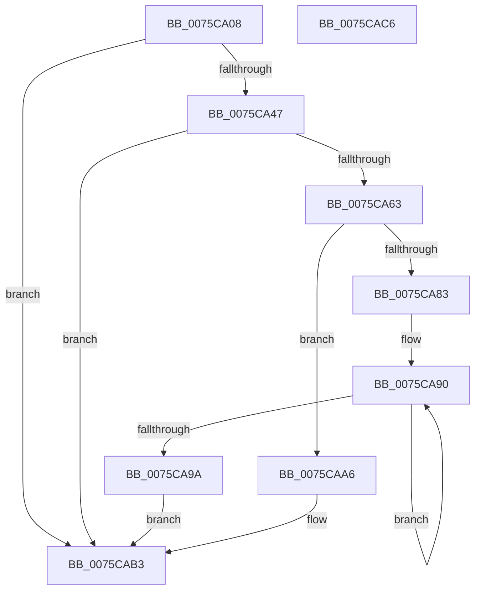

# PopWakeSourceGetDeviceProperty

- RVA: `0x0075CA08`–`0x0075CAC7` (길이 `191` bytes)
- VA: `0x000000014075CA08`
- 실행 섹션: `PAGE`
- PDB 이름 있음: `예`; PDB Function 태그: `아니요`
- unwind 정보 RVA: `0x000A2264`
- 디코드: `57`개 명령, `191/191` bytes 표시
- 미해석 바이트: `0` (있으면 어셈블리에 `.byte`로 보존)

> 이 문서는 커널 이미지의 기계어와 PDB 기호를 분석해 생성했습니다. 4번과 5번은 함수 원형과 자료형을 바이너리 사용 방식에서 추정한 C 해석이며 원본 소스 복구 결과는 아닙니다.

## 1. Dependencies

- 직접 호출 지점: **4**; 고유 호출 대상: **3**
- 직접 호출자로 확인된 함수: **1**
- RIP 상대 이미지 참조: **0**

### Outgoing calls
- `0x0075CA3B` → [IoGetDeviceProperty](../8F/IoGetDeviceProperty_function_008FA720.md) (function, `0x008FA720`)
- `0x0075CA56` → [ExAllocatePool2](../../poolcode/B8/ExAllocatePool2_function_00B820F0.md) (function, `0x00B820F0`)
- `0x0075CA7A` → [IoGetDeviceProperty](../8F/IoGetDeviceProperty_function_008FA720.md) (function, `0x008FA720`)
- `0x0075CAAE` → [ExFreePoolWithTag](../../poolcode/B8/ExFreePoolWithTag_function_00B82870.md) (function, `0x00B82870`)

### Direct callers
- [PopProcessWakeSourceWork](../../pagelk/B7/PopProcessWakeSourceWork_function_00B7C488.md) at `0x00B7C594`
- [PopProcessWakeSourceWork](../../pagelk/B7/PopProcessWakeSourceWork_function_00B7C488.md) at `0x00B7C5A2`
- [PopProcessWakeSourceWork](../../pagelk/B7/PopProcessWakeSourceWork_function_00B7C488.md) at `0x00B7C5B3`
- [PopProcessWakeSourceWork](../../pagelk/B7/PopProcessWakeSourceWork_function_00B7C488.md) at `0x00B7C5C5`

### Static image references
- 디코드된 RIP-relative 메모리 참조가 없습니다.

## 2. Other-region calls and transfers

- 다른 실행 섹션으로 향하는 call: **2**
  - `0x0075CA56` → [ExAllocatePool2](../../poolcode/B8/ExAllocatePool2_function_00B820F0.md) (`PAGE` → `POOLCODE`)
  - `0x0075CAAE` → [ExFreePoolWithTag](../../poolcode/B8/ExFreePoolWithTag_function_00B82870.md) (`PAGE` → `POOLCODE`)
- 별도 외부 분기/꼬리 이동을 확인하지 못했습니다.

## 3. Assembly (complete function range)

```asm
0075CA08  4C 8B DC                        mov r11, rsp
0075CA0B  49 89 5B 08                     mov qword ptr [r11 + 8], rbx
0075CA0F  49 89 6B 10                     mov qword ptr [r11 + 0x10], rbp
0075CA13  56                              push rsi
0075CA14  57                              push rdi
0075CA15  41 56                           push r14
0075CA17  48 83 EC 30                     sub rsp, 0x30
0075CA1B  49 8B F0                        mov rsi, r8
0075CA1E  49 8D 43 20                     lea rax, [r11 + 0x20]
0075CA22  48 8B F9                        mov rdi, rcx
0075CA25  49 89 43 D8                     mov qword ptr [r11 - 0x28], rax
0075CA29  45 33 F6                        xor r14d, r14d
0075CA2C  48 8B CE                        mov rcx, rsi
0075CA2F  45 33 C9                        xor r9d, r9d
0075CA32  45 89 73 20                     mov dword ptr [r11 + 0x20], r14d
0075CA36  45 33 C0                        xor r8d, r8d
0075CA39  8B EA                           mov ebp, edx
0075CA3B  E8 E0 DC 19 00                  call 0x1408fa720
0075CA40  3D 23 00 00 C0                  cmp eax, 0xc0000023
0075CA45  75 6C                           jne 0x14075cab3
0075CA47  8B 54 24 68                     mov edx, dword ptr [rsp + 0x68]
0075CA4B  B9 00 01 00 00                  mov ecx, 0x100
0075CA50  41 B8 4D 65 6D 20               mov r8d, 0x206d654d
0075CA56  E8 95 56 42 00                  call 0x140b820f0
0075CA5B  48 8B D8                        mov rbx, rax
0075CA5E  48 85 C0                        test rax, rax
0075CA61  74 50                           je 0x14075cab3
0075CA63  44 8B 44 24 68                  mov r8d, dword ptr [rsp + 0x68]
0075CA68  48 8D 44 24 68                  lea rax, [rsp + 0x68]
0075CA6D  4C 8B CB                        mov r9, rbx
0075CA70  48 89 44 24 20                  mov qword ptr [rsp + 0x20], rax
0075CA75  8B D5                           mov edx, ebp
0075CA77  48 8B CE                        mov rcx, rsi
0075CA7A  E8 A1 DC 19 00                  call 0x1408fa720
0075CA7F  85 C0                           test eax, eax
0075CA81  78 23                           js 0x14075caa6
0075CA83  0F B7 44 24 68                  movzx eax, word ptr [rsp + 0x68]
0075CA88  66 89 47 02                     mov word ptr [rdi + 2], ax
0075CA8C  48 83 C8 FF                     or rax, 0xffffffffffffffff
0075CA90  48 FF C0                        inc rax
0075CA93  66 44 39 34 43                  cmp word ptr [rbx + rax*2], r14w
0075CA98  75 F6                           jne 0x14075ca90
0075CA9A  66 03 C0                        add ax, ax
0075CA9D  48 89 5F 08                     mov qword ptr [rdi + 8], rbx
0075CAA1  66 89 07                        mov word ptr [rdi], ax
0075CAA4  EB 0D                           jmp 0x14075cab3
0075CAA6  BA 4D 65 6D 20                  mov edx, 0x206d654d
0075CAAB  48 8B CB                        mov rcx, rbx
0075CAAE  E8 BD 5D 42 00                  call 0x140b82870
0075CAB3  48 8B 5C 24 50                  mov rbx, qword ptr [rsp + 0x50]
0075CAB8  48 8B 6C 24 58                  mov rbp, qword ptr [rsp + 0x58]
0075CABD  48 83 C4 30                     add rsp, 0x30
0075CAC1  41 5E                           pop r14
0075CAC3  5F                              pop rdi
0075CAC4  5E                              pop rsi
0075CAC5  C3                              ret
0075CAC6  CC                              int3
```

## 4. C-style interpretation (structured pseudocode)

```c
__int64 __fastcall PopWakeSourceGetDeviceProperty(__int64 a1, int a2, __int64 a3, int a4)
{
    __int64 result;
    __int64 v_r14;
    __int64 v_rsp;
    unsigned __int64 v_stack_m28;
    unsigned __int64 v_stack_p10;
    unsigned int v_stack_p20;
    unsigned __int64 v_stack_p8;

    *(unsigned __int64 *)(v_rsp + 8) = v_rbx;
    *(unsigned __int64 *)(v_rsp + 16) = v_rbp;
    v_rsp = (v_rsp) - (48);
    *(unsigned __int64 *)(v_rsp - 40) = v_rsp + 32;
    v_r14 = 0;
    a4 = 0;
    *(unsigned int *)(v_rsp + 32) = 0;
    a3 = 0;
    result = IoGetDeviceProperty(a3, a2, a3, a4);
    if (((unsigned int)(result)) != 0xC0000023ULL) goto loc_0075CAB3;
    result = ExAllocatePool2(256, (unsigned int)(v_stack_p20), (unsigned int)(0x206D654DULL), a4);
    if (result == 0) goto loc_0075CAB3;
    v_stack_m28 = v_stack_p20;
    result = IoGetDeviceProperty(0, (unsigned int)((unsigned int)((unsigned int)(a2))), (unsigned int)(v_stack_p20), result);
    if (sign_flag) goto loc_0075CAA6;
    *(unsigned __int16 *)(a1 + 2) = (unsigned __int16)(v_stack_p20);
    result = (v_stack_p20) | (-1);
loc_0075CA90:
    result = (result) + 1;
    if ((*(unsigned __int16 *)(result + result * 2)) != 0) goto loc_0075CA90;
    result = (unsigned __int16)((result) + ((unsigned __int16)(result)));
    *(unsigned __int64 *)(a1 + 8) = result;
    *(unsigned __int16 *)(a1) = (unsigned __int16)(result);
    goto loc_0075CAB3;
loc_0075CAA6:
    result = ExFreePoolWithTag(result, (unsigned int)(0x206D654DULL), (unsigned int)(v_stack_p20), result);
loc_0075CAB3:
    v_rsp = (v_rsp) + (48);
    return result;
}
```

## 5. (Beta) C Style

```c
int64_t PopWakeSourceGetDeviceProperty(void *Arg1, int32_t Arg2, int64_t Arg3, int32_t Arg4)
{
    uint8_t *arg1 = (uint8_t *)Arg1;

    int64_t result;
    int64_t local_r14;
    int64_t local_rsp;
    uint64_t v_stack_m28;
    uint64_t v_stack_p10;
    uint32_t v_stack_p20;
    uint64_t v_stack_p8;

    *(uint64_t *)(local_rsp + 0x8) = local_rbx;
    *(uint64_t *)(local_rsp + 0x10) = local_rbp;
    local_rsp = (local_rsp) - (48);
    *(uint64_t *)(local_rsp - 0x28) = local_rsp + 32;
    local_r14 = 0;
    Arg4 = 0;
    *(uint32_t *)(local_rsp + 0x20) = 0;
    Arg3 = 0;
    result = IoGetDeviceProperty(Arg3, Arg2, Arg3, Arg4);
    if (((uint32_t)(result)) != 0xC0000023ULL) goto loc_0075CAB3;
    result = ExAllocatePool2(256, (uint32_t)(v_stack_p20), (uint32_t)(0x206D654DULL), Arg4);
    if (result == 0) goto loc_0075CAB3;
    v_stack_m28 = v_stack_p20;
    result = IoGetDeviceProperty(0, (uint32_t)((uint32_t)((uint32_t)(Arg2))), (uint32_t)(v_stack_p20), result);
    if (sign_flag) goto loc_0075CAA6;
    *(uint16_t *)(arg1 + 0x2) = (uint16_t)(v_stack_p20);
    result = (v_stack_p20) | (-1);
loc_0075CA90:
    result = (result) + 1;
    if ((*(uint16_t *)(result + result * 2)) != 0) goto loc_0075CA90;
    result = (uint16_t)((result) + ((uint16_t)(result)));
    *(uint64_t *)(arg1 + 0x8) = result;
    *(uint16_t *)(arg1) = (uint16_t)(result);
    goto loc_0075CAB3;
loc_0075CAA6:
    result = ExFreePoolWithTag(result, (uint32_t)(0x206D654DULL), (uint32_t)(v_stack_p20), result);
loc_0075CAB3:
    local_rsp = (local_rsp) + (48);
    return result;
}
```

### 관측된 메모리 오프셋

구조체 형식이 확인되지 않은 접근은 인자 기준의 오프셋으로만 기록했습니다.

| 기준 인자 | 오프셋 표현 | 폭 (bit) | 접근 |
|---|---:|---:|---|
| `Arg1` | `+ 0x0` | `16` | `W` |
| `Arg1` | `+ 0x2` | `16` | `W` |
| `Arg1` | `+ 0x8` | `64` | `W` |

## 6. Execution-region graph

[열기: 2D/3D 그래프와 함수 탐색 컨트롤 패널](../../../control-panel.html?section=page&rva=0x0075CA08&view=graph)

- 2D 그래프는 위에서 아래로 흐르고, 3D 그래프는 빈 공간을 드래그해 회전합니다. Shift+드래그는 이동, 휠은 확대·축소, 함수 노드 선택은 대상 보고서 이동입니다.

### Static fallback


