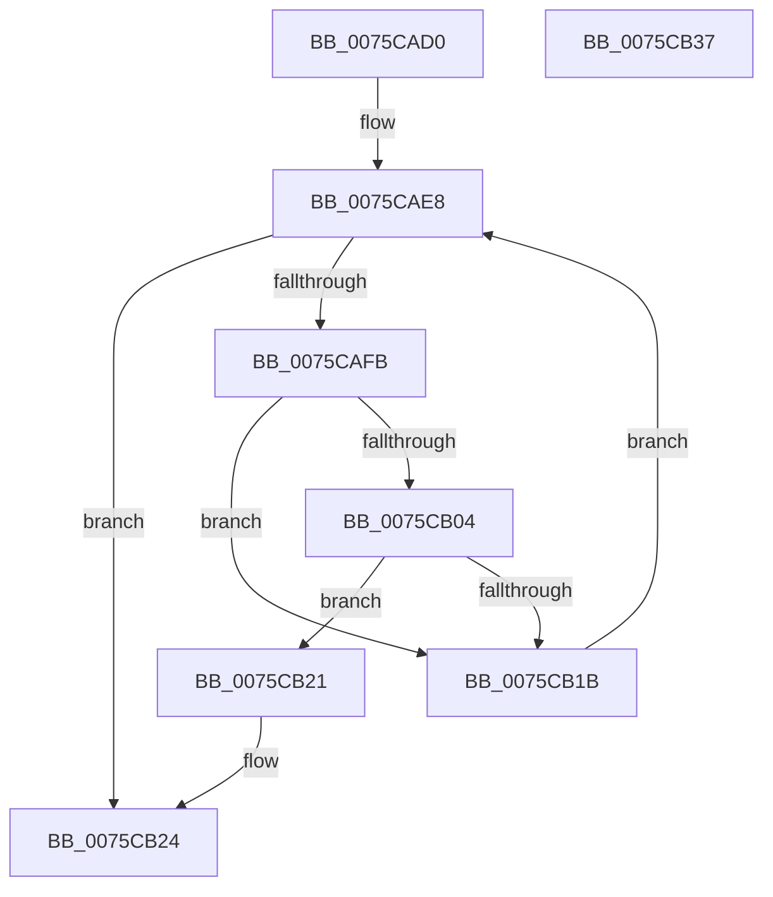

# PopWakeSourceIsChild

- RVA: `0x0075CAD0`–`0x0075CB38` (길이 `104` bytes)
- VA: `0x000000014075CAD0`
- 실행 섹션: `PAGE`
- PDB 이름 있음: `예`; PDB Function 태그: `아니요`
- unwind 정보 RVA: `0x00060BC4`
- 디코드: `32`개 명령, `104/104` bytes 표시
- 미해석 바이트: `0` (있으면 어셈블리에 `.byte`로 보존)

> 이 문서는 커널 이미지의 기계어와 PDB 기호를 분석해 생성했습니다. 4번과 5번은 함수 원형과 자료형을 바이너리 사용 방식에서 추정한 C 해석이며 원본 소스 복구 결과는 아닙니다.

## 1. Dependencies

- 직접 호출 지점: **1**; 고유 호출 대상: **1**
- 직접 호출자로 확인된 함수: **1**
- RIP 상대 이미지 참조: **1**

### Outgoing calls
- `0x0075CB12` → [wcsncmp](../../text/50/wcsncmp_function_00501CA0.md) (function, `0x00501CA0`)

### Direct callers
- [PopProcessWakeSourceWork](../../pagelk/B7/PopProcessWakeSourceWork_function_00B7C488.md) at `0x00B7C51D`

### Static image references
- `0x0075CAE8` → RVA `0x00F8C438` (`.data`; read)

## 2. Other-region calls and transfers

- 다른 실행 섹션으로 향하는 call: **1**
  - `0x0075CB12` → [wcsncmp](../../text/50/wcsncmp_function_00501CA0.md) (`PAGE` → `.text`)
- 별도 외부 분기/꼬리 이동을 확인하지 못했습니다.

## 3. Assembly (complete function range)

```asm
0075CAD0  48 89 5C 24 08                  mov qword ptr [rsp + 8], rbx
0075CAD5  48 89 74 24 10                  mov qword ptr [rsp + 0x10], rsi
0075CADA  57                              push rdi
0075CADB  48 83 EC 20                     sub rsp, 0x20
0075CADF  48 8B 41 10                     mov rax, qword ptr [rcx + 0x10]
0075CAE3  48 8B F2                        mov rsi, rdx
0075CAE6  33 FF                           xor edi, edi
0075CAE8  48 3B 05 49 F9 82 00            cmp rax, qword ptr [rip + 0x82f949]
0075CAEF  48 8B DF                        mov rbx, rdi
0075CAF2  48 0F 45 D8                     cmovne rbx, rax
0075CAF6  48 85 DB                        test rbx, rbx
0075CAF9  74 29                           je 0x14075cb24
0075CAFB  0F B7 43 28                     movzx eax, word ptr [rbx + 0x28]
0075CAFF  66 3B 06                        cmp ax, word ptr [rsi]
0075CB02  75 17                           jne 0x14075cb1b
0075CB04  48 8B 56 08                     mov rdx, qword ptr [rsi + 8]
0075CB08  44 8B C0                        mov r8d, eax
0075CB0B  48 8B 4B 30                     mov rcx, qword ptr [rbx + 0x30]
0075CB0F  49 D1 E8                        shr r8, 1
0075CB12  E8 89 51 DA FF                  call 0x140501ca0
0075CB17  85 C0                           test eax, eax
0075CB19  74 06                           je 0x14075cb21
0075CB1B  48 8B 43 10                     mov rax, qword ptr [rbx + 0x10]
0075CB1F  EB C7                           jmp 0x14075cae8
0075CB21  40 B7 01                        mov dil, 1
0075CB24  48 8B 5C 24 30                  mov rbx, qword ptr [rsp + 0x30]
0075CB29  40 8A C7                        mov al, dil
0075CB2C  48 8B 74 24 38                  mov rsi, qword ptr [rsp + 0x38]
0075CB31  48 83 C4 20                     add rsp, 0x20
0075CB35  5F                              pop rdi
0075CB36  C3                              ret
0075CB37  CC                              int3
```

## 4. C-style interpretation (structured pseudocode)

```c
__int64 __fastcall PopWakeSourceIsChild(__int64 a1, __int64 a2)
{
    __int64 result;
    __int64 v_rbx;
    __int64 v_rdi;
    __int64 v_rsp;
    unsigned __int64 v_stack_p10;
    unsigned __int64 v_stack_p8;

    v_stack_p8 = v_rbx;
    v_stack_p10 = v_rsi;
    v_rsp = (v_rsp) - (32);
    v_rdi = 0;
loc_0075CAE8:
    v_rbx = 0;
    if ((*(unsigned __int64 *)(a1 + 16)) != (*(unsigned __int64 *)(v_rip + 8583497))) { v_rbx = *(unsigned __int64 *)(a1 + 16); }
    if (v_rbx == 0) goto loc_0075CB24;
    if (((unsigned __int16)(*(unsigned __int16 *)(v_rbx + 40))) != (*(unsigned __int16 *)(a2))) goto loc_0075CB1B;
    a3 = ((unsigned int)((unsigned int)(*(unsigned __int16 *)(v_rbx + 40)))) >> (1);
    result = wcsncmp(*(unsigned __int64 *)(v_rbx + 48), *(unsigned __int64 *)(a2 + 8), a3, a4);
    if ((unsigned int)(result) == 0) goto loc_0075CB21;
loc_0075CB1B:
    goto loc_0075CAE8;
loc_0075CB21:
loc_0075CB24:
    v_rsp = (v_rsp) + (32);
    return 1;
}
```

## 5. (Beta) C Style

```c
int64_t PopWakeSourceIsChild(void *Arg1, void *Arg2)
{
    uint8_t *arg1 = (uint8_t *)Arg1;
    uint8_t *arg2 = (uint8_t *)Arg2;

    int64_t result;
    int64_t local_rbx;
    int64_t local_rdi;
    int64_t local_rsp;
    uint64_t v_stack_p10;
    uint64_t v_stack_p8;

    v_stack_p8 = local_rbx;
    v_stack_p10 = local_rsi;
    local_rsp = (local_rsp) - (32);
    local_rdi = 0;
loc_0075CAE8:
    local_rbx = 0;
    if ((*(uint64_t *)(arg1 + 0x10)) != (*(uint64_t *)(v_rip + 0x82F949))) { local_rbx = *(uint64_t *)(arg1 + 0x10); }
    if (local_rbx == 0) goto loc_0075CB24;
    if (((uint16_t)(*(uint16_t *)(local_rbx + 0x28))) != (*(uint16_t *)(arg2))) goto loc_0075CB1B;
    a3 = ((uint32_t)((uint32_t)(*(uint16_t *)(local_rbx + 0x28)))) >> (1);
    result = wcsncmp(*(uint64_t *)(local_rbx + 0x30), *(uint64_t *)(arg2 + 0x8), a3, a4);
    if ((uint32_t)(result) == 0) goto loc_0075CB21;
loc_0075CB1B:
    goto loc_0075CAE8;
loc_0075CB21:
loc_0075CB24:
    local_rsp = (local_rsp) + (32);
    return 1;
}
```

### 관측된 메모리 오프셋

구조체 형식이 확인되지 않은 접근은 인자 기준의 오프셋으로만 기록했습니다.

| 기준 인자 | 오프셋 표현 | 폭 (bit) | 접근 |
|---|---:|---:|---|
| `Arg1` | `+ 0x10` | `64` | `R` |
| `Arg2` | `+ 0x0` | `16` | `R` |
| `Arg2` | `+ 0x8` | `64` | `R` |

## 6. Execution-region graph

[열기: 2D/3D 그래프와 함수 탐색 컨트롤 패널](../../../control-panel.html?section=page&rva=0x0075CAD0&view=graph)

- 2D 그래프는 위에서 아래로 흐르고, 3D 그래프는 빈 공간을 드래그해 회전합니다. Shift+드래그는 이동, 휠은 확대·축소, 함수 노드 선택은 대상 보고서 이동입니다.

### Static fallback


