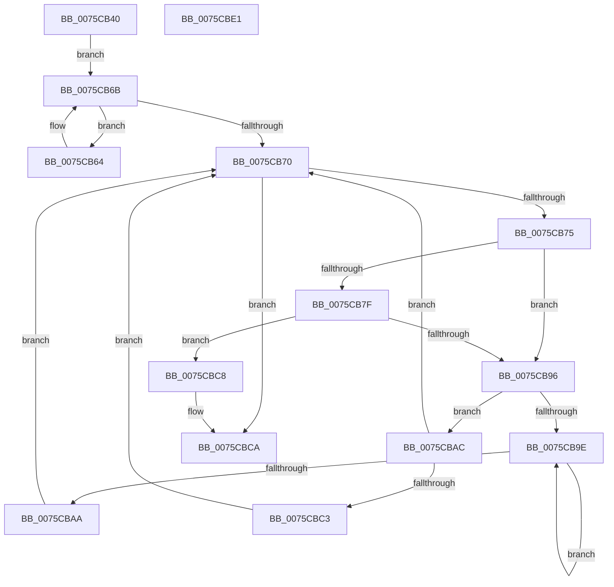

# PopWakeSourceIsParent

- RVA: `0x0075CB40`–`0x0075CBE2` (길이 `162` bytes)
- VA: `0x000000014075CB40`
- 실행 섹션: `PAGE`
- PDB 이름 있음: `예`; PDB Function 태그: `아니요`
- unwind 정보 RVA: `0x0005C954`
- 디코드: `52`개 명령, `162/162` bytes 표시
- 미해석 바이트: `0` (있으면 어셈블리에 `.byte`로 보존)

> 이 문서는 커널 이미지의 기계어와 PDB 기호를 분석해 생성했습니다. 4번과 5번은 함수 원형과 자료형을 바이너리 사용 방식에서 추정한 C 해석이며 원본 소스 복구 결과는 아닙니다.

## 1. Dependencies

- 직접 호출 지점: **1**; 고유 호출 대상: **1**
- 직접 호출자로 확인된 함수: **1**
- RIP 상대 이미지 참조: **1**

### Outgoing calls
- `0x0075CB8D` → [wcsncmp](../../text/50/wcsncmp_function_00501CA0.md) (function, `0x00501CA0`)

### Direct callers
- [PopProcessWakeSourceWork](../../pagelk/B7/PopProcessWakeSourceWork_function_00B7C488.md) at `0x00B7C504`

### Static image references
- `0x0075CBB3` → RVA `0x00F8C438` (`.data`; read)

## 2. Other-region calls and transfers

- 다른 실행 섹션으로 향하는 call: **1**
  - `0x0075CB8D` → [wcsncmp](../../text/50/wcsncmp_function_00501CA0.md) (`PAGE` → `.text`)
- 별도 외부 분기/꼬리 이동을 확인하지 못했습니다.

## 3. Assembly (complete function range)

```asm
0075CB40  48 89 5C 24 08                  mov qword ptr [rsp + 8], rbx
0075CB45  48 89 6C 24 10                  mov qword ptr [rsp + 0x10], rbp
0075CB4A  48 89 74 24 18                  mov qword ptr [rsp + 0x18], rsi
0075CB4F  57                              push rdi
0075CB50  48 83 EC 20                     sub rsp, 0x20
0075CB54  48 8B 41 08                     mov rax, qword ptr [rcx + 8]
0075CB58  33 DB                           xor ebx, ebx
0075CB5A  8B FB                           mov edi, ebx
0075CB5C  48 8B EA                        mov rbp, rdx
0075CB5F  48 8B F1                        mov rsi, rcx
0075CB62  EB 07                           jmp 0x14075cb6b
0075CB64  48 8B F8                        mov rdi, rax
0075CB67  48 8B 40 08                     mov rax, qword ptr [rax + 8]
0075CB6B  48 85 C0                        test rax, rax
0075CB6E  75 F4                           jne 0x14075cb64
0075CB70  48 85 FF                        test rdi, rdi
0075CB73  74 55                           je 0x14075cbca
0075CB75  0F B7 47 28                     movzx eax, word ptr [rdi + 0x28]
0075CB79  66 3B 45 00                     cmp ax, word ptr [rbp]
0075CB7D  75 17                           jne 0x14075cb96
0075CB7F  48 8B 55 08                     mov rdx, qword ptr [rbp + 8]
0075CB83  44 8B C0                        mov r8d, eax
0075CB86  48 8B 4F 30                     mov rcx, qword ptr [rdi + 0x30]
0075CB8A  49 D1 E8                        shr r8, 1
0075CB8D  E8 0E 51 DA FF                  call 0x140501ca0
0075CB92  85 C0                           test eax, eax
0075CB94  74 32                           je 0x14075cbc8
0075CB96  48 8B 07                        mov rax, qword ptr [rdi]
0075CB99  48 85 C0                        test rax, rax
0075CB9C  74 0E                           je 0x14075cbac
0075CB9E  48 8B F8                        mov rdi, rax
0075CBA1  48 8B 40 08                     mov rax, qword ptr [rax + 8]
0075CBA5  48 85 C0                        test rax, rax
0075CBA8  75 F4                           jne 0x14075cb9e
0075CBAA  EB C4                           jmp 0x14075cb70
0075CBAC  48 8B 47 10                     mov rax, qword ptr [rdi + 0x10]
0075CBB0  48 8B FB                        mov rdi, rbx
0075CBB3  48 3B 05 7E F8 82 00            cmp rax, qword ptr [rip + 0x82f87e]
0075CBBA  48 0F 45 F8                     cmovne rdi, rax
0075CBBE  48 3B FE                        cmp rdi, rsi
0075CBC1  75 AD                           jne 0x14075cb70
0075CBC3  48 8B FB                        mov rdi, rbx
0075CBC6  EB A8                           jmp 0x14075cb70
0075CBC8  B3 01                           mov bl, 1
0075CBCA  48 8B 6C 24 38                  mov rbp, qword ptr [rsp + 0x38]
0075CBCF  8A C3                           mov al, bl
0075CBD1  48 8B 5C 24 30                  mov rbx, qword ptr [rsp + 0x30]
0075CBD6  48 8B 74 24 40                  mov rsi, qword ptr [rsp + 0x40]
0075CBDB  48 83 C4 20                     add rsp, 0x20
0075CBDF  5F                              pop rdi
0075CBE0  C3                              ret
0075CBE1  CC                              int3
```

## 4. C-style interpretation (structured pseudocode)

```c
__int64 __fastcall PopWakeSourceIsParent(__int64 a1, __int64 a2)
{
    __int64 result;
    __int64 v_rbx;
    __int64 v_rdi;
    __int64 v_rsp;
    unsigned __int64 v_stack_p10;
    unsigned __int64 v_stack_p18;
    unsigned __int64 v_stack_p8;

    v_stack_p8 = v_rbx;
    v_stack_p10 = v_rbp;
    v_stack_p18 = v_rsi;
    v_rsp = (v_rsp) - (32);
    v_rbx = 0;
    goto loc_0075CB6B;
loc_0075CB64:
loc_0075CB6B:
    if (*(unsigned __int64 *)(*(unsigned __int64 *)(a1 + 8) + 8) != 0) goto loc_0075CB64;
loc_0075CB70:
    if (*(unsigned __int64 *)(a1 + 8) == 0) goto loc_0075CBCA;
    if (((unsigned __int16)(*(unsigned __int16 *)(*(unsigned __int64 *)(a1 + 8) + 40))) != (*(unsigned __int16 *)(a2))) goto loc_0075CB96;
    a3 = ((unsigned int)((unsigned int)(*(unsigned __int16 *)(*(unsigned __int64 *)(a1 + 8) + 40)))) >> (1);
    result = wcsncmp(*(unsigned __int64 *)(*(unsigned __int64 *)(a1 + 8) + 48), *(unsigned __int64 *)(a2 + 8), a3, a4);
    if ((unsigned int)(result) == 0) goto loc_0075CBC8;
loc_0075CB96:
    if (*(unsigned __int64 *)(*(unsigned __int64 *)(a1 + 8)) == 0) goto loc_0075CBAC;
loc_0075CB9E:
    if (*(unsigned __int64 *)(*(unsigned __int64 *)(*(unsigned __int64 *)(a1 + 8)) + 8) != 0) goto loc_0075CB9E;
    goto loc_0075CB70;
loc_0075CBAC:
    v_rdi = 0;
    if ((*(unsigned __int64 *)(*(unsigned __int64 *)(*(unsigned __int64 *)(a1 + 8)) + 16)) != (*(unsigned __int64 *)(v_rip + 8583294))) { v_rdi = *(unsigned __int64 *)(*(unsigned __int64 *)(*(unsigned __int64 *)(a1 + 8)) + 16); }
    if (v_rdi != a1) goto loc_0075CB70;
    goto loc_0075CB70;
loc_0075CBC8:
loc_0075CBCA:
    v_rsp = (v_rsp) + (32);
    return 1;
}
```

## 5. (Beta) C Style

```c
int64_t PopWakeSourceIsParent(void *Arg1, void *Arg2)
{
    uint8_t *arg1 = (uint8_t *)Arg1;
    uint8_t *arg2 = (uint8_t *)Arg2;

    int64_t result;
    int64_t local_rbx;
    int64_t local_rdi;
    int64_t local_rsp;
    uint64_t v_stack_p10;
    uint64_t v_stack_p18;
    uint64_t v_stack_p8;

    v_stack_p8 = local_rbx;
    v_stack_p10 = local_rbp;
    v_stack_p18 = local_rsi;
    local_rsp = (local_rsp) - (32);
    local_rbx = 0;
    goto loc_0075CB6B;
loc_0075CB64:
loc_0075CB6B:
    if (*(uint64_t *)(*(uint64_t *)(arg1 + 0x8) + 0x8) != 0) goto loc_0075CB64;
loc_0075CB70:
    if (*(uint64_t *)(arg1 + 0x8) == 0) goto loc_0075CBCA;
    if (((uint16_t)(*(uint16_t *)(*(uint64_t *)(arg1 + 0x8) + 0x28))) != (*(uint16_t *)(arg2))) goto loc_0075CB96;
    a3 = ((uint32_t)((uint32_t)(*(uint16_t *)(*(uint64_t *)(arg1 + 0x8) + 0x28)))) >> (1);
    result = wcsncmp(*(uint64_t *)(*(uint64_t *)(arg1 + 0x8) + 0x30), *(uint64_t *)(arg2 + 0x8), a3, a4);
    if ((uint32_t)(result) == 0) goto loc_0075CBC8;
loc_0075CB96:
    if (*(uint64_t *)(*(uint64_t *)(arg1 + 0x8)) == 0) goto loc_0075CBAC;
loc_0075CB9E:
    if (*(uint64_t *)(*(uint64_t *)(*(uint64_t *)(arg1 + 0x8)) + 0x8) != 0) goto loc_0075CB9E;
    goto loc_0075CB70;
loc_0075CBAC:
    local_rdi = 0;
    if ((*(uint64_t *)(*(uint64_t *)(*(uint64_t *)(arg1 + 0x8)) + 0x10)) != (*(uint64_t *)(v_rip + 0x82F87E))) { local_rdi = *(uint64_t *)(*(uint64_t *)(*(uint64_t *)(arg1 + 0x8)) + 0x10); }
    if (local_rdi != Arg1) goto loc_0075CB70;
    goto loc_0075CB70;
loc_0075CBC8:
loc_0075CBCA:
    local_rsp = (local_rsp) + (32);
    return 1;
}
```

### 관측된 메모리 오프셋

구조체 형식이 확인되지 않은 접근은 인자 기준의 오프셋으로만 기록했습니다.

| 기준 인자 | 오프셋 표현 | 폭 (bit) | 접근 |
|---|---:|---:|---|
| `Arg1` | `+ 0x8` | `64` | `R` |
| `Arg2` | `+ 0x0` | `16` | `R` |
| `Arg2` | `+ 0x8` | `64` | `R` |

## 6. Execution-region graph

[열기: 2D/3D 그래프와 함수 탐색 컨트롤 패널](../../../control-panel.html?section=page&rva=0x0075CB40&view=graph)

- 2D 그래프는 위에서 아래로 흐르고, 3D 그래프는 빈 공간을 드래그해 회전합니다. Shift+드래그는 이동, 휠은 확대·축소, 함수 노드 선택은 대상 보고서 이동입니다.

### Static fallback


