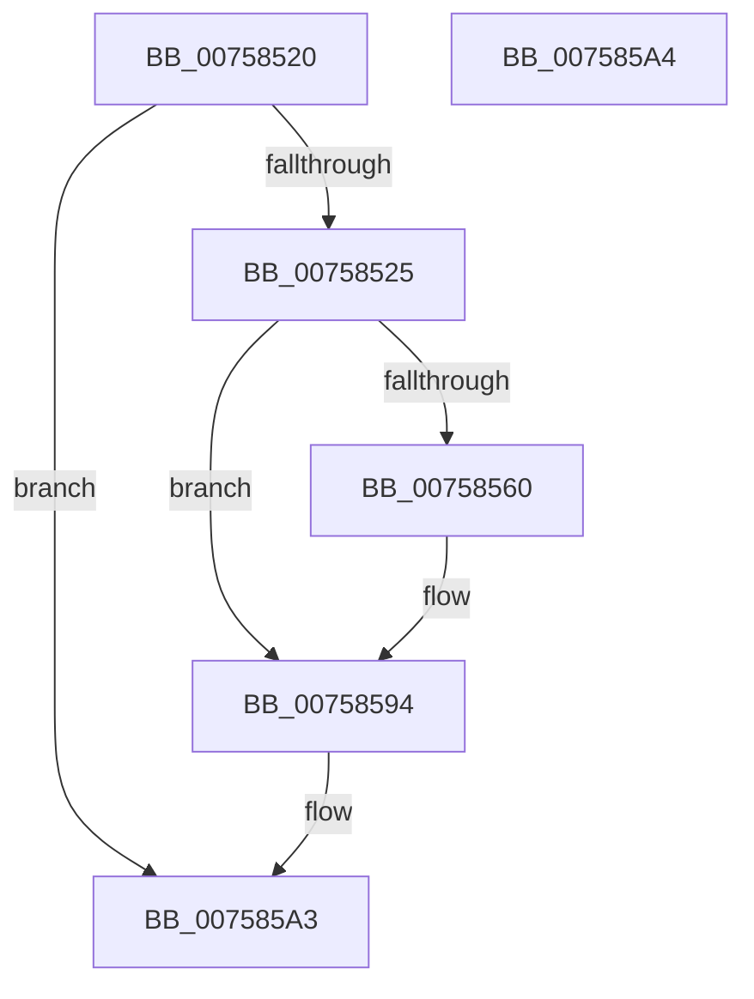

# PopWin32kActivatorCallback

- RVA: `0x00758520`–`0x007585A5` (길이 `133` bytes)
- VA: `0x0000000140758520`
- 실행 섹션: `PAGE`
- PDB 이름 있음: `예`; PDB Function 태그: `아니요`
- unwind 정보 RVA: `0x000CC09C`
- 디코드: `34`개 명령, `133/133` bytes 표시
- 미해석 바이트: `0` (있으면 어셈블리에 `.byte`로 보존)

> 이 문서는 커널 이미지의 기계어와 PDB 기호를 분석해 생성했습니다. 4번과 5번은 함수 원형과 자료형을 바이너리 사용 방식에서 추정한 C 해석이며 원본 소스 복구 결과는 아닙니다.

## 1. Dependencies

- 직접 호출 지점: **3**; 고유 호출 대상: **3**
- 직접 호출자로 확인된 함수: **0**
- RIP 상대 이미지 참조: **1**

### Outgoing calls
- `0x00758549` → [PopAcquireRwLockExclusive](../../text/43/PopAcquireRwLockExclusive_function_00430B44.md) (function, `0x00430B44`)
- `0x00758557` → [PopReleaseRwLock](../../text/2D/PopReleaseRwLock_function_002DFBBC.md) (function, `0x002DFBBC`)
- `0x0075858F` → [Pdcv2ActivationClientRenewActivation](../79/Pdcv2ActivationClientRenewActivation_function_0079B0F0.md) (function, `0x0079B0F0`)

### Direct callers
- 이 함수 시작 RVA로 연결되는 직접 call은 확인되지 않았습니다. 간접 호출은 완전히 역산할 수 없습니다.

### Static image references
- `0x00758539` → RVA `0x00F0E840` (`.data`; read)

## 2. Other-region calls and transfers

- 다른 실행 섹션으로 향하는 call: **2**
  - `0x00758549` → [PopAcquireRwLockExclusive](../../text/43/PopAcquireRwLockExclusive_function_00430B44.md) (`PAGE` → `.text`)
  - `0x00758557` → [PopReleaseRwLock](../../text/2D/PopReleaseRwLock_function_002DFBBC.md) (`PAGE` → `.text`)
- 별도 외부 분기/꼬리 이동을 확인하지 못했습니다.

## 3. Assembly (complete function range)

```asm
00758520  83 FA 64                        cmp edx, 0x64
00758523  75 7E                           jne 0x1407585a3
00758525  48 89 5C 24 08                  mov qword ptr [rsp + 8], rbx
0075852A  48 89 74 24 18                  mov qword ptr [rsp + 0x18], rsi
0075852F  57                              push rdi
00758530  48 83 EC 50                     sub rsp, 0x50
00758534  83 64 24 68 00                  and dword ptr [rsp + 0x68], 0
00758539  48 8D 35 00 63 7B 00            lea rsi, [rip + 0x7b6300]
00758540  48 8B F9                        mov rdi, rcx
00758543  49 8B D9                        mov rbx, r9
00758546  48 8B CE                        mov rcx, rsi
00758549  E8 F6 85 CD FF                  call 0x140430b44
0075854E  8B C3                           mov eax, ebx
00758550  48 8B CE                        mov rcx, rsi
00758553  8B 5C 86 18                     mov ebx, dword ptr [rsi + rax*4 + 0x18]
00758557  E8 60 76 B8 FF                  call 0x1402dfbbc
0075855C  85 DB                           test ebx, ebx
0075855E  74 34                           je 0x140758594
00758560  0F 57 C0                        xorps xmm0, xmm0
00758563  C7 44 24 20 01 00 00 00         mov dword ptr [rsp + 0x20], 1
0075856B  0F 57 C9                        xorps xmm1, xmm1
0075856E  C7 44 24 24 2C 01 00 00         mov dword ptr [rsp + 0x24], 0x12c
00758576  4C 8D 44 24 68                  lea r8, [rsp + 0x68]
0075857B  48 8B CF                        mov rcx, rdi
0075857E  48 8D 54 24 20                  lea rdx, [rsp + 0x20]
00758583  F3 0F 7F 44 24 28               movdqu xmmword ptr [rsp + 0x28], xmm0
00758589  F3 0F 7F 4C 24 38               movdqu xmmword ptr [rsp + 0x38], xmm1
0075858F  E8 5C 2B 04 00                  call 0x14079b0f0
00758594  48 8B 5C 24 60                  mov rbx, qword ptr [rsp + 0x60]
00758599  48 8B 74 24 70                  mov rsi, qword ptr [rsp + 0x70]
0075859E  48 83 C4 50                     add rsp, 0x50
007585A2  5F                              pop rdi
007585A3  C3                              ret
007585A4  CC                              int3
```

## 4. C-style interpretation (structured pseudocode)

```c
__int64 __fastcall PopWin32kActivatorCallback(__int64 a1, int a2, __int64 a3, __int64 a4)
{
    __int64 result;
    __int64 v_rsp;
    unsigned __int64 v_stack_m20;
    unsigned __int64 v_stack_m30;
    unsigned int v_stack_m34;
    unsigned int v_stack_m38;
    unsigned int v_stack_p10;
    unsigned __int64 v_stack_p18;
    unsigned __int64 v_stack_p8;

    if (a2 != 100) goto loc_007585A3;
    v_stack_p8 = v_rbx;
    v_stack_p18 = v_rsi;
    v_rsp = (v_rsp) - (80);
    result = PopAcquireRwLockExclusive(v_rip + 8086272, a2, a3, a4);
    result = PopReleaseRwLock(v_rip + 8086272, a2, a3, a4);
    if ((unsigned int)((unsigned int)(*(unsigned int *)(v_rip + 8086272 + (unsigned int)((unsigned int)(a4)) * 4 + 24))) != 0) {
        v_stack_m38 = 1;
        v_stack_m34 = 300;
        a3 = v_stack_p10;
        a1 = a1;
        a2 = v_stack_m38;
        v_stack_m30 = v_xmm0;
        v_stack_m20 = v_xmm1;
        result = Pdcv2ActivationClientRenewActivation(a1, a2, a3, a4);
    }
    v_rsp = (v_rsp) + (80);
loc_007585A3:
    return result;
}
```

## 5. (Beta) C Style

```c
int64_t PopWin32kActivatorCallback(int64_t Arg1, int32_t Arg2, int64_t Arg3, int64_t Arg4)
{
    int64_t result;
    int64_t local_rsp;
    uint64_t v_stack_m20;
    uint64_t v_stack_m30;
    uint32_t v_stack_m34;
    uint32_t v_stack_m38;
    uint32_t v_stack_p10;
    uint64_t v_stack_p18;
    uint64_t v_stack_p8;

    if (Arg2 != 100) goto loc_007585A3;
    v_stack_p8 = local_rbx;
    v_stack_p18 = local_rsi;
    local_rsp = (local_rsp) - (80);
    result = PopAcquireRwLockExclusive(v_rip + 8086272, Arg2, Arg3, Arg4);
    result = PopReleaseRwLock(v_rip + 8086272, Arg2, Arg3, Arg4);
    if ((uint32_t)((uint32_t)(*(uint32_t *)(v_rip + 0x7B6300 + (uint32_t)((uint32_t)(Arg4)) * 4 + 0x18))) != 0) {
        v_stack_m38 = 1;
        v_stack_m34 = 300;
        Arg3 = v_stack_p10;
        Arg1 = Arg1;
        Arg2 = v_stack_m38;
        v_stack_m30 = v_xmm0;
        v_stack_m20 = v_xmm1;
        result = Pdcv2ActivationClientRenewActivation(Arg1, Arg2, Arg3, Arg4);
    }
    local_rsp = (local_rsp) + (80);
loc_007585A3:
    return result;
}
```

## 6. Execution-region graph

[열기: 2D/3D 그래프와 함수 탐색 컨트롤 패널](../../../control-panel.html?section=page&rva=0x00758520&view=graph)

- 2D 그래프는 위에서 아래로 흐르고, 3D 그래프는 빈 공간을 드래그해 회전합니다. Shift+드래그는 이동, 휠은 확대·축소, 함수 노드 선택은 대상 보고서 이동입니다.

### Static fallback


