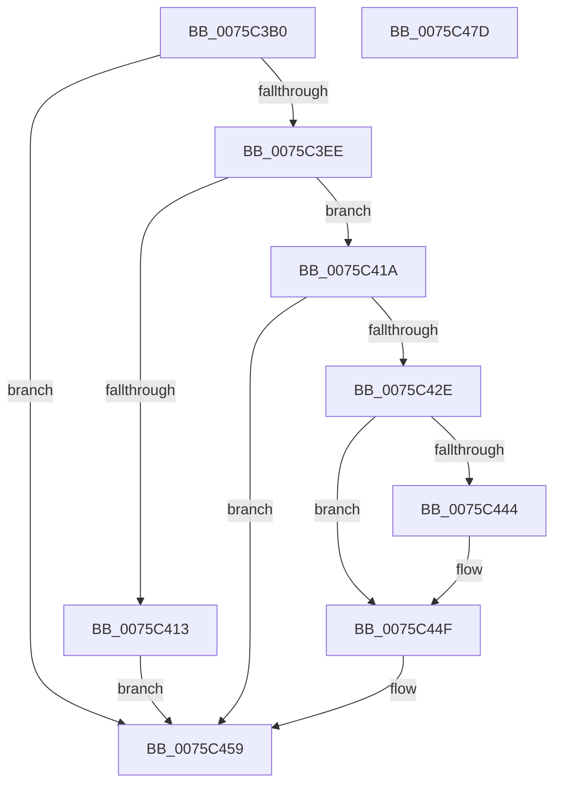

# PopWnfEffectivePowerModeCallback

- RVA: `0x0075C3B0`–`0x0075C47E` (길이 `206` bytes)
- VA: `0x000000014075C3B0`
- 실행 섹션: `PAGE`
- PDB 이름 있음: `예`; PDB Function 태그: `아니요`
- unwind 정보 RVA: `0x00084C9C`
- 디코드: `58`개 명령, `206/206` bytes 표시
- 미해석 바이트: `0` (있으면 어셈블리에 `.byte`로 보존)

> 이 문서는 커널 이미지의 기계어와 PDB 기호를 분석해 생성했습니다. 4번과 5번은 함수 원형과 자료형을 바이너리 사용 방식에서 추정한 C 해석이며 원본 소스 복구 결과는 아닙니다.

## 1. Dependencies

- 직접 호출 지점: **4**; 고유 호출 대상: **4**
- 직접 호출자로 확인된 함수: **0**
- RIP 상대 이미지 참조: **1**

### Outgoing calls
- `0x0075C3DD` → [PopAcquireRwLockExclusive](../../text/43/PopAcquireRwLockExclusive_function_00430B44.md) (function, `0x00430B44`)
- `0x0075C408` → [ExQueryWnfStateData](../A4/ExQueryWnfStateData_function_00A4A480.md) (function, `0x00A4A480`)
- `0x0075C44A` → [guard_dispatch_icall](../../text/6B/guard_dispatch_icall_function_006BAAD0.md) (function, `0x006BAAD0`)
- `0x0075C45D` → [PopReleaseRwLock](../../text/2D/PopReleaseRwLock_function_002DFBBC.md) (function, `0x002DFBBC`)

### Direct callers
- 이 함수 시작 RVA로 연결되는 직접 call은 확인되지 않았습니다. 간접 호출은 완전히 역산할 수 없습니다.

### Static image references
- `0x0075C3E5` → RVA `0x000209F0` (`.rdata`; read)

## 2. Other-region calls and transfers

- 다른 실행 섹션으로 향하는 call: **3**
  - `0x0075C3DD` → [PopAcquireRwLockExclusive](../../text/43/PopAcquireRwLockExclusive_function_00430B44.md) (`PAGE` → `.text`)
  - `0x0075C44A` → [guard_dispatch_icall](../../text/6B/guard_dispatch_icall_function_006BAAD0.md) (`PAGE` → `.text`)
  - `0x0075C45D` → [PopReleaseRwLock](../../text/2D/PopReleaseRwLock_function_002DFBBC.md) (`PAGE` → `.text`)
- 별도 외부 분기/꼬리 이동을 확인하지 못했습니다.

## 3. Assembly (complete function range)

```asm
0075C3B0  48 89 5C 24 08                  mov qword ptr [rsp + 8], rbx
0075C3B5  48 89 6C 24 10                  mov qword ptr [rsp + 0x10], rbp
0075C3BA  48 89 74 24 18                  mov qword ptr [rsp + 0x18], rsi
0075C3BF  57                              push rdi
0075C3C0  41 56                           push r14
0075C3C2  41 57                           push r15
0075C3C4  48 83 EC 30                     sub rsp, 0x30
0075C3C8  48 8B 7C 24 78                  mov rdi, qword ptr [rsp + 0x78]
0075C3CD  4C 8B F1                        mov r14, rcx
0075C3D0  45 33 FF                        xor r15d, r15d
0075C3D3  48 8B DA                        mov rbx, rdx
0075C3D6  41 8B F7                        mov esi, r15d
0075C3D9  48 8D 4F 28                     lea rcx, [rdi + 0x28]
0075C3DD  E8 62 47 CD FF                  call 0x140430b44
0075C3E2  48 8B 03                        mov rax, qword ptr [rbx]
0075C3E5  48 3B 05 04 46 8C FF            cmp rax, qword ptr [rip - 0x73b9fc]
0075C3EC  75 6B                           jne 0x14075c459
0075C3EE  4C 8D 4C 24 78                  lea r9, [rsp + 0x78]
0075C3F3  C7 44 24 78 08 00 00 00         mov dword ptr [rsp + 0x78], 8
0075C3FB  4C 8D 44 24 20                  lea r8, [rsp + 0x20]
0075C400  49 8B CE                        mov rcx, r14
0075C403  48 8D 54 24 68                  lea rdx, [rsp + 0x68]
0075C408  E8 73 E0 2E 00                  call 0x140a4a480
0075C40D  8B F0                           mov esi, eax
0075C40F  85 C0                           test eax, eax
0075C411  74 07                           je 0x14075c41a
0075C413  BE 80 00 00 00                  mov esi, 0x80
0075C418  EB 3F                           jmp 0x14075c459
0075C41A  8B 07                           mov eax, dword ptr [rdi]
0075C41C  FF C8                           dec eax
0075C41E  83 F8 01                        cmp eax, 1
0075C421  41 0F 47 C7                     cmova eax, r15d
0075C425  8B 5C 84 20                     mov ebx, dword ptr [rsp + rax*4 + 0x20]
0075C429  3B 5F 10                        cmp ebx, dword ptr [rdi + 0x10]
0075C42C  74 2B                           je 0x14075c459
0075C42E  65 48 8B 04 25 88 01 00 00      mov rax, qword ptr gs:[0x188]
0075C437  48 89 47 48                     mov qword ptr [rdi + 0x48], rax
0075C43B  48 8B 47 38                     mov rax, qword ptr [rdi + 0x38]
0075C43F  48 85 C0                        test rax, rax
0075C442  74 0B                           je 0x14075c44f
0075C444  48 8B 57 50                     mov rdx, qword ptr [rdi + 0x50]
0075C448  8B CB                           mov ecx, ebx
0075C44A  E8 81 E6 F5 FF                  call 0x1406baad0
0075C44F  FF 47 40                        inc dword ptr [rdi + 0x40]
0075C452  89 5F 10                        mov dword ptr [rdi + 0x10], ebx
0075C455  4C 89 7F 48                     mov qword ptr [rdi + 0x48], r15
0075C459  48 8D 4F 28                     lea rcx, [rdi + 0x28]
0075C45D  E8 5A 37 B8 FF                  call 0x1402dfbbc
0075C462  48 8B 5C 24 50                  mov rbx, qword ptr [rsp + 0x50]
0075C467  8B C6                           mov eax, esi
0075C469  48 8B 74 24 60                  mov rsi, qword ptr [rsp + 0x60]
0075C46E  48 8B 6C 24 58                  mov rbp, qword ptr [rsp + 0x58]
0075C473  48 83 C4 30                     add rsp, 0x30
0075C477  41 5F                           pop r15
0075C479  41 5E                           pop r14
0075C47B  5F                              pop rdi
0075C47C  C3                              ret
0075C47D  CC                              int3
```

## 4. C-style interpretation (structured pseudocode)

```c
__int64 __fastcall PopWnfEffectivePowerModeCallback(__int64 a1, __int64 a2, __int64 a3, __int64 a4, __int64 a5, __int64 a6)
{
    __int64 result;
    __int64 v_r15;
    __int64 v_rsp;
    unsigned __int64 v_stack_m28;
    unsigned __int64 v_stack_p10;
    unsigned __int64 v_stack_p18;
    unsigned __int64 v_stack_p20;
    unsigned int v_stack_p30;
    unsigned __int64 v_stack_p8;

    v_stack_p8 = v_rbx;
    v_stack_p10 = v_rbp;
    v_stack_p18 = v_rsi;
    v_rsp = (v_rsp) - (48);
    v_r15 = 0;
    result = PopAcquireRwLockExclusive(a6 + 40, a2, a3, a4);
    if ((*(unsigned __int64 *)(a2)) != (*(unsigned __int64 *)(v_rip - 7584252))) goto loc_0075C459;
    v_stack_p30 = 8;
    result = ExQueryWnfStateData(a1, v_stack_p20, v_stack_m28, a6);
    if ((unsigned int)(result) == 0) goto loc_0075C41A;
    goto loc_0075C459;
loc_0075C41A:
    result = (unsigned int)(((unsigned int)(*(unsigned int *)(a6))) - 1);
    if (((unsigned int)(result)) > 1) { result = 0; }
    if (((unsigned int)((unsigned int)(*(unsigned int *)(v_rsp + result * 4 + 32)))) == (*(unsigned int *)(a6 + 16))) goto loc_0075C459;
    *(unsigned __int64 *)(a6 + 72) = *(unsigned __int64 *)(gs_base + (0 + 392));
    result = *(unsigned __int64 *)(a6 + 56);
    if (*(unsigned __int64 *)(a6 + 56) != 0) {
        a2 = *(unsigned __int64 *)(a6 + 80);
        a1 = (unsigned int)((unsigned int)(*(unsigned int *)(v_rsp + result * 4 + 32)));
        result = guard_dispatch_icall(a1, a2, v_stack_m28, a6);
    }
    *(unsigned int *)(a6 + 16) = (unsigned int)((unsigned int)(*(unsigned int *)(v_rsp + result * 4 + 32)));
    *(unsigned __int64 *)(a6 + 72) = 0;
loc_0075C459:
    result = PopReleaseRwLock(a6 + 40, a2, v_stack_m28, a6);
    v_rsp = (v_rsp) + (48);
    return 128;
}
```

## 5. (Beta) C Style

```c
int64_t PopWnfEffectivePowerModeCallback(int64_t Arg1, void *Arg2, int64_t Arg3, int64_t Arg4, uint64_t Arg5, void *Arg6)
{
    uint8_t *arg2 = (uint8_t *)Arg2;
    uint8_t *arg6 = (uint8_t *)Arg6;

    int64_t result;
    int64_t local_r15;
    int64_t local_rsp;
    uint64_t v_stack_m28;
    uint64_t v_stack_p10;
    uint64_t v_stack_p18;
    uint64_t v_stack_p20;
    uint32_t v_stack_p30;
    uint64_t v_stack_p8;

    v_stack_p8 = local_rbx;
    v_stack_p10 = local_rbp;
    v_stack_p18 = local_rsi;
    local_rsp = (local_rsp) - (48);
    local_r15 = 0;
    result = PopAcquireRwLockExclusive(Arg6 + 40, Arg2, Arg3, Arg4);
    if ((*(uint64_t *)(arg2)) != (*(uint64_t *)(v_rip - 0x73B9FC))) goto loc_0075C459;
    v_stack_p30 = 8;
    result = ExQueryWnfStateData(Arg1, v_stack_p20, v_stack_m28, Arg6);
    if ((uint32_t)(result) == 0) goto loc_0075C41A;
    goto loc_0075C459;
loc_0075C41A:
    result = (uint32_t)(((uint32_t)(*(uint32_t *)(arg6))) - 1);
    if (((uint32_t)(result)) > 1) { result = 0; }
    if (((uint32_t)((uint32_t)(*(uint32_t *)(local_rsp + result * 4 + 0x20)))) == (*(uint32_t *)(arg6 + 0x10))) goto loc_0075C459;
    *(uint64_t *)(arg6 + 0x48) = *(uint64_t *)(gs_base + (0 + 0x188));
    result = *(uint64_t *)(arg6 + 0x38);
    if (*(uint64_t *)(arg6 + 0x38) != 0) {
        Arg2 = *(uint64_t *)(arg6 + 0x50);
        Arg1 = (uint32_t)((uint32_t)(*(uint32_t *)(local_rsp + result * 4 + 0x20)));
        result = guard_dispatch_icall(Arg1, Arg2, v_stack_m28, Arg6);
    }
    *(uint32_t *)(arg6 + 0x10) = (uint32_t)((uint32_t)(*(uint32_t *)(local_rsp + result * 4 + 0x20)));
    *(uint64_t *)(arg6 + 0x48) = 0;
loc_0075C459:
    result = PopReleaseRwLock(Arg6 + 40, Arg2, v_stack_m28, Arg6);
    local_rsp = (local_rsp) + (48);
    return 128;
}
```

### 관측된 메모리 오프셋

구조체 형식이 확인되지 않은 접근은 인자 기준의 오프셋으로만 기록했습니다.

| 기준 인자 | 오프셋 표현 | 폭 (bit) | 접근 |
|---|---:|---:|---|
| `Arg2` | `+ 0x0` | `64` | `R` |
| `Arg6` | `+ 0x0` | `32` | `R` |
| `Arg6` | `+ 0x10` | `32` | `R` |
| `Arg6` | `+ 0x10` | `32` | `W` |
| `Arg6` | `+ 0x28` | `64` | `R` |
| `Arg6` | `+ 0x38` | `64` | `R` |
| `Arg6` | `+ 0x40` | `32` | `R/W` |
| `Arg6` | `+ 0x48` | `64` | `W` |
| `Arg6` | `+ 0x50` | `64` | `R` |

## 6. Execution-region graph

[열기: 2D/3D 그래프와 함수 탐색 컨트롤 패널](../../../control-panel.html?section=page&rva=0x0075C3B0&view=graph)

- 2D 그래프는 위에서 아래로 흐르고, 3D 그래프는 빈 공간을 드래그해 회전합니다. Shift+드래그는 이동, 휠은 확대·축소, 함수 노드 선택은 대상 보고서 이동입니다.

### Static fallback


