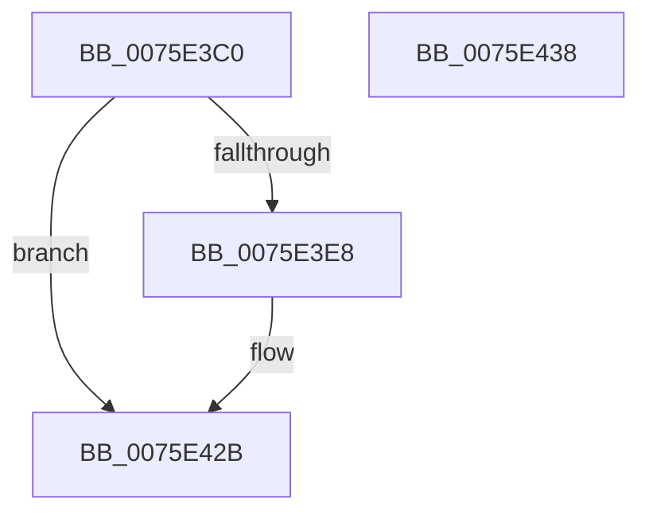

# PopWnfHibernatePolicyCallback

- RVA: `0x0075E3C0`–`0x0075E439` (길이 `121` bytes)
- VA: `0x000000014075E3C0`
- 실행 섹션: `PAGE`
- PDB 이름 있음: `예`; PDB Function 태그: `아니요`
- unwind 정보 RVA: `0x00084AC0`
- 디코드: `34`개 명령, `121/121` bytes 표시
- 미해석 바이트: `0` (있으면 어셈블리에 `.byte`로 보존)

> 이 문서는 커널 이미지의 기계어와 PDB 기호를 분석해 생성했습니다. 4번과 5번은 함수 원형과 자료형을 바이너리 사용 방식에서 추정한 C 해석이며 원본 소스 복구 결과는 아닙니다.

## 1. Dependencies

- 직접 호출 지점: **7**; 고유 호출 대상: **7**
- 직접 호출자로 확인된 함수: **0**
- RIP 상대 이미지 참조: **1**

### Outgoing calls
- `0x0075E3DD` → [PopQueryHiberPersistedRegValue](PopQueryHiberPersistedRegValue_function_0075DDFC.md) (function, `0x0075DDFC`)
- `0x0075E3ED` → [PopAcquireTransitionLock](../AA/PopAcquireTransitionLock_function_00AA9E7C.md) (function, `0x00AA9E7C`)
- `0x0075E3F2` → [PopAcquirePolicyLock](../../pagelk/B7/PopAcquirePolicyLock_function_00B783C0.md) (function, `0x00B783C0`)
- `0x0075E40A` → [PopHibernateEvaluation](../90/PopHibernateEvaluation_function_0090F7B0.md) (function, `0x0090F7B0`)
- `0x0075E411` → [PopReleasePolicyLock](../../pagelk/B7/PopReleasePolicyLock_function_00B78410.md) (function, `0x00B78410`)
- `0x0075E41B` → [PopReleaseTransitionLock](../AB/PopReleaseTransitionLock_function_00ABDABC.md) (function, `0x00ABDABC`)
- `0x0075E426` → [PopTraceHibernatePolicyUpdate](../76/PopTraceHibernatePolicyUpdate_function_00763B18.md) (function, `0x00763B18`)

### Direct callers
- 이 함수 시작 RVA로 연결되는 직접 call은 확인되지 않았습니다. 간접 호출은 완전히 역산할 수 없습니다.

### Static image references
- `0x0075E402` → RVA `0x00FC510C` (`ALMOSTRO`; write)

## 2. Other-region calls and transfers

- 다른 실행 섹션으로 향하는 call: **2**
  - `0x0075E3F2` → [PopAcquirePolicyLock](../../pagelk/B7/PopAcquirePolicyLock_function_00B783C0.md) (`PAGE` → `PAGELK`)
  - `0x0075E411` → [PopReleasePolicyLock](../../pagelk/B7/PopReleasePolicyLock_function_00B78410.md) (`PAGE` → `PAGELK`)
- 별도 외부 분기/꼬리 이동을 확인하지 못했습니다.

## 3. Assembly (complete function range)

```asm
0075E3C0  48 8B C4                        mov rax, rsp
0075E3C3  48 89 58 08                     mov qword ptr [rax + 8], rbx
0075E3C7  57                              push rdi
0075E3C8  48 83 EC 30                     sub rsp, 0x30
0075E3CC  83 60 EC 00                     and dword ptr [rax - 0x14], 0
0075E3D0  48 8D 50 EC                     lea rdx, [rax - 0x14]
0075E3D4  B9 03 00 00 00                  mov ecx, 3
0075E3D9  C6 40 E8 00                     mov byte ptr [rax - 0x18], 0
0075E3DD  E8 1A FA FF FF                  call 0x14075ddfc
0075E3E2  8B F8                           mov edi, eax
0075E3E4  85 C0                           test eax, eax
0075E3E6  78 43                           js 0x14075e42b
0075E3E8  B9 02 00 00 00                  mov ecx, 2
0075E3ED  E8 8A BA 34 00                  call 0x140aa9e7c
0075E3F2  E8 C9 9F 41 00                  call 0x140b783c0
0075E3F7  8B 5C 24 24                     mov ebx, dword ptr [rsp + 0x24]
0075E3FB  4C 8D 44 24 20                  lea r8, [rsp + 0x20]
0075E400  B2 01                           mov dl, 1
0075E402  89 1D 04 6D 86 00               mov dword ptr [rip + 0x866d04], ebx
0075E408  8A CA                           mov cl, dl
0075E40A  E8 A1 13 1B 00                  call 0x14090f7b0
0075E40F  8B F8                           mov edi, eax
0075E411  E8 FA 9F 41 00                  call 0x140b78410
0075E416  B9 02 00 00 00                  mov ecx, 2
0075E41B  E8 9C F6 35 00                  call 0x140abdabc
0075E420  8A 54 24 20                     mov dl, byte ptr [rsp + 0x20]
0075E424  8B CB                           mov ecx, ebx
0075E426  E8 ED 56 00 00                  call 0x140763b18
0075E42B  48 8B 5C 24 40                  mov rbx, qword ptr [rsp + 0x40]
0075E430  8B C7                           mov eax, edi
0075E432  48 83 C4 30                     add rsp, 0x30
0075E436  5F                              pop rdi
0075E437  C3                              ret
0075E438  CC                              int3
```

## 4. C-style interpretation (structured pseudocode)

```c
__int64 __fastcall PopWnfHibernatePolicyCallback(void)
{
    __int64 result;
    __int64 v_rbx;
    __int64 v_rdi;
    __int64 v_rsp;
    unsigned int v_stack_m14;
    unsigned __int64 v_stack_m18;
    unsigned __int64 v_stack_p8;

    *(unsigned __int64 *)(v_rsp + 8) = v_rbx;
    v_rsp = (v_rsp) - (48);
    *(unsigned __int8 *)(v_rsp - 24) = 0;
    result = PopQueryHiberPersistedRegValue(3, v_rsp - 20, a3, a4);
    v_rdi = (unsigned int)((unsigned int)(result));
    if (!(sign_flag)) {
        a1 = 2;
        result = PopAcquireTransitionLock(a1, v_rsp - 20, a3, a4);
        result = PopAcquirePolicyLock(a1, v_rsp - 20, a3, a4);
        v_rbx = v_stack_m14;
        a3 = v_stack_m18;
        a2 = 1;
        *(unsigned int *)(v_rip + 8809732) = (unsigned int)(v_rbx);
        a1 = (unsigned __int8)(a2);
        result = PopHibernateEvaluation(a1, a2, a3, a4);
        v_rdi = (unsigned int)(result);
        result = PopReleasePolicyLock(a1, a2, a3, a4);
        a1 = 2;
        result = PopReleaseTransitionLock(a1, a2, a3, a4);
        a2 = v_stack_m18;
        a1 = (unsigned int)(v_rbx);
        result = PopTraceHibernatePolicyUpdate(a1, a2, a3, a4);
    }
    v_rsp = (v_rsp) + (48);
    return (unsigned int)((unsigned int)(v_rdi));
}
```

## 5. (Beta) C Style

```c
void PopWnfHibernatePolicyCallback(void)
{
    int64_t result;
    int64_t local_rbx;
    int64_t local_rdi;
    int64_t local_rsp;
    uint32_t v_stack_m14;
    uint64_t v_stack_m18;
    uint64_t v_stack_p8;

    *(uint64_t *)(local_rsp + 0x8) = local_rbx;
    local_rsp = (local_rsp) - (48);
    *(uint8_t *)(local_rsp - 0x18) = 0;
    result = PopQueryHiberPersistedRegValue(3, local_rsp - 20, a3, a4);
    local_rdi = (uint32_t)((uint32_t)(result));
    if (!(sign_flag)) {
        a1 = 2;
        result = PopAcquireTransitionLock(a1, local_rsp - 20, a3, a4);
        result = PopAcquirePolicyLock(a1, local_rsp - 20, a3, a4);
        local_rbx = v_stack_m14;
        a3 = v_stack_m18;
        a2 = 1;
        *(uint32_t *)(v_rip + 0x866D04) = (uint32_t)(local_rbx);
        a1 = (uint8_t)(a2);
        result = PopHibernateEvaluation(a1, a2, a3, a4);
        local_rdi = (uint32_t)(result);
        result = PopReleasePolicyLock(a1, a2, a3, a4);
        a1 = 2;
        result = PopReleaseTransitionLock(a1, a2, a3, a4);
        a2 = v_stack_m18;
        a1 = (uint32_t)(local_rbx);
        result = PopTraceHibernatePolicyUpdate(a1, a2, a3, a4);
    }
    local_rsp = (local_rsp) + (48);
    return (uint32_t)((uint32_t)(local_rdi));
}
```

## 6. Execution-region graph

[열기: 2D/3D 그래프와 함수 탐색 컨트롤 패널](../../../control-panel.html?section=page&rva=0x0075E3C0&view=graph)

- 2D 그래프는 위에서 아래로 흐르고, 3D 그래프는 빈 공간을 드래그해 회전합니다. Shift+드래그는 이동, 휠은 확대·축소, 함수 노드 선택은 대상 보고서 이동입니다.

### Static fallback


