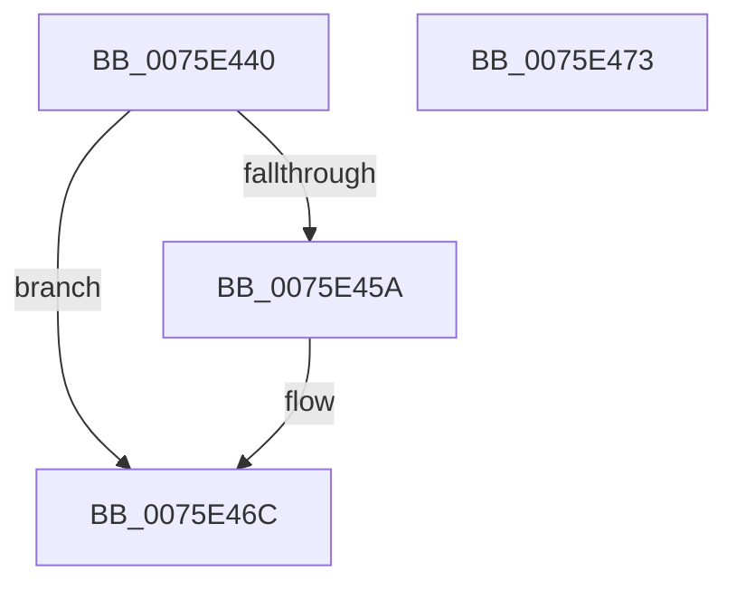

# PopWnfHibernateRevocationCheckCallback

- RVA: `0x0075E440`–`0x0075E474` (길이 `52` bytes)
- VA: `0x000000014075E440`
- 실행 섹션: `PAGE`
- PDB 이름 있음: `예`; PDB Function 태그: `아니요`
- unwind 정보 RVA: `0x0005D2F4`
- 디코드: `14`개 명령, `52/52` bytes 표시
- 미해석 바이트: `0` (있으면 어셈블리에 `.byte`로 보존)

> 이 문서는 커널 이미지의 기계어와 PDB 기호를 분석해 생성했습니다. 4번과 5번은 함수 원형과 자료형을 바이너리 사용 방식에서 추정한 C 해석이며 원본 소스 복구 결과는 아닙니다.

## 1. Dependencies

- 직접 호출 지점: **2**; 고유 호출 대상: **2**
- 직접 호출자로 확인된 함수: **0**
- RIP 상대 이미지 참조: **0**

### Outgoing calls
- `0x0075E44E` → [PopValidateWinresume](PopValidateWinresume_function_0075DFF4.md) (function, `0x0075DFF4`)
- `0x0075E467` → [PoDisableSleepStates](PoDisableSleepStates_function_00757EE0.md) (function, `0x00757EE0`)

### Direct callers
- 이 함수 시작 RVA로 연결되는 직접 call은 확인되지 않았습니다. 간접 호출은 완전히 역산할 수 없습니다.

### Static image references
- 디코드된 RIP-relative 메모리 참조가 없습니다.

## 2. Other-region calls and transfers

- 다른 실행 섹션으로 향하는 call: **0**
- 별도 외부 분기/꼬리 이동을 확인하지 못했습니다.

## 3. Assembly (complete function range)

```asm
0075E440  48 83 EC 38                     sub rsp, 0x38
0075E444  48 8D 4C 24 20                  lea rcx, [rsp + 0x20]
0075E449  C6 44 24 20 00                  mov byte ptr [rsp + 0x20], 0
0075E44E  E8 A1 FB FF FF                  call 0x14075dff4
0075E453  80 7C 24 20 00                  cmp byte ptr [rsp + 0x20], 0
0075E458  74 12                           je 0x14075e46c
0075E45A  BA 08 00 00 00                  mov edx, 8
0075E45F  4C 8D 44 24 28                  lea r8, [rsp + 0x28]
0075E464  8D 4A FC                        lea ecx, [rdx - 4]
0075E467  E8 74 9A FF FF                  call 0x140757ee0
0075E46C  33 C0                           xor eax, eax
0075E46E  48 83 C4 38                     add rsp, 0x38
0075E472  C3                              ret
0075E473  CC                              int3
```

## 4. C-style interpretation (structured pseudocode)

```c
__int64 __fastcall PopWnfHibernateRevocationCheckCallback(void)
{
    __int64 result;
    __int64 v_rsp;
    unsigned __int64 v_stack_m10;
    unsigned __int64 v_stack_m18;

    v_rsp = (v_rsp) - (56);
    v_stack_m18 = 0;
    result = PopValidateWinresume(v_stack_m18, a2, a3, a4);
    if (v_stack_m18 != 0) {
        a2 = 8;
        a3 = v_stack_m10;
        a1 = a2 - 4;
        result = PoDisableSleepStates(a1, a2, a3, a4);
    }
    result = 0;
    v_rsp = (v_rsp) + (56);
    return result;
}
```

## 5. (Beta) C Style

```c
void PopWnfHibernateRevocationCheckCallback(void)
{
    int64_t result;
    int64_t local_rsp;
    uint64_t v_stack_m10;
    uint64_t v_stack_m18;

    local_rsp = (local_rsp) - (56);
    v_stack_m18 = 0;
    result = PopValidateWinresume(v_stack_m18, a2, a3, a4);
    if (v_stack_m18 != 0) {
        a2 = 8;
        a3 = v_stack_m10;
        a1 = a2 - 4;
        result = PoDisableSleepStates(a1, a2, a3, a4);
    }
    result = 0;
    local_rsp = (local_rsp) + (56);
    return result;
}
```

## 6. Execution-region graph

[열기: 2D/3D 그래프와 함수 탐색 컨트롤 패널](../../../control-panel.html?section=page&rva=0x0075E440&view=graph)

- 2D 그래프는 위에서 아래로 흐르고, 3D 그래프는 빈 공간을 드래그해 회전합니다. Shift+드래그는 이동, 휠은 확대·축소, 함수 노드 선택은 대상 보고서 이동입니다.

### Static fallback


