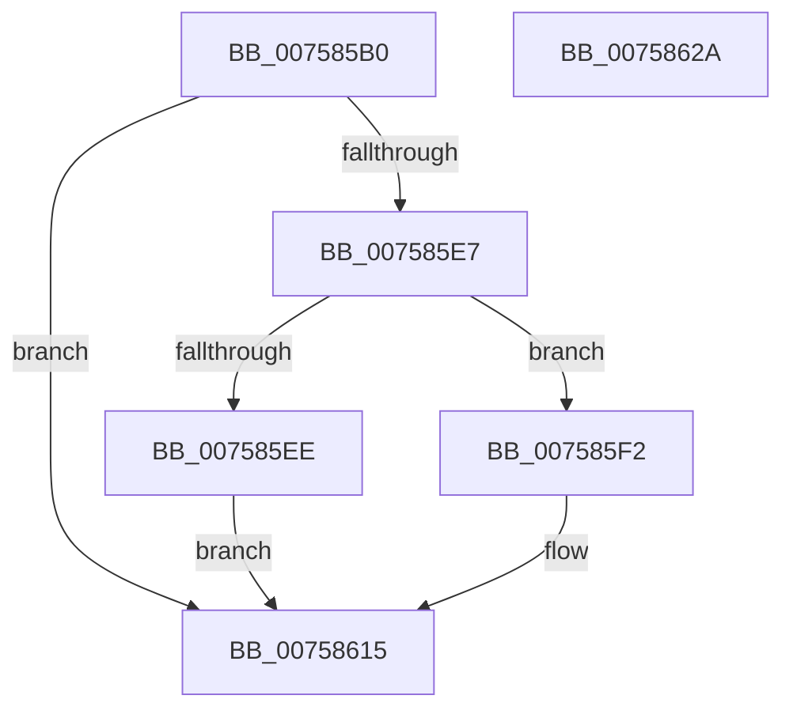

# PopWnfMixedRealityCallback

- RVA: `0x007585B0`–`0x0075862B` (길이 `123` bytes)
- VA: `0x00000001407585B0`
- 실행 섹션: `PAGE`
- PDB 이름 있음: `예`; PDB Function 태그: `아니요`
- unwind 정보 RVA: `0x000A5A24`
- 디코드: `33`개 명령, `123/123` bytes 표시
- 미해석 바이트: `0` (있으면 어셈블리에 `.byte`로 보존)

> 이 문서는 커널 이미지의 기계어와 PDB 기호를 분석해 생성했습니다. 4번과 5번은 함수 원형과 자료형을 바이너리 사용 방식에서 추정한 C 해석이며 원본 소스 복구 결과는 아닙니다.

## 1. Dependencies

- 직접 호출 지점: **3**; 고유 호출 대상: **3**
- 직접 호출자로 확인된 함수: **0**
- RIP 상대 이미지 참조: **2**

### Outgoing calls
- `0x007585DC` → [ExQueryWnfStateData](../A4/ExQueryWnfStateData_function_00A4A480.md) (function, `0x00A4A480`)
- `0x00758610` → [PopSetPowerSettingValueAcDc](../91/PopSetPowerSettingValueAcDc_function_00914D6C.md) (function, `0x00914D6C`)
- `0x0075861F` → [_security_check_cookie](../../text/6A/_security_check_cookie_function_006AC640.md) (function, `0x006AC640`)

### Direct callers
- 이 함수 시작 RVA로 연결되는 직접 call은 확인되지 않았습니다. 간접 호출은 완전히 역산할 수 없습니다.

### Static image references
- `0x007585B6` → RVA `0x00E0A740` (`.data`; read)
- `0x007585FD` → RVA `0x000248A8` (`.rdata`; read)

## 2. Other-region calls and transfers

- 다른 실행 섹션으로 향하는 call: **1**
  - `0x0075861F` → [_security_check_cookie](../../text/6A/_security_check_cookie_function_006AC640.md) (`PAGE` → `.text`)
- 별도 외부 분기/꼬리 이동을 확인하지 못했습니다.

## 3. Assembly (complete function range)

```asm
007585B0  40 53                           push rbx
007585B2  48 83 EC 40                     sub rsp, 0x40
007585B6  48 8B 05 83 21 6B 00            mov rax, qword ptr [rip + 0x6b2183]
007585BD  48 33 C4                        xor rax, rsp
007585C0  48 89 44 24 38                  mov qword ptr [rsp + 0x38], rax
007585C5  4C 8D 4C 24 20                  lea r9, [rsp + 0x20]
007585CA  C7 44 24 20 08 00 00 00         mov dword ptr [rsp + 0x20], 8
007585D2  4C 8D 44 24 30                  lea r8, [rsp + 0x30]
007585D7  48 8D 54 24 28                  lea rdx, [rsp + 0x28]
007585DC  E8 9F 1E 2F 00                  call 0x140a4a480
007585E1  8B D8                           mov ebx, eax
007585E3  85 C0                           test eax, eax
007585E5  78 2E                           js 0x140758615
007585E7  83 7C 24 20 08                  cmp dword ptr [rsp + 0x20], 8
007585EC  73 04                           jae 0x1407585f2
007585EE  33 DB                           xor ebx, ebx
007585F0  EB 23                           jmp 0x140758615
007585F2  8B 44 24 30                     mov eax, dword ptr [rsp + 0x30]
007585F6  4C 8D 44 24 20                  lea r8, [rsp + 0x20]
007585FB  D1 E8                           shr eax, 1
007585FD  48 8D 0D A4 C2 8C FF            lea rcx, [rip - 0x733d5c]
00758604  83 E0 01                        and eax, 1
00758607  BA 04 00 00 00                  mov edx, 4
0075860C  89 44 24 20                     mov dword ptr [rsp + 0x20], eax
00758610  E8 57 C7 1B 00                  call 0x140914d6c
00758615  8B C3                           mov eax, ebx
00758617  48 8B 4C 24 38                  mov rcx, qword ptr [rsp + 0x38]
0075861C  48 33 CC                        xor rcx, rsp
0075861F  E8 1C 40 F5 FF                  call 0x1406ac640
00758624  48 83 C4 40                     add rsp, 0x40
00758628  5B                              pop rbx
00758629  C3                              ret
0075862A  CC                              int3
```

## 4. C-style interpretation (structured pseudocode)

```c
__int64 __fastcall PopWnfMixedRealityCallback(void)
{
    __int64 result;
    __int64 v_rbx;
    __int64 v_rsp;
    unsigned __int64 v_stack_m10;
    unsigned __int64 v_stack_m18;
    unsigned __int64 v_stack_m20;
    unsigned __int64 v_stack_m28;

    v_rsp = (v_rsp) - (64);
    result = (*(unsigned __int64 *)(v_rip + 7020931)) ^ (v_rsp);
    v_stack_m10 = result;
    v_stack_m28 = 8;
    result = ExQueryWnfStateData(a1, v_stack_m20, v_stack_m18, v_stack_m28);
    if (sign_flag) goto loc_00758615;
    if (v_stack_m28 >= 8) goto loc_007585F2;
    v_rbx = 0;
    goto loc_00758615;
loc_007585F2:
    result = (unsigned int)(((unsigned int)(v_stack_m18)) >> (1));
    result = (unsigned int)((result) & (1));
    v_stack_m28 = (unsigned int)(result);
    result = PopSetPowerSettingValueAcDc(v_rip - 7552348, 4, v_stack_m28, v_stack_m28);
loc_00758615:
    a1 = (v_stack_m10) ^ (v_rsp);
    result = _security_check_cookie(a1, 4, v_stack_m28, v_stack_m28);
    v_rsp = (v_rsp) + (64);
    return result;
}
```

## 5. (Beta) C Style

```c
void PopWnfMixedRealityCallback(void)
{
    int64_t result;
    int64_t local_rbx;
    int64_t local_rsp;
    uint64_t v_stack_m10;
    uint64_t v_stack_m18;
    uint64_t v_stack_m20;
    uint64_t v_stack_m28;

    local_rsp = (local_rsp) - (64);
    result = (*(uint64_t *)(v_rip + 0x6B2183)) ^ (local_rsp);
    v_stack_m10 = result;
    v_stack_m28 = 8;
    result = ExQueryWnfStateData(a1, v_stack_m20, v_stack_m18, v_stack_m28);
    if (sign_flag) goto loc_00758615;
    if (v_stack_m28 >= 8) goto loc_007585F2;
    local_rbx = 0;
    goto loc_00758615;
loc_007585F2:
    result = (uint32_t)(((uint32_t)(v_stack_m18)) >> (1));
    result = (uint32_t)((result) & (1));
    v_stack_m28 = (uint32_t)(result);
    result = PopSetPowerSettingValueAcDc(v_rip - 7552348, 4, v_stack_m28, v_stack_m28);
loc_00758615:
    a1 = (v_stack_m10) ^ (local_rsp);
    result = _security_check_cookie(a1, 4, v_stack_m28, v_stack_m28);
    local_rsp = (local_rsp) + (64);
    return result;
}
```

## 6. Execution-region graph

[열기: 2D/3D 그래프와 함수 탐색 컨트롤 패널](../../../control-panel.html?section=page&rva=0x007585B0&view=graph)

- 2D 그래프는 위에서 아래로 흐르고, 3D 그래프는 빈 공간을 드래그해 회전합니다. Shift+드래그는 이동, 휠은 확대·축소, 함수 노드 선택은 대상 보고서 이동입니다.

### Static fallback


