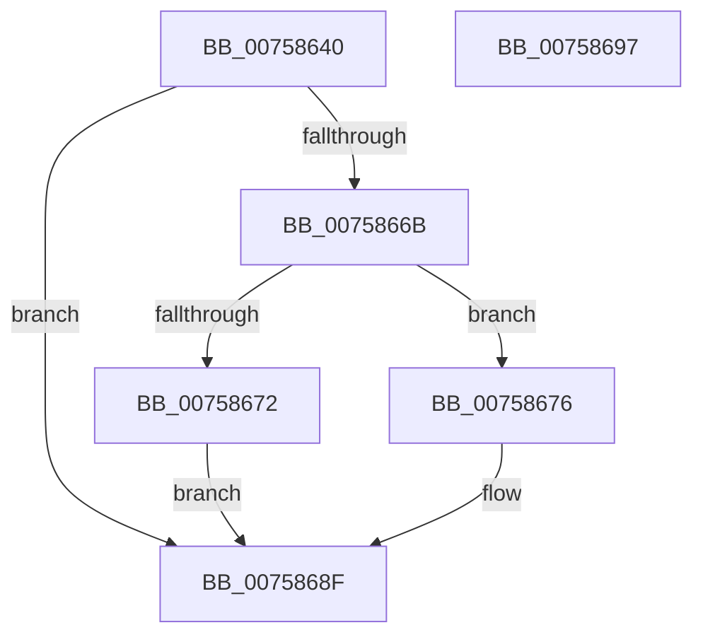

# PopWnfUserAwayPredictionCallback

- RVA: `0x00758640`–`0x00758698` (길이 `88` bytes)
- VA: `0x0000000140758640`
- 실행 섹션: `PAGE`
- PDB 이름 있음: `예`; PDB Function 태그: `아니요`
- unwind 정보 RVA: `0x000AA39C`
- 디코드: `26`개 명령, `88/88` bytes 표시
- 미해석 바이트: `0` (있으면 어셈블리에 `.byte`로 보존)

> 이 문서는 커널 이미지의 기계어와 PDB 기호를 분석해 생성했습니다. 4번과 5번은 함수 원형과 자료형을 바이너리 사용 방식에서 추정한 C 해석이며 원본 소스 복구 결과는 아닙니다.

## 1. Dependencies

- 직접 호출 지점: **4**; 고유 호출 대상: **4**
- 직접 호출자로 확인된 함수: **0**
- RIP 상대 이미지 참조: **0**

### Outgoing calls
- `0x00758660` → [ExQueryWnfStateData](../A4/ExQueryWnfStateData_function_00A4A480.md) (function, `0x00A4A480`)
- `0x00758676` → [PopAcquirePolicyLock](../../pagelk/B7/PopAcquirePolicyLock_function_00B783C0.md) (function, `0x00B783C0`)
- `0x00758685` → [PopUpdateSmartUserPresencePredictions](../76/PopUpdateSmartUserPresencePredictions_function_0076894C.md) (function, `0x0076894C`)
- `0x0075868A` → [PopReleasePolicyLock](../../pagelk/B7/PopReleasePolicyLock_function_00B78410.md) (function, `0x00B78410`)

### Direct callers
- 이 함수 시작 RVA로 연결되는 직접 call은 확인되지 않았습니다. 간접 호출은 완전히 역산할 수 없습니다.

### Static image references
- 디코드된 RIP-relative 메모리 참조가 없습니다.

## 2. Other-region calls and transfers

- 다른 실행 섹션으로 향하는 call: **2**
  - `0x00758676` → [PopAcquirePolicyLock](../../pagelk/B7/PopAcquirePolicyLock_function_00B783C0.md) (`PAGE` → `PAGELK`)
  - `0x0075868A` → [PopReleasePolicyLock](../../pagelk/B7/PopReleasePolicyLock_function_00B78410.md) (`PAGE` → `PAGELK`)
- 별도 외부 분기/꼬리 이동을 확인하지 못했습니다.

## 3. Assembly (complete function range)

```asm
00758640  48 8B C4                        mov rax, rsp
00758643  53                              push rbx
00758644  48 83 EC 30                     sub rsp, 0x30
00758648  48 83 60 F0 00                  and qword ptr [rax - 0x10], 0
0075864D  4C 8D 48 E8                     lea r9, [rax - 0x18]
00758651  4C 8D 40 F0                     lea r8, [rax - 0x10]
00758655  C7 40 E8 08 00 00 00            mov dword ptr [rax - 0x18], 8
0075865C  48 8D 50 20                     lea rdx, [rax + 0x20]
00758660  E8 1B 1E 2F 00                  call 0x140a4a480
00758665  8B D8                           mov ebx, eax
00758667  85 C0                           test eax, eax
00758669  78 24                           js 0x14075868f
0075866B  83 7C 24 20 08                  cmp dword ptr [rsp + 0x20], 8
00758670  73 04                           jae 0x140758676
00758672  33 DB                           xor ebx, ebx
00758674  EB 19                           jmp 0x14075868f
00758676  E8 45 FD 41 00                  call 0x140b783c0
0075867B  48 8B 4C 24 28                  mov rcx, qword ptr [rsp + 0x28]
00758680  BA 03 00 00 00                  mov edx, 3
00758685  E8 C2 02 01 00                  call 0x14076894c
0075868A  E8 81 FD 41 00                  call 0x140b78410
0075868F  8B C3                           mov eax, ebx
00758691  48 83 C4 30                     add rsp, 0x30
00758695  5B                              pop rbx
00758696  C3                              ret
00758697  CC                              int3
```

## 4. C-style interpretation (structured pseudocode)

```c
__int64 __fastcall PopWnfUserAwayPredictionCallback(void)
{
    __int64 result;
    __int64 v_rbx;
    __int64 v_rsp;
    unsigned __int64 v_stack_m10;
    unsigned int v_stack_m18;

    v_rsp = (v_rsp) - (48);
    *(unsigned int *)(v_rsp - 24) = 8;
    result = ExQueryWnfStateData(a1, v_rsp + 32, v_rsp - 16, v_rsp - 24);
    if (sign_flag) goto loc_0075868F;
    if (v_stack_m18 >= 8) goto loc_00758676;
    v_rbx = 0;
    goto loc_0075868F;
loc_00758676:
    result = PopAcquirePolicyLock(a1, v_rsp + 32, v_rsp - 16, v_rsp - 24);
    result = PopUpdateSmartUserPresencePredictions(v_stack_m10, 3, v_rsp - 16, v_rsp - 24);
    result = PopReleasePolicyLock(v_stack_m10, 3, v_rsp - 16, v_rsp - 24);
loc_0075868F:
    v_rsp = (v_rsp) + (48);
    return 0;
}
```

## 5. (Beta) C Style

```c
void PopWnfUserAwayPredictionCallback(void)
{
    int64_t result;
    int64_t local_rbx;
    int64_t local_rsp;
    uint64_t v_stack_m10;
    uint32_t v_stack_m18;

    local_rsp = (local_rsp) - (48);
    *(uint32_t *)(local_rsp - 0x18) = 8;
    result = ExQueryWnfStateData(a1, local_rsp + 32, local_rsp - 16, local_rsp - 24);
    if (sign_flag) goto loc_0075868F;
    if (v_stack_m18 >= 8) goto loc_00758676;
    local_rbx = 0;
    goto loc_0075868F;
loc_00758676:
    result = PopAcquirePolicyLock(a1, local_rsp + 32, local_rsp - 16, local_rsp - 24);
    result = PopUpdateSmartUserPresencePredictions(v_stack_m10, 3, local_rsp - 16, local_rsp - 24);
    result = PopReleasePolicyLock(v_stack_m10, 3, local_rsp - 16, local_rsp - 24);
loc_0075868F:
    local_rsp = (local_rsp) + (48);
    return 0;
}
```

## 6. Execution-region graph

[열기: 2D/3D 그래프와 함수 탐색 컨트롤 패널](../../../control-panel.html?section=page&rva=0x00758640&view=graph)

- 2D 그래프는 위에서 아래로 흐르고, 3D 그래프는 빈 공간을 드래그해 회전합니다. Shift+드래그는 이동, 휠은 확대·축소, 함수 노드 선택은 대상 보고서 이동입니다.

### Static fallback


