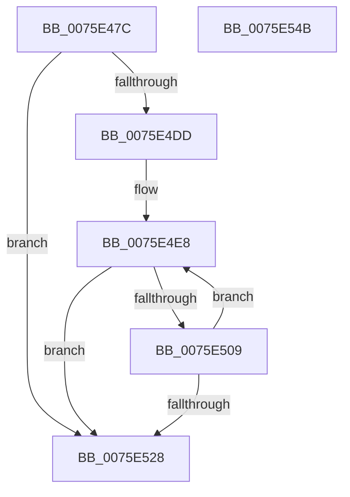

# PopZeroHiberFile

- RVA: `0x0075E47C`–`0x0075E54C` (길이 `208` bytes)
- VA: `0x000000014075E47C`
- 실행 섹션: `PAGE`
- PDB 이름 있음: `예`; PDB Function 태그: `아니요`
- unwind 정보 RVA: `0x000CC4B0`
- 디코드: `55`개 명령, `208/208` bytes 표시
- 미해석 바이트: `0` (있으면 어셈블리에 `.byte`로 보존)

> 이 문서는 커널 이미지의 기계어와 PDB 기호를 분석해 생성했습니다. 4번과 5번은 함수 원형과 자료형을 바이너리 사용 방식에서 추정한 C 해석이며 원본 소스 복구 결과는 아닙니다.

## 1. Dependencies

- 직접 호출 지점: **5**; 고유 호출 대상: **5**
- 직접 호출자로 확인된 함수: **2**
- RIP 상대 이미지 참조: **1**

### Outgoing calls
- `0x0075E4B6` → [PopDiagTraceZeroHiberFile](../../pagelk/B7/PopDiagTraceZeroHiberFile_function_00B714D0.md) (function, `0x00B714D0`)
- `0x0075E4D4` → [ZwQueryInformationFile](../../text/6A/ZwQueryInformationFile_function_006AD2F0.md) (function, `0x006AD2F0`)
- `0x0075E500` → [MmZeroPageWrite](../../text/49/MmZeroPageWrite_function_0049E74C.md) (function, `0x0049E74C`)
- `0x0075E528` → [PopDiagTraceZeroHiberFileEnd](../../pagelk/B7/PopDiagTraceZeroHiberFileEnd_function_00B714EC.md) (function, `0x00B714EC`)
- `0x0075E534` → [_security_check_cookie](../../text/6A/_security_check_cookie_function_006AC640.md) (function, `0x006AC640`)

### Direct callers
- [PopEnableHiberFile](../90/PopEnableHiberFile_function_0090F850.md) at `0x0090F9AA`
- [PopTransitionSystemPowerStateEx](../../pagelk/B7/PopTransitionSystemPowerStateEx_function_00B7E8C0.md) at `0x00B7EB5C`

### Static image references
- `0x0075E48E` → RVA `0x00E0A740` (`.data`; read)

## 2. Other-region calls and transfers

- 다른 실행 섹션으로 향하는 call: **5**
  - `0x0075E4B6` → [PopDiagTraceZeroHiberFile](../../pagelk/B7/PopDiagTraceZeroHiberFile_function_00B714D0.md) (`PAGE` → `PAGELK`)
  - `0x0075E4D4` → [ZwQueryInformationFile](../../text/6A/ZwQueryInformationFile_function_006AD2F0.md) (`PAGE` → `.text`)
  - `0x0075E500` → [MmZeroPageWrite](../../text/49/MmZeroPageWrite_function_0049E74C.md) (`PAGE` → `.text`)
  - `0x0075E528` → [PopDiagTraceZeroHiberFileEnd](../../pagelk/B7/PopDiagTraceZeroHiberFileEnd_function_00B714EC.md) (`PAGE` → `PAGELK`)
  - `0x0075E534` → [_security_check_cookie](../../text/6A/_security_check_cookie_function_006AC640.md) (`PAGE` → `.text`)
- 별도 외부 분기/꼬리 이동을 확인하지 못했습니다.

## 3. Assembly (complete function range)

```asm
0075E47C  48 89 5C 24 18                  mov qword ptr [rsp + 0x18], rbx
0075E481  48 89 7C 24 20                  mov qword ptr [rsp + 0x20], rdi
0075E486  55                              push rbp
0075E487  48 8B EC                        mov rbp, rsp
0075E48A  48 83 EC 70                     sub rsp, 0x70
0075E48E  48 8B 05 AB C2 6A 00            mov rax, qword ptr [rip + 0x6ac2ab]
0075E495  48 33 C4                        xor rax, rsp
0075E498  48 89 45 F8                     mov qword ptr [rbp - 8], rax
0075E49C  0F 57 C0                        xorps xmm0, xmm0
0075E49F  0F 57 C9                        xorps xmm1, xmm1
0075E4A2  33 C0                           xor eax, eax
0075E4A4  48 8B FA                        mov rdi, rdx
0075E4A7  0F 11 45 D0                     movups xmmword ptr [rbp - 0x30], xmm0
0075E4AB  48 89 45 F0                     mov qword ptr [rbp - 0x10], rax
0075E4AF  48 8B D9                        mov rbx, rcx
0075E4B2  0F 11 4D E0                     movups xmmword ptr [rbp - 0x20], xmm1
0075E4B6  E8 15 30 41 00                  call 0x140b714d0
0075E4BB  41 B9 18 00 00 00               mov r9d, 0x18
0075E4C1  C7 44 24 20 05 00 00 00         mov dword ptr [rsp + 0x20], 5
0075E4C9  4C 8D 45 E0                     lea r8, [rbp - 0x20]
0075E4CD  48 8B CB                        mov rcx, rbx
0075E4D0  48 8D 55 D0                     lea rdx, [rbp - 0x30]
0075E4D4  E8 17 EE F4 FF                  call 0x1406ad2f0
0075E4D9  85 C0                           test eax, eax
0075E4DB  78 4B                           js 0x14075e528
0075E4DD  48 83 65 C0 00                  and qword ptr [rbp - 0x40], 0
0075E4E2  48 8B 45 E0                     mov rax, qword ptr [rbp - 0x20]
0075E4E6  33 C9                           xor ecx, ecx
0075E4E8  48 2B C1                        sub rax, rcx
0075E4EB  4C 8D 45 C8                     lea r8, [rbp - 0x38]
0075E4EF  48 8B CF                        mov rcx, rdi
0075E4F2  48 89 45 C8                     mov qword ptr [rbp - 0x38], rax
0075E4F6  41 B9 00 00 01 00               mov r9d, 0x10000
0075E4FC  48 8D 55 C0                     lea rdx, [rbp - 0x40]
0075E500  E8 47 02 D4 FF                  call 0x14049e74c
0075E505  85 C0                           test eax, eax
0075E507  79 1F                           jns 0x14075e528
0075E509  48 8B 4D C0                     mov rcx, qword ptr [rbp - 0x40]
0075E50D  48 8B 45 E0                     mov rax, qword ptr [rbp - 0x20]
0075E511  48 81 E1 00 00 FF FF            and rcx, 0xffffffffffff0000
0075E518  48 81 C1 00 00 01 00            add rcx, 0x10000
0075E51F  48 89 4D C0                     mov qword ptr [rbp - 0x40], rcx
0075E523  48 3B C8                        cmp rcx, rax
0075E526  7C C0                           jl 0x14075e4e8
0075E528  E8 BF 2F 41 00                  call 0x140b714ec
0075E52D  48 8B 4D F8                     mov rcx, qword ptr [rbp - 8]
0075E531  48 33 CC                        xor rcx, rsp
0075E534  E8 07 E1 F4 FF                  call 0x1406ac640
0075E539  4C 8D 5C 24 70                  lea r11, [rsp + 0x70]
0075E53E  49 8B 5B 20                     mov rbx, qword ptr [r11 + 0x20]
0075E542  49 8B 7B 28                     mov rdi, qword ptr [r11 + 0x28]
0075E546  49 8B E3                        mov rsp, r11
0075E549  5D                              pop rbp
0075E54A  C3                              ret
0075E54B  CC                              int3
```

## 4. C-style interpretation (structured pseudocode)

```c
__int64 __fastcall PopZeroHiberFile(__int64 a1, __int64 a2)
{
    __int64 result;
    __int64 v_rsp;
    unsigned __int64 v_stack_m10;
    unsigned __int64 v_stack_m18;
    unsigned __int64 v_stack_m28;
    unsigned __int64 v_stack_m38;
    unsigned __int64 v_stack_m40;
    unsigned __int64 v_stack_m48;
    unsigned int v_stack_m58;
    unsigned __int64 v_stack_m8;
    unsigned __int64 v_stack_p18;
    unsigned __int64 v_stack_p20;

    v_stack_p18 = v_rbx;
    v_stack_p20 = v_rdi;
    v_rsp = (v_rsp) - (112);
    result = (*(unsigned __int64 *)(v_rip + 6996651)) ^ (v_rsp);
    v_stack_m10 = result;
    result = 0;
    v_stack_m38 = v_xmm0;
    v_stack_m18 = 0;
    v_stack_m28 = v_xmm1;
    result = PopDiagTraceZeroHiberFile(a1, a2, a3, a4);
    v_stack_m58 = 5;
    result = ZwQueryInformationFile(a1, v_stack_m38, v_stack_m28, 24);
    if (sign_flag) goto loc_0075E528;
    a1 = 0;
loc_0075E4E8:
    result = (v_stack_m28) - (0);
    v_stack_m40 = result;
    result = MmZeroPageWrite(a2, v_stack_m48, v_stack_m40, (unsigned int)(0x10000ULL));
    if (!sign_flag) goto loc_0075E528;
    a1 = (v_stack_m48) & (0xFFFFFFFFFFFF0000ULL);
    a1 = (a1) + (0x10000ULL);
    v_stack_m48 = a1;
    if (a1 < v_stack_m28) goto loc_0075E4E8;
loc_0075E528:
    result = PopDiagTraceZeroHiberFileEnd(a1, v_stack_m48, v_stack_m40, (unsigned int)(0x10000ULL));
    a1 = (v_stack_m10) ^ (v_rsp);
    result = _security_check_cookie(a1, v_stack_m48, v_stack_m40, (unsigned int)(0x10000ULL));
    return result;
}
```

## 5. (Beta) C Style

```c
int64_t PopZeroHiberFile(int64_t Arg1, int64_t Arg2)
{
    int64_t result;
    int64_t local_rsp;
    uint64_t v_stack_m10;
    uint64_t v_stack_m18;
    uint64_t v_stack_m28;
    uint64_t v_stack_m38;
    uint64_t v_stack_m40;
    uint64_t v_stack_m48;
    uint32_t v_stack_m58;
    uint64_t v_stack_m8;
    uint64_t v_stack_p18;
    uint64_t v_stack_p20;

    v_stack_p18 = local_rbx;
    v_stack_p20 = local_rdi;
    local_rsp = (local_rsp) - (112);
    result = (*(uint64_t *)(v_rip + 0x6AC2AB)) ^ (local_rsp);
    v_stack_m10 = result;
    result = 0;
    v_stack_m38 = v_xmm0;
    v_stack_m18 = 0;
    v_stack_m28 = v_xmm1;
    result = PopDiagTraceZeroHiberFile(Arg1, Arg2, a3, a4);
    v_stack_m58 = 5;
    result = ZwQueryInformationFile(Arg1, v_stack_m38, v_stack_m28, 24);
    if (sign_flag) goto loc_0075E528;
    Arg1 = 0;
loc_0075E4E8:
    result = (v_stack_m28) - (0);
    v_stack_m40 = result;
    result = MmZeroPageWrite(Arg2, v_stack_m48, v_stack_m40, (uint32_t)(0x10000ULL));
    if (!sign_flag) goto loc_0075E528;
    Arg1 = (v_stack_m48) & (0xFFFFFFFFFFFF0000ULL);
    Arg1 = (Arg1) + (0x10000ULL);
    v_stack_m48 = Arg1;
    if (Arg1 < v_stack_m28) goto loc_0075E4E8;
loc_0075E528:
    result = PopDiagTraceZeroHiberFileEnd(Arg1, v_stack_m48, v_stack_m40, (uint32_t)(0x10000ULL));
    Arg1 = (v_stack_m10) ^ (local_rsp);
    result = _security_check_cookie(Arg1, v_stack_m48, v_stack_m40, (uint32_t)(0x10000ULL));
    return result;
}
```

## 6. Execution-region graph

[열기: 2D/3D 그래프와 함수 탐색 컨트롤 패널](../../../control-panel.html?section=page&rva=0x0075E47C&view=graph)

- 2D 그래프는 위에서 아래로 흐르고, 3D 그래프는 빈 공간을 드래그해 회전합니다. Shift+드래그는 이동, 휠은 확대·축소, 함수 노드 선택은 대상 보고서 이동입니다.

### Static fallback


