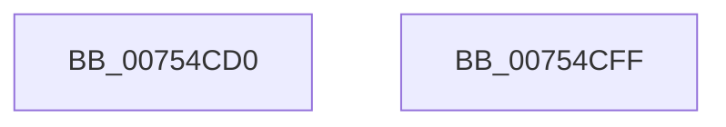

# PpmEnableCoordinatedIdleStates

- RVA: `0x00754CD0`–`0x00754D00` (길이 `48` bytes)
- VA: `0x0000000140754CD0`
- 실행 섹션: `PAGE`
- PDB 이름 있음: `예`; PDB Function 태그: `아니요`
- unwind 정보 RVA: `0x0005CF00`
- 디코드: `13`개 명령, `48/48` bytes 표시
- 미해석 바이트: `0` (있으면 어셈블리에 `.byte`로 보존)

> 이 문서는 커널 이미지의 기계어와 PDB 기호를 분석해 생성했습니다. 4번과 5번은 함수 원형과 자료형을 바이너리 사용 방식에서 추정한 C 해석이며 원본 소스 복구 결과는 아닙니다.

## 1. Dependencies

- 직접 호출 지점: **2**; 고유 호출 대상: **2**
- 직접 호출자로 확인된 함수: **2**
- RIP 상대 이미지 참조: **3**

### Outgoing calls
- `0x00754CED` → [PopReleaseRwLock](../../text/2D/PopReleaseRwLock_function_002DFBBC.md) (function, `0x002DFBBC`)
- `0x00754CF4` → [PopFxEnablePlatformStates](../../text/5D/PopFxEnablePlatformStates_function_005D2A98.md) (function, `0x005D2A98`)

### Direct callers
- [PpmInstallCoordinatedIdleStates](PpmInstallCoordinatedIdleStates_function_007552A0.md) at `0x00755868`
- [PpmInstallPlatformIdleStates](../A4/PpmInstallPlatformIdleStates_function_00A46A80.md) at `0x00A46D1C`

### Static image references
- `0x00754CD6` → RVA `0x00FC6B47` (`ALMOSTRO`; write)
- `0x00754CDF` → RVA `0x00FC6AD0` (`ALMOSTRO`; write)
- `0x00754CE6` → RVA `0x00F0CA70` (`.data`; read)

## 2. Other-region calls and transfers

- 다른 실행 섹션으로 향하는 call: **2**
  - `0x00754CED` → [PopReleaseRwLock](../../text/2D/PopReleaseRwLock_function_002DFBBC.md) (`PAGE` → `.text`)
  - `0x00754CF4` → [PopFxEnablePlatformStates](../../text/5D/PopFxEnablePlatformStates_function_005D2A98.md) (`PAGE` → `.text`)
- 별도 외부 분기/꼬리 이동을 확인하지 못했습니다.

## 3. Assembly (complete function range)

```asm
00754CD0  40 53                           push rbx
00754CD2  48 83 EC 20                     sub rsp, 0x20
00754CD6  88 15 6B 1E 87 00               mov byte ptr [rip + 0x871e6b], dl
00754CDC  48 8B D9                        mov rbx, rcx
00754CDF  48 89 0D EA 1D 87 00            mov qword ptr [rip + 0x871dea], rcx
00754CE6  48 8D 0D 83 7D 7B 00            lea rcx, [rip + 0x7b7d83]
00754CED  E8 CA AE B8 FF                  call 0x1402dfbbc
00754CF2  8B 0B                           mov ecx, dword ptr [rbx]
00754CF4  E8 9F DD E7 FF                  call 0x1405d2a98
00754CF9  48 83 C4 20                     add rsp, 0x20
00754CFD  5B                              pop rbx
00754CFE  C3                              ret
00754CFF  CC                              int3
```

## 4. C-style interpretation (structured pseudocode)

```c
__int64 __fastcall PpmEnableCoordinatedIdleStates(__int64 a1, unsigned __int8 a2)
{
    __int64 result;
    __int64 v_rsp;

    v_rsp = (v_rsp) - (32);
    *(unsigned __int8 *)(v_rip + 8855147) = a2;
    *(unsigned __int64 *)(v_rip + 8855018) = a1;
    result = PopReleaseRwLock(v_rip + 8093059, a2, a3, a4);
    result = PopFxEnablePlatformStates((unsigned int)(*(unsigned int *)(a1)), a2, a3, a4);
    v_rsp = (v_rsp) + (32);
    return result;
}
```

## 5. (Beta) C Style

```c
int64_t PpmEnableCoordinatedIdleStates(void *Arg1, uint8_t Arg2)
{
    uint8_t *arg1 = (uint8_t *)Arg1;

    int64_t result;
    int64_t local_rsp;

    local_rsp = (local_rsp) - (32);
    *(uint8_t *)(v_rip + 0x871E6B) = Arg2;
    *(void **)(v_rip + 0x871DEA) = Arg1;
    result = PopReleaseRwLock(v_rip + 8093059, Arg2, a3, a4);
    result = PopFxEnablePlatformStates((uint32_t)(*(uint32_t *)(arg1)), Arg2, a3, a4);
    local_rsp = (local_rsp) + (32);
    return result;
}
```

### 관측된 메모리 오프셋

구조체 형식이 확인되지 않은 접근은 인자 기준의 오프셋으로만 기록했습니다.

| 기준 인자 | 오프셋 표현 | 폭 (bit) | 접근 |
|---|---:|---:|---|
| `Arg1` | `+ 0x0` | `32` | `R` |

## 6. Execution-region graph

[열기: 2D/3D 그래프와 함수 탐색 컨트롤 패널](../../../control-panel.html?section=page&rva=0x00754CD0&view=graph)

- 2D 그래프는 위에서 아래로 흐르고, 3D 그래프는 빈 공간을 드래그해 회전합니다. Shift+드래그는 이동, 휠은 확대·축소, 함수 노드 선택은 대상 보고서 이동입니다.

### Static fallback


