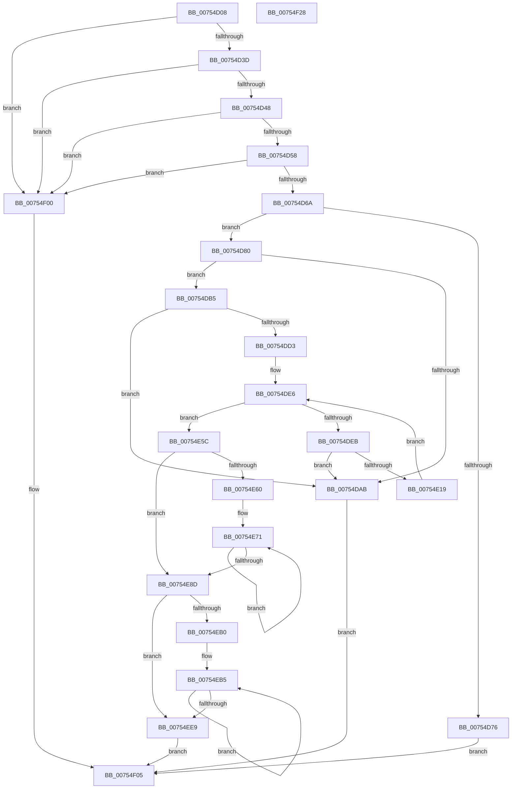

# PpmIdleAllocateVetoReasons

- RVA: `0x00754D08`–`0x00754F29` (길이 `545` bytes)
- VA: `0x0000000140754D08`
- 실행 섹션: `PAGE`
- PDB 이름 있음: `예`; PDB Function 태그: `아니요`
- unwind 정보 RVA: `0x000AA2A0`
- 디코드: `145`개 명령, `545/545` bytes 표시
- 미해석 바이트: `0` (있으면 어셈블리에 `.byte`로 보존)

> 이 문서는 커널 이미지의 기계어와 PDB 기호를 분석해 생성했습니다. 4번과 5번은 함수 원형과 자료형을 바이너리 사용 방식에서 추정한 C 해석이며 원본 소스 복구 결과는 아닙니다.

## 1. Dependencies

- 직접 호출 지점: **10**; 고유 호출 대상: **7**
- 직접 호출자로 확인된 함수: **1**
- RIP 상대 이미지 참조: **4**

### Outgoing calls
- `0x00754D26` → [PopAcquireRwLockExclusive](../../text/43/PopAcquireRwLockExclusive_function_00430B44.md) (function, `0x00430B44`)
- `0x00754D9C` → [ExAllocatePool2](../../poolcode/B8/ExAllocatePool2_function_00B820F0.md) (function, `0x00B820F0`)
- `0x00754DC6` → [ExAllocatePool2](../../poolcode/B8/ExAllocatePool2_function_00B820F0.md) (function, `0x00B820F0`)
- `0x00754E0A` → [ExAllocatePool2](../../poolcode/B8/ExAllocatePool2_function_00B820F0.md) (function, `0x00B820F0`)
- `0x00754E2A` → [memcpy](../../text/6C/memcpy_function_006C6840.md) (function, `0x006C6840`)
- `0x00754E43` → [RtlInitUnicodeString](../../text/42/RtlInitUnicodeString_function_0042A780.md) (function, `0x0042A780`)
- `0x00754E96` → [ExFreePoolWithTag](../../poolcode/B8/ExFreePoolWithTag_function_00B82870.md) (function, `0x00B82870`)
- `0x00754ED6` → [PpmIdleInstallNewVetoList](../../text/5C/PpmIdleInstallNewVetoList_function_005CFE90.md) (function, `0x005CFE90`)
- `0x00754EF3` → [ExFreePoolWithTag](../../poolcode/B8/ExFreePoolWithTag_function_00B82870.md) (function, `0x00B82870`)
- `0x00754F0C` → [PopReleaseRwLock](../../text/2D/PopReleaseRwLock_function_002DFBBC.md) (function, `0x002DFBBC`)

### Direct callers
- [PopFxRequestCommon](../../text/5D/PopFxRequestCommon_function_005D3600.md) at `0x005D361B`

### Static image references
- `0x00754D1F` → RVA `0x00F0CA70` (`.data`; read)
- `0x00754D2B` → RVA `0x00E67678` (`.data`; read)
- `0x00754D48` → RVA `0x00FC6AD0` (`ALMOSTRO`; read)
- `0x00754EA4` → RVA `0x00E67678` (`.data`; write)

## 2. Other-region calls and transfers

- 다른 실행 섹션으로 향하는 call: **10**
  - `0x00754D26` → [PopAcquireRwLockExclusive](../../text/43/PopAcquireRwLockExclusive_function_00430B44.md) (`PAGE` → `.text`)
  - `0x00754D9C` → [ExAllocatePool2](../../poolcode/B8/ExAllocatePool2_function_00B820F0.md) (`PAGE` → `POOLCODE`)
  - `0x00754DC6` → [ExAllocatePool2](../../poolcode/B8/ExAllocatePool2_function_00B820F0.md) (`PAGE` → `POOLCODE`)
  - `0x00754E0A` → [ExAllocatePool2](../../poolcode/B8/ExAllocatePool2_function_00B820F0.md) (`PAGE` → `POOLCODE`)
  - `0x00754E2A` → [memcpy](../../text/6C/memcpy_function_006C6840.md) (`PAGE` → `.text`)
  - `0x00754E43` → [RtlInitUnicodeString](../../text/42/RtlInitUnicodeString_function_0042A780.md) (`PAGE` → `.text`)
  - `0x00754E96` → [ExFreePoolWithTag](../../poolcode/B8/ExFreePoolWithTag_function_00B82870.md) (`PAGE` → `POOLCODE`)
  - `0x00754ED6` → [PpmIdleInstallNewVetoList](../../text/5C/PpmIdleInstallNewVetoList_function_005CFE90.md) (`PAGE` → `.text`)
  - `0x00754EF3` → [ExFreePoolWithTag](../../poolcode/B8/ExFreePoolWithTag_function_00B82870.md) (`PAGE` → `POOLCODE`)
  - `0x00754F0C` → [PopReleaseRwLock](../../text/2D/PopReleaseRwLock_function_002DFBBC.md) (`PAGE` → `.text`)
- 별도 외부 분기/꼬리 이동을 확인하지 못했습니다.

## 3. Assembly (complete function range)

```asm
00754D08  48 89 5C 24 08                  mov qword ptr [rsp + 8], rbx
00754D0D  55                              push rbp
00754D0E  56                              push rsi
00754D0F  57                              push rdi
00754D10  41 54                           push r12
00754D12  41 55                           push r13
00754D14  41 56                           push r14
00754D16  41 57                           push r15
00754D18  48 83 EC 20                     sub rsp, 0x20
00754D1C  48 8B E9                        mov rbp, rcx
00754D1F  48 8D 0D 4A 7D 7B 00            lea rcx, [rip + 0x7b7d4a]
00754D26  E8 19 BE CD FF                  call 0x140430b44
00754D2B  48 8B 35 46 29 71 00            mov rsi, qword ptr [rip + 0x712946]
00754D32  33 FF                           xor edi, edi
00754D34  48 85 F6                        test rsi, rsi
00754D37  0F 84 C3 01 00 00               je 0x140754f00
00754D3D  8B 76 04                        mov esi, dword ptr [rsi + 4]
00754D40  85 F6                           test esi, esi
00754D42  0F 84 B8 01 00 00               je 0x140754f00
00754D48  48 8B 15 81 1D 87 00            mov rdx, qword ptr [rip + 0x871d81]
00754D4F  48 85 D2                        test rdx, rdx
00754D52  0F 84 A8 01 00 00               je 0x140754f00
00754D58  4C 8B 6A 70                     mov r13, qword ptr [rdx + 0x70]
00754D5C  4C 89 6C 24 78                  mov qword ptr [rsp + 0x78], r13
00754D61  4D 85 ED                        test r13, r13
00754D64  0F 84 96 01 00 00               je 0x140754f00
00754D6A  44 8B 75 04                     mov r14d, dword ptr [rbp + 4]
00754D6E  44 03 F6                        add r14d, esi
00754D71  44 3B F6                        cmp r14d, esi
00754D74  73 0A                           jae 0x140754d80
00754D76  BF 95 00 00 C0                  mov edi, 0xc0000095
00754D7B  E9 85 01 00 00                  jmp 0x140754f05
00754D80  41 8B C6                        mov eax, r14d
00754D83  BB 50 50 4D 69                  mov ebx, 0x694d5050
00754D88  0F AF 02                        imul eax, dword ptr [rdx]
00754D8B  41 BF 40 00 00 00               mov r15d, 0x40
00754D91  44 8B C3                        mov r8d, ebx
00754D94  41 8B CF                        mov ecx, r15d
00754D97  C1 E0 06                        shl eax, 6
00754D9A  8B D0                           mov edx, eax
00754D9C  E8 4F D3 42 00                  call 0x140b820f0
00754DA1  48 89 44 24 70                  mov qword ptr [rsp + 0x70], rax
00754DA6  48 85 C0                        test rax, rax
00754DA9  75 0A                           jne 0x140754db5
00754DAB  BF 9A 00 00 C0                  mov edi, 0xc000009a
00754DB0  E9 50 01 00 00                  jmp 0x140754f05
00754DB5  43 8D 04 76                     lea eax, [r14 + r14*2]
00754DB9  44 8B C3                        mov r8d, ebx
00754DBC  8D 14 C5 08 00 00 00            lea edx, [rax*8 + 8]
00754DC3  49 8B CF                        mov rcx, r15
00754DC6  E8 25 D3 42 00                  call 0x140b820f0
00754DCB  4C 8B F8                        mov r15, rax
00754DCE  48 85 C0                        test rax, rax
00754DD1  74 D8                           je 0x140754dab
00754DD3  44 89 70 04                     mov dword ptr [rax + 4], r14d
00754DD7  44 8B E6                        mov r12d, esi
00754DDA  48 8B 05 97 28 71 00            mov rax, qword ptr [rip + 0x712897]
00754DE1  8B 08                           mov ecx, dword ptr [rax]
00754DE3  41 89 0F                        mov dword ptr [r15], ecx
00754DE6  45 3B E6                        cmp r12d, r14d
00754DE9  73 71                           jae 0x140754e5c
00754DEB  45 8B EC                        mov r13d, r12d
00754DEE  44 8B C3                        mov r8d, ebx
00754DF1  44 2B EE                        sub r13d, esi
00754DF4  B9 40 00 00 00                  mov ecx, 0x40
00754DF9  4D 03 ED                        add r13, r13
00754DFC  42 0F B7 54 ED 0C               movzx edx, word ptr [rbp + r13*8 + 0xc]
00754E02  48 8D 14 55 02 00 00 00         lea rdx, [rdx*2 + 2]
00754E0A  E8 E1 D2 42 00                  call 0x140b820f0
00754E0F  48 89 44 24 68                  mov qword ptr [rsp + 0x68], rax
00754E14  48 85 C0                        test rax, rax
00754E17  74 92                           je 0x140754dab
00754E19  46 0F B7 44 ED 0C               movzx r8d, word ptr [rbp + r13*8 + 0xc]
00754E1F  48 8B C8                        mov rcx, rax
00754E22  4A 8B 54 ED 10                  mov rdx, qword ptr [rbp + r13*8 + 0x10]
00754E27  4D 03 C0                        add r8, r8
00754E2A  E8 11 1A F7 FF                  call 0x1406c6840
00754E2F  48 8B 54 24 68                  mov rdx, qword ptr [rsp + 0x68]
00754E34  49 8D 4F 10                     lea rcx, [r15 + 0x10]
00754E38  41 8B C4                        mov eax, r12d
00754E3B  48 8D 1C 40                     lea rbx, [rax + rax*2]
00754E3F  48 8D 0C D9                     lea rcx, [rcx + rbx*8]
00754E43  E8 38 59 CD FF                  call 0x14042a780
00754E48  42 8B 44 ED 08                  mov eax, dword ptr [rbp + r13*8 + 8]
00754E4D  41 FF C4                        inc r12d
00754E50  41 89 44 DF 08                  mov dword ptr [r15 + rbx*8 + 8], eax
00754E55  BB 50 50 4D 69                  mov ebx, 0x694d5050
00754E5A  EB 8A                           jmp 0x140754de6
00754E5C  85 F6                           test esi, esi
00754E5E  74 2D                           je 0x140754e8d
00754E60  48 8B 0D 11 28 71 00            mov rcx, qword ptr [rip + 0x712811]
00754E67  49 8D 47 08                     lea rax, [r15 + 8]
00754E6B  49 2B CF                        sub rcx, r15
00754E6E  48 8B D6                        mov rdx, rsi
00754E71  0F 10 04 01                     movups xmm0, xmmword ptr [rcx + rax]
00754E75  0F 11 00                        movups xmmword ptr [rax], xmm0
00754E78  F2 0F 10 4C 01 10               movsd xmm1, qword ptr [rcx + rax + 0x10]
00754E7E  F2 0F 11 48 10                  movsd qword ptr [rax + 0x10], xmm1
00754E83  48 8D 40 18                     lea rax, [rax + 0x18]
00754E87  48 83 EA 01                     sub rdx, 1
00754E8B  75 E4                           jne 0x140754e71
00754E8D  48 8B 0D E4 27 71 00            mov rcx, qword ptr [rip + 0x7127e4]
00754E94  8B D3                           mov edx, ebx
00754E96  E8 D5 D9 42 00                  call 0x140b82870
00754E9B  4C 8B 15 2E 1C 87 00            mov r10, qword ptr [rip + 0x871c2e]
00754EA2  8B DF                           mov ebx, edi
00754EA4  4C 89 3D CD 27 71 00            mov qword ptr [rip + 0x7127cd], r15
00754EAB  41 39 3A                        cmp dword ptr [r10], edi
00754EAE  76 39                           jbe 0x140754ee9
00754EB0  4C 8B 6C 24 70                  mov r13, qword ptr [rsp + 0x70]
00754EB5  8B C3                           mov eax, ebx
00754EB7  49 8D 4A 40                     lea rcx, [r10 + 0x40]
00754EBB  4C 69 C8 C0 01 00 00            imul r9, rax, 0x1c0
00754EC2  45 8B C6                        mov r8d, r14d
00754EC5  41 8B D6                        mov edx, r14d
00754EC8  44 0F AF C3                     imul r8d, ebx
00754ECC  49 03 C9                        add rcx, r9
00754ECF  49 C1 E0 06                     shl r8, 6
00754ED3  4D 03 C5                        add r8, r13
00754ED6  E8 B5 AF E7 FF                  call 0x1405cfe90
00754EDB  4C 8B 15 EE 1B 87 00            mov r10, qword ptr [rip + 0x871bee]
00754EE2  FF C3                           inc ebx
00754EE4  41 3B 1A                        cmp ebx, dword ptr [r10]
00754EE7  72 CC                           jb 0x140754eb5
00754EE9  48 8B 4C 24 78                  mov rcx, qword ptr [rsp + 0x78]
00754EEE  BA 50 50 4D 69                  mov edx, 0x694d5050
00754EF3  E8 78 D9 42 00                  call 0x140b82870
00754EF8  8D 46 01                        lea eax, [rsi + 1]
00754EFB  89 45 00                        mov dword ptr [rbp], eax
00754EFE  EB 05                           jmp 0x140754f05
00754F00  BF BB 00 00 C0                  mov edi, 0xc00000bb
00754F05  48 8D 0D 64 7B 7B 00            lea rcx, [rip + 0x7b7b64]
00754F0C  E8 AB AC B8 FF                  call 0x1402dfbbc
00754F11  48 8B 5C 24 60                  mov rbx, qword ptr [rsp + 0x60]
00754F16  8B C7                           mov eax, edi
00754F18  48 83 C4 20                     add rsp, 0x20
00754F1C  41 5F                           pop r15
00754F1E  41 5E                           pop r14
00754F20  41 5D                           pop r13
00754F22  41 5C                           pop r12
00754F24  5F                              pop rdi
00754F25  5E                              pop rsi
00754F26  5D                              pop rbp
00754F27  C3                              ret
00754F28  CC                              int3
```

## 4. C-style interpretation (structured pseudocode)

```c
__int64 __fastcall PpmIdleAllocateVetoReasons(__int64 a1)
{
    __int64 result;
    __int64 v_r12;
    __int64 v_r13;
    __int64 v_r14;
    __int64 v_rbx;
    __int64 v_rdi;
    __int64 v_rsp;
    unsigned __int64 v_stack_p10;
    unsigned __int64 v_stack_p18;
    unsigned __int64 v_stack_p20;
    unsigned __int64 v_stack_p8;

    v_stack_p8 = v_rbx;
    v_rsp = (v_rsp) - (32);
    result = PopAcquireRwLockExclusive(v_rip + 8093002, a2, a3, a4);
    v_rdi = 0;
    if (*(unsigned __int64 *)(v_rip + 7416134) == 0) goto loc_00754F00;
    if ((unsigned int)((unsigned int)(*(unsigned int *)(*(unsigned __int64 *)(v_rip + 7416134) + 4))) == 0) goto loc_00754F00;
    if (*(unsigned __int64 *)(v_rip + 8854913) == 0) goto loc_00754F00;
    v_stack_p20 = *(unsigned __int64 *)(*(unsigned __int64 *)(v_rip + 8854913) + 112);
    if (*(unsigned __int64 *)(*(unsigned __int64 *)(v_rip + 8854913) + 112) == 0) goto loc_00754F00;
    v_r14 = (unsigned int)(((unsigned int)(*(unsigned int *)(a1 + 4))) + ((unsigned int)((unsigned int)(*(unsigned int *)(*(unsigned __int64 *)(v_rip + 7416134) + 4)))));
    if (((unsigned int)(v_r14)) >= ((unsigned int)((unsigned int)(*(unsigned int *)(*(unsigned __int64 *)(v_rip + 7416134) + 4))))) goto loc_00754D80;
    goto loc_00754F05;
loc_00754D80:
    result = (unsigned int)(((unsigned int)((unsigned int)(v_r14))) * (*(unsigned int *)(*(unsigned __int64 *)(v_rip + 8854913))));
    result = (unsigned int)((result) << (6));
    result = ExAllocatePool2(64, (unsigned int)((unsigned int)(result)), (unsigned int)((unsigned int)((unsigned int)(0x694D5050ULL))), a4);
    v_stack_p18 = result;
    if (result != 0) goto loc_00754DB5;
loc_00754DAB:
    goto loc_00754F05;
loc_00754DB5:
    result = ExAllocatePool2(64, v_r14 + v_r14 * 2 * 8 + 8, (unsigned int)((unsigned int)((unsigned int)(0x694D5050ULL))), a4);
    if (result == 0) goto loc_00754DAB;
    *(unsigned int *)(result + 4) = (unsigned int)(v_r14);
    *(unsigned int *)(result) = (unsigned int)((unsigned int)(*(unsigned int *)(*(unsigned __int64 *)(v_rip + 7415959))));
loc_00754DE6:
    if (((unsigned int)((unsigned int)((unsigned int)((unsigned int)(*(unsigned int *)(*(unsigned __int64 *)(v_rip + 7416134) + 4)))))) >= ((unsigned int)(v_r14))) goto loc_00754E5C;
    v_r13 = (unsigned int)(((unsigned int)((unsigned int)((unsigned int)((unsigned int)((unsigned int)(*(unsigned int *)(*(unsigned __int64 *)(v_rip + 7416134) + 4))))))) - ((unsigned int)((unsigned int)(*(unsigned int *)(*(unsigned __int64 *)(v_rip + 7416134) + 4)))));
    v_r13 = (v_r13) + (v_r13);
    result = ExAllocatePool2(64, *(unsigned __int16 *)(a1 + v_r13 * 8 + 12) * 2 + 2, (unsigned int)((unsigned int)((unsigned int)(0x694D5050ULL))), a4);
    v_stack_p10 = result;
    if (result == 0) goto loc_00754DAB;
    a3 = (*(unsigned __int16 *)(a1 + v_r13 * 8 + 12)) + (*(unsigned __int16 *)(a1 + v_r13 * 8 + 12));
    result = memcpy(result, *(unsigned __int64 *)(a1 + v_r13 * 8 + 16), a3, a4);
    result = RtlInitUnicodeString(result + 16 + (unsigned int)((unsigned int)((unsigned int)((unsigned int)((unsigned int)(*(unsigned int *)(*(unsigned __int64 *)(v_rip + 7416134) + 4)))))) + (unsigned int)((unsigned int)((unsigned int)((unsigned int)((unsigned int)(*(unsigned int *)(*(unsigned __int64 *)(v_rip + 7416134) + 4)))))) * 2 * 8, v_stack_p10, a3, a4);
    v_r12 = (unsigned int)(((unsigned int)((unsigned int)((unsigned int)(*(unsigned int *)(*(unsigned __int64 *)(v_rip + 7416134) + 4))))) + 1);
    *(unsigned int *)(result + (unsigned int)((unsigned int)((unsigned int)((unsigned int)((unsigned int)(*(unsigned int *)(*(unsigned __int64 *)(v_rip + 7416134) + 4)))))) + (unsigned int)((unsigned int)((unsigned int)((unsigned int)((unsigned int)(*(unsigned int *)(*(unsigned __int64 *)(v_rip + 7416134) + 4)))))) * 2 * 8 + 8) = (unsigned int)((unsigned int)(*(unsigned int *)(a1 + v_r13 * 8 + 8)));
    goto loc_00754DE6;
loc_00754E5C:
    if ((unsigned int)((unsigned int)(*(unsigned int *)(*(unsigned __int64 *)(v_rip + 7416134) + 4))) == 0) goto loc_00754E8D;
    a1 = (*(unsigned __int64 *)(v_rip + 7415825)) - (result);
loc_00754E71:
    *(unsigned __int64 *)(result + 8) = v_xmm0;
    *(unsigned __int64 *)(result + 8 + 16) = v_xmm1;
    a2 = ((unsigned int)(*(unsigned int *)(*(unsigned __int64 *)(v_rip + 7416134) + 4))) - (1);
    if (condition_is_not_equal) goto loc_00754E71;
loc_00754E8D:
    result = ExFreePoolWithTag(*(unsigned __int64 *)(v_rip + 7415780), (unsigned int)((unsigned int)((unsigned int)(0x694D5050ULL))), a3, a4);
    *(unsigned __int64 *)(v_rip + 7415757) = result;
    if ((*(unsigned int *)(*(unsigned __int64 *)(v_rip + 8854574))) <= ((unsigned int)((unsigned int)(0xC000009AULL)))) goto loc_00754EE9;
loc_00754EB5:
    a4 = (a4) * ((unsigned int)((unsigned int)((unsigned int)((unsigned int)((unsigned int)(0xC000009AULL))))));
    a3 = (unsigned int)(((unsigned int)((unsigned int)(v_r14))) * ((unsigned int)((unsigned int)((unsigned int)((unsigned int)(0xC000009AULL))))));
    a1 = (*(unsigned __int64 *)(v_rip + 8854574) + 64) + (a4);
    a3 = (a3) << (6);
    a3 = (a3) + (v_stack_p18);
    result = PpmIdleInstallNewVetoList(a1, (unsigned int)((unsigned int)(v_r14)), a3, a4);
    v_rbx = (unsigned int)(((unsigned int)((unsigned int)((unsigned int)(0xC000009AULL)))) + 1);
    if (((unsigned int)(v_rbx)) < (*(unsigned int *)(*(unsigned __int64 *)(v_rip + 8854510)))) goto loc_00754EB5;
loc_00754EE9:
    result = ExFreePoolWithTag(v_stack_p20, (unsigned int)(0x694D5050ULL), a3, a4);
    *(unsigned int *)(a1) = (unsigned int)((unsigned int)(*(unsigned int *)(*(unsigned __int64 *)(v_rip + 7416134) + 4)) + 1);
    goto loc_00754F05;
loc_00754F00:
loc_00754F05:
    result = PopReleaseRwLock(v_rip + 8092516, (unsigned int)(0x694D5050ULL), a3, a4);
    v_rsp = (v_rsp) + (32);
    return (unsigned int)((unsigned int)((unsigned int)(0xC00000BBULL)));
}
```

## 5. (Beta) C Style

```c
int64_t PpmIdleAllocateVetoReasons(void *Arg1)
{
    uint8_t *arg1 = (uint8_t *)Arg1;

    int64_t result;
    int64_t local_r12;
    int64_t local_r13;
    int64_t local_r14;
    int64_t local_rbx;
    int64_t local_rdi;
    int64_t local_rsp;
    uint64_t v_stack_p10;
    uint64_t v_stack_p18;
    uint64_t v_stack_p20;
    uint64_t v_stack_p8;

    v_stack_p8 = local_rbx;
    local_rsp = (local_rsp) - (32);
    result = PopAcquireRwLockExclusive(v_rip + 8093002, a2, a3, a4);
    local_rdi = 0;
    if (*(uint64_t *)(v_rip + 0x712946) == 0) goto loc_00754F00;
    if ((uint32_t)((uint32_t)(*(uint32_t *)(*(uint64_t *)(v_rip + 0x712946) + 0x4))) == 0) goto loc_00754F00;
    if (*(uint64_t *)(v_rip + 0x871D81) == 0) goto loc_00754F00;
    v_stack_p20 = *(uint64_t *)(*(uint64_t *)(v_rip + 0x871D81) + 0x70);
    if (*(uint64_t *)(*(uint64_t *)(v_rip + 0x871D81) + 0x70) == 0) goto loc_00754F00;
    local_r14 = (uint32_t)(((uint32_t)(*(uint32_t *)(arg1 + 0x4))) + ((uint32_t)((uint32_t)(*(uint32_t *)(*(uint64_t *)(v_rip + 0x712946) + 0x4)))));
    if (((uint32_t)(local_r14)) >= ((uint32_t)((uint32_t)(*(uint32_t *)(*(uint64_t *)(v_rip + 0x712946) + 0x4))))) goto loc_00754D80;
    goto loc_00754F05;
loc_00754D80:
    result = (uint32_t)(((uint32_t)((uint32_t)(local_r14))) * (*(uint32_t *)(*(uint64_t *)(v_rip + 0x871D81))));
    result = (uint32_t)((result) << (6));
    result = ExAllocatePool2(64, (uint32_t)((uint32_t)(result)), (uint32_t)((uint32_t)((uint32_t)(0x694D5050ULL))), a4);
    v_stack_p18 = result;
    if (result != 0) goto loc_00754DB5;
loc_00754DAB:
    goto loc_00754F05;
loc_00754DB5:
    result = ExAllocatePool2(64, local_r14 + local_r14 * 2 * 8 + 8, (uint32_t)((uint32_t)((uint32_t)(0x694D5050ULL))), a4);
    if (result == 0) goto loc_00754DAB;
    *(uint32_t *)(result + 0x4) = (uint32_t)(local_r14);
    *(uint32_t *)(result) = (uint32_t)((uint32_t)(*(uint32_t *)(*(uint64_t *)(v_rip + 0x712897))));
loc_00754DE6:
    if (((uint32_t)((uint32_t)((uint32_t)((uint32_t)(*(uint32_t *)(*(uint64_t *)(v_rip + 0x712946) + 0x4)))))) >= ((uint32_t)(local_r14))) goto loc_00754E5C;
    local_r13 = (uint32_t)(((uint32_t)((uint32_t)((uint32_t)((uint32_t)((uint32_t)(*(uint32_t *)(*(uint64_t *)(v_rip + 0x712946) + 0x4))))))) - ((uint32_t)((uint32_t)(*(uint32_t *)(*(uint64_t *)(v_rip + 0x712946) + 0x4)))));
    local_r13 = (local_r13) + (local_r13);
    result = ExAllocatePool2(64, *(uint16_t *)(arg1 + local_r13 * 8 + 0xC) * 2 + 2, (uint32_t)((uint32_t)((uint32_t)(0x694D5050ULL))), a4);
    v_stack_p10 = result;
    if (result == 0) goto loc_00754DAB;
    a3 = (*(uint16_t *)(arg1 + local_r13 * 8 + 0xC)) + (*(uint16_t *)(arg1 + local_r13 * 8 + 0xC));
    result = memcpy(result, *(uint64_t *)(arg1 + local_r13 * 8 + 0x10), a3, a4);
    result = RtlInitUnicodeString(result + 16 + (uint32_t)((uint32_t)((uint32_t)((uint32_t)((uint32_t)(*(uint32_t *)(*(uint64_t *)(v_rip + 0x712946) + 0x4)))))) + (uint32_t)((uint32_t)((uint32_t)((uint32_t)((uint32_t)(*(uint32_t *)(*(uint64_t *)(v_rip + 0x712946) + 0x4)))))) * 2 * 8, v_stack_p10, a3, a4);
    local_r12 = (uint32_t)(((uint32_t)((uint32_t)((uint32_t)(*(uint32_t *)(*(uint64_t *)(v_rip + 0x712946) + 0x4))))) + 1);
    *(uint32_t *)(result + (uint32_t)((uint32_t)((uint32_t)((uint32_t)((uint32_t)(*(uint32_t *)(*(uint64_t *)(v_rip + 0x712946) + 0x4)))))) + (uint32_t)((uint32_t)((uint32_t)((uint32_t)((uint32_t)(*(uint32_t *)(*(uint64_t *)(v_rip + 0x712946) + 0x4)))))) * 2 * 8 + 0x8) = (uint32_t)((uint32_t)(*(uint32_t *)(arg1 + local_r13 * 8 + 0x8)));
    goto loc_00754DE6;
loc_00754E5C:
    if ((uint32_t)((uint32_t)(*(uint32_t *)(*(uint64_t *)(v_rip + 0x712946) + 0x4))) == 0) goto loc_00754E8D;
    Arg1 = (*(uint64_t *)(v_rip + 0x712811)) - (result);
loc_00754E71:
    *(uint64_t *)(result + 0x8) = v_xmm0;
    *(uint64_t *)(result + 0x8 + 0x10) = v_xmm1;
    a2 = ((uint32_t)(*(uint32_t *)(*(uint64_t *)(v_rip + 0x712946) + 0x4))) - (1);
    if (condition_is_not_equal) goto loc_00754E71;
loc_00754E8D:
    result = ExFreePoolWithTag(*(uint64_t *)(v_rip + 0x7127E4), (uint32_t)((uint32_t)((uint32_t)(0x694D5050ULL))), a3, a4);
    *(uint64_t *)(v_rip + 0x7127CD) = result;
    if ((*(uint32_t *)(*(uint64_t *)(v_rip + 0x871C2E))) <= ((uint32_t)((uint32_t)(0xC000009AULL)))) goto loc_00754EE9;
loc_00754EB5:
    a4 = (a4) * ((uint32_t)((uint32_t)((uint32_t)((uint32_t)((uint32_t)(0xC000009AULL))))));
    a3 = (uint32_t)(((uint32_t)((uint32_t)(local_r14))) * ((uint32_t)((uint32_t)((uint32_t)((uint32_t)(0xC000009AULL))))));
    Arg1 = (*(uint64_t *)(v_rip + 0x871C2E) + 64) + (a4);
    a3 = (a3) << (6);
    a3 = (a3) + (v_stack_p18);
    result = PpmIdleInstallNewVetoList(Arg1, (uint32_t)((uint32_t)(local_r14)), a3, a4);
    local_rbx = (uint32_t)(((uint32_t)((uint32_t)((uint32_t)(0xC000009AULL)))) + 1);
    if (((uint32_t)(local_rbx)) < (*(uint32_t *)(*(uint64_t *)(v_rip + 0x871BEE)))) goto loc_00754EB5;
loc_00754EE9:
    result = ExFreePoolWithTag(v_stack_p20, (uint32_t)(0x694D5050ULL), a3, a4);
    *(uint32_t *)(arg1) = (uint32_t)((uint32_t)(*(uint32_t *)(*(uint64_t *)(v_rip + 0x712946) + 0x4)) + 1);
    goto loc_00754F05;
loc_00754F00:
loc_00754F05:
    result = PopReleaseRwLock(v_rip + 8092516, (uint32_t)(0x694D5050ULL), a3, a4);
    local_rsp = (local_rsp) + (32);
    return (uint32_t)((uint32_t)((uint32_t)(0xC00000BBULL)));
}
```

### 관측된 메모리 오프셋

구조체 형식이 확인되지 않은 접근은 인자 기준의 오프셋으로만 기록했습니다.

| 기준 인자 | 오프셋 표현 | 폭 (bit) | 접근 |
|---|---:|---:|---|
| `Arg1` | `+ 0x0` | `32` | `W` |
| `Arg1` | `+ 0x4` | `32` | `R` |
| `Arg1` | `+ 0x8 + r13*8` | `32` | `R` |
| `Arg1` | `+ 0xC + r13*8` | `16` | `R` |
| `Arg1` | `+ 0x10 + r13*8` | `64` | `R` |

## 6. Execution-region graph

[열기: 2D/3D 그래프와 함수 탐색 컨트롤 패널](../../../control-panel.html?section=page&rva=0x00754D08&view=graph)

- 2D 그래프는 위에서 아래로 흐르고, 3D 그래프는 빈 공간을 드래그해 회전합니다. Shift+드래그는 이동, 휠은 확대·축소, 함수 노드 선택은 대상 보고서 이동입니다.

### Static fallback


