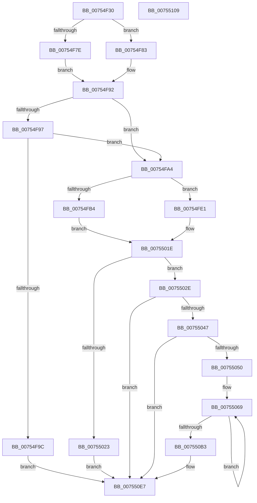

# PpmIdleInitializeConcurrency

- RVA: `0x00754F30`–`0x0075510A` (길이 `474` bytes)
- VA: `0x0000000140754F30`
- 실행 섹션: `PAGE`
- PDB 이름 있음: `예`; PDB Function 태그: `아니요`
- unwind 정보 RVA: `0x000C79DC`
- 디코드: `132`개 명령, `474/474` bytes 표시
- 미해석 바이트: `0` (있으면 어셈블리에 `.byte`로 보존)

> 이 문서는 커널 이미지의 기계어와 PDB 기호를 분석해 생성했습니다. 4번과 5번은 함수 원형과 자료형을 바이너리 사용 방식에서 추정한 C 해석이며 원본 소스 복구 결과는 아닙니다.

## 1. Dependencies

- 직접 호출 지점: **11**; 고유 호출 대상: **10**
- 직접 호출자로 확인된 함수: **2**
- RIP 상대 이미지 참조: **1**

### Outgoing calls
- `0x00754F6E` → [KeCountSetBitsAffinityEx](../../text/2C/KeCountSetBitsAffinityEx_function_002CE6E0.md) (function, `0x002CE6E0`)
- `0x00754F75` → [Feature_PpmParkEx__private_IsEnabledDeviceUsageNoInline](../../text/4F/Feature_PpmParkEx__private_IsEnabledDeviceUsageNoInline_function_004F135C.md) (function, `0x004F135C`)
- `0x00754F8A` → [KeFirstGroupAffinityEx](../../text/46/KeFirstGroupAffinityEx_function_00463810.md) (function, `0x00463810`)
- `0x00754FAB` → [Feature_PpmParkEx__private_IsEnabledDeviceUsageNoInline](../../text/4F/Feature_PpmParkEx__private_IsEnabledDeviceUsageNoInline_function_004F135C.md) (function, `0x004F135C`)
- `0x00754FBC` → [KeSetSystemGroupAffinityThread](../../text/39/KeSetSystemGroupAffinityThread_function_00399140.md) (function, `0x00399140`)
- `0x00754FCE` → [ExAllocatePool2](../../poolcode/B8/ExAllocatePool2_function_00B820F0.md) (function, `0x00B820F0`)
- `0x00754FDA` → [KeRevertToUserGroupAffinityThread](../../text/39/KeRevertToUserGroupAffinityThread_function_00398EC0.md) (function, `0x00398EC0`)
- `0x00755016` → [ExAllocatePool3](../../poolcode/B8/ExAllocatePool3_function_00B84270.md) (function, `0x00B84270`)
- `0x00755035` → [PpmQueryTime](../../text/45/PpmQueryTime_function_00454604.md) (function, `0x00454604`)
- `0x007550E2` → [memcpy](../../text/6C/memcpy_function_006C6840.md) (function, `0x006C6840`)
- `0x007550F5` → [_security_check_cookie](../../text/6A/_security_check_cookie_function_006AC640.md) (function, `0x006AC640`)

### Direct callers
- [PpmParkRegisterParking](../../text/5D/PpmParkRegisterParking_function_005DB508.md) at `0x005DBA1C`
- [PpmParkRegisterParking](../../text/5D/PpmParkRegisterParking_function_005DB508.md) at `0x005DBACE`
- [PpmParkInitParkNode](../../text/5E/PpmParkInitParkNode_function_005E1444.md) at `0x005E1770`
- [PpmParkInitParkNode](../../text/5E/PpmParkInitParkNode_function_005E1444.md) at `0x005E17EE`

### Static image references
- `0x00754F42` → RVA `0x00E0A740` (`.data`; read)

## 2. Other-region calls and transfers

- 다른 실행 섹션으로 향하는 call: **11**
  - `0x00754F6E` → [KeCountSetBitsAffinityEx](../../text/2C/KeCountSetBitsAffinityEx_function_002CE6E0.md) (`PAGE` → `.text`)
  - `0x00754F75` → [Feature_PpmParkEx__private_IsEnabledDeviceUsageNoInline](../../text/4F/Feature_PpmParkEx__private_IsEnabledDeviceUsageNoInline_function_004F135C.md) (`PAGE` → `.text`)
  - `0x00754F8A` → [KeFirstGroupAffinityEx](../../text/46/KeFirstGroupAffinityEx_function_00463810.md) (`PAGE` → `.text`)
  - `0x00754FAB` → [Feature_PpmParkEx__private_IsEnabledDeviceUsageNoInline](../../text/4F/Feature_PpmParkEx__private_IsEnabledDeviceUsageNoInline_function_004F135C.md) (`PAGE` → `.text`)
  - `0x00754FBC` → [KeSetSystemGroupAffinityThread](../../text/39/KeSetSystemGroupAffinityThread_function_00399140.md) (`PAGE` → `.text`)
  - `0x00754FCE` → [ExAllocatePool2](../../poolcode/B8/ExAllocatePool2_function_00B820F0.md) (`PAGE` → `POOLCODE`)
  - `0x00754FDA` → [KeRevertToUserGroupAffinityThread](../../text/39/KeRevertToUserGroupAffinityThread_function_00398EC0.md) (`PAGE` → `.text`)
  - `0x00755016` → [ExAllocatePool3](../../poolcode/B8/ExAllocatePool3_function_00B84270.md) (`PAGE` → `POOLCODE`)
  - `0x00755035` → [PpmQueryTime](../../text/45/PpmQueryTime_function_00454604.md) (`PAGE` → `.text`)
  - `0x007550E2` → [memcpy](../../text/6C/memcpy_function_006C6840.md) (`PAGE` → `.text`)
  - `0x007550F5` → [_security_check_cookie](../../text/6A/_security_check_cookie_function_006AC640.md) (`PAGE` → `.text`)
- 별도 외부 분기/꼬리 이동을 확인하지 못했습니다.

## 3. Assembly (complete function range)

```asm
00754F30  40 55                           push rbp
00754F32  53                              push rbx
00754F33  56                              push rsi
00754F34  57                              push rdi
00754F35  41 54                           push r12
00754F37  41 56                           push r14
00754F39  41 57                           push r15
00754F3B  48 8B EC                        mov rbp, rsp
00754F3E  48 83 EC 70                     sub rsp, 0x70
00754F42  48 8B 05 F7 57 6B 00            mov rax, qword ptr [rip + 0x6b57f7]
00754F49  48 33 C4                        xor rax, rsp
00754F4C  48 89 45 F0                     mov qword ptr [rbp - 0x10], rax
00754F50  44 0F B7 F9                     movzx r15d, cx
00754F54  0F 57 C0                        xorps xmm0, xmm0
00754F57  0F 57 C9                        xorps xmm1, xmm1
00754F5A  48 8B CA                        mov rcx, rdx
00754F5D  0F 11 45 D0                     movups xmmword ptr [rbp - 0x30], xmm0
00754F61  49 8B F9                        mov rdi, r9
00754F64  4D 8B E0                        mov r12, r8
00754F67  0F 11 4D E0                     movups xmmword ptr [rbp - 0x20], xmm1
00754F6B  48 8B DA                        mov rbx, rdx
00754F6E  E8 6D 97 B7 FF                  call 0x1402ce6e0
00754F73  8B F0                           mov esi, eax
00754F75  E8 E2 C3 D9 FF                  call 0x1404f135c
00754F7A  85 C0                           test eax, eax
00754F7C  74 05                           je 0x140754f83
00754F7E  45 33 F6                        xor r14d, r14d
00754F81  EB 0F                           jmp 0x140754f92
00754F83  48 8B D3                        mov rdx, rbx
00754F86  48 8D 4D D0                     lea rcx, [rbp - 0x30]
00754F8A  E8 81 E8 D0 FF                  call 0x140463810
00754F8F  44 8B F0                        mov r14d, eax
00754F92  48 85 FF                        test rdi, rdi
00754F95  74 0D                           je 0x140754fa4
00754F97  3B 77 08                        cmp esi, dword ptr [rdi + 8]
00754F9A  75 08                           jne 0x140754fa4
00754F9C  48 8B DF                        mov rbx, rdi
00754F9F  E9 43 01 00 00                  jmp 0x1407550e7
00754FA4  8D 1C F5 50 01 00 00            lea ebx, [rsi*8 + 0x150]
00754FAB  E8 AC C3 D9 FF                  call 0x1404f135c
00754FB0  85 C0                           test eax, eax
00754FB2  75 2D                           jne 0x140754fe1
00754FB4  48 8D 55 E0                     lea rdx, [rbp - 0x20]
00754FB8  48 8D 4D D0                     lea rcx, [rbp - 0x30]
00754FBC  E8 7F 41 C4 FF                  call 0x140399140
00754FC1  41 B8 50 50 4D 70               mov r8d, 0x704d5050
00754FC7  8B D3                           mov edx, ebx
00754FC9  B9 40 00 00 00                  mov ecx, 0x40
00754FCE  E8 1D D1 42 00                  call 0x140b820f0
00754FD3  48 8D 4D E0                     lea rcx, [rbp - 0x20]
00754FD7  48 8B D8                        mov rbx, rax
00754FDA  E8 E1 3E C4 FF                  call 0x140398ec0
00754FDF  EB 3D                           jmp 0x14075501e
00754FE1  0F 57 C0                        xorps xmm0, xmm0
00754FE4  C7 44 24 20 01 00 00 00         mov dword ptr [rsp + 0x20], 1
00754FEC  0F 11 45 C0                     movups xmmword ptr [rbp - 0x40], xmm0
00754FF0  41 8B C7                        mov eax, r15d
00754FF3  C6 45 C0 03                     mov byte ptr [rbp - 0x40], 3
00754FF7  48 0F BA 6D C0 08               bts qword ptr [rbp - 0x40], 8
00754FFD  4C 8D 4D C0                     lea r9, [rbp - 0x40]
00755001  0F BA E8 1F                     bts eax, 0x1f
00755005  41 B8 50 50 4D 70               mov r8d, 0x704d5050
0075500B  48 8B D3                        mov rdx, rbx
0075500E  89 45 C8                        mov dword ptr [rbp - 0x38], eax
00755011  B9 40 00 00 00                  mov ecx, 0x40
00755016  E8 55 F2 42 00                  call 0x140b84270
0075501B  48 8B D8                        mov rbx, rax
0075501E  48 85 DB                        test rbx, rbx
00755021  75 0B                           jne 0x14075502e
00755023  41 BE 9A 00 00 C0               mov r14d, 0xc000009a
00755029  E9 B9 00 00 00                  jmp 0x1407550e7
0075502E  48 83 23 00                     and qword ptr [rbx], 0
00755032  89 73 08                        mov dword ptr [rbx + 8], esi
00755035  E8 CA F5 CF FF                  call 0x140454604
0075503A  48 89 43 10                     mov qword ptr [rbx + 0x10], rax
0075503E  48 85 FF                        test rdi, rdi
00755041  0F 84 A0 00 00 00               je 0x1407550e7
00755047  3B 77 08                        cmp esi, dword ptr [rdi + 8]
0075504A  0F 86 97 00 00 00               jbe 0x1407550e7
00755050  48 8B 47 18                     mov rax, qword ptr [rdi + 0x18]
00755054  48 8D 4B 20                     lea rcx, [rbx + 0x20]
00755058  BA 02 00 00 00                  mov edx, 2
0075505D  48 89 43 18                     mov qword ptr [rbx + 0x18], rax
00755061  48 8D 47 20                     lea rax, [rdi + 0x20]
00755065  44 8D 42 7E                     lea r8d, [rdx + 0x7e]
00755069  0F 10 00                        movups xmm0, xmmword ptr [rax]
0075506C  0F 11 01                        movups xmmword ptr [rcx], xmm0
0075506F  0F 10 48 10                     movups xmm1, xmmword ptr [rax + 0x10]
00755073  0F 11 49 10                     movups xmmword ptr [rcx + 0x10], xmm1
00755077  0F 10 40 20                     movups xmm0, xmmword ptr [rax + 0x20]
0075507B  0F 11 41 20                     movups xmmword ptr [rcx + 0x20], xmm0
0075507F  0F 10 48 30                     movups xmm1, xmmword ptr [rax + 0x30]
00755083  0F 11 49 30                     movups xmmword ptr [rcx + 0x30], xmm1
00755087  0F 10 40 40                     movups xmm0, xmmword ptr [rax + 0x40]
0075508B  0F 11 41 40                     movups xmmword ptr [rcx + 0x40], xmm0
0075508F  0F 10 48 50                     movups xmm1, xmmword ptr [rax + 0x50]
00755093  0F 11 49 50                     movups xmmword ptr [rcx + 0x50], xmm1
00755097  0F 10 40 60                     movups xmm0, xmmword ptr [rax + 0x60]
0075509B  0F 11 41 60                     movups xmmword ptr [rcx + 0x60], xmm0
0075509F  49 03 C8                        add rcx, r8
007550A2  0F 10 48 70                     movups xmm1, xmmword ptr [rax + 0x70]
007550A6  49 03 C0                        add rax, r8
007550A9  0F 11 49 F0                     movups xmmword ptr [rcx - 0x10], xmm1
007550AD  48 83 EA 01                     sub rdx, 1
007550B1  75 B6                           jne 0x140755069
007550B3  0F 10 00                        movups xmm0, xmmword ptr [rax]
007550B6  48 8D 97 48 01 00 00            lea rdx, [rdi + 0x148]
007550BD  0F 11 01                        movups xmmword ptr [rcx], xmm0
007550C0  0F 10 48 10                     movups xmm1, xmmword ptr [rax + 0x10]
007550C4  0F 11 49 10                     movups xmmword ptr [rcx + 0x10], xmm1
007550C8  48 8B 40 20                     mov rax, qword ptr [rax + 0x20]
007550CC  48 89 41 20                     mov qword ptr [rcx + 0x20], rax
007550D0  48 8D 8B 48 01 00 00            lea rcx, [rbx + 0x148]
007550D7  44 8B 47 08                     mov r8d, dword ptr [rdi + 8]
007550DB  41 FF C0                        inc r8d
007550DE  49 C1 E0 03                     shl r8, 3
007550E2  E8 59 17 F7 FF                  call 0x1406c6840
007550E7  49 89 1C 24                     mov qword ptr [r12], rbx
007550EB  41 8B C6                        mov eax, r14d
007550EE  48 8B 4D F0                     mov rcx, qword ptr [rbp - 0x10]
007550F2  48 33 CC                        xor rcx, rsp
007550F5  E8 46 75 F5 FF                  call 0x1406ac640
007550FA  48 83 C4 70                     add rsp, 0x70
007550FE  41 5F                           pop r15
00755100  41 5E                           pop r14
00755102  41 5C                           pop r12
00755104  5F                              pop rdi
00755105  5E                              pop rsi
00755106  5B                              pop rbx
00755107  5D                              pop rbp
00755108  C3                              ret
00755109  CC                              int3
```

## 4. C-style interpretation (structured pseudocode)

```c
__int64 __fastcall PpmIdleInitializeConcurrency(unsigned __int16 a1, __int64 a2, __int64 a3, __int64 a4)
{
    __int64 result;
    __int64 v_r14;
    __int64 v_rsp;
    unsigned __int64 v_stack_m48;
    unsigned __int64 v_stack_m58;
    unsigned __int64 v_stack_m68;
    unsigned int v_stack_m70;
    unsigned __int64 v_stack_m78;
    unsigned int v_stack_m88;

    v_rsp = (v_rsp) - (112);
    result = (*(unsigned __int64 *)(v_rip + 7034871)) ^ (v_rsp);
    v_stack_m48 = result;
    v_stack_m68 = v_xmm0;
    v_stack_m58 = v_xmm1;
    result = KeCountSetBitsAffinityEx(a2, a2, a3, a4);
    result = Feature_PpmParkEx__private_IsEnabledDeviceUsageNoInline(a2, a2, a3, a4);
    if ((unsigned int)(result) == 0) goto loc_00754F83;
    v_r14 = 0;
    goto loc_00754F92;
loc_00754F83:
    result = KeFirstGroupAffinityEx(v_stack_m68, a2, a3, a4);
loc_00754F92:
    if (a4 == 0) goto loc_00754FA4;
    if (((unsigned int)((unsigned int)((unsigned int)(result)))) != (*(unsigned int *)(a4 + 8))) goto loc_00754FA4;
    goto loc_007550E7;
loc_00754FA4:
    result = Feature_PpmParkEx__private_IsEnabledDeviceUsageNoInline(v_stack_m68, a2, a3, a4);
    if ((unsigned int)(result) != 0) goto loc_00754FE1;
    result = KeSetSystemGroupAffinityThread(v_stack_m68, v_stack_m58, a3, a4);
    result = ExAllocatePool2(64, (unsigned int)((unsigned int)((unsigned int)((unsigned int)(result)) * 8 + 336)), (unsigned int)(0x704D5050ULL), a4);
    result = KeRevertToUserGroupAffinityThread(v_stack_m58, (unsigned int)((unsigned int)((unsigned int)((unsigned int)(result)) * 8 + 336)), (unsigned int)(0x704D5050ULL), a4);
    goto loc_0075501E;
loc_00754FE1:
    v_stack_m88 = 1;
    v_stack_m78 = v_xmm0;
    v_stack_m78 = 3;
    v_stack_m70 = (unsigned int)((unsigned int)(a1));
    result = ExAllocatePool3(64, result, (unsigned int)(0x704D5050ULL), v_stack_m78);
loc_0075501E:
    if (result != 0) goto loc_0075502E;
    goto loc_007550E7;
loc_0075502E:
    *(unsigned int *)(result + 8) = (unsigned int)((unsigned int)((unsigned int)(result)));
    result = PpmQueryTime(64, result, (unsigned int)(0x704D5050ULL), v_stack_m78);
    *(unsigned __int64 *)(result + 16) = result;
    if (a4 == 0) goto loc_007550E7;
    if (((unsigned int)((unsigned int)((unsigned int)(result)))) <= (*(unsigned int *)(a4 + 8))) goto loc_007550E7;
    *(unsigned __int64 *)(result + 24) = *(unsigned __int64 *)(a4 + 24);
loc_00755069:
    *(unsigned __int64 *)(result + 32) = v_xmm0;
    *(unsigned __int64 *)(result + 32 + 16) = v_xmm1;
    *(unsigned __int64 *)(result + 32 + 32) = v_xmm0;
    *(unsigned __int64 *)(result + 32 + 48) = v_xmm1;
    *(unsigned __int64 *)(result + 32 + 64) = v_xmm0;
    *(unsigned __int64 *)(result + 32 + 80) = v_xmm1;
    *(unsigned __int64 *)(result + 32 + 96) = v_xmm0;
    a1 = (result + 32) + (2 + 126);
    result = (a4 + 32) + (2 + 126);
    *(unsigned __int64 *)(a1 - 16) = v_xmm1;
    a2 = (2) - (1);
    if (condition_is_not_equal) goto loc_00755069;
    *(unsigned __int64 *)(a1) = v_xmm0;
    *(unsigned __int64 *)(a1 + 16) = v_xmm1;
    *(unsigned __int64 *)(a1 + 32) = *(unsigned __int64 *)(result + 32);
    a3 = (unsigned int)(((unsigned int)(*(unsigned int *)(a4 + 8))) + 1);
    a3 = (a3) << (3);
    result = memcpy(result + 328, a4 + 328, a3, v_stack_m78);
loc_007550E7:
    *(unsigned __int64 *)(a3) = result;
    a1 = (v_stack_m48) ^ (v_rsp);
    result = _security_check_cookie(a1, a4 + 328, a3, v_stack_m78);
    v_rsp = (v_rsp) + (112);
    return result;
}
```

## 5. (Beta) C Style

```c
int64_t PpmIdleInitializeConcurrency(uint16_t Arg1, int64_t Arg2, void *Arg3, int64_t Arg4)
{
    uint8_t *arg3 = (uint8_t *)Arg3;

    int64_t result;
    int64_t local_r14;
    int64_t local_rsp;
    uint64_t v_stack_m48;
    uint64_t v_stack_m58;
    uint64_t v_stack_m68;
    uint32_t v_stack_m70;
    uint64_t v_stack_m78;
    uint32_t v_stack_m88;

    local_rsp = (local_rsp) - (112);
    result = (*(uint64_t *)(v_rip + 0x6B57F7)) ^ (local_rsp);
    v_stack_m48 = result;
    v_stack_m68 = v_xmm0;
    v_stack_m58 = v_xmm1;
    result = KeCountSetBitsAffinityEx(Arg2, Arg2, Arg3, Arg4);
    result = Feature_PpmParkEx__private_IsEnabledDeviceUsageNoInline(Arg2, Arg2, Arg3, Arg4);
    if ((uint32_t)(result) == 0) goto loc_00754F83;
    local_r14 = 0;
    goto loc_00754F92;
loc_00754F83:
    result = KeFirstGroupAffinityEx(v_stack_m68, Arg2, Arg3, Arg4);
loc_00754F92:
    if (Arg4 == 0) goto loc_00754FA4;
    if (((uint32_t)((uint32_t)((uint32_t)(result)))) != (*(uint32_t *)(Arg4 + 0x8))) goto loc_00754FA4;
    goto loc_007550E7;
loc_00754FA4:
    result = Feature_PpmParkEx__private_IsEnabledDeviceUsageNoInline(v_stack_m68, Arg2, Arg3, Arg4);
    if ((uint32_t)(result) != 0) goto loc_00754FE1;
    result = KeSetSystemGroupAffinityThread(v_stack_m68, v_stack_m58, Arg3, Arg4);
    result = ExAllocatePool2(64, (uint32_t)((uint32_t)((uint32_t)((uint32_t)(result)) * 8 + 336)), (uint32_t)(0x704D5050ULL), Arg4);
    result = KeRevertToUserGroupAffinityThread(v_stack_m58, (uint32_t)((uint32_t)((uint32_t)((uint32_t)(result)) * 8 + 336)), (uint32_t)(0x704D5050ULL), Arg4);
    goto loc_0075501E;
loc_00754FE1:
    v_stack_m88 = 1;
    v_stack_m78 = v_xmm0;
    v_stack_m78 = 3;
    v_stack_m70 = (uint32_t)((uint32_t)(Arg1));
    result = ExAllocatePool3(64, result, (uint32_t)(0x704D5050ULL), v_stack_m78);
loc_0075501E:
    if (result != 0) goto loc_0075502E;
    goto loc_007550E7;
loc_0075502E:
    *(uint32_t *)(result + 0x8) = (uint32_t)((uint32_t)((uint32_t)(result)));
    result = PpmQueryTime(64, result, (uint32_t)(0x704D5050ULL), v_stack_m78);
    *(uint64_t *)(result + 0x10) = result;
    if (Arg4 == 0) goto loc_007550E7;
    if (((uint32_t)((uint32_t)((uint32_t)(result)))) <= (*(uint32_t *)(Arg4 + 0x8))) goto loc_007550E7;
    *(uint64_t *)(result + 0x18) = *(uint64_t *)(Arg4 + 0x18);
loc_00755069:
    *(uint64_t *)(result + 0x20) = v_xmm0;
    *(uint64_t *)(result + 0x20 + 0x10) = v_xmm1;
    *(uint64_t *)(result + 0x20 + 0x20) = v_xmm0;
    *(uint64_t *)(result + 0x20 + 0x30) = v_xmm1;
    *(uint64_t *)(result + 0x20 + 0x40) = v_xmm0;
    *(uint64_t *)(result + 0x20 + 0x50) = v_xmm1;
    *(uint64_t *)(result + 0x20 + 0x60) = v_xmm0;
    Arg1 = (result + 32) + (2 + 126);
    result = (Arg4 + 32) + (2 + 126);
    *(uint64_t *)(Arg1 - 0x10) = v_xmm1;
    Arg2 = (2) - (1);
    if (condition_is_not_equal) goto loc_00755069;
    *(uint64_t *)(Arg1) = v_xmm0;
    *(uint64_t *)(Arg1 + 0x10) = v_xmm1;
    *(uint64_t *)(Arg1 + 0x20) = *(uint64_t *)(result + 0x20);
    Arg3 = (uint32_t)(((uint32_t)(*(uint32_t *)(Arg4 + 0x8))) + 1);
    Arg3 = (Arg3) << (3);
    result = memcpy(result + 328, Arg4 + 328, Arg3, v_stack_m78);
loc_007550E7:
    *(uint64_t *)(arg3) = result;
    Arg1 = (v_stack_m48) ^ (local_rsp);
    result = _security_check_cookie(Arg1, Arg4 + 328, Arg3, v_stack_m78);
    local_rsp = (local_rsp) + (112);
    return result;
}
```

### 관측된 메모리 오프셋

구조체 형식이 확인되지 않은 접근은 인자 기준의 오프셋으로만 기록했습니다.

| 기준 인자 | 오프셋 표현 | 폭 (bit) | 접근 |
|---|---:|---:|---|
| `Arg3` | `+ 0x0` | `64` | `W` |

## 6. Execution-region graph

[열기: 2D/3D 그래프와 함수 탐색 컨트롤 패널](../../../control-panel.html?section=page&rva=0x00754F30&view=graph)

- 2D 그래프는 위에서 아래로 흐르고, 3D 그래프는 빈 공간을 드래그해 회전합니다. Shift+드래그는 이동, 휠은 확대·축소, 함수 노드 선택은 대상 보고서 이동입니다.

### Static fallback


