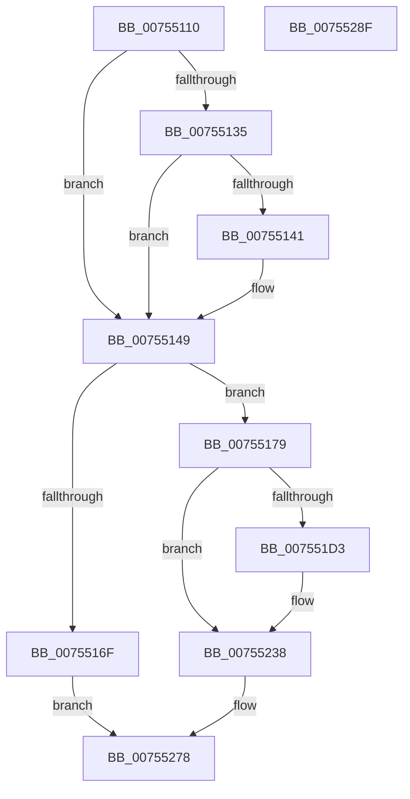

# PpmIdleRegisterDefaultStates

- RVA: `0x00755110`–`0x00755290` (길이 `384` bytes)
- VA: `0x0000000140755110`
- 실행 섹션: `PAGE`
- PDB 이름 있음: `예`; PDB Function 태그: `아니요`
- unwind 정보 RVA: `0x0005C954`
- 디코드: `88`개 명령, `384/384` bytes 표시
- 미해석 바이트: `0` (있으면 어셈블리에 `.byte`로 보존)

> 이 문서는 커널 이미지의 기계어와 PDB 기호를 분석해 생성했습니다. 4번과 5번은 함수 원형과 자료형을 바이너리 사용 방식에서 추정한 C 해석이며 원본 소스 복구 결과는 아닙니다.

## 1. Dependencies

- 직접 호출 지점: **8**; 고유 호출 대상: **7**
- 직접 호출자로 확인된 함수: **2**
- RIP 상대 이미지 참조: **14**

### Outgoing calls
- `0x00755127` → [PpmHvUseNativeAlgorithms](../../text/4B/PpmHvUseNativeAlgorithms_function_004BDBB4.md) (function, `0x004BDBB4`)
- `0x00755162` → [ExAllocatePool2](../../poolcode/B8/ExAllocatePool2_function_00B820F0.md) (function, `0x00B820F0`)
- `0x00755199` → [RtlInitUnicodeString](../../text/42/RtlInitUnicodeString_function_0042A780.md) (function, `0x0042A780`)
- `0x0075522E` → [RtlInitUnicodeString](../../text/42/RtlInitUnicodeString_function_0042A780.md) (function, `0x0042A780`)
- `0x0075523F` → [PopAcquireRwLockExclusive](../../text/43/PopAcquireRwLockExclusive_function_00430B44.md) (function, `0x00430B44`)
- `0x00755258` → [PopExecuteOnTargetProcessors](../../text/2D/PopExecuteOnTargetProcessors_function_002DD834.md) (function, `0x002DD834`)
- `0x00755266` → [PopReleaseRwLock](../../text/2D/PopReleaseRwLock_function_002DFBBC.md) (function, `0x002DFBBC`)
- `0x00755273` → [ExFreePoolWithTag](../../poolcode/B8/ExFreePoolWithTag_function_00B82870.md) (function, `0x00B82870`)

### Direct callers
- [PopNewProcessorCallback](PopNewProcessorCallback_function_007539A0.md) at `0x007539DF`
- [PoInitSystem](../../init/C7/PoInitSystem_function_00C72358.md) at `0x00C729DA`
- [PoInitSystem](../../init/C7/PoInitSystem_function_00C72358.md) at `0x00C72E40`

### Static image references
- `0x00755135` → RVA `0x00FC6AB8` (`ALMOSTRO`; read)
- `0x00755184` → RVA `0x00B01BD0` (` ?? ::NNGAKEGL::`string'`; read)
- `0x007551A2` → RVA `0x004AF670` (`PpmIdleDefaultExecute`; read)
- `0x007551AD` → RVA `0x0049E550` (`EmpCheckErrataList`; read)
- `0x007551B8` → RVA `0x0053F4C0` (`HalpIsHybridPassthroughCapable`; read)
- `0x007551D3` → RVA `0x005DD120` (`PpmIdleGuestPreselect`; read)
- `0x007551E5` → RVA `0x005DD280` (`PpmIdleGuestTest`; read)
- `0x007551F0` → RVA `0x00B01BE0` (` ?? ::NNGAKEGL::`string'`; read)
- `0x007551F7` → RVA `0x005DD0E0` (`PpmIdleGuestPreExecute`; read)
- `0x00755202` → RVA `0x004BD260` (`PpmIdleGuestExecute`; read)
- `0x0075520D` → RVA `0x0048B720` (`PpmIdleGuestComplete`; read)
- `0x00755238` → RVA `0x00F0CA70` (`.data`; read)
- `0x00755247` → RVA `0x005CFE70` (`PpmIdleInstallDefaultStates`; read)
- `0x00755251` → RVA `0x00FC7120` (`ALMOSTRO`; read)

## 2. Other-region calls and transfers

- 다른 실행 섹션으로 향하는 call: **8**
  - `0x00755127` → [PpmHvUseNativeAlgorithms](../../text/4B/PpmHvUseNativeAlgorithms_function_004BDBB4.md) (`PAGE` → `.text`)
  - `0x00755162` → [ExAllocatePool2](../../poolcode/B8/ExAllocatePool2_function_00B820F0.md) (`PAGE` → `POOLCODE`)
  - `0x00755199` → [RtlInitUnicodeString](../../text/42/RtlInitUnicodeString_function_0042A780.md) (`PAGE` → `.text`)
  - `0x0075522E` → [RtlInitUnicodeString](../../text/42/RtlInitUnicodeString_function_0042A780.md) (`PAGE` → `.text`)
  - `0x0075523F` → [PopAcquireRwLockExclusive](../../text/43/PopAcquireRwLockExclusive_function_00430B44.md) (`PAGE` → `.text`)
  - `0x00755258` → [PopExecuteOnTargetProcessors](../../text/2D/PopExecuteOnTargetProcessors_function_002DD834.md) (`PAGE` → `.text`)
  - `0x00755266` → [PopReleaseRwLock](../../text/2D/PopReleaseRwLock_function_002DFBBC.md) (`PAGE` → `.text`)
  - `0x00755273` → [ExFreePoolWithTag](../../poolcode/B8/ExFreePoolWithTag_function_00B82870.md) (`PAGE` → `POOLCODE`)
- 별도 외부 분기/꼬리 이동을 확인하지 못했습니다.

## 3. Assembly (complete function range)

```asm
00755110  48 89 5C 24 08                  mov qword ptr [rsp + 8], rbx
00755115  48 89 6C 24 10                  mov qword ptr [rsp + 0x10], rbp
0075511A  48 89 74 24 18                  mov qword ptr [rsp + 0x18], rsi
0075511F  57                              push rdi
00755120  48 83 EC 20                     sub rsp, 0x20
00755124  40 32 FF                        xor dil, dil
00755127  E8 88 8A D6 FF                  call 0x1404bdbb4
0075512C  BE 01 00 00 00                  mov esi, 1
00755131  84 C0                           test al, al
00755133  75 14                           jne 0x140755149
00755135  8B 05 7D 19 87 00               mov eax, dword ptr [rip + 0x87197d]
0075513B  0F BA E0 1C                     bt eax, 0x1c
0075513F  72 08                           jb 0x140755149
00755141  8B F8                           mov edi, eax
00755143  C1 EF 09                        shr edi, 9
00755146  40 22 FE                        and dil, sil
00755149  40 0F B6 EF                     movzx ebp, dil
0075514D  B9 40 00 00 00                  mov ecx, 0x40
00755152  FF C5                           inc ebp
00755154  41 B8 50 50 4D 69               mov r8d, 0x694d5050
0075515A  8B D5                           mov edx, ebp
0075515C  C1 E2 05                        shl edx, 5
0075515F  83 C2 68                        add edx, 0x68
00755162  E8 89 CF 42 00                  call 0x140b820f0
00755167  48 8B D8                        mov rbx, rax
0075516A  48 85 C0                        test rax, rax
0075516D  75 0A                           jne 0x140755179
0075516F  BF 9A 00 00 C0                  mov edi, 0xc000009a
00755174  E9 FF 00 00 00                  jmp 0x140755278
00755179  40 88 70 13                     mov byte ptr [rax + 0x13], sil
0075517D  48 8D 4B 78                     lea rcx, [rbx + 0x78]
00755181  89 68 60                        mov dword ptr [rax + 0x60], ebp
00755184  48 8D 15 45 CA 3A 00            lea rdx, [rip + 0x3aca45]
0075518B  8B 40 68                        mov eax, dword ptr [rax + 0x68]
0075518E  83 E0 8F                        and eax, 0xffffff8f
00755191  0D 8F 00 00 80                  or eax, 0x8000008f
00755196  89 43 68                        mov dword ptr [rbx + 0x68], eax
00755199  E8 E2 55 CD FF                  call 0x14042a780
0075519E  C6 43 10 00                     mov byte ptr [rbx + 0x10], 0
007551A2  48 8D 05 C7 A4 D5 FF            lea rax, [rip - 0x2a5b39]
007551A9  48 89 43 40                     mov qword ptr [rbx + 0x40], rax
007551AD  48 8D 05 9C 93 D4 FF            lea rax, [rip - 0x2b6c64]
007551B4  48 89 43 48                     mov qword ptr [rbx + 0x48], rax
007551B8  48 8D 05 01 A3 DE FF            lea rax, [rip - 0x215cff]
007551BF  48 89 43 50                     mov qword ptr [rbx + 0x50], rax
007551C3  48 8D 05 F6 A2 DE FF            lea rax, [rip - 0x215d0a]
007551CA  48 89 43 58                     mov qword ptr [rbx + 0x58], rax
007551CE  40 84 FF                        test dil, dil
007551D1  74 65                           je 0x140755238
007551D3  48 8D 05 46 7F E8 FF            lea rax, [rip - 0x1780ba]
007551DA  48 89 43 18                     mov qword ptr [rbx + 0x18], rax
007551DE  48 8D 8B 98 00 00 00            lea rcx, [rbx + 0x98]
007551E5  48 8D 05 94 80 E8 FF            lea rax, [rip - 0x177f6c]
007551EC  48 89 43 20                     mov qword ptr [rbx + 0x20], rax
007551F0  48 8D 15 E9 C9 3A 00            lea rdx, [rip + 0x3ac9e9]
007551F7  48 8D 05 E2 7E E8 FF            lea rax, [rip - 0x17811e]
007551FE  48 89 43 30                     mov qword ptr [rbx + 0x30], rax
00755202  48 8D 05 57 80 D6 FF            lea rax, [rip - 0x297fa9]
00755209  48 89 43 40                     mov qword ptr [rbx + 0x40], rax
0075520D  48 8D 05 0C 65 D3 FF            lea rax, [rip - 0x2c9af4]
00755214  48 89 43 48                     mov qword ptr [rbx + 0x48], rax
00755218  8B 83 88 00 00 00               mov eax, dword ptr [rbx + 0x88]
0075521E  25 00 FF FF 7F                  and eax, 0x7fffff00
00755223  0D 97 00 00 00                  or eax, 0x97
00755228  89 83 88 00 00 00               mov dword ptr [rbx + 0x88], eax
0075522E  E8 4D 55 CD FF                  call 0x14042a780
00755233  BE 02 00 00 00                  mov esi, 2
00755238  48 8D 0D 31 78 7B 00            lea rcx, [rip + 0x7b7831]
0075523F  E8 00 B9 CD FF                  call 0x140430b44
00755244  4C 8B CE                        mov r9, rsi
00755247  48 8D 15 22 AC E7 FF            lea rdx, [rip - 0x1853de]
0075524E  4C 8B C3                        mov r8, rbx
00755251  48 8D 0D C8 1E 87 00            lea rcx, [rip + 0x871ec8]
00755258  E8 D7 85 B8 FF                  call 0x1402dd834
0075525D  48 8D 0D 0C 78 7B 00            lea rcx, [rip + 0x7b780c]
00755264  8B F8                           mov edi, eax
00755266  E8 51 A9 B8 FF                  call 0x1402dfbbc
0075526B  BA 50 50 4D 69                  mov edx, 0x694d5050
00755270  48 8B CB                        mov rcx, rbx
00755273  E8 F8 D5 42 00                  call 0x140b82870
00755278  48 8B 5C 24 30                  mov rbx, qword ptr [rsp + 0x30]
0075527D  8B C7                           mov eax, edi
0075527F  48 8B 6C 24 38                  mov rbp, qword ptr [rsp + 0x38]
00755284  48 8B 74 24 40                  mov rsi, qword ptr [rsp + 0x40]
00755289  48 83 C4 20                     add rsp, 0x20
0075528D  5F                              pop rdi
0075528E  C3                              ret
0075528F  CC                              int3
```

## 4. C-style interpretation (structured pseudocode)

```c
__int64 __fastcall PpmIdleRegisterDefaultStates(void)
{
    __int64 result;
    __int64 v_rbp;
    __int64 v_rdi;
    __int64 v_rsi;
    __int64 v_rsp;
    unsigned __int64 v_stack_p10;
    unsigned __int64 v_stack_p18;
    unsigned __int64 v_stack_p8;

    v_stack_p8 = v_rbx;
    v_stack_p10 = v_rbp;
    v_stack_p18 = v_rsi;
    v_rsp = (v_rsp) - (32);
    v_rdi = 0;
    result = PpmHvUseNativeAlgorithms(a1, a2, a3, a4);
    if ((unsigned __int8)(result) != 0) goto loc_00755149;
    if (!(condition_is_below)) {
        v_rdi = (unsigned int)((unsigned int)(*(unsigned int *)(v_rip + 8853885)));
        v_rdi = (unsigned int)((v_rdi) >> (9));
        v_rdi = (unsigned __int8)((v_rdi) & (1));
    }
    v_rbp = (unsigned int)(((unsigned __int8)(v_rdi)) + 1);
    a2 = (unsigned int)(((unsigned int)((unsigned int)(v_rbp))) << (5));
    a2 = (unsigned int)((a2) + (104));
    result = ExAllocatePool2(64, a2, (unsigned int)(0x694D5050ULL), a4);
    if (result != 0) goto loc_00755179;
    goto loc_00755278;
loc_00755179:
    *(unsigned __int8 *)(result + 19) = 1;
    *(unsigned int *)(result + 96) = (unsigned int)(v_rbp);
    result = (unsigned int)(((unsigned int)(*(unsigned int *)(result + 104))) & (0xFFFFFF8FULL));
    result = (unsigned int)((result) | (0x8000008FULL));
    *(unsigned int *)(result + 104) = (unsigned int)(result);
    result = RtlInitUnicodeString(result + 120, v_rip + 3852869, (unsigned int)(0x694D5050ULL), a4);
    *(unsigned __int8 *)(result + 16) = 0;
    *(unsigned __int64 *)(result + 64) = v_rip - 2775865;
    *(unsigned __int64 *)(result + 72) = v_rip - 2845796;
    *(unsigned __int64 *)(result + 80) = v_rip - 2186495;
    *(unsigned __int64 *)(result + 88) = v_rip - 2186506;
    result = v_rip - 2186506;
    v_rsi = 1;
    if ((unsigned __int8)((unsigned int)(0xC000009AULL)) != 0) {
        result = v_rip - 1540282;
        *(unsigned __int64 *)(result + 24) = result;
        a1 = result + 152;
        result = v_rip - 1539948;
        *(unsigned __int64 *)(result + 32) = result;
        a2 = v_rip + 3852777;
        result = v_rip - 1540382;
        *(unsigned __int64 *)(result + 48) = result;
        result = v_rip - 2719657;
        *(unsigned __int64 *)(result + 64) = result;
        result = v_rip - 2923252;
        *(unsigned __int64 *)(result + 72) = result;
        result = *(unsigned int *)(result + 136);
        result = (unsigned int)((result) & (0x7FFFFF00ULL));
        result = (unsigned int)((result) | (151));
        *(unsigned int *)(result + 136) = (unsigned int)(result);
        result = RtlInitUnicodeString(a1, a2, (unsigned int)(0x694D5050ULL), a4);
        v_rsi = 2;
    }
    result = PopAcquireRwLockExclusive(v_rip + 8091697, a2, (unsigned int)(0x694D5050ULL), a4);
    result = PopExecuteOnTargetProcessors(v_rip + 8855240, v_rip - 1594334, result, v_rsi);
    result = PopReleaseRwLock(v_rip + 8091660, v_rip - 1594334, result, v_rsi);
    result = ExFreePoolWithTag(result, (unsigned int)(0x694D5050ULL), result, v_rsi);
loc_00755278:
    v_rsp = (v_rsp) + (32);
    return (unsigned int)((unsigned int)((unsigned int)((unsigned int)(result))));
}
```

## 5. (Beta) C Style

```c
void PpmIdleRegisterDefaultStates(void)
{
    int64_t result;
    int64_t local_rbp;
    int64_t local_rdi;
    int64_t local_rsi;
    int64_t local_rsp;
    uint64_t v_stack_p10;
    uint64_t v_stack_p18;
    uint64_t v_stack_p8;

    v_stack_p8 = local_rbx;
    v_stack_p10 = local_rbp;
    v_stack_p18 = local_rsi;
    local_rsp = (local_rsp) - (32);
    local_rdi = 0;
    result = PpmHvUseNativeAlgorithms(a1, a2, a3, a4);
    if ((uint8_t)(result) != 0) goto loc_00755149;
    if (!(condition_is_below)) {
        local_rdi = (uint32_t)((uint32_t)(*(uint32_t *)(v_rip + 0x87197D)));
        local_rdi = (uint32_t)((local_rdi) >> (9));
        local_rdi = (uint8_t)((local_rdi) & (1));
    }
    local_rbp = (uint32_t)(((uint8_t)(local_rdi)) + 1);
    a2 = (uint32_t)(((uint32_t)((uint32_t)(local_rbp))) << (5));
    a2 = (uint32_t)((a2) + (104));
    result = ExAllocatePool2(64, a2, (uint32_t)(0x694D5050ULL), a4);
    if (result != 0) goto loc_00755179;
    goto loc_00755278;
loc_00755179:
    *(uint8_t *)(result + 0x13) = 1;
    *(uint32_t *)(result + 0x60) = (uint32_t)(local_rbp);
    result = (uint32_t)(((uint32_t)(*(uint32_t *)(result + 0x68))) & (0xFFFFFF8FULL));
    result = (uint32_t)((result) | (0x8000008FULL));
    *(uint32_t *)(result + 0x68) = (uint32_t)(result);
    result = RtlInitUnicodeString(result + 120, v_rip + 3852869, (uint32_t)(0x694D5050ULL), a4);
    *(uint8_t *)(result + 0x10) = 0;
    *(uint64_t *)(result + 0x40) = v_rip - 2775865;
    *(uint64_t *)(result + 0x48) = v_rip - 2845796;
    *(uint64_t *)(result + 0x50) = v_rip - 2186495;
    *(uint64_t *)(result + 0x58) = v_rip - 2186506;
    result = v_rip - 2186506;
    local_rsi = 1;
    if ((uint8_t)((uint32_t)(0xC000009AULL)) != 0) {
        result = v_rip - 1540282;
        *(uint64_t *)(result + 0x18) = result;
        a1 = result + 152;
        result = v_rip - 1539948;
        *(uint64_t *)(result + 0x20) = result;
        a2 = v_rip + 3852777;
        result = v_rip - 1540382;
        *(uint64_t *)(result + 0x30) = result;
        result = v_rip - 2719657;
        *(uint64_t *)(result + 0x40) = result;
        result = v_rip - 2923252;
        *(uint64_t *)(result + 0x48) = result;
        result = *(uint32_t *)(result + 0x88);
        result = (uint32_t)((result) & (0x7FFFFF00ULL));
        result = (uint32_t)((result) | (151));
        *(uint32_t *)(result + 0x88) = (uint32_t)(result);
        result = RtlInitUnicodeString(a1, a2, (uint32_t)(0x694D5050ULL), a4);
        local_rsi = 2;
    }
    result = PopAcquireRwLockExclusive(v_rip + 8091697, a2, (uint32_t)(0x694D5050ULL), a4);
    result = PopExecuteOnTargetProcessors(v_rip + 8855240, v_rip - 1594334, result, local_rsi);
    result = PopReleaseRwLock(v_rip + 8091660, v_rip - 1594334, result, local_rsi);
    result = ExFreePoolWithTag(result, (uint32_t)(0x694D5050ULL), result, local_rsi);
loc_00755278:
    local_rsp = (local_rsp) + (32);
    return (uint32_t)((uint32_t)((uint32_t)((uint32_t)(result))));
}
```

## 6. Execution-region graph

[열기: 2D/3D 그래프와 함수 탐색 컨트롤 패널](../../../control-panel.html?section=page&rva=0x00755110&view=graph)

- 2D 그래프는 위에서 아래로 흐르고, 3D 그래프는 빈 공간을 드래그해 회전합니다. Shift+드래그는 이동, 휠은 확대·축소, 함수 노드 선택은 대상 보고서 이동입니다.

### Static fallback


