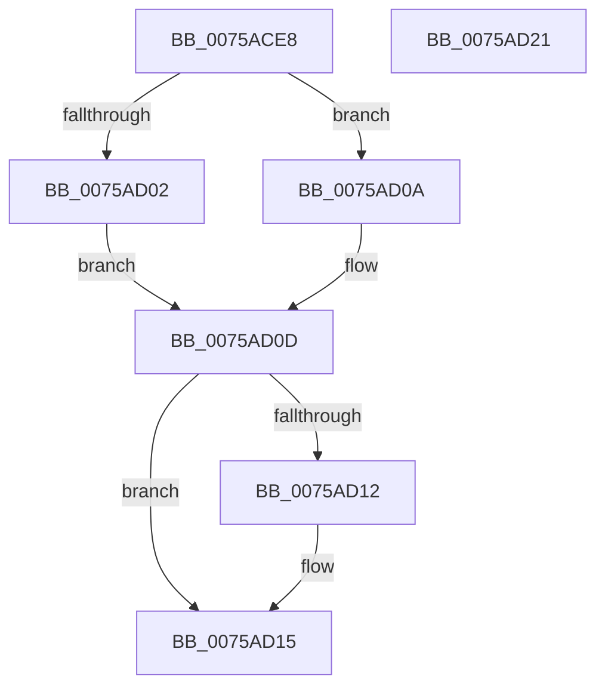

# PpmPerfAccumulateBrandedFrequency

- RVA: `0x0075ACE8`–`0x0075AD22` (길이 `58` bytes)
- VA: `0x000000014075ACE8`
- 실행 섹션: `PAGE`
- PDB 이름 있음: `예`; PDB Function 태그: `아니요`
- unwind 정보 RVA: `0x0005CF00`
- 디코드: `18`개 명령, `58/58` bytes 표시
- 미해석 바이트: `0` (있으면 어셈블리에 `.byte`로 보존)

> 이 문서는 커널 이미지의 기계어와 PDB 기호를 분석해 생성했습니다. 4번과 5번은 함수 원형과 자료형을 바이너리 사용 방식에서 추정한 C 해석이며 원본 소스 복구 결과는 아닙니다.

## 1. Dependencies

- 직접 호출 지점: **1**; 고유 호출 대상: **1**
- 직접 호출자로 확인된 함수: **1**
- RIP 상대 이미지 참조: **0**

### Outgoing calls
- `0x0075ACF1` → [KeGetPrcb](../../text/2D/KeGetPrcb_function_002D85D0.md) (function, `0x002D85D0`)

### Direct callers
- [PpmPerfGetBrandedFrequency](../AD/PpmPerfGetBrandedFrequency_function_00AD4900.md) at `0x00AD4954`
- [PpmPerfGetBrandedFrequency](../AD/PpmPerfGetBrandedFrequency_function_00AD4900.md) at `0x00AD4981`

### Static image references
- 디코드된 RIP-relative 메모리 참조가 없습니다.

## 2. Other-region calls and transfers

- 다른 실행 섹션으로 향하는 call: **1**
  - `0x0075ACF1` → [KeGetPrcb](../../text/2D/KeGetPrcb_function_002D85D0.md) (`PAGE` → `.text`)
- 별도 외부 분기/꼬리 이동을 확인하지 못했습니다.

## 3. Assembly (complete function range)

```asm
0075ACE8  40 53                           push rbx
0075ACEA  48 83 EC 20                     sub rsp, 0x20
0075ACEE  48 8B DA                        mov rbx, rdx
0075ACF1  E8 DA D8 B7 FF                  call 0x1402d85d0
0075ACF6  48 8B 88 B0 89 00 00            mov rcx, qword ptr [rax + 0x89b0]
0075ACFD  48 85 C9                        test rcx, rcx
0075AD00  74 08                           je 0x14075ad0a
0075AD02  8B 81 C0 01 00 00               mov eax, dword ptr [rcx + 0x1c0]
0075AD08  EB 03                           jmp 0x14075ad0d
0075AD0A  8B 40 44                        mov eax, dword ptr [rax + 0x44]
0075AD0D  39 43 04                        cmp dword ptr [rbx + 4], eax
0075AD10  73 03                           jae 0x14075ad15
0075AD12  89 43 04                        mov dword ptr [rbx + 4], eax
0075AD15  C7 03 01 00 00 00               mov dword ptr [rbx], 1
0075AD1B  48 83 C4 20                     add rsp, 0x20
0075AD1F  5B                              pop rbx
0075AD20  C3                              ret
0075AD21  CC                              int3
```

## 4. C-style interpretation (structured pseudocode)

```c
__int64 __fastcall PpmPerfAccumulateBrandedFrequency(__int64 a1, __int64 a2)
{
    __int64 result;
    __int64 v_rsp;

    v_rsp = (v_rsp) - (32);
    result = KeGetPrcb(a1, a2, a3, a4);
    if (*(unsigned __int64 *)(result + 35248) == 0) goto loc_0075AD0A;
    goto loc_0075AD0D;
loc_0075AD0A:
loc_0075AD0D:
    if ((*(unsigned int *)(a2 + 4)) < ((unsigned int)((unsigned int)(*(unsigned int *)((unsigned int)(*(unsigned int *)(*(unsigned __int64 *)(result + 35248) + 448)) + 68))))) {
        *(unsigned int *)(a2 + 4) = (unsigned int)((unsigned int)(*(unsigned int *)((unsigned int)(*(unsigned int *)(*(unsigned __int64 *)(result + 35248) + 448)) + 68)));
    }
    *(unsigned int *)(a2) = 1;
    v_rsp = (v_rsp) + (32);
    return (unsigned int)(*(unsigned int *)((unsigned int)(*(unsigned int *)(*(unsigned __int64 *)(result + 35248) + 448)) + 68));
}
```

## 5. (Beta) C Style

```c
int64_t PpmPerfAccumulateBrandedFrequency(int64_t Arg1, void *Arg2)
{
    uint8_t *arg2 = (uint8_t *)Arg2;

    int64_t result;
    int64_t local_rsp;

    local_rsp = (local_rsp) - (32);
    result = KeGetPrcb(Arg1, Arg2, a3, a4);
    if (*(uint64_t *)(result + 0x89B0) == 0) goto loc_0075AD0A;
    goto loc_0075AD0D;
loc_0075AD0A:
loc_0075AD0D:
    if ((*(uint32_t *)(arg2 + 0x4)) < ((uint32_t)((uint32_t)(*(uint32_t *)((uint32_t)(*(uint32_t *)(*(uint64_t *)(result + 0x89B0) + 0x1C0)) + 0x44))))) {
        *(uint32_t *)(arg2 + 0x4) = (uint32_t)((uint32_t)(*(uint32_t *)((uint32_t)(*(uint32_t *)(*(uint64_t *)(result + 0x89B0) + 0x1C0)) + 0x44)));
    }
    *(uint32_t *)(arg2) = 1;
    local_rsp = (local_rsp) + (32);
    return (uint32_t)(*(uint32_t *)((uint32_t)(*(uint32_t *)(*(uint64_t *)(result + 0x89B0) + 0x1C0)) + 0x44));
}
```

### 관측된 메모리 오프셋

구조체 형식이 확인되지 않은 접근은 인자 기준의 오프셋으로만 기록했습니다.

| 기준 인자 | 오프셋 표현 | 폭 (bit) | 접근 |
|---|---:|---:|---|
| `Arg2` | `+ 0x0` | `32` | `W` |
| `Arg2` | `+ 0x4` | `32` | `R` |
| `Arg2` | `+ 0x4` | `32` | `W` |

## 6. Execution-region graph

[열기: 2D/3D 그래프와 함수 탐색 컨트롤 패널](../../../control-panel.html?section=page&rva=0x0075ACE8&view=graph)

- 2D 그래프는 위에서 아래로 흐르고, 3D 그래프는 빈 공간을 드래그해 회전합니다. Shift+드래그는 이동, 휠은 확대·축소, 함수 노드 선택은 대상 보고서 이동입니다.

### Static fallback


