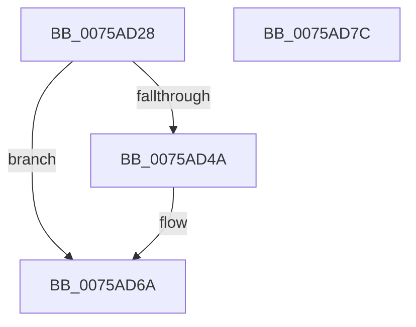

# PpmPerfGetVmPerfPrioritySupport

- RVA: `0x0075AD28`–`0x0075AD7D` (길이 `85` bytes)
- VA: `0x000000014075AD28`
- 실행 섹션: `PAGE`
- PDB 이름 있음: `예`; PDB Function 태그: `아니요`
- unwind 정보 RVA: `0x0005CF00`
- 디코드: `22`개 명령, `85/85` bytes 표시
- 미해석 바이트: `0` (있으면 어셈블리에 `.byte`로 보존)

> 이 문서는 커널 이미지의 기계어와 PDB 기호를 분석해 생성했습니다. 4번과 5번은 함수 원형과 자료형을 바이너리 사용 방식에서 추정한 C 해석이며 원본 소스 복구 결과는 아닙니다.

## 1. Dependencies

- 직접 호출 지점: **2**; 고유 호출 대상: **2**
- 직접 호출자로 확인된 함수: **1**
- RIP 상대 이미지 참조: **2**

### Outgoing calls
- `0x0075AD38` → [PpmAcquireLock](../../text/2D/PpmAcquireLock_function_002D9AA4.md) (function, `0x002D9AA4`)
- `0x0075AD71` → [PpmReleaseLock](../../text/2D/PpmReleaseLock_function_002DA428.md) (function, `0x002DA428`)

### Direct callers
- [PopPowerInformationInternal](../A8/PopPowerInformationInternal_function_00A8B7C0.md) at `0x00A8D1F6`

### Static image references
- `0x0075AD31` → RVA `0x00F0CC00` (`.data`; read)
- `0x0075AD3F` → RVA `0x00FC6AEC` (`ALMOSTRO`; read)

## 2. Other-region calls and transfers

- 다른 실행 섹션으로 향하는 call: **2**
  - `0x0075AD38` → [PpmAcquireLock](../../text/2D/PpmAcquireLock_function_002D9AA4.md) (`PAGE` → `.text`)
  - `0x0075AD71` → [PpmReleaseLock](../../text/2D/PpmReleaseLock_function_002DA428.md) (`PAGE` → `.text`)
- 별도 외부 분기/꼬리 이동을 확인하지 못했습니다.

## 3. Assembly (complete function range)

```asm
0075AD28  40 53                           push rbx
0075AD2A  48 83 EC 20                     sub rsp, 0x20
0075AD2E  48 8B D9                        mov rbx, rcx
0075AD31  48 8D 0D C8 1E 7B 00            lea rcx, [rip + 0x7b1ec8]
0075AD38  E8 67 ED B7 FF                  call 0x1402d9aa4
0075AD3D  33 C0                           xor eax, eax
0075AD3F  38 05 A7 BD 86 00               cmp byte ptr [rip + 0x86bda7], al
0075AD45  48 89 03                        mov qword ptr [rbx], rax
0075AD48  74 20                           je 0x14075ad6a
0075AD4A  65 48 8B 04 25 20 00 00 00      mov rax, qword ptr gs:[0x20]
0075AD53  48 8B 90 B0 89 00 00            mov rdx, qword ptr [rax + 0x89b0]
0075AD5A  8B 82 04 02 00 00               mov eax, dword ptr [rdx + 0x204]
0075AD60  85 C0                           test eax, eax
0075AD62  89 43 04                        mov dword ptr [rbx + 4], eax
0075AD65  0F 95 C0                        setne al
0075AD68  88 03                           mov byte ptr [rbx], al
0075AD6A  48 8D 0D 8F 1E 7B 00            lea rcx, [rip + 0x7b1e8f]
0075AD71  E8 B2 F6 B7 FF                  call 0x1402da428
0075AD76  48 83 C4 20                     add rsp, 0x20
0075AD7A  5B                              pop rbx
0075AD7B  C3                              ret
0075AD7C  CC                              int3
```

## 4. C-style interpretation (structured pseudocode)

```c
__int64 __fastcall PpmPerfGetVmPerfPrioritySupport(__int64 a1)
{
    __int64 result;
    __int64 v_rsp;

    v_rsp = (v_rsp) - (32);
    result = PpmAcquireLock(v_rip + 8068808, a2, a3, a4);
    result = 0;
    *(unsigned __int64 *)(a1) = 0;
    if ((*(unsigned __int8 *)(v_rip + 8830375)) != 0) {
        result = *(unsigned __int64 *)(gs_base + (0 + 32));
        a2 = *(unsigned __int64 *)(result + 35248);
        result = *(unsigned int *)(a2 + 516);
        *(unsigned int *)(a1 + 4) = (unsigned int)(result);
        result = ((unsigned int)(result) != 0) ? 1 : 0;
        *(unsigned __int8 *)(a1) = (unsigned __int8)(result);
    }
    result = PpmReleaseLock(v_rip + 8068751, a2, a3, a4);
    v_rsp = (v_rsp) + (32);
    return result;
}
```

## 5. (Beta) C Style

```c
int64_t PpmPerfGetVmPerfPrioritySupport(void *Arg1)
{
    uint8_t *arg1 = (uint8_t *)Arg1;

    int64_t result;
    int64_t local_rsp;

    local_rsp = (local_rsp) - (32);
    result = PpmAcquireLock(v_rip + 8068808, a2, a3, a4);
    result = 0;
    *(uint64_t *)(arg1) = 0;
    if ((*(uint8_t *)(v_rip + 0x86BDA7)) != 0) {
        result = *(uint64_t *)(gs_base + (0 + 0x20));
        a2 = *(uint64_t *)(result + 0x89B0);
        result = *(uint32_t *)(a2 + 0x204);
        *(uint32_t *)(arg1 + 0x4) = (uint32_t)(result);
        result = ((uint32_t)(result) != 0) ? 1 : 0;
        *(uint8_t *)(arg1) = (uint8_t)(result);
    }
    result = PpmReleaseLock(v_rip + 8068751, a2, a3, a4);
    local_rsp = (local_rsp) + (32);
    return result;
}
```

### 관측된 메모리 오프셋

구조체 형식이 확인되지 않은 접근은 인자 기준의 오프셋으로만 기록했습니다.

| 기준 인자 | 오프셋 표현 | 폭 (bit) | 접근 |
|---|---:|---:|---|
| `Arg1` | `+ 0x0` | `8` | `W` |
| `Arg1` | `+ 0x0` | `64` | `W` |
| `Arg1` | `+ 0x4` | `32` | `W` |

## 6. Execution-region graph

[열기: 2D/3D 그래프와 함수 탐색 컨트롤 패널](../../../control-panel.html?section=page&rva=0x0075AD28&view=graph)

- 2D 그래프는 위에서 아래로 흐르고, 3D 그래프는 빈 공간을 드래그해 회전합니다. Shift+드래그는 이동, 휠은 확대·축소, 함수 노드 선택은 대상 보고서 이동입니다.

### Static fallback


