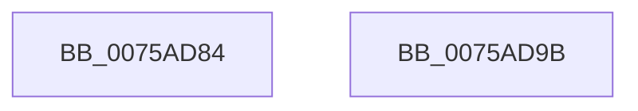

# PpmPerfPercentageFromFrequency

- RVA: `0x0075AD84`–`0x0075AD9C` (길이 `24` bytes)
- VA: `0x000000014075AD84`
- 실행 섹션: `PAGE`
- PDB 이름 있음: `예`; PDB Function 태그: `아니요`
- unwind 정보 RVA: `0x000DB714`
- 디코드: `10`개 명령, `24/24` bytes 표시
- 미해석 바이트: `0` (있으면 어셈블리에 `.byte`로 보존)

> 이 문서는 커널 이미지의 기계어와 PDB 기호를 분석해 생성했습니다. 4번과 5번은 함수 원형과 자료형을 바이너리 사용 방식에서 추정한 C 해석이며 원본 소스 복구 결과는 아닙니다.

## 1. Dependencies

- 직접 호출 지점: **0**; 고유 호출 대상: **0**
- 직접 호출자로 확인된 함수: **1**
- RIP 상대 이미지 참조: **0**

### Outgoing calls
- 직접 디코드된 call 명령이 없습니다.

### Direct callers
- [PpmPerfGetVmCppcConfig](../../text/5D/PpmPerfGetVmCppcConfig_function_005D41A8.md) at `0x005D429B`
- [PpmPerfGetVmCppcConfig](../../text/5D/PpmPerfGetVmCppcConfig_function_005D41A8.md) at `0x005D42F7`
- [PpmPerfGetVmCppcConfig](../../text/5D/PpmPerfGetVmCppcConfig_function_005D41A8.md) at `0x005D4377`

### Static image references
- 디코드된 RIP-relative 메모리 참조가 없습니다.

## 2. Other-region calls and transfers

- 다른 실행 섹션으로 향하는 call: **0**
- 별도 외부 분기/꼬리 이동을 확인하지 못했습니다.

## 3. Assembly (complete function range)

```asm
0075AD84  8B C1                           mov eax, ecx
0075AD86  8B CA                           mov ecx, edx
0075AD88  48 6B C0 64                     imul rax, rax, 0x64
0075AD8C  44 8B C2                        mov r8d, edx
0075AD8F  33 D2                           xor edx, edx
0075AD91  48 D1 E9                        shr rcx, 1
0075AD94  48 03 C1                        add rax, rcx
0075AD97  49 F7 F0                        div r8
0075AD9A  C3                              ret
0075AD9B  CC                              int3
```

## 4. C-style interpretation (structured pseudocode)

```c
__int64 __fastcall PpmPerfPercentageFromFrequency(int a1, int a2)
{
    __int64 result;

    result = ((unsigned int)(a1)) * ((unsigned int)(a1));
    a2 = 0;
    a1 = ((unsigned int)(a2)) >> (1);
    result = (result) + (a1);
    return result;
}
```

## 5. (Beta) C Style

```c
int64_t PpmPerfPercentageFromFrequency(int32_t Arg1, int32_t Arg2)
{
    int64_t result;

    result = ((uint32_t)(Arg1)) * ((uint32_t)(Arg1));
    Arg2 = 0;
    Arg1 = ((uint32_t)(Arg2)) >> (1);
    result = (result) + (Arg1);
    return result;
}
```

## 6. Execution-region graph

[열기: 2D/3D 그래프와 함수 탐색 컨트롤 패널](../../../control-panel.html?section=page&rva=0x0075AD84&view=graph)

- 2D 그래프는 위에서 아래로 흐르고, 3D 그래프는 빈 공간을 드래그해 회전합니다. Shift+드래그는 이동, 휠은 확대·축소, 함수 노드 선택은 대상 보고서 이동입니다.

### Static fallback


