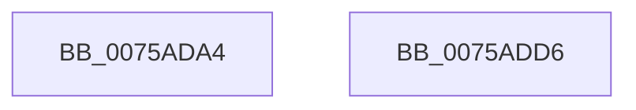

# PpmPerfReApplyStates

- RVA: `0x0075ADA4`–`0x0075ADD7` (길이 `51` bytes)
- VA: `0x000000014075ADA4`
- 실행 섹션: `PAGE`
- PDB 이름 있음: `예`; PDB Function 태그: `아니요`
- unwind 정보 RVA: `0x0005C788`
- 디코드: `12`개 명령, `51/51` bytes 표시
- 미해석 바이트: `0` (있으면 어셈블리에 `.byte`로 보존)

> 이 문서는 커널 이미지의 기계어와 PDB 기호를 분석해 생성했습니다. 4번과 5번은 함수 원형과 자료형을 바이너리 사용 방식에서 추정한 C 해석이며 원본 소스 복구 결과는 아닙니다.

## 1. Dependencies

- 직접 호출 지점: **4**; 고유 호출 대상: **4**
- 직접 호출자로 확인된 함수: **1**
- RIP 상대 이미지 참조: **2**

### Outgoing calls
- `0x0075ADAF` → [PpmAcquireLock](../../text/2D/PpmAcquireLock_function_002D9AA4.md) (function, `0x002D9AA4`)
- `0x0075ADB4` → [PpmPerfSetAllDomainsToUpdate](../../text/3B/PpmPerfSetAllDomainsToUpdate_function_003BF044.md) (function, `0x003BF044`)
- `0x0075ADC2` → [PpmUpdateProcessorPolicy](../A5/PpmUpdateProcessorPolicy_function_00A53324.md) (function, `0x00A53324`)
- `0x0075ADCC` → [PpmCheckCustomRun](../../text/3B/PpmCheckCustomRun_function_003BEC2C.md) (function, `0x003BEC2C`)

### Direct callers
- [PopTransitionSystemPowerStateEx](../../pagelk/B7/PopTransitionSystemPowerStateEx_function_00B7E8C0.md) at `0x00B7FB5C`

### Static image references
- `0x0075ADA8` → RVA `0x00F0CC00` (`.data`; read)
- `0x0075ADB9` → RVA `0x00F0E180` (`.data`; read)

## 2. Other-region calls and transfers

- 다른 실행 섹션으로 향하는 call: **3**
  - `0x0075ADAF` → [PpmAcquireLock](../../text/2D/PpmAcquireLock_function_002D9AA4.md) (`PAGE` → `.text`)
  - `0x0075ADB4` → [PpmPerfSetAllDomainsToUpdate](../../text/3B/PpmPerfSetAllDomainsToUpdate_function_003BF044.md) (`PAGE` → `.text`)
  - `0x0075ADCC` → [PpmCheckCustomRun](../../text/3B/PpmCheckCustomRun_function_003BEC2C.md) (`PAGE` → `.text`)
- 별도 외부 분기/꼬리 이동을 확인하지 못했습니다.

## 3. Assembly (complete function range)

```asm
0075ADA4  48 83 EC 28                     sub rsp, 0x28
0075ADA8  48 8D 0D 51 1E 7B 00            lea rcx, [rip + 0x7b1e51]
0075ADAF  E8 F0 EC B7 FF                  call 0x1402d9aa4
0075ADB4  E8 8B 42 C6 FF                  call 0x1403bf044
0075ADB9  48 8D 0D C0 33 7B 00            lea rcx, [rip + 0x7b33c0]
0075ADC0  33 D2                           xor edx, edx
0075ADC2  E8 5D 85 2F 00                  call 0x140a53324
0075ADC7  B9 02 00 00 00                  mov ecx, 2
0075ADCC  E8 5B 3E C6 FF                  call 0x1403bec2c
0075ADD1  48 83 C4 28                     add rsp, 0x28
0075ADD5  C3                              ret
0075ADD6  CC                              int3
```

## 4. C-style interpretation (structured pseudocode)

```c
__int64 __fastcall PpmPerfReApplyStates(__int64 a1, int a2)
{
    __int64 result;
    __int64 v_rsp;

    v_rsp = (v_rsp) - (40);
    result = PpmAcquireLock(v_rip + 8068689, a2, a3, a4);
    result = PpmPerfSetAllDomainsToUpdate(v_rip + 8068689, a2, a3, a4);
    a2 = 0;
    result = PpmUpdateProcessorPolicy(v_rip + 8074176, a2, a3, a4);
    result = PpmCheckCustomRun(2, a2, a3, a4);
    v_rsp = (v_rsp) + (40);
    return result;
}
```

## 5. (Beta) C Style

```c
int64_t PpmPerfReApplyStates(int64_t Arg1, int32_t Arg2)
{
    int64_t result;
    int64_t local_rsp;

    local_rsp = (local_rsp) - (40);
    result = PpmAcquireLock(v_rip + 8068689, Arg2, a3, a4);
    result = PpmPerfSetAllDomainsToUpdate(v_rip + 8068689, Arg2, a3, a4);
    Arg2 = 0;
    result = PpmUpdateProcessorPolicy(v_rip + 8074176, Arg2, a3, a4);
    result = PpmCheckCustomRun(2, Arg2, a3, a4);
    local_rsp = (local_rsp) + (40);
    return result;
}
```

## 6. Execution-region graph

[열기: 2D/3D 그래프와 함수 탐색 컨트롤 패널](../../../control-panel.html?section=page&rva=0x0075ADA4&view=graph)

- 2D 그래프는 위에서 아래로 흐르고, 3D 그래프는 빈 공간을 드래그해 회전합니다. Shift+드래그는 이동, 휠은 확대·축소, 함수 노드 선택은 대상 보고서 이동입니다.

### Static fallback


