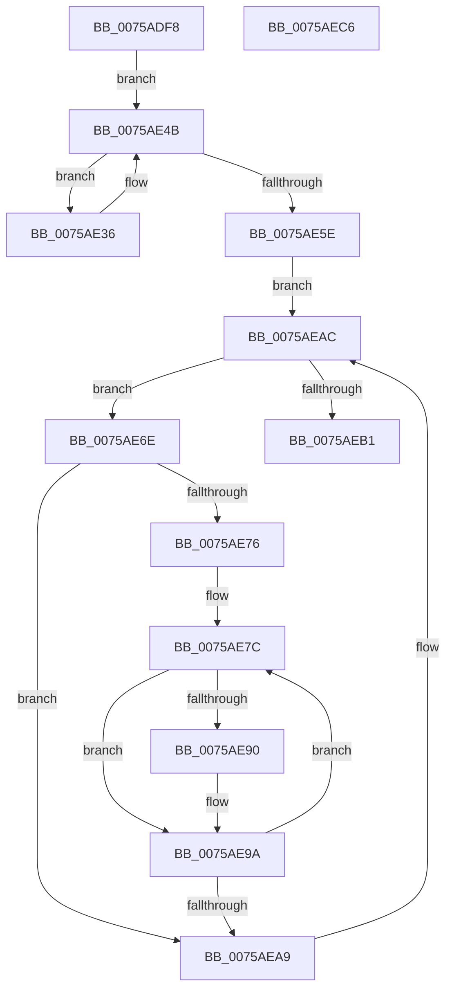

# PpmPerfResizeHistoryAll

- RVA: `0x0075ADF8`–`0x0075AEC7` (길이 `207` bytes)
- VA: `0x000000014075ADF8`
- 실행 섹션: `PAGE`
- PDB 이름 있음: `예`; PDB Function 태그: `아니요`
- unwind 정보 RVA: `0x000C7B58`
- 디코드: `55`개 명령, `207/207` bytes 표시
- 미해석 바이트: `0` (있으면 어셈블리에 `.byte`로 보존)

> 이 문서는 커널 이미지의 기계어와 PDB 기호를 분석해 생성했습니다. 4번과 5번은 함수 원형과 자료형을 바이너리 사용 방식에서 추정한 C 해석이며 원본 소스 복구 결과는 아닙니다.

## 1. Dependencies

- 직접 호출 지점: **4**; 고유 호출 대상: **3**
- 직접 호출자로 확인된 함수: **1**
- RIP 상대 이미지 참조: **3**

### Outgoing calls
- `0x0075AE3A` → [KeGetPrcb](../../text/2D/KeGetPrcb_function_002D85D0.md) (function, `0x002D85D0`)
- `0x0075AE46` → [PpmPerfResizeHistory](../AA/PpmPerfResizeHistory_function_00AAF9C8.md) (function, `0x00AAF9C8`)
- `0x0075AE55` → [KeEnumerateNextProcessor](../../text/41/KeEnumerateNextProcessor_function_00415480.md) (function, `0x00415480`)
- `0x0075AE93` → [PpmPerfResizeHistory](../AA/PpmPerfResizeHistory_function_00AAF9C8.md) (function, `0x00AAF9C8`)

### Direct callers
- [PpmReapplyPerfPolicy](../A5/PpmReapplyPerfPolicy_function_00A53148.md) at `0x00A532BD`

### Static image references
- `0x0075AE1C` → RVA `0x00E0B5A8` (`.data`; read)
- `0x0075AE28` → RVA `0x00E0B5A0` (`.data`; read)
- `0x0075AE5E` → RVA `0x00FC6BA8` (`ALMOSTRO`; read)

## 2. Other-region calls and transfers

- 다른 실행 섹션으로 향하는 call: **2**
  - `0x0075AE3A` → [KeGetPrcb](../../text/2D/KeGetPrcb_function_002D85D0.md) (`PAGE` → `.text`)
  - `0x0075AE55` → [KeEnumerateNextProcessor](../../text/41/KeEnumerateNextProcessor_function_00415480.md) (`PAGE` → `.text`)
- 별도 외부 분기/꼬리 이동을 확인하지 못했습니다.

## 3. Assembly (complete function range)

```asm
0075ADF8  48 8B C4                        mov rax, rsp
0075ADFB  48 89 58 10                     mov qword ptr [rax + 0x10], rbx
0075ADFF  48 89 68 18                     mov qword ptr [rax + 0x18], rbp
0075AE03  48 89 70 20                     mov qword ptr [rax + 0x20], rsi
0075AE07  57                              push rdi
0075AE08  48 83 EC 40                     sub rsp, 0x40
0075AE0C  33 F6                           xor esi, esi
0075AE0E  89 70 EA                        mov dword ptr [rax - 0x16], esi
0075AE11  66 89 70 EE                     mov word ptr [rax - 0x12], si
0075AE15  66 89 70 E8                     mov word ptr [rax - 0x18], si
0075AE19  89 70 08                        mov dword ptr [rax + 8], esi
0075AE1C  48 8B 05 85 07 6B 00            mov rax, qword ptr [rip + 0x6b0785]
0075AE23  48 89 44 24 28                  mov qword ptr [rsp + 0x28], rax
0075AE28  48 8D 05 71 07 6B 00            lea rax, [rip + 0x6b0771]
0075AE2F  48 89 44 24 20                  mov qword ptr [rsp + 0x20], rax
0075AE34  EB 15                           jmp 0x14075ae4b
0075AE36  8B 4C 24 50                     mov ecx, dword ptr [rsp + 0x50]
0075AE3A  E8 91 D7 B7 FF                  call 0x1402d85d0
0075AE3F  48 8D 88 B0 89 00 00            lea rcx, [rax + 0x89b0]
0075AE46  E8 7D 4B 35 00                  call 0x140aaf9c8
0075AE4B  48 8D 54 24 20                  lea rdx, [rsp + 0x20]
0075AE50  48 8D 4C 24 50                  lea rcx, [rsp + 0x50]
0075AE55  E8 26 A6 CB FF                  call 0x140415480
0075AE5A  85 C0                           test eax, eax
0075AE5C  74 D8                           je 0x14075ae36
0075AE5E  48 8B 1D 43 BD 86 00            mov rbx, qword ptr [rip + 0x86bd43]
0075AE65  48 8D 2D 3C BD 86 00            lea rbp, [rip + 0x86bd3c]
0075AE6C  EB 3E                           jmp 0x14075aeac
0075AE6E  39 B3 28 01 00 00               cmp dword ptr [rbx + 0x128], esi
0075AE74  76 33                           jbe 0x14075aea9
0075AE76  8B C6                           mov eax, esi
0075AE78  8B D6                           mov edx, esi
0075AE7A  8B FE                           mov edi, esi
0075AE7C  48 69 C8 A8 04 00 00            imul rcx, rax, 0x4a8
0075AE83  48 03 8B 38 01 00 00            add rcx, qword ptr [rbx + 0x138]
0075AE8A  83 79 10 01                     cmp dword ptr [rcx + 0x10], 1
0075AE8E  75 0A                           jne 0x14075ae9a
0075AE90  48 8B 09                        mov rcx, qword ptr [rcx]
0075AE93  E8 30 4B 35 00                  call 0x140aaf9c8
0075AE98  8B D7                           mov edx, edi
0075AE9A  8D 42 01                        lea eax, [rdx + 1]
0075AE9D  8B D0                           mov edx, eax
0075AE9F  8B F8                           mov edi, eax
0075AEA1  3B 83 28 01 00 00               cmp eax, dword ptr [rbx + 0x128]
0075AEA7  72 D3                           jb 0x14075ae7c
0075AEA9  48 8B 1B                        mov rbx, qword ptr [rbx]
0075AEAC  48 3B DD                        cmp rbx, rbp
0075AEAF  75 BD                           jne 0x14075ae6e
0075AEB1  48 8B 5C 24 58                  mov rbx, qword ptr [rsp + 0x58]
0075AEB6  48 8B 6C 24 60                  mov rbp, qword ptr [rsp + 0x60]
0075AEBB  48 8B 74 24 68                  mov rsi, qword ptr [rsp + 0x68]
0075AEC0  48 83 C4 40                     add rsp, 0x40
0075AEC4  5F                              pop rdi
0075AEC5  C3                              ret
0075AEC6  CC                              int3
```

## 4. C-style interpretation (structured pseudocode)

```c
__int64 __fastcall PpmPerfResizeHistoryAll(void)
{
    __int64 result;
    __int64 v_rsi;
    __int64 v_rsp;
    unsigned __int64 v_stack_m20;
    unsigned __int64 v_stack_m28;
    unsigned __int64 v_stack_p10;
    unsigned __int64 v_stack_p18;
    unsigned __int64 v_stack_p20;
    unsigned int v_stack_p8;

    *(unsigned __int64 *)(v_rsp + 16) = v_rbx;
    *(unsigned __int64 *)(v_rsp + 24) = v_rbp;
    *(unsigned __int64 *)(v_rsp + 32) = v_rsi;
    v_rsp = (v_rsp) - (64);
    v_rsi = 0;
    *(unsigned int *)(v_rsp - 22) = 0;
    *(unsigned __int16 *)(v_rsp - 18) = 0;
    *(unsigned __int16 *)(v_rsp - 24) = 0;
    *(unsigned int *)(v_rsp + 8) = 0;
    v_stack_m20 = *(unsigned __int64 *)(v_rip + 7014277);
    v_stack_m28 = v_rip + 7014257;
    goto loc_0075AE4B;
loc_0075AE36:
    result = KeGetPrcb((unsigned int)(v_stack_p8), a2, a3, a4);
    result = PpmPerfResizeHistory(result + 35248, a2, a3, a4);
loc_0075AE4B:
    result = KeEnumerateNextProcessor(v_stack_p8, v_stack_m28, a3, a4);
    if ((unsigned int)(result) == 0) goto loc_0075AE36;
    goto loc_0075AEAC;
loc_0075AE6E:
    if ((*(unsigned int *)(*(unsigned __int64 *)(v_rip + 8830275) + 296)) <= 0) goto loc_0075AEA9;
loc_0075AE7C:
    a1 = (v_stack_p8) * (0);
    a1 = (a1) + (*(unsigned __int64 *)(*(unsigned __int64 *)(v_rip + 8830275) + 312));
    result = 0;
    if ((*(unsigned int *)(a1 + 16)) == 1) {
        a1 = *(unsigned __int64 *)(a1);
        result = PpmPerfResizeHistory(a1, 0, a3, a4);
        a2 = 0;
    }
    if (((unsigned int)(a2 + 1)) < (*(unsigned int *)(*(unsigned __int64 *)(v_rip + 8830275) + 296))) goto loc_0075AE7C;
loc_0075AEA9:
loc_0075AEAC:
    if ((*(unsigned __int64 *)(*(unsigned __int64 *)(v_rip + 8830275))) != (v_rip + 8830268)) goto loc_0075AE6E;
    v_rsp = (v_rsp) + (64);
    return a2 + 1;
}
```

## 5. (Beta) C Style

```c
void PpmPerfResizeHistoryAll(void)
{
    int64_t result;
    int64_t local_rsi;
    int64_t local_rsp;
    uint64_t v_stack_m20;
    uint64_t v_stack_m28;
    uint64_t v_stack_p10;
    uint64_t v_stack_p18;
    uint64_t v_stack_p20;
    uint32_t v_stack_p8;

    *(uint64_t *)(local_rsp + 0x10) = local_rbx;
    *(uint64_t *)(local_rsp + 0x18) = local_rbp;
    *(uint64_t *)(local_rsp + 0x20) = local_rsi;
    local_rsp = (local_rsp) - (64);
    local_rsi = 0;
    *(uint32_t *)(local_rsp - 0x16) = 0;
    *(uint16_t *)(local_rsp - 0x12) = 0;
    *(uint16_t *)(local_rsp - 0x18) = 0;
    *(uint32_t *)(local_rsp + 0x8) = 0;
    v_stack_m20 = *(uint64_t *)(v_rip + 0x6B0785);
    v_stack_m28 = v_rip + 7014257;
    goto loc_0075AE4B;
loc_0075AE36:
    result = KeGetPrcb((uint32_t)(v_stack_p8), a2, a3, a4);
    result = PpmPerfResizeHistory(result + 35248, a2, a3, a4);
loc_0075AE4B:
    result = KeEnumerateNextProcessor(v_stack_p8, v_stack_m28, a3, a4);
    if ((uint32_t)(result) == 0) goto loc_0075AE36;
    goto loc_0075AEAC;
loc_0075AE6E:
    if ((*(uint32_t *)(*(uint64_t *)(v_rip + 0x86BD43) + 0x128)) <= 0) goto loc_0075AEA9;
loc_0075AE7C:
    a1 = (v_stack_p8) * (0);
    a1 = (a1) + (*(uint64_t *)(*(uint64_t *)(v_rip + 0x86BD43) + 0x138));
    result = 0;
    if ((*(uint32_t *)(a1 + 0x10)) == 1) {
        a1 = *(uint64_t *)(a1);
        result = PpmPerfResizeHistory(a1, 0, a3, a4);
        a2 = 0;
    }
    if (((uint32_t)(a2 + 1)) < (*(uint32_t *)(*(uint64_t *)(v_rip + 0x86BD43) + 0x128))) goto loc_0075AE7C;
loc_0075AEA9:
loc_0075AEAC:
    if ((*(uint64_t *)(*(uint64_t *)(v_rip + 0x86BD43))) != (v_rip + 8830268)) goto loc_0075AE6E;
    local_rsp = (local_rsp) + (64);
    return a2 + 1;
}
```

## 6. Execution-region graph

[열기: 2D/3D 그래프와 함수 탐색 컨트롤 패널](../../../control-panel.html?section=page&rva=0x0075ADF8&view=graph)

- 2D 그래프는 위에서 아래로 흐르고, 3D 그래프는 빈 공간을 드래그해 회전합니다. Shift+드래그는 이동, 휠은 확대·축소, 함수 노드 선택은 대상 보고서 이동입니다.

### Static fallback


