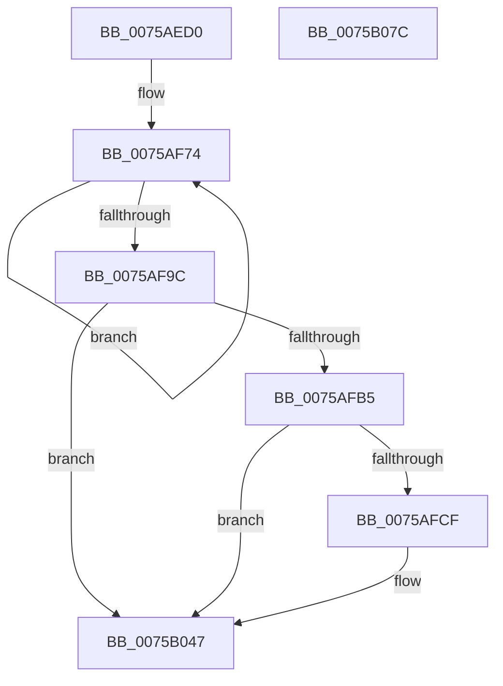

# PpmPerfTelemetryWorker

- RVA: `0x0075AED0`–`0x0075B07D` (길이 `429` bytes)
- VA: `0x000000014075AED0`
- 실행 섹션: `PAGE`
- PDB 이름 있음: `예`; PDB Function 태그: `아니요`
- unwind 정보 RVA: `0x000CC27C`
- 디코드: `93`개 명령, `429/429` bytes 표시
- 미해석 바이트: `0` (있으면 어셈블리에 `.byte`로 보존)

> 이 문서는 커널 이미지의 기계어와 PDB 기호를 분석해 생성했습니다. 4번과 5번은 함수 원형과 자료형을 바이너리 사용 방식에서 추정한 C 해석이며 원본 소스 복구 결과는 아닙니다.

## 1. Dependencies

- 직접 호출 지점: **7**; 고유 호출 대상: **7**
- 직접 호출자로 확인된 함수: **0**
- RIP 상대 이미지 참조: **12**

### Outgoing calls
- `0x0075AF04` → [PpmAcquireLock](../../text/2D/PpmAcquireLock_function_002D9AA4.md) (function, `0x002D9AA4`)
- `0x0075AF0B` → [PpmPerfUpdateQosDisableReasons](../../text/49/PpmPerfUpdateQosDisableReasons_function_004991F0.md) (function, `0x004991F0`)
- `0x0075AFA3` → [PpmReleaseLock](../../text/2D/PpmReleaseLock_function_002DA428.md) (function, `0x002DA428`)
- `0x0075AFC6` → [tlgKeywordOn](../../text/42/tlgKeywordOn_function_0042EAA0.md) (function, `0x0042EAA0`)
- `0x0075B042` → [tlgWriteTransfer_EtwWriteTransfer](../../text/42/tlgWriteTransfer_EtwWriteTransfer_function_004260E0.md) (function, `0x004260E0`)
- `0x0075B04E` → [PopOkayToQueueNextWorkItem](../../text/4A/PopOkayToQueueNextWorkItem_function_004AED54.md) (function, `0x004AED54`)
- `0x0075B05A` → [_security_check_cookie](../../text/6A/_security_check_cookie_function_006AC640.md) (function, `0x006AC640`)

### Direct callers
- 이 함수 시작 RVA로 연결되는 직접 call은 확인되지 않았습니다. 간접 호출은 완전히 역산할 수 없습니다.

### Static image references
- `0x0075AEEF` → RVA `0x00E0A740` (`.data`; read)
- `0x0075AEFD` → RVA `0x00F0CC00` (`.data`; read)
- `0x0075AF10` → RVA `0x00FC7718` (`ALMOSTRO`; read)
- `0x0075AF17` → RVA `0x00FC7780` (`ALMOSTRO`; read)
- `0x0075AF25` → RVA `0x00FC7720` (`ALMOSTRO`; read)
- `0x0075AF39` → RVA `0x00FC7720` (`ALMOSTRO`; write)
- `0x0075AF40` → RVA `0x00FC7728` (`ALMOSTRO`; read)
- `0x0075AF55` → RVA `0x00FC7730` (`ALMOSTRO`; read)
- `0x0075AF69` → RVA `0x00FC7730` (`ALMOSTRO`; write)
- `0x0075AFA8` → RVA `0x00E07748` (`.data`; read)
- `0x0075AFDA` → RVA `0x000490FC` (`.rdata`; read)
- `0x0075B047` → RVA `0x00F0E228` (`.data`; read)

## 2. Other-region calls and transfers

- 다른 실행 섹션으로 향하는 call: **7**
  - `0x0075AF04` → [PpmAcquireLock](../../text/2D/PpmAcquireLock_function_002D9AA4.md) (`PAGE` → `.text`)
  - `0x0075AF0B` → [PpmPerfUpdateQosDisableReasons](../../text/49/PpmPerfUpdateQosDisableReasons_function_004991F0.md) (`PAGE` → `.text`)
  - `0x0075AFA3` → [PpmReleaseLock](../../text/2D/PpmReleaseLock_function_002DA428.md) (`PAGE` → `.text`)
  - `0x0075AFC6` → [tlgKeywordOn](../../text/42/tlgKeywordOn_function_0042EAA0.md) (`PAGE` → `.text`)
  - `0x0075B042` → [tlgWriteTransfer_EtwWriteTransfer](../../text/42/tlgWriteTransfer_EtwWriteTransfer_function_004260E0.md) (`PAGE` → `.text`)
  - `0x0075B04E` → [PopOkayToQueueNextWorkItem](../../text/4A/PopOkayToQueueNextWorkItem_function_004AED54.md) (`PAGE` → `.text`)
  - `0x0075B05A` → [_security_check_cookie](../../text/6A/_security_check_cookie_function_006AC640.md) (`PAGE` → `.text`)
- 별도 외부 분기/꼬리 이동을 확인하지 못했습니다.

## 3. Assembly (complete function range)

```asm
0075AED0  48 8B C4                        mov rax, rsp
0075AED3  48 89 58 08                     mov qword ptr [rax + 8], rbx
0075AED7  48 89 70 10                     mov qword ptr [rax + 0x10], rsi
0075AEDB  48 89 78 18                     mov qword ptr [rax + 0x18], rdi
0075AEDF  4C 89 70 20                     mov qword ptr [rax + 0x20], r14
0075AEE3  55                              push rbp
0075AEE4  48 8D 68 A1                     lea rbp, [rax - 0x5f]
0075AEE8  48 81 EC D0 00 00 00            sub rsp, 0xd0
0075AEEF  48 8B 05 4A F8 6A 00            mov rax, qword ptr [rip + 0x6af84a]
0075AEF6  48 33 C4                        xor rax, rsp
0075AEF9  48 89 45 4F                     mov qword ptr [rbp + 0x4f], rax
0075AEFD  48 8D 0D FC 1C 7B 00            lea rcx, [rip + 0x7b1cfc]
0075AF04  E8 9B EB B7 FF                  call 0x1402d9aa4
0075AF09  33 C9                           xor ecx, ecx
0075AF0B  E8 E0 E2 D3 FF                  call 0x1404991f0
0075AF10  4C 8B 05 01 C8 86 00            mov r8, qword ptr [rip + 0x86c801]
0075AF17  4C 8D 15 62 C8 86 00            lea r10, [rip + 0x86c862]
0075AF1E  49 8B C8                        mov rcx, r8
0075AF21  4C 8D 5D 27                     lea r11, [rbp + 0x27]
0075AF25  48 2B 0D F4 C7 86 00            sub rcx, qword ptr [rip + 0x86c7f4]
0075AF2C  49 BE BD 42 7A E5 D5 94 BF D6   movabs r14, 0xd6bf94d5e57a42bd
0075AF36  49 8B C6                        mov rax, r14
0075AF39  4C 89 05 E0 C7 86 00            mov qword ptr [rip + 0x86c7e0], r8
0075AF40  4C 8B 05 E1 C7 86 00            mov r8, qword ptr [rip + 0x86c7e1]
0075AF47  BB 09 00 00 00                  mov ebx, 9
0075AF4C  48 F7 E1                        mul rcx
0075AF4F  49 8B C8                        mov rcx, r8
0075AF52  49 8B C6                        mov rax, r14
0075AF55  48 2B 0D D4 C7 86 00            sub rcx, qword ptr [rip + 0x86c7d4]
0075AF5C  48 8B FA                        mov rdi, rdx
0075AF5F  48 F7 E1                        mul rcx
0075AF62  48 C1 EF 17                     shr rdi, 0x17
0075AF66  48 8B F2                        mov rsi, rdx
0075AF69  4C 89 05 C0 C7 86 00            mov qword ptr [rip + 0x86c7c0], r8
0075AF70  48 C1 EE 17                     shr rsi, 0x17
0075AF74  4D 8B 4A B8                     mov r9, qword ptr [r10 - 0x48]
0075AF78  49 8B C6                        mov rax, r14
0075AF7B  4D 8B C1                        mov r8, r9
0075AF7E  4D 2B 02                        sub r8, qword ptr [r10]
0075AF81  49 F7 E0                        mul r8
0075AF84  4D 89 0A                        mov qword ptr [r10], r9
0075AF87  4D 8D 52 08                     lea r10, [r10 + 8]
0075AF8B  48 C1 EA 17                     shr rdx, 0x17
0075AF8F  41 89 13                        mov dword ptr [r11], edx
0075AF92  4D 8D 5B 04                     lea r11, [r11 + 4]
0075AF96  48 83 EB 01                     sub rbx, 1
0075AF9A  75 D8                           jne 0x14075af74
0075AF9C  48 8D 0D 5D 1C 7B 00            lea rcx, [rip + 0x7b1c5d]
0075AFA3  E8 80 F4 B7 FF                  call 0x1402da428
0075AFA8  83 3D 99 C7 6A 00 05            cmp dword ptr [rip + 0x6ac799], 5
0075AFAF  0F 86 92 00 00 00               jbe 0x14075b047
0075AFB5  48 BA 00 00 00 00 00 40 00 00   movabs rdx, 0x400000000000
0075AFBF  48 8D 0D 82 C7 6A 00            lea rcx, [rip + 0x6ac782]
0075AFC6  E8 D5 3A CD FF                  call 0x14042eaa0
0075AFCB  84 C0                           test al, al
0075AFCD  74 78                           je 0x14075b047
0075AFCF  48 8D 45 B7                     lea rax, [rbp - 0x49]
0075AFD3  89 7D B7                        mov dword ptr [rbp - 0x49], edi
0075AFD6  48 89 45 E7                     mov qword ptr [rbp - 0x19], rax
0075AFDA  48 8D 15 1B E1 8E FF            lea rdx, [rip - 0x711ee5]
0075AFE1  48 8D 45 BB                     lea rax, [rbp - 0x45]
0075AFE5  48 C7 45 EF 04 00 00 00         mov qword ptr [rbp - 0x11], 4
0075AFED  48 89 45 F7                     mov qword ptr [rbp - 9], rax
0075AFF1  48 8D 0D 50 C7 6A 00            lea rcx, [rip + 0x6ac750]
0075AFF8  48 8D 45 27                     lea rax, [rbp + 0x27]
0075AFFC  89 75 BB                        mov dword ptr [rbp - 0x45], esi
0075AFFF  48 89 45 07                     mov qword ptr [rbp + 7], rax
0075B003  45 33 C9                        xor r9d, r9d
0075B006  48 8D 45 BF                     lea rax, [rbp - 0x41]
0075B00A  48 C7 45 FF 04 00 00 00         mov qword ptr [rbp - 1], 4
0075B012  48 89 45 17                     mov qword ptr [rbp + 0x17], rax
0075B016  45 33 C0                        xor r8d, r8d
0075B019  48 8D 45 C7                     lea rax, [rbp - 0x39]
0075B01D  48 C7 45 0F 24 00 00 00         mov qword ptr [rbp + 0xf], 0x24
0075B025  48 89 44 24 28                  mov qword ptr [rsp + 0x28], rax
0075B02A  C7 44 24 20 06 00 00 00         mov dword ptr [rsp + 0x20], 6
0075B032  48 C7 45 BF 00 00 00 01         mov qword ptr [rbp - 0x41], 0x1000000
0075B03A  48 C7 45 1F 08 00 00 00         mov qword ptr [rbp + 0x1f], 8
0075B042  E8 99 B0 CC FF                  call 0x1404260e0
0075B047  48 8D 0D DA 31 7B 00            lea rcx, [rip + 0x7b31da]
0075B04E  E8 01 3D D5 FF                  call 0x1404aed54
0075B053  48 8B 4D 4F                     mov rcx, qword ptr [rbp + 0x4f]
0075B057  48 33 CC                        xor rcx, rsp
0075B05A  E8 E1 15 F5 FF                  call 0x1406ac640
0075B05F  4C 8D 9C 24 D0 00 00 00         lea r11, [rsp + 0xd0]
0075B067  49 8B 5B 10                     mov rbx, qword ptr [r11 + 0x10]
0075B06B  49 8B 73 18                     mov rsi, qword ptr [r11 + 0x18]
0075B06F  49 8B 7B 20                     mov rdi, qword ptr [r11 + 0x20]
0075B073  4D 8B 73 28                     mov r14, qword ptr [r11 + 0x28]
0075B077  49 8B E3                        mov rsp, r11
0075B07A  5D                              pop rbp
0075B07B  C3                              ret
0075B07C  CC                              int3
```

## 4. C-style interpretation (structured pseudocode)

```c
__int64 __fastcall PpmPerfTelemetryWorker(__int64 a1, __int64 a2)
{
    __int64 result;
    __int64 v_rbx;
    __int64 v_rdi;
    __int64 v_rsi;
    __int64 v_rsp;
    unsigned __int64 v_stack_m8;
    unsigned __int64 v_stack_mB0;
    unsigned int v_stack_mB8;

    *(unsigned __int64 *)(v_rsp + 8) = v_rbx;
    *(unsigned __int64 *)(v_rsp + 16) = v_rsi;
    *(unsigned __int64 *)(v_rsp + 24) = v_rdi;
    *(unsigned __int64 *)(v_rsp + 32) = v_r14;
    v_rsp = (v_rsp) - (208);
    result = (*(unsigned __int64 *)(v_rip + 7010378)) ^ (v_rsp);
    *(unsigned __int64 *)(v_rsp - 95 + 79) = result;
    result = PpmAcquireLock(v_rip + 8068348, a2, a3, a4);
    a1 = 0;
    result = PpmPerfUpdateQosDisableReasons(a1, a2, a3, a4);
    a1 = (*(unsigned __int64 *)(v_rip + 8833025)) - (*(unsigned __int64 *)(v_rip + 8833012));
    *(unsigned __int64 *)(v_rip + 8832992) = *(unsigned __int64 *)(v_rip + 8833025);
    a1 = (*(unsigned __int64 *)(v_rip + 8832993)) - (*(unsigned __int64 *)(v_rip + 8832980));
    v_rdi = (a2) >> (23);
    *(unsigned __int64 *)(v_rip + 8832960) = *(unsigned __int64 *)(v_rip + 8832993);
    v_rsi = (a2) >> (23);
loc_0075AF74:
    a3 = (*(unsigned __int64 *)(v_rip + 8833122 - 72)) - (*(unsigned __int64 *)(v_rip + 8833122));
    *(unsigned __int64 *)(v_rip + 8833122) = *(unsigned __int64 *)(v_rip + 8833122 - 72);
    a2 = (a2) >> (23);
    *(unsigned int *)(v_rsp - 95 + 39) = (unsigned int)(a2);
    v_rbx = (9) - (1);
    if (condition_is_not_equal) goto loc_0075AF74;
    result = PpmReleaseLock(v_rip + 8068189, a2, a3, *(unsigned __int64 *)(v_rip + 8833122 - 72));
    if ((*(unsigned int *)(v_rip + 6997913)) <= 5) goto loc_0075B047;
    result = tlgKeywordOn(v_rip + 6997890, a2, a3, *(unsigned __int64 *)(v_rip + 8833122 - 72));
    if ((unsigned __int8)(result) != 0) {
        result = v_rsp - 95 - 73;
        *(unsigned int *)(v_rsp - 95 - 73) = (unsigned int)(v_rdi);
        *(unsigned __int64 *)(v_rsp - 95 - 25) = result;
        a2 = v_rip - 7413477;
        result = v_rsp - 95 - 69;
        *(unsigned __int64 *)(v_rsp - 95 - 17) = 4;
        *(unsigned __int64 *)(v_rsp - 95 - 9) = result;
        a1 = v_rip + 6997840;
        result = v_rsp - 95 + 39;
        *(unsigned int *)(v_rsp - 95 - 69) = (unsigned int)(v_rsi);
        *(unsigned __int64 *)(v_rsp - 95 + 7) = result;
        a4 = 0;
        result = v_rsp - 95 - 65;
        *(unsigned __int64 *)(v_rsp - 95 - 1) = 4;
        *(unsigned __int64 *)(v_rsp - 95 + 23) = result;
        a3 = 0;
        result = v_rsp - 95 - 57;
        *(unsigned __int64 *)(v_rsp - 95 + 15) = 36;
        v_stack_mB0 = result;
        v_stack_mB8 = 6;
        *(unsigned __int64 *)(v_rsp - 95 - 65) = 0x1000000ULL;
        *(unsigned __int64 *)(v_rsp - 95 + 31) = 8;
        result = tlgWriteTransfer_EtwWriteTransfer(a1, a2, a3, a4);
    }
    result = PopOkayToQueueNextWorkItem(v_rip + 8073690, a2, a3, a4);
    a1 = (*(unsigned __int64 *)(v_rsp - 95 + 79)) ^ (v_rsp);
    result = _security_check_cookie(a1, a2, a3, a4);
    return result;
}
```

## 5. (Beta) C Style

```c
int64_t PpmPerfTelemetryWorker(int64_t Arg1, int64_t Arg2)
{
    int64_t result;
    int64_t local_rbx;
    int64_t local_rdi;
    int64_t local_rsi;
    int64_t local_rsp;
    uint64_t v_stack_m8;
    uint64_t v_stack_mB0;
    uint32_t v_stack_mB8;

    *(uint64_t *)(local_rsp + 0x8) = local_rbx;
    *(uint64_t *)(local_rsp + 0x10) = local_rsi;
    *(uint64_t *)(local_rsp + 0x18) = local_rdi;
    *(uint64_t *)(local_rsp + 0x20) = local_r14;
    local_rsp = (local_rsp) - (208);
    result = (*(uint64_t *)(v_rip + 0x6AF84A)) ^ (local_rsp);
    *(uint64_t *)(local_rsp - 0x5F + 0x4F) = result;
    result = PpmAcquireLock(v_rip + 8068348, Arg2, a3, a4);
    Arg1 = 0;
    result = PpmPerfUpdateQosDisableReasons(Arg1, Arg2, a3, a4);
    Arg1 = (*(uint64_t *)(v_rip + 0x86C801)) - (*(uint64_t *)(v_rip + 0x86C7F4));
    *(uint64_t *)(v_rip + 0x86C7E0) = *(uint64_t *)(v_rip + 0x86C801);
    Arg1 = (*(uint64_t *)(v_rip + 0x86C7E1)) - (*(uint64_t *)(v_rip + 0x86C7D4));
    local_rdi = (Arg2) >> (23);
    *(uint64_t *)(v_rip + 0x86C7C0) = *(uint64_t *)(v_rip + 0x86C7E1);
    local_rsi = (Arg2) >> (23);
loc_0075AF74:
    a3 = (*(uint64_t *)(v_rip + 0x86C862 - 0x48)) - (*(uint64_t *)(v_rip + 0x86C862));
    *(uint64_t *)(v_rip + 0x86C862) = *(uint64_t *)(v_rip + 0x86C862 - 0x48);
    Arg2 = (Arg2) >> (23);
    *(uint32_t *)(local_rsp - 0x5F + 0x27) = (uint32_t)(Arg2);
    local_rbx = (9) - (1);
    if (condition_is_not_equal) goto loc_0075AF74;
    result = PpmReleaseLock(v_rip + 8068189, Arg2, a3, *(uint64_t *)(v_rip + 0x86C862 - 0x48));
    if ((*(uint32_t *)(v_rip + 0x6AC799)) <= 5) goto loc_0075B047;
    result = tlgKeywordOn(v_rip + 6997890, Arg2, a3, *(uint64_t *)(v_rip + 0x86C862 - 0x48));
    if ((uint8_t)(result) != 0) {
        result = local_rsp - 95 - 73;
        *(uint32_t *)(local_rsp - 0x5F - 0x49) = (uint32_t)(local_rdi);
        *(uint64_t *)(local_rsp - 0x5F - 0x19) = result;
        Arg2 = v_rip - 7413477;
        result = local_rsp - 95 - 69;
        *(uint64_t *)(local_rsp - 0x5F - 0x11) = 4;
        *(uint64_t *)(local_rsp - 0x5F - 0x9) = result;
        Arg1 = v_rip + 6997840;
        result = local_rsp - 95 + 39;
        *(uint32_t *)(local_rsp - 0x5F - 0x45) = (uint32_t)(local_rsi);
        *(uint64_t *)(local_rsp - 0x5F + 0x7) = result;
        a4 = 0;
        result = local_rsp - 95 - 65;
        *(uint64_t *)(local_rsp - 0x5F - 0x1) = 4;
        *(uint64_t *)(local_rsp - 0x5F + 0x17) = result;
        a3 = 0;
        result = local_rsp - 95 - 57;
        *(uint64_t *)(local_rsp - 0x5F + 0xF) = 36;
        v_stack_mB0 = result;
        v_stack_mB8 = 6;
        *(uint64_t *)(local_rsp - 0x5F - 0x41) = 0x1000000ULL;
        *(uint64_t *)(local_rsp - 0x5F + 0x1F) = 8;
        result = tlgWriteTransfer_EtwWriteTransfer(Arg1, Arg2, a3, a4);
    }
    result = PopOkayToQueueNextWorkItem(v_rip + 8073690, Arg2, a3, a4);
    Arg1 = (*(uint64_t *)(local_rsp - 0x5F + 0x4F)) ^ (local_rsp);
    result = _security_check_cookie(Arg1, Arg2, a3, a4);
    return result;
}
```

## 6. Execution-region graph

[열기: 2D/3D 그래프와 함수 탐색 컨트롤 패널](../../../control-panel.html?section=page&rva=0x0075AED0&view=graph)

- 2D 그래프는 위에서 아래로 흐르고, 3D 그래프는 빈 공간을 드래그해 회전합니다. Shift+드래그는 이동, 휠은 확대·축소, 함수 노드 선택은 대상 보고서 이동입니다.

### Static fallback


