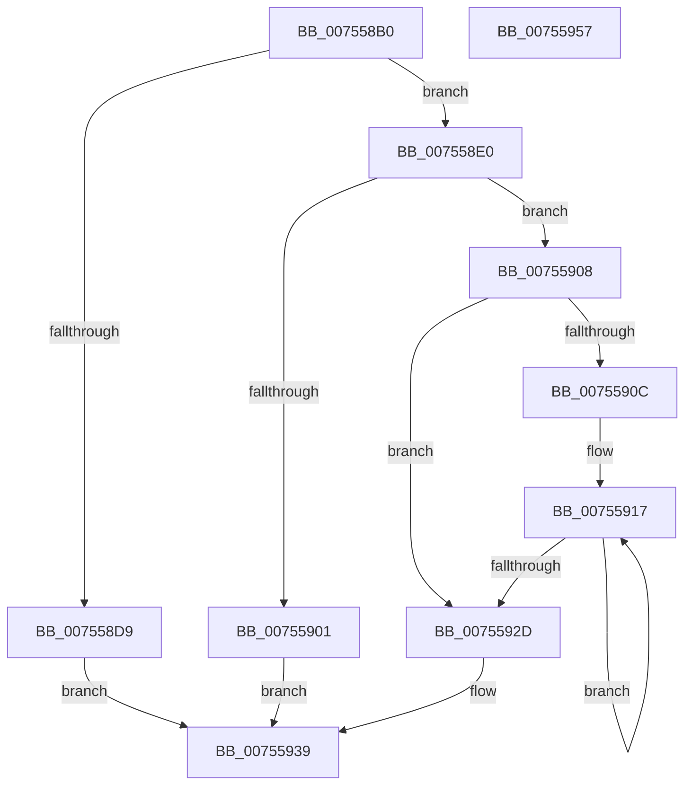

# PpmRegisterVetoList

- RVA: `0x007558B0`–`0x00755958` (길이 `168` bytes)
- VA: `0x00000001407558B0`
- 실행 섹션: `PAGE`
- PDB 이름 있음: `예`; PDB Function 태그: `아니요`
- unwind 정보 RVA: `0x00060BC4`
- 디코드: `45`개 명령, `168/168` bytes 표시
- 미해석 바이트: `0` (있으면 어셈블리에 `.byte`로 보존)

> 이 문서는 커널 이미지의 기계어와 PDB 기호를 분석해 생성했습니다. 4번과 5번은 함수 원형과 자료형을 바이너리 사용 방식에서 추정한 C 해석이며 원본 소스 복구 결과는 아닙니다.

## 1. Dependencies

- 직접 호출 지점: **3**; 고유 호출 대상: **3**
- 직접 호출자로 확인된 함수: **0**
- RIP 상대 이미지 참조: **3**

### Outgoing calls
- `0x007558C9` → [PopAcquireRwLockExclusive](../../text/43/PopAcquireRwLockExclusive_function_00430B44.md) (function, `0x00430B44`)
- `0x007558F7` → [ExAllocatePool2](../../poolcode/B8/ExAllocatePool2_function_00B820F0.md) (function, `0x00B820F0`)
- `0x00755940` → [PopReleaseRwLock](../../text/2D/PopReleaseRwLock_function_002DFBBC.md) (function, `0x002DFBBC`)

### Direct callers
- 이 함수 시작 RVA로 연결되는 직접 call은 확인되지 않았습니다. 간접 호출은 완전히 역산할 수 없습니다.

### Static image references
- `0x007558C2` → RVA `0x00F0CA70` (`.data`; read)
- `0x007558D0` → RVA `0x00E67678` (`.data`; read)
- `0x00755932` → RVA `0x00E67678` (`.data`; write)

## 2. Other-region calls and transfers

- 다른 실행 섹션으로 향하는 call: **3**
  - `0x007558C9` → [PopAcquireRwLockExclusive](../../text/43/PopAcquireRwLockExclusive_function_00430B44.md) (`PAGE` → `.text`)
  - `0x007558F7` → [ExAllocatePool2](../../poolcode/B8/ExAllocatePool2_function_00B820F0.md) (`PAGE` → `POOLCODE`)
  - `0x00755940` → [PopReleaseRwLock](../../text/2D/PopReleaseRwLock_function_002DFBBC.md) (`PAGE` → `.text`)
- 별도 외부 분기/꼬리 이동을 확인하지 못했습니다.

## 3. Assembly (complete function range)

```asm
007558B0  48 89 5C 24 08                  mov qword ptr [rsp + 8], rbx
007558B5  48 89 74 24 10                  mov qword ptr [rsp + 0x10], rsi
007558BA  57                              push rdi
007558BB  48 83 EC 20                     sub rsp, 0x20
007558BF  48 8B F1                        mov rsi, rcx
007558C2  48 8D 0D A7 71 7B 00            lea rcx, [rip + 0x7b71a7]
007558C9  E8 76 B2 CD FF                  call 0x140430b44
007558CE  33 DB                           xor ebx, ebx
007558D0  48 39 1D A1 1D 71 00            cmp qword ptr [rip + 0x711da1], rbx
007558D7  74 07                           je 0x1407558e0
007558D9  BB 89 01 00 C0                  mov ebx, 0xc0000189
007558DE  EB 59                           jmp 0x140755939
007558E0  8B 3E                           mov edi, dword ptr [rsi]
007558E2  B9 40 00 00 00                  mov ecx, 0x40
007558E7  41 B8 50 50 4D 69               mov r8d, 0x694d5050
007558ED  8D 04 7F                        lea eax, [rdi + rdi*2]
007558F0  8D 14 C5 08 00 00 00            lea edx, [rax*8 + 8]
007558F7  E8 F4 C7 42 00                  call 0x140b820f0
007558FC  48 85 C0                        test rax, rax
007558FF  75 07                           jne 0x140755908
00755901  BB 9A 00 00 C0                  mov ebx, 0xc000009a
00755906  EB 31                           jmp 0x140755939
00755908  85 FF                           test edi, edi
0075590A  74 21                           je 0x14075592d
0075590C  48 8D 50 10                     lea rdx, [rax + 0x10]
00755910  4C 8B CF                        mov r9, rdi
00755913  4C 8D 46 08                     lea r8, [rsi + 8]
00755917  41 0F 10 00                     movups xmm0, xmmword ptr [r8]
0075591B  4D 8D 40 10                     lea r8, [r8 + 0x10]
0075591F  F3 0F 7F 02                     movdqu xmmword ptr [rdx], xmm0
00755923  48 8D 52 18                     lea rdx, [rdx + 0x18]
00755927  49 83 E9 01                     sub r9, 1
0075592B  75 EA                           jne 0x140755917
0075592D  89 38                           mov dword ptr [rax], edi
0075592F  89 78 04                        mov dword ptr [rax + 4], edi
00755932  48 89 05 3F 1D 71 00            mov qword ptr [rip + 0x711d3f], rax
00755939  48 8D 0D 30 71 7B 00            lea rcx, [rip + 0x7b7130]
00755940  E8 77 A2 B8 FF                  call 0x1402dfbbc
00755945  48 8B 74 24 38                  mov rsi, qword ptr [rsp + 0x38]
0075594A  8B C3                           mov eax, ebx
0075594C  48 8B 5C 24 30                  mov rbx, qword ptr [rsp + 0x30]
00755951  48 83 C4 20                     add rsp, 0x20
00755955  5F                              pop rdi
00755956  C3                              ret
00755957  CC                              int3
```

## 4. C-style interpretation (structured pseudocode)

```c
__int64 __fastcall PpmRegisterVetoList(__int64 a1)
{
    __int64 result;
    __int64 v_rbx;
    __int64 v_rsp;
    unsigned __int64 v_stack_p10;
    unsigned __int64 v_stack_p8;

    v_stack_p8 = v_rbx;
    v_stack_p10 = v_rsi;
    v_rsp = (v_rsp) - (32);
    result = PopAcquireRwLockExclusive(v_rip + 8090023, a2, a3, a4);
    v_rbx = 0;
    if ((*(unsigned __int64 *)(v_rip + 7413153)) == 0) goto loc_007558E0;
    goto loc_00755939;
loc_007558E0:
    result = ExAllocatePool2(64, (unsigned int)(*(unsigned int *)(a1)) + (unsigned int)(*(unsigned int *)(a1)) * 2 * 8 + 8, (unsigned int)(0x694D5050ULL), a4);
    if (result != 0) goto loc_00755908;
    goto loc_00755939;
loc_00755908:
    if ((unsigned int)((unsigned int)(*(unsigned int *)(a1))) == 0) goto loc_0075592D;
loc_00755917:
    *(unsigned __int64 *)(result + 16) = v_xmm0;
    a4 = ((unsigned int)(*(unsigned int *)(a1))) - (1);
    if (condition_is_not_equal) goto loc_00755917;
loc_0075592D:
    *(unsigned int *)(result) = (unsigned int)((unsigned int)(*(unsigned int *)(a1)));
    *(unsigned int *)(result + 4) = (unsigned int)((unsigned int)(*(unsigned int *)(a1)));
    *(unsigned __int64 *)(v_rip + 7413055) = result;
loc_00755939:
    result = PopReleaseRwLock(v_rip + 8089904, result + 16 + 24, a1 + 8 + 16, a4);
    v_rsp = (v_rsp) + (32);
    return (unsigned int)((unsigned int)((unsigned int)(0xC000009AULL)));
}
```

## 5. (Beta) C Style

```c
int64_t PpmRegisterVetoList(void *Arg1)
{
    uint8_t *arg1 = (uint8_t *)Arg1;

    int64_t result;
    int64_t local_rbx;
    int64_t local_rsp;
    uint64_t v_stack_p10;
    uint64_t v_stack_p8;

    v_stack_p8 = local_rbx;
    v_stack_p10 = local_rsi;
    local_rsp = (local_rsp) - (32);
    result = PopAcquireRwLockExclusive(v_rip + 8090023, a2, a3, a4);
    local_rbx = 0;
    if ((*(uint64_t *)(v_rip + 0x711DA1)) == 0) goto loc_007558E0;
    goto loc_00755939;
loc_007558E0:
    result = ExAllocatePool2(64, (uint32_t)(*(uint32_t *)(arg1)) + (uint32_t)(*(uint32_t *)(arg1)) * 2 * 8 + 8, (uint32_t)(0x694D5050ULL), a4);
    if (result != 0) goto loc_00755908;
    goto loc_00755939;
loc_00755908:
    if ((uint32_t)((uint32_t)(*(uint32_t *)(arg1))) == 0) goto loc_0075592D;
loc_00755917:
    *(uint64_t *)(result + 0x10) = v_xmm0;
    a4 = ((uint32_t)(*(uint32_t *)(arg1))) - (1);
    if (condition_is_not_equal) goto loc_00755917;
loc_0075592D:
    *(uint32_t *)(result) = (uint32_t)((uint32_t)(*(uint32_t *)(arg1)));
    *(uint32_t *)(result + 0x4) = (uint32_t)((uint32_t)(*(uint32_t *)(arg1)));
    *(uint64_t *)(v_rip + 0x711D3F) = result;
loc_00755939:
    result = PopReleaseRwLock(v_rip + 8089904, result + 16 + 24, Arg1 + 8 + 16, a4);
    local_rsp = (local_rsp) + (32);
    return (uint32_t)((uint32_t)((uint32_t)(0xC000009AULL)));
}
```

### 관측된 메모리 오프셋

구조체 형식이 확인되지 않은 접근은 인자 기준의 오프셋으로만 기록했습니다.

| 기준 인자 | 오프셋 표현 | 폭 (bit) | 접근 |
|---|---:|---:|---|
| `Arg1` | `+ 0x0` | `32` | `R` |
| `Arg1` | `+ 0x0` | `128` | `R` |
| `Arg1` | `+ 0x8` | `64` | `R` |
| `Arg1` | `+ 0x10` | `64` | `R` |

## 6. Execution-region graph

[열기: 2D/3D 그래프와 함수 탐색 컨트롤 패널](../../../control-panel.html?section=page&rva=0x007558B0&view=graph)

- 2D 그래프는 위에서 아래로 흐르고, 3D 그래프는 빈 공간을 드래그해 회전합니다. Shift+드래그는 이동, 휠은 확대·축소, 함수 노드 선택은 대상 보고서 이동입니다.

### Static fallback


