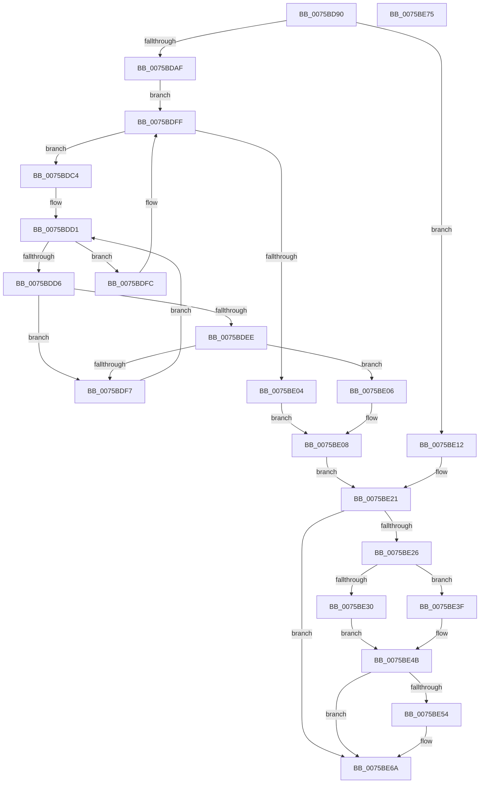

# PpmUpdatePerfStates

- RVA: `0x0075BD90`–`0x0075BE76` (길이 `230` bytes)
- VA: `0x000000014075BD90`
- 실행 섹션: `PAGE`
- PDB 이름 있음: `예`; PDB Function 태그: `아니요`
- unwind 정보 RVA: `0x00085760`
- 디코드: `63`개 명령, `230/230` bytes 표시
- 미해석 바이트: `0` (있으면 어셈블리에 `.byte`로 보존)

> 이 문서는 커널 이미지의 기계어와 PDB 기호를 분석해 생성했습니다. 4번과 5번은 함수 원형과 자료형을 바이너리 사용 방식에서 추정한 C 해석이며 원본 소스 복구 결과는 아닙니다.

## 1. Dependencies

- 직접 호출 지점: **6**; 고유 호출 대상: **5**
- 직접 호출자로 확인된 함수: **0**
- RIP 상대 이미지 참조: **3**

### Outgoing calls
- `0x0075BDA4` → [PpmAcquireLock](../../text/2D/PpmAcquireLock_function_002D9AA4.md) (function, `0x002D9AA4`)
- `0x0075BE15` → [KeGetPrcb](../../text/2D/KeGetPrcb_function_002D85D0.md) (function, `0x002D85D0`)
- `0x0075BE38` → [PpmPerfUpdateDomainPolicy](../A9/PpmPerfUpdateDomainPolicy_function_00A97030.md) (function, `0x00A97030`)
- `0x0075BE46` → [PpmReleaseLock](../../text/2D/PpmReleaseLock_function_002DA428.md) (function, `0x002DA428`)
- `0x0075BE5B` → [PpmAcquireLock](../../text/2D/PpmAcquireLock_function_002D9AA4.md) (function, `0x002D9AA4`)
- `0x0075BE65` → [PpmReinitializeHeteroEngine](../A5/PpmReinitializeHeteroEngine_function_00A53108.md) (function, `0x00A53108`)

### Direct callers
- 이 함수 시작 RVA로 연결되는 직접 call은 확인되지 않았습니다. 간접 호출은 완전히 역산할 수 없습니다.

### Static image references
- `0x0075BD9D` → RVA `0x00F0CC00` (`.data`; read)
- `0x0075BDAF` → RVA `0x00FC6BA8` (`ALMOSTRO`; read)
- `0x0075BE4B` → RVA `0x00FC6CF0` (`ALMOSTRO`; read)

## 2. Other-region calls and transfers

- 다른 실행 섹션으로 향하는 call: **4**
  - `0x0075BDA4` → [PpmAcquireLock](../../text/2D/PpmAcquireLock_function_002D9AA4.md) (`PAGE` → `.text`)
  - `0x0075BE15` → [KeGetPrcb](../../text/2D/KeGetPrcb_function_002D85D0.md) (`PAGE` → `.text`)
  - `0x0075BE46` → [PpmReleaseLock](../../text/2D/PpmReleaseLock_function_002DA428.md) (`PAGE` → `.text`)
  - `0x0075BE5B` → [PpmAcquireLock](../../text/2D/PpmAcquireLock_function_002D9AA4.md) (`PAGE` → `.text`)
- 별도 외부 분기/꼬리 이동을 확인하지 못했습니다.

## 3. Assembly (complete function range)

```asm
0075BD90  48 89 5C 24 08                  mov qword ptr [rsp + 8], rbx
0075BD95  56                              push rsi
0075BD96  48 83 EC 20                     sub rsp, 0x20
0075BD9A  48 8B D9                        mov rbx, rcx
0075BD9D  48 8D 0D 5C 0E 7B 00            lea rcx, [rip + 0x7b0e5c]
0075BDA4  E8 FB DC B7 FF                  call 0x1402d9aa4
0075BDA9  83 7B 08 00                     cmp dword ptr [rbx + 8], 0
0075BDAD  74 63                           je 0x14075be12
0075BDAF  48 8B 15 F2 AD 86 00            mov rdx, qword ptr [rip + 0x86adf2]
0075BDB6  48 8D 35 EB AD 86 00            lea rsi, [rip + 0x86adeb]
0075BDBD  45 33 D2                        xor r10d, r10d
0075BDC0  32 C9                           xor cl, cl
0075BDC2  EB 3B                           jmp 0x14075bdff
0075BDC4  44 8B 9A 28 01 00 00            mov r11d, dword ptr [rdx + 0x128]
0075BDCB  4C 8B D2                        mov r10, rdx
0075BDCE  45 33 C0                        xor r8d, r8d
0075BDD1  45 3B C3                        cmp r8d, r11d
0075BDD4  73 26                           jae 0x14075bdfc
0075BDD6  41 8B C0                        mov eax, r8d
0075BDD9  4C 69 C8 A8 04 00 00            imul r9, rax, 0x4a8
0075BDE0  4C 03 8A 38 01 00 00            add r9, qword ptr [rdx + 0x138]
0075BDE7  41 83 79 10 00                  cmp dword ptr [r9 + 0x10], 0
0075BDEC  74 09                           je 0x14075bdf7
0075BDEE  8B 43 04                        mov eax, dword ptr [rbx + 4]
0075BDF1  41 39 41 14                     cmp dword ptr [r9 + 0x14], eax
0075BDF5  74 0F                           je 0x14075be06
0075BDF7  41 FF C0                        inc r8d
0075BDFA  EB D5                           jmp 0x14075bdd1
0075BDFC  48 8B 12                        mov rdx, qword ptr [rdx]
0075BDFF  48 3B D6                        cmp rdx, rsi
0075BE02  75 C0                           jne 0x14075bdc4
0075BE04  EB 02                           jmp 0x14075be08
0075BE06  B1 01                           mov cl, 1
0075BE08  F6 D9                           neg cl
0075BE0A  48 1B C0                        sbb rax, rax
0075BE0D  49 23 C2                        and rax, r10
0075BE10  EB 0F                           jmp 0x14075be21
0075BE12  8B 4B 04                        mov ecx, dword ptr [rbx + 4]
0075BE15  E8 B6 C7 B7 FF                  call 0x1402d85d0
0075BE1A  48 8B 80 B0 89 00 00            mov rax, qword ptr [rax + 0x89b0]
0075BE21  48 85 C0                        test rax, rax
0075BE24  74 44                           je 0x14075be6a
0075BE26  8B 0B                           mov ecx, dword ptr [rbx]
0075BE28  39 88 C4 01 00 00               cmp dword ptr [rax + 0x1c4], ecx
0075BE2E  74 0F                           je 0x14075be3f
0075BE30  89 88 C4 01 00 00               mov dword ptr [rax + 0x1c4], ecx
0075BE36  B1 01                           mov cl, 1
0075BE38  E8 F3 B1 33 00                  call 0x140a97030
0075BE3D  EB 0C                           jmp 0x14075be4b
0075BE3F  48 8D 0D BA 0D 7B 00            lea rcx, [rip + 0x7b0dba]
0075BE46  E8 DD E5 B7 FF                  call 0x1402da428
0075BE4B  83 3D 9E AE 86 00 01            cmp dword ptr [rip + 0x86ae9e], 1
0075BE52  76 16                           jbe 0x14075be6a
0075BE54  48 8D 0D A5 0D 7B 00            lea rcx, [rip + 0x7b0da5]
0075BE5B  E8 44 DC B7 FF                  call 0x1402d9aa4
0075BE60  45 33 C0                        xor r8d, r8d
0075BE63  B1 01                           mov cl, 1
0075BE65  E8 9E 72 2F 00                  call 0x140a53108
0075BE6A  48 8B 5C 24 30                  mov rbx, qword ptr [rsp + 0x30]
0075BE6F  48 83 C4 20                     add rsp, 0x20
0075BE73  5E                              pop rsi
0075BE74  C3                              ret
0075BE75  CC                              int3
```

## 4. C-style interpretation (structured pseudocode)

```c
__int64 __fastcall PpmUpdatePerfStates(__int64 a1, __int64 a2, int a3)
{
    __int64 result;
    __int64 v_r10;
    __int64 v_rsp;
    unsigned __int64 v_stack_p8;

    v_stack_p8 = v_rbx;
    v_rsp = (v_rsp) - (32);
    result = PpmAcquireLock(v_rip + 8064604, a2, a3, a4);
    if ((*(unsigned int *)(a1 + 8)) == 0) goto loc_0075BE12;
    v_r10 = 0;
    a1 = 0;
    goto loc_0075BDFF;
loc_0075BDC4:
    a3 = 0;
loc_0075BDD1:
    if (0 >= ((unsigned int)((unsigned int)(*(unsigned int *)(*(unsigned __int64 *)(v_rip + 8826354) + 296))))) goto loc_0075BDFC;
    a4 = (a4) * (0);
    a4 = (a4) + (*(unsigned __int64 *)(*(unsigned __int64 *)(v_rip + 8826354) + 312));
    if ((*(unsigned int *)(a4 + 16)) == 0) goto loc_0075BDF7;
    if ((*(unsigned int *)(a4 + 20)) == ((unsigned int)((unsigned int)(*(unsigned int *)(a1 + 4))))) goto loc_0075BE06;
loc_0075BDF7:
    a3 = (unsigned int)((a3) + 1);
    goto loc_0075BDD1;
loc_0075BDFC:
loc_0075BDFF:
    if ((*(unsigned __int64 *)(*(unsigned __int64 *)(v_rip + 8826354))) != (v_rip + 8826347)) goto loc_0075BDC4;
    goto loc_0075BE08;
loc_0075BE06:
loc_0075BE08:
    a1 = (unsigned __int8)(-(1));
    result = ((unsigned int)(*(unsigned int *)(a1 + 4))) & (*(unsigned __int64 *)(v_rip + 8826354));
    goto loc_0075BE21;
loc_0075BE12:
    result = KeGetPrcb((unsigned int)(*(unsigned int *)(a1 + 4)), *(unsigned __int64 *)(*(unsigned __int64 *)(v_rip + 8826354)), a3, a4);
loc_0075BE21:
    if (*(unsigned __int64 *)(result + 35248) == 0) goto loc_0075BE6A;
    if ((*(unsigned int *)(*(unsigned __int64 *)(result + 35248) + 452)) == ((unsigned int)((unsigned int)(*(unsigned int *)(a1))))) goto loc_0075BE3F;
    *(unsigned int *)(*(unsigned __int64 *)(result + 35248) + 452) = (unsigned int)((unsigned int)(*(unsigned int *)(a1)));
    result = PpmPerfUpdateDomainPolicy(1, *(unsigned __int64 *)(*(unsigned __int64 *)(v_rip + 8826354)), a3, a4);
    goto loc_0075BE4B;
loc_0075BE3F:
    result = PpmReleaseLock(v_rip + 8064442, *(unsigned __int64 *)(*(unsigned __int64 *)(v_rip + 8826354)), a3, a4);
loc_0075BE4B:
    if ((*(unsigned int *)(v_rip + 8826526)) >= = 1) {
        a1 = v_rip + 8064421;
        result = PpmAcquireLock(a1, *(unsigned __int64 *)(*(unsigned __int64 *)(v_rip + 8826354)), a3, a4);
        a3 = 0;
        a1 = 1;
        result = PpmReinitializeHeteroEngine(a1, *(unsigned __int64 *)(*(unsigned __int64 *)(v_rip + 8826354)), a3, a4);
    }
    v_rsp = (v_rsp) + (32);
    return result;
}
```

## 5. (Beta) C Style

```c
int64_t PpmUpdatePerfStates(void *Arg1, int64_t Arg2, int32_t Arg3)
{
    uint8_t *arg1 = (uint8_t *)Arg1;

    int64_t result;
    int64_t local_r10;
    int64_t local_rsp;
    uint64_t v_stack_p8;

    v_stack_p8 = local_rbx;
    local_rsp = (local_rsp) - (32);
    result = PpmAcquireLock(v_rip + 8064604, Arg2, Arg3, a4);
    if ((*(uint32_t *)(arg1 + 0x8)) == 0) goto loc_0075BE12;
    local_r10 = 0;
    Arg1 = 0;
    goto loc_0075BDFF;
loc_0075BDC4:
    Arg3 = 0;
loc_0075BDD1:
    if (0 >= ((uint32_t)((uint32_t)(*(uint32_t *)(*(uint64_t *)(v_rip + 0x86ADF2) + 0x128))))) goto loc_0075BDFC;
    a4 = (a4) * (0);
    a4 = (a4) + (*(uint64_t *)(*(uint64_t *)(v_rip + 0x86ADF2) + 0x138));
    if ((*(uint32_t *)(a4 + 0x10)) == 0) goto loc_0075BDF7;
    if ((*(uint32_t *)(a4 + 0x14)) == ((uint32_t)((uint32_t)(*(uint32_t *)(arg1 + 0x4))))) goto loc_0075BE06;
loc_0075BDF7:
    Arg3 = (uint32_t)((Arg3) + 1);
    goto loc_0075BDD1;
loc_0075BDFC:
loc_0075BDFF:
    if ((*(uint64_t *)(*(uint64_t *)(v_rip + 0x86ADF2))) != (v_rip + 8826347)) goto loc_0075BDC4;
    goto loc_0075BE08;
loc_0075BE06:
loc_0075BE08:
    Arg1 = (uint8_t)(-(1));
    result = ((uint32_t)(*(uint32_t *)(arg1 + 0x4))) & (*(uint64_t *)(v_rip + 0x86ADF2));
    goto loc_0075BE21;
loc_0075BE12:
    result = KeGetPrcb((uint32_t)(*(uint32_t *)(arg1 + 0x4)), *(uint64_t *)(*(uint64_t *)(v_rip + 0x86ADF2)), Arg3, a4);
loc_0075BE21:
    if (*(uint64_t *)(result + 0x89B0) == 0) goto loc_0075BE6A;
    if ((*(uint32_t *)(*(uint64_t *)(result + 0x89B0) + 0x1C4)) == ((uint32_t)((uint32_t)(*(uint32_t *)(arg1))))) goto loc_0075BE3F;
    *(uint32_t *)(*(uint64_t *)(result + 0x89B0) + 0x1C4) = (uint32_t)((uint32_t)(*(uint32_t *)(arg1)));
    result = PpmPerfUpdateDomainPolicy(1, *(uint64_t *)(*(uint64_t *)(v_rip + 0x86ADF2)), Arg3, a4);
    goto loc_0075BE4B;
loc_0075BE3F:
    result = PpmReleaseLock(v_rip + 8064442, *(uint64_t *)(*(uint64_t *)(v_rip + 0x86ADF2)), Arg3, a4);
loc_0075BE4B:
    if ((*(uint32_t *)(v_rip + 0x86AE9E)) >= = 1) {
        Arg1 = v_rip + 8064421;
        result = PpmAcquireLock(Arg1, *(uint64_t *)(*(uint64_t *)(v_rip + 0x86ADF2)), Arg3, a4);
        Arg3 = 0;
        Arg1 = 1;
        result = PpmReinitializeHeteroEngine(Arg1, *(uint64_t *)(*(uint64_t *)(v_rip + 0x86ADF2)), Arg3, a4);
    }
    local_rsp = (local_rsp) + (32);
    return result;
}
```

### 관측된 메모리 오프셋

구조체 형식이 확인되지 않은 접근은 인자 기준의 오프셋으로만 기록했습니다.

| 기준 인자 | 오프셋 표현 | 폭 (bit) | 접근 |
|---|---:|---:|---|
| `Arg1` | `+ 0x0` | `32` | `R` |
| `Arg1` | `+ 0x4` | `32` | `R` |
| `Arg1` | `+ 0x8` | `32` | `R` |

## 6. Execution-region graph

[열기: 2D/3D 그래프와 함수 탐색 컨트롤 패널](../../../control-panel.html?section=page&rva=0x0075BD90&view=graph)

- 2D 그래프는 위에서 아래로 흐르고, 3D 그래프는 빈 공간을 드래그해 회전합니다. Shift+드래그는 이동, 휠은 확대·축소, 함수 노드 선택은 대상 보고서 이동입니다.

### Static fallback


