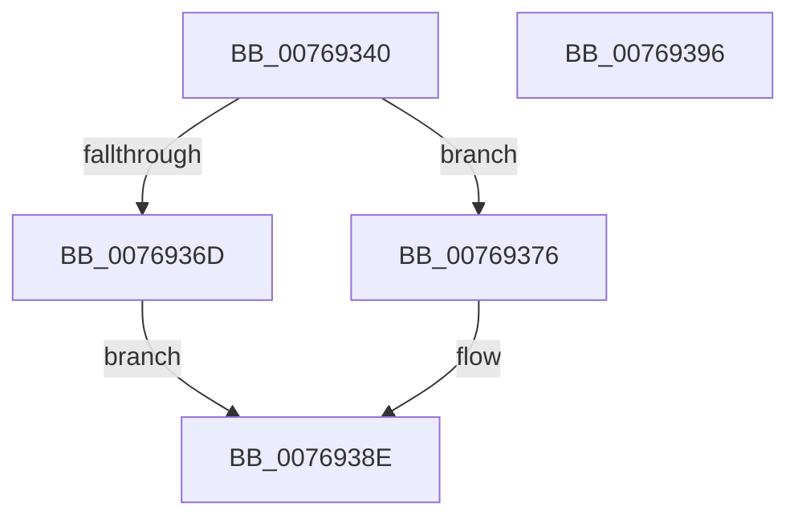

# PdcPoBlockSessionSwitchEx

- RVA: `0x00769340`–`0x00769397` (길이 `87` bytes)
- VA: `0x0000000140769340`
- 실행 섹션: `PAGE`
- PDB 이름 있음: `예`; PDB Function 태그: `아니요`
- unwind 정보 RVA: `0x00071A74`
- 디코드: `25`개 명령, `87/87` bytes 표시
- 미해석 바이트: `0` (있으면 어셈블리에 `.byte`로 보존)

> 이 문서는 커널 이미지의 기계어와 PDB 기호를 분석해 생성했습니다. 4번과 5번은 함수 원형과 자료형을 바이너리 사용 방식에서 추정한 C 해석이며 원본 소스 복구 결과는 아닙니다.

## 1. Dependencies

- 직접 호출 지점: **2**; 고유 호출 대상: **2**
- 직접 호출자로 확인된 함수: **0**
- RIP 상대 이미지 참조: **0**

### Outgoing calls
- `0x0076936D` → [PoBlockConsoleSwitchEx](../../text/43/PoBlockConsoleSwitchEx_function_00435CD4.md) (function, `0x00435CD4`)
- `0x00769389` → [PopDispatchStateCallout](../91/PopDispatchStateCallout_function_0091248C.md) (function, `0x0091248C`)

### Direct callers
- 이 함수 시작 RVA로 연결되는 직접 call은 확인되지 않았습니다. 간접 호출은 완전히 역산할 수 없습니다.

### Static image references
- 디코드된 RIP-relative 메모리 참조가 없습니다.

## 2. Other-region calls and transfers

- 다른 실행 섹션으로 향하는 call: **1**
  - `0x0076936D` → [PoBlockConsoleSwitchEx](../../text/43/PoBlockConsoleSwitchEx_function_00435CD4.md) (`PAGE` → `.text`)
- 별도 외부 분기/꼬리 이동을 확인하지 못했습니다.

## 3. Assembly (complete function range)

```asm
00769340  40 53                           push rbx
00769342  48 83 EC 50                     sub rsp, 0x50
00769346  0F 57 C0                        xorps xmm0, xmm0
00769349  33 C0                           xor eax, eax
0076934B  33 DB                           xor ebx, ebx
0076934D  48 89 44 24 40                  mov qword ptr [rsp + 0x40], rax
00769352  0F 11 44 24 30                  movups xmmword ptr [rsp + 0x30], xmm0
00769357  84 C9                           test cl, cl
00769359  C7 44 24 38 01 00 00 00         mov dword ptr [rsp + 0x38], 1
00769361  48 8D 4C 24 20                  lea rcx, [rsp + 0x20]
00769366  0F 11 44 24 20                  movups xmmword ptr [rsp + 0x20], xmm0
0076936B  74 09                           je 0x140769376
0076936D  E8 62 C9 CC FF                  call 0x140435cd4
00769372  8B D8                           mov ebx, eax
00769374  EB 18                           jmp 0x14076938e
00769376  8B 02                           mov eax, dword ptr [rdx]
00769378  48 8D 54 24 60                  lea rdx, [rsp + 0x60]
0076937D  89 44 24 60                     mov dword ptr [rsp + 0x60], eax
00769381  C7 44 24 40 07 00 00 00         mov dword ptr [rsp + 0x40], 7
00769389  E8 FE 90 1A 00                  call 0x14091248c
0076938E  8B C3                           mov eax, ebx
00769390  48 83 C4 50                     add rsp, 0x50
00769394  5B                              pop rbx
00769395  C3                              ret
00769396  CC                              int3
```

## 4. C-style interpretation (structured pseudocode)

```c
__int64 __fastcall PdcPoBlockSessionSwitchEx(unsigned __int8 a1, __int64 a2)
{
    __int64 result;
    __int64 v_rbx;
    __int64 v_rsp;
    unsigned __int64 v_stack_m18;
    unsigned int v_stack_m20;
    unsigned __int64 v_stack_m28;
    unsigned __int64 v_stack_m38;
    unsigned __int64 v_stack_p8;

    v_rsp = (v_rsp) - (80);
    result = 0;
    v_rbx = 0;
    v_stack_m18 = 0;
    v_stack_m28 = v_xmm0;
    v_stack_m20 = 1;
    v_stack_m38 = v_xmm0;
    if (a1 == 0) goto loc_00769376;
    result = PoBlockConsoleSwitchEx(v_stack_m38, a2, a3, a4);
    goto loc_0076938E;
loc_00769376:
    v_stack_p8 = (unsigned int)((unsigned int)(*(unsigned int *)(a2)));
    v_stack_m18 = 7;
    result = PopDispatchStateCallout(v_stack_m38, v_stack_p8, a3, a4);
loc_0076938E:
    v_rsp = (v_rsp) + (80);
    return (unsigned int)((unsigned int)((unsigned int)((unsigned int)(result))));
}
```

## 5. (Beta) C Style

```c
int64_t PdcPoBlockSessionSwitchEx(uint8_t Arg1, void *Arg2)
{
    uint8_t *arg2 = (uint8_t *)Arg2;

    int64_t result;
    int64_t local_rbx;
    int64_t local_rsp;
    uint64_t v_stack_m18;
    uint32_t v_stack_m20;
    uint64_t v_stack_m28;
    uint64_t v_stack_m38;
    uint64_t v_stack_p8;

    local_rsp = (local_rsp) - (80);
    result = 0;
    local_rbx = 0;
    v_stack_m18 = 0;
    v_stack_m28 = v_xmm0;
    v_stack_m20 = 1;
    v_stack_m38 = v_xmm0;
    if (Arg1 == 0) goto loc_00769376;
    result = PoBlockConsoleSwitchEx(v_stack_m38, Arg2, a3, a4);
    goto loc_0076938E;
loc_00769376:
    v_stack_p8 = (uint32_t)((uint32_t)(*(uint32_t *)(arg2)));
    v_stack_m18 = 7;
    result = PopDispatchStateCallout(v_stack_m38, v_stack_p8, a3, a4);
loc_0076938E:
    local_rsp = (local_rsp) + (80);
    return (uint32_t)((uint32_t)((uint32_t)((uint32_t)(result))));
}
```

### 관측된 메모리 오프셋

구조체 형식이 확인되지 않은 접근은 인자 기준의 오프셋으로만 기록했습니다.

| 기준 인자 | 오프셋 표현 | 폭 (bit) | 접근 |
|---|---:|---:|---|
| `Arg2` | `+ 0x0` | `32` | `R` |

## 6. Execution-region graph

[열기: 2D/3D 그래프와 함수 탐색 컨트롤 패널](../../../control-panel.html?section=page&rva=0x00769340&view=graph)

- 2D 그래프는 위에서 아래로 흐르고, 3D 그래프는 빈 공간을 드래그해 회전합니다. Shift+드래그는 이동, 휠은 확대·축소, 함수 노드 선택은 대상 보고서 이동입니다.

### Static fallback


