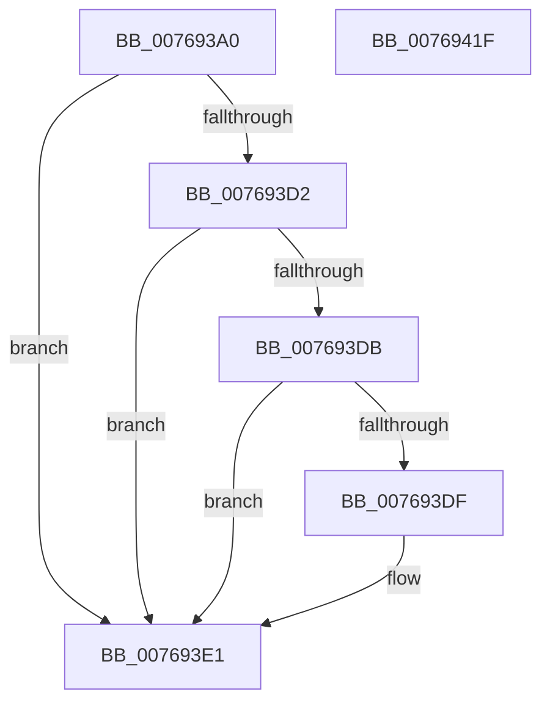

# PdcPoNetworkResiliency

- RVA: `0x007693A0`–`0x00769420` (길이 `128` bytes)
- VA: `0x00000001407693A0`
- 실행 섹션: `PAGE`
- PDB 이름 있음: `예`; PDB Function 태그: `아니요`
- unwind 정보 RVA: `0x000697A4`
- 디코드: `32`개 명령, `128/128` bytes 표시
- 미해석 바이트: `0` (있으면 어셈블리에 `.byte`로 보존)

> 이 문서는 커널 이미지의 기계어와 PDB 기호를 분석해 생성했습니다. 4번과 5번은 함수 원형과 자료형을 바이너리 사용 방식에서 추정한 C 해석이며 원본 소스 복구 결과는 아닙니다.

## 1. Dependencies

- 직접 호출 지점: **6**; 고유 호출 대상: **6**
- 직접 호출자로 확인된 함수: **0**
- RIP 상대 이미지 참조: **4**

### Outgoing calls
- `0x007693A8` → [PopAcquirePolicyLock](../../pagelk/B7/PopAcquirePolicyLock_function_00B783C0.md) (function, `0x00B783C0`)
- `0x007693AF` → [PopNetUpdateDsAccounting](../../text/4C/PopNetUpdateDsAccounting_function_004CE000.md) (function, `0x004CE000`)
- `0x007693B4` → [PopReleasePolicyLock](../../pagelk/B7/PopReleasePolicyLock_function_00B78410.md) (function, `0x00B78410`)
- `0x007693C0` → [PopAcquireRwLockExclusive](../../text/43/PopAcquireRwLockExclusive_function_00430B44.md) (function, `0x00430B44`)
- `0x007693EC` → [PopReleaseRwLock](../../text/2D/PopReleaseRwLock_function_002DFBBC.md) (function, `0x002DFBBC`)
- `0x00769414` → [ZwUpdateWnfStateData](../../text/6B/ZwUpdateWnfStateData_function_006B0D10.md) (function, `0x006B0D10`)

### Direct callers
- 이 함수 시작 RVA로 연결되는 직접 call은 확인되지 않았습니다. 간접 호출은 완전히 역산할 수 없습니다.

### Static image references
- `0x007693B9` → RVA `0x00F09710` (`.data`; read)
- `0x007693CA` → RVA `0x00F09750` (`.data`; read)
- `0x007693D2` → RVA `0x00F0976B` (`.data`; read)
- `0x00769400` → RVA `0x00020930` (`.rdata`; read)

## 2. Other-region calls and transfers

- 다른 실행 섹션으로 향하는 call: **6**
  - `0x007693A8` → [PopAcquirePolicyLock](../../pagelk/B7/PopAcquirePolicyLock_function_00B783C0.md) (`PAGE` → `PAGELK`)
  - `0x007693AF` → [PopNetUpdateDsAccounting](../../text/4C/PopNetUpdateDsAccounting_function_004CE000.md) (`PAGE` → `.text`)
  - `0x007693B4` → [PopReleasePolicyLock](../../pagelk/B7/PopReleasePolicyLock_function_00B78410.md) (`PAGE` → `PAGELK`)
  - `0x007693C0` → [PopAcquireRwLockExclusive](../../text/43/PopAcquireRwLockExclusive_function_00430B44.md) (`PAGE` → `.text`)
  - `0x007693EC` → [PopReleaseRwLock](../../text/2D/PopReleaseRwLock_function_002DFBBC.md) (`PAGE` → `.text`)
  - `0x00769414` → [ZwUpdateWnfStateData](../../text/6B/ZwUpdateWnfStateData_function_006B0D10.md) (`PAGE` → `.text`)
- 별도 외부 분기/꼬리 이동을 확인하지 못했습니다.

## 3. Assembly (complete function range)

```asm
007693A0  40 53                           push rbx
007693A2  48 83 EC 40                     sub rsp, 0x40
007693A6  8A D9                           mov bl, cl
007693A8  E8 13 F0 40 00                  call 0x140b783c0
007693AD  8A CB                           mov cl, bl
007693AF  E8 4C 4C D6 FF                  call 0x1404ce000
007693B4  E8 57 F0 40 00                  call 0x140b78410
007693B9  48 8D 0D 50 03 7A 00            lea rcx, [rip + 0x7a0350]
007693C0  E8 7F 77 CC FF                  call 0x140430b44
007693C5  B8 01 00 00 00                  mov eax, 1
007693CA  39 05 80 03 7A 00               cmp dword ptr [rip + 0x7a0380], eax
007693D0  75 0F                           jne 0x1407693e1
007693D2  80 3D 92 03 7A 00 00            cmp byte ptr [rip + 0x7a0392], 0
007693D9  74 06                           je 0x1407693e1
007693DB  84 DB                           test bl, bl
007693DD  74 02                           je 0x1407693e1
007693DF  33 C0                           xor eax, eax
007693E1  48 8D 0D 28 03 7A 00            lea rcx, [rip + 0x7a0328]
007693E8  89 44 24 58                     mov dword ptr [rsp + 0x58], eax
007693EC  E8 CB 67 B7 FF                  call 0x1402dfbbc
007693F1  83 64 24 30 00                  and dword ptr [rsp + 0x30], 0
007693F6  48 8D 54 24 58                  lea rdx, [rsp + 0x58]
007693FB  83 64 24 28 00                  and dword ptr [rsp + 0x28], 0
00769400  48 8D 0D 29 75 8B FF            lea rcx, [rip - 0x748ad7]
00769407  48 83 64 24 20 00               and qword ptr [rsp + 0x20], 0
0076940D  45 33 C9                        xor r9d, r9d
00769410  45 8D 41 04                     lea r8d, [r9 + 4]
00769414  E8 F7 78 F4 FF                  call 0x1406b0d10
00769419  48 83 C4 40                     add rsp, 0x40
0076941D  5B                              pop rbx
0076941E  C3                              ret
0076941F  CC                              int3
```

## 4. C-style interpretation (structured pseudocode)

```c
__int64 __fastcall PdcPoNetworkResiliency(unsigned __int8 a1, __int64 a2, __int64 a3, int a4)
{
    __int64 result;
    __int64 v_rsp;
    unsigned int v_stack_m18;
    unsigned int v_stack_m20;
    unsigned __int64 v_stack_m28;
    unsigned int v_stack_p10;

    v_rsp = (v_rsp) - (64);
    result = PopAcquirePolicyLock(a1, a2, a3, a4);
    result = PopNetUpdateDsAccounting(a1, a2, a3, a4);
    result = PopReleasePolicyLock(a1, a2, a3, a4);
    result = PopAcquireRwLockExclusive(v_rip + 7996240, a2, a3, a4);
    if ((*(unsigned int *)(v_rip + 7996288)) != 1) goto loc_007693E1;
    if ((*(unsigned __int8 *)(v_rip + 7996306)) == 0) goto loc_007693E1;
    result = 1;
    if (a1 != 0) {
        result = 0;
    }
    v_stack_p10 = 0;
    result = PopReleaseRwLock(v_rip + 7996200, a2, a3, a4);
    a4 = 0;
    result = ZwUpdateWnfStateData(v_rip - 7637719, v_stack_p10, a4 + 4, a4);
    v_rsp = (v_rsp) + (64);
    return result;
}
```

## 5. (Beta) C Style

```c
int64_t PdcPoNetworkResiliency(uint8_t Arg1, int64_t Arg2, int64_t Arg3, int32_t Arg4)
{
    int64_t result;
    int64_t local_rsp;
    uint32_t v_stack_m18;
    uint32_t v_stack_m20;
    uint64_t v_stack_m28;
    uint32_t v_stack_p10;

    local_rsp = (local_rsp) - (64);
    result = PopAcquirePolicyLock(Arg1, Arg2, Arg3, Arg4);
    result = PopNetUpdateDsAccounting(Arg1, Arg2, Arg3, Arg4);
    result = PopReleasePolicyLock(Arg1, Arg2, Arg3, Arg4);
    result = PopAcquireRwLockExclusive(v_rip + 7996240, Arg2, Arg3, Arg4);
    if ((*(uint32_t *)(v_rip + 0x7A0380)) != 1) goto loc_007693E1;
    if ((*(uint8_t *)(v_rip + 0x7A0392)) == 0) goto loc_007693E1;
    result = 1;
    if (Arg1 != 0) {
        result = 0;
    }
    v_stack_p10 = 0;
    result = PopReleaseRwLock(v_rip + 7996200, Arg2, Arg3, Arg4);
    Arg4 = 0;
    result = ZwUpdateWnfStateData(v_rip - 7637719, v_stack_p10, Arg4 + 4, Arg4);
    local_rsp = (local_rsp) + (64);
    return result;
}
```

## 6. Execution-region graph

[열기: 2D/3D 그래프와 함수 탐색 컨트롤 패널](../../../control-panel.html?section=page&rva=0x007693A0&view=graph)

- 2D 그래프는 위에서 아래로 흐르고, 3D 그래프는 빈 공간을 드래그해 회전합니다. Shift+드래그는 이동, 휠은 확대·축소, 함수 노드 선택은 대상 보고서 이동입니다.

### Static fallback


