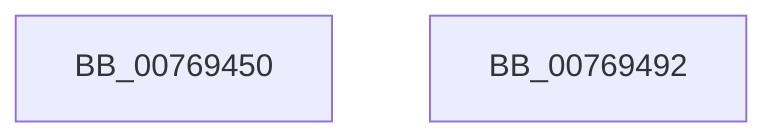

# PdcPoRecordButton

- RVA: `0x00769450`–`0x00769493` (길이 `67` bytes)
- VA: `0x0000000140769450`
- 실행 섹션: `PAGE`
- PDB 이름 있음: `예`; PDB Function 태그: `아니요`
- unwind 정보 RVA: `0x0005CF00`
- 디코드: `15`개 명령, `67/67` bytes 표시
- 미해석 바이트: `0` (있으면 어셈블리에 `.byte`로 보존)

> 이 문서는 커널 이미지의 기계어와 PDB 기호를 분석해 생성했습니다. 4번과 5번은 함수 원형과 자료형을 바이너리 사용 방식에서 추정한 C 해석이며 원본 소스 복구 결과는 아닙니다.

## 1. Dependencies

- 직접 호출 지점: **3**; 고유 호출 대상: **3**
- 직접 호출자로 확인된 함수: **0**
- RIP 상대 이미지 참조: **2**

### Outgoing calls
- `0x0076946A` → [PopAcquireRwLockExclusive](../../text/43/PopAcquireRwLockExclusive_function_00430B44.md) (function, `0x00430B44`)
- `0x0076947B` → [PopBsdHandleRequest](../../text/4B/PopBsdHandleRequest_function_004B27A0.md) (function, `0x004B27A0`)
- `0x00769487` → [PopReleaseRwLock](../../text/2D/PopReleaseRwLock_function_002DFBBC.md) (function, `0x002DFBBC`)

### Direct callers
- 이 함수 시작 RVA로 연결되는 직접 call은 확인되지 않았습니다. 간접 호출은 완전히 역산할 수 없습니다.

### Static image references
- `0x00769460` → RVA `0x00F0F1E0` (`.data`; read)
- `0x00769474` → RVA `0x00E67410` (`.data`; write)

## 2. Other-region calls and transfers

- 다른 실행 섹션으로 향하는 call: **3**
  - `0x0076946A` → [PopAcquireRwLockExclusive](../../text/43/PopAcquireRwLockExclusive_function_00430B44.md) (`PAGE` → `.text`)
  - `0x0076947B` → [PopBsdHandleRequest](../../text/4B/PopBsdHandleRequest_function_004B27A0.md) (`PAGE` → `.text`)
  - `0x00769487` → [PopReleaseRwLock](../../text/2D/PopReleaseRwLock_function_002DFBBC.md) (`PAGE` → `.text`)
- 별도 외부 분기/꼬리 이동을 확인하지 못했습니다.

## 3. Assembly (complete function range)

```asm
00769450  40 53                           push rbx
00769452  48 83 EC 20                     sub rsp, 0x20
00769456  48 BB 14 00 00 00 80 F7 FF FF   movabs rbx, 0xfffff78000000014
00769460  48 8D 0D 79 5D 7A 00            lea rcx, [rip + 0x7a5d79]
00769467  48 8B 1B                        mov rbx, qword ptr [rbx]
0076946A  E8 D5 76 CC FF                  call 0x140430b44
0076946F  B9 01 00 00 00                  mov ecx, 1
00769474  48 89 1D 95 DF 6F 00            mov qword ptr [rip + 0x6fdf95], rbx
0076947B  E8 20 93 D4 FF                  call 0x1404b27a0
00769480  48 8D 0D 59 5D 7A 00            lea rcx, [rip + 0x7a5d59]
00769487  E8 30 67 B7 FF                  call 0x1402dfbbc
0076948C  48 83 C4 20                     add rsp, 0x20
00769490  5B                              pop rbx
00769491  C3                              ret
00769492  CC                              int3
```

## 4. C-style interpretation (structured pseudocode)

```c
__int64 __fastcall PdcPoRecordButton(void)
{
    __int64 result;
    __int64 v_rsp;

    v_rsp = (v_rsp) - (32);
    result = PopAcquireRwLockExclusive(v_rip + 8019321, a2, a3, a4);
    *(unsigned __int64 *)(v_rip + 7331733) = *(unsigned __int64 *)(v_rbx);
    result = PopBsdHandleRequest(1, a2, a3, a4);
    result = PopReleaseRwLock(v_rip + 8019289, a2, a3, a4);
    v_rsp = (v_rsp) + (32);
    return result;
}
```

## 5. (Beta) C Style

```c
void PdcPoRecordButton(void)
{
    int64_t result;
    int64_t local_rsp;

    local_rsp = (local_rsp) - (32);
    result = PopAcquireRwLockExclusive(v_rip + 8019321, a2, a3, a4);
    *(uint64_t *)(v_rip + 0x6FDF95) = *(uint64_t *)(local_rbx);
    result = PopBsdHandleRequest(1, a2, a3, a4);
    result = PopReleaseRwLock(v_rip + 8019289, a2, a3, a4);
    local_rsp = (local_rsp) + (32);
    return result;
}
```

## 6. Execution-region graph

[열기: 2D/3D 그래프와 함수 탐색 컨트롤 패널](../../../control-panel.html?section=page&rva=0x00769450&view=graph)

- 2D 그래프는 위에서 아래로 흐르고, 3D 그래프는 빈 공간을 드래그해 회전합니다. Shift+드래그는 이동, 휠은 확대·축소, 함수 노드 선택은 대상 보고서 이동입니다.

### Static fallback


