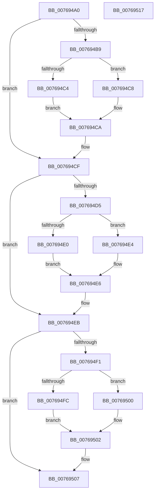

# PdcPoReportButton

- RVA: `0x007694A0`–`0x00769518` (길이 `120` bytes)
- VA: `0x00000001407694A0`
- 실행 섹션: `PAGE`
- PDB 이름 있음: `예`; PDB Function 태그: `아니요`
- unwind 정보 RVA: `0x0005CAAC`
- 디코드: `39`개 명령, `120/120` bytes 표시
- 미해석 바이트: `0` (있으면 어셈블리에 `.byte`로 보존)

> 이 문서는 커널 이미지의 기계어와 PDB 기호를 분석해 생성했습니다. 4번과 5번은 함수 원형과 자료형을 바이너리 사용 방식에서 추정한 C 해석이며 원본 소스 복구 결과는 아닙니다.

## 1. Dependencies

- 직접 호출 지점: **5**; 고유 호출 대상: **3**
- 직접 호출자로 확인된 함수: **0**
- RIP 상대 이미지 참조: **3**

### Outgoing calls
- `0x007694AE` → [PopAcquirePolicyLock](../../pagelk/B7/PopAcquirePolicyLock_function_00B783C0.md) (function, `0x00B783C0`)
- `0x007694CA` → [PopChangeCapability](../90/PopChangeCapability_function_0090FF48.md) (function, `0x0090FF48`)
- `0x007694E6` → [PopChangeCapability](../90/PopChangeCapability_function_0090FF48.md) (function, `0x0090FF48`)
- `0x00769502` → [PopChangeCapability](../90/PopChangeCapability_function_0090FF48.md) (function, `0x0090FF48`)
- `0x00769507` → [PopReleasePolicyLock](../../pagelk/B7/PopReleasePolicyLock_function_00B78410.md) (function, `0x00B78410`)

### Direct callers
- 이 함수 시작 RVA로 연결되는 직접 call은 확인되지 않았습니다. 간접 호출은 완전히 역산할 수 없습니다.

### Static image references
- `0x007694B9` → RVA `0x00F0CEC0` (`.data`; read)
- `0x007694D5` → RVA `0x00F0CEC1` (`.data`; read)
- `0x007694F1` → RVA `0x00F0CEC2` (`.data`; read)

## 2. Other-region calls and transfers

- 다른 실행 섹션으로 향하는 call: **2**
  - `0x007694AE` → [PopAcquirePolicyLock](../../pagelk/B7/PopAcquirePolicyLock_function_00B783C0.md) (`PAGE` → `PAGELK`)
  - `0x00769507` → [PopReleasePolicyLock](../../pagelk/B7/PopReleasePolicyLock_function_00B78410.md) (`PAGE` → `PAGELK`)
- 별도 외부 분기/꼬리 이동을 확인하지 못했습니다.

## 3. Assembly (complete function range)

```asm
007694A0  48 89 5C 24 08                  mov qword ptr [rsp + 8], rbx
007694A5  57                              push rdi
007694A6  48 83 EC 20                     sub rsp, 0x20
007694AA  8A DA                           mov bl, dl
007694AC  8B F9                           mov edi, ecx
007694AE  E8 0D EF 40 00                  call 0x140b783c0
007694B3  40 F6 C7 01                     test dil, 1
007694B7  74 16                           je 0x1407694cf
007694B9  48 8D 0D 00 3A 7A 00            lea rcx, [rip + 0x7a3a00]
007694C0  84 DB                           test bl, bl
007694C2  74 04                           je 0x1407694c8
007694C4  B2 01                           mov dl, 1
007694C6  EB 02                           jmp 0x1407694ca
007694C8  33 D2                           xor edx, edx
007694CA  E8 79 6A 1A 00                  call 0x14090ff48
007694CF  40 F6 C7 02                     test dil, 2
007694D3  74 16                           je 0x1407694eb
007694D5  48 8D 0D E5 39 7A 00            lea rcx, [rip + 0x7a39e5]
007694DC  84 DB                           test bl, bl
007694DE  74 04                           je 0x1407694e4
007694E0  B2 01                           mov dl, 1
007694E2  EB 02                           jmp 0x1407694e6
007694E4  33 D2                           xor edx, edx
007694E6  E8 5D 6A 1A 00                  call 0x14090ff48
007694EB  40 F6 C7 04                     test dil, 4
007694EF  74 16                           je 0x140769507
007694F1  48 8D 0D CA 39 7A 00            lea rcx, [rip + 0x7a39ca]
007694F8  84 DB                           test bl, bl
007694FA  74 04                           je 0x140769500
007694FC  B2 01                           mov dl, 1
007694FE  EB 02                           jmp 0x140769502
00769500  33 D2                           xor edx, edx
00769502  E8 41 6A 1A 00                  call 0x14090ff48
00769507  E8 04 EF 40 00                  call 0x140b78410
0076950C  48 8B 5C 24 30                  mov rbx, qword ptr [rsp + 0x30]
00769511  48 83 C4 20                     add rsp, 0x20
00769515  5F                              pop rdi
00769516  C3                              ret
00769517  CC                              int3
```

## 4. C-style interpretation (structured pseudocode)

```c
__int64 __fastcall PdcPoReportButton(int a1, unsigned __int8 a2)
{
    __int64 result;
    __int64 v_rsp;
    unsigned __int64 v_stack_p8;

    v_stack_p8 = v_rbx;
    v_rsp = (v_rsp) - (32);
    result = PopAcquirePolicyLock(a1, a2, a3, a4);
    if ((((unsigned __int8)((unsigned int)(a1))) & (1)) == 0) goto loc_007694CF;
    if (a2 == 0) goto loc_007694C8;
    goto loc_007694CA;
loc_007694C8:
    a2 = 0;
loc_007694CA:
    result = PopChangeCapability(v_rip + 8010240, a2, a3, a4);
loc_007694CF:
    if ((((unsigned __int8)((unsigned int)(a1))) & (2)) == 0) goto loc_007694EB;
    if (0 == 0) goto loc_007694E4;
    goto loc_007694E6;
loc_007694E4:
    a2 = 0;
loc_007694E6:
    result = PopChangeCapability(v_rip + 8010213, a2, a3, a4);
loc_007694EB:
    if ((((unsigned __int8)((unsigned int)(a1))) & (4)) == 0) goto loc_00769507;
    if (0 == 0) goto loc_00769500;
    goto loc_00769502;
loc_00769500:
    a2 = 0;
loc_00769502:
    result = PopChangeCapability(v_rip + 8010186, a2, a3, a4);
loc_00769507:
    result = PopReleasePolicyLock(v_rip + 8010186, a2, a3, a4);
    v_rsp = (v_rsp) + (32);
    return result;
}
```

## 5. (Beta) C Style

```c
int64_t PdcPoReportButton(int32_t Arg1, uint8_t Arg2)
{
    int64_t result;
    int64_t local_rsp;
    uint64_t v_stack_p8;

    v_stack_p8 = local_rbx;
    local_rsp = (local_rsp) - (32);
    result = PopAcquirePolicyLock(Arg1, Arg2, a3, a4);
    if ((((uint8_t)((uint32_t)(Arg1))) & (1)) == 0) goto loc_007694CF;
    if (Arg2 == 0) goto loc_007694C8;
    goto loc_007694CA;
loc_007694C8:
    Arg2 = 0;
loc_007694CA:
    result = PopChangeCapability(v_rip + 8010240, Arg2, a3, a4);
loc_007694CF:
    if ((((uint8_t)((uint32_t)(Arg1))) & (2)) == 0) goto loc_007694EB;
    if (0 == 0) goto loc_007694E4;
    goto loc_007694E6;
loc_007694E4:
    Arg2 = 0;
loc_007694E6:
    result = PopChangeCapability(v_rip + 8010213, Arg2, a3, a4);
loc_007694EB:
    if ((((uint8_t)((uint32_t)(Arg1))) & (4)) == 0) goto loc_00769507;
    if (0 == 0) goto loc_00769500;
    goto loc_00769502;
loc_00769500:
    Arg2 = 0;
loc_00769502:
    result = PopChangeCapability(v_rip + 8010186, Arg2, a3, a4);
loc_00769507:
    result = PopReleasePolicyLock(v_rip + 8010186, Arg2, a3, a4);
    local_rsp = (local_rsp) + (32);
    return result;
}
```

## 6. Execution-region graph

[열기: 2D/3D 그래프와 함수 탐색 컨트롤 패널](../../../control-panel.html?section=page&rva=0x007694A0&view=graph)

- 2D 그래프는 위에서 아래로 흐르고, 3D 그래프는 빈 공간을 드래그해 회전합니다. Shift+드래그는 이동, 휠은 확대·축소, 함수 노드 선택은 대상 보고서 이동입니다.

### Static fallback


