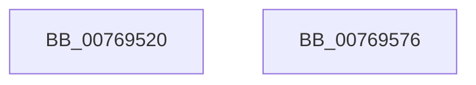

# PdcPoSetPowerAction

- RVA: `0x00769520`–`0x00769577` (길이 `87` bytes)
- VA: `0x0000000140769520`
- 실행 섹션: `PAGE`
- PDB 이름 있음: `예`; PDB Function 태그: `아니요`
- unwind 정보 RVA: `0x00066400`
- 디코드: `25`개 명령, `87/87` bytes 표시
- 미해석 바이트: `0` (있으면 어셈블리에 `.byte`로 보존)

> 이 문서는 커널 이미지의 기계어와 PDB 기호를 분석해 생성했습니다. 4번과 5번은 함수 원형과 자료형을 바이너리 사용 방식에서 추정한 C 해석이며 원본 소스 복구 결과는 아닙니다.

## 1. Dependencies

- 직접 호출 지점: **3**; 고유 호출 대상: **3**
- 직접 호출자로 확인된 함수: **0**
- RIP 상대 이미지 참조: **0**

### Outgoing calls
- `0x0076953F` → [PopAcquirePolicyLock](../../pagelk/B7/PopAcquirePolicyLock_function_00B783C0.md) (function, `0x00B783C0`)
- `0x00769557` → [PopExecutePowerAction](../75/PopExecutePowerAction_function_0075E6B4.md) (function, `0x0075E6B4`)
- `0x0076955C` → [PopReleasePolicyLock](../../pagelk/B7/PopReleasePolicyLock_function_00B78410.md) (function, `0x00B78410`)

### Direct callers
- 이 함수 시작 RVA로 연결되는 직접 call은 확인되지 않았습니다. 간접 호출은 완전히 역산할 수 없습니다.

### Static image references
- 디코드된 RIP-relative 메모리 참조가 없습니다.

## 2. Other-region calls and transfers

- 다른 실행 섹션으로 향하는 call: **2**
  - `0x0076953F` → [PopAcquirePolicyLock](../../pagelk/B7/PopAcquirePolicyLock_function_00B783C0.md) (`PAGE` → `PAGELK`)
  - `0x0076955C` → [PopReleasePolicyLock](../../pagelk/B7/PopReleasePolicyLock_function_00B78410.md) (`PAGE` → `PAGELK`)
- 별도 외부 분기/꼬리 이동을 확인하지 못했습니다.

## 3. Assembly (complete function range)

```asm
00769520  48 89 5C 24 08                  mov qword ptr [rsp + 8], rbx
00769525  48 89 6C 24 10                  mov qword ptr [rsp + 0x10], rbp
0076952A  48 89 74 24 18                  mov qword ptr [rsp + 0x18], rsi
0076952F  57                              push rdi
00769530  48 83 EC 30                     sub rsp, 0x30
00769534  41 8B D9                        mov ebx, r9d
00769537  49 8B F8                        mov rdi, r8
0076953A  8B F2                           mov esi, edx
0076953C  48 8B E9                        mov rbp, rcx
0076953F  E8 7C EE 40 00                  call 0x140b783c0
00769544  8B 44 24 60                     mov eax, dword ptr [rsp + 0x60]
00769548  44 8B CB                        mov r9d, ebx
0076954B  4C 8B C7                        mov r8, rdi
0076954E  89 44 24 20                     mov dword ptr [rsp + 0x20], eax
00769552  8B D6                           mov edx, esi
00769554  48 8B CD                        mov rcx, rbp
00769557  E8 58 51 FF FF                  call 0x14075e6b4
0076955C  E8 AF EE 40 00                  call 0x140b78410
00769561  48 8B 5C 24 40                  mov rbx, qword ptr [rsp + 0x40]
00769566  48 8B 6C 24 48                  mov rbp, qword ptr [rsp + 0x48]
0076956B  48 8B 74 24 50                  mov rsi, qword ptr [rsp + 0x50]
00769570  48 83 C4 30                     add rsp, 0x30
00769574  5F                              pop rdi
00769575  C3                              ret
00769576  CC                              int3
```

## 4. C-style interpretation (structured pseudocode)

```c
__int64 __fastcall PdcPoSetPowerAction(__int64 a1, int a2, __int64 a3, int a4, unsigned int a5)
{
    __int64 result;
    __int64 v_rsp;
    unsigned int v_stack_m18;
    unsigned __int64 v_stack_p10;
    unsigned __int64 v_stack_p18;
    unsigned __int64 v_stack_p8;

    v_stack_p8 = v_rbx;
    v_stack_p10 = v_rbp;
    v_stack_p18 = v_rsi;
    v_rsp = (v_rsp) - (48);
    result = PopAcquirePolicyLock(a1, a2, a3, a4);
    v_stack_m18 = (unsigned int)((unsigned int)(a5));
    result = PopExecutePowerAction(a1, (unsigned int)((unsigned int)((unsigned int)(a2))), a3, (unsigned int)((unsigned int)((unsigned int)(a4))));
    result = PopReleasePolicyLock(a1, (unsigned int)((unsigned int)((unsigned int)(a2))), a3, (unsigned int)((unsigned int)((unsigned int)(a4))));
    v_rsp = (v_rsp) + (48);
    return result;
}
```

## 5. (Beta) C Style

```c
int64_t PdcPoSetPowerAction(int64_t Arg1, int32_t Arg2, int64_t Arg3, int32_t Arg4, uint32_t Arg5)
{
    int64_t result;
    int64_t local_rsp;
    uint32_t v_stack_m18;
    uint64_t v_stack_p10;
    uint64_t v_stack_p18;
    uint64_t v_stack_p8;

    v_stack_p8 = local_rbx;
    v_stack_p10 = local_rbp;
    v_stack_p18 = local_rsi;
    local_rsp = (local_rsp) - (48);
    result = PopAcquirePolicyLock(Arg1, Arg2, Arg3, Arg4);
    v_stack_m18 = (uint32_t)((uint32_t)(Arg5));
    result = PopExecutePowerAction(Arg1, (uint32_t)((uint32_t)((uint32_t)(Arg2))), Arg3, (uint32_t)((uint32_t)((uint32_t)(Arg4))));
    result = PopReleasePolicyLock(Arg1, (uint32_t)((uint32_t)((uint32_t)(Arg2))), Arg3, (uint32_t)((uint32_t)((uint32_t)(Arg4))));
    local_rsp = (local_rsp) + (48);
    return result;
}
```

## 6. Execution-region graph

[열기: 2D/3D 그래프와 함수 탐색 컨트롤 패널](../../../control-panel.html?section=page&rva=0x00769520&view=graph)

- 2D 그래프는 위에서 아래로 흐르고, 3D 그래프는 빈 공간을 드래그해 회전합니다. Shift+드래그는 이동, 휠은 확대·축소, 함수 노드 선택은 대상 보고서 이동입니다.

### Static fallback


