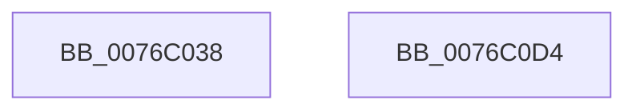

# PoSessionPowerControl

- RVA: `0x0076C038`–`0x0076C0D5` (길이 `157` bytes)
- VA: `0x000000014076C038`
- 실행 섹션: `PAGE`
- PDB 이름 있음: `예`; PDB Function 태그: `아니요`
- unwind 정보 RVA: `0x000BD874`
- 디코드: `46`개 명령, `157/157` bytes 표시
- 미해석 바이트: `0` (있으면 어셈블리에 `.byte`로 보존)

> 이 문서는 커널 이미지의 기계어와 PDB 기호를 분석해 생성했습니다. 4번과 5번은 함수 원형과 자료형을 바이너리 사용 방식에서 추정한 C 해석이며 원본 소스 복구 결과는 아닙니다.

## 1. Dependencies

- 직접 호출 지점: **3**; 고유 호출 대상: **2**
- 직접 호출자로 확인된 함수: **1**
- RIP 상대 이미지 참조: **0**

### Outgoing calls
- `0x0076C062` → [PopBlockSessionSwitch](../AC/PopBlockSessionSwitch_function_00ACE4C0.md) (function, `0x00ACE4C0`)
- `0x0076C0BC` → [PopInvokeWin32Callout](../91/PopInvokeWin32Callout_function_009125F4.md) (function, `0x009125F4`)
- `0x0076C0C7` → [PopBlockSessionSwitch](../AC/PopBlockSessionSwitch_function_00ACE4C0.md) (function, `0x00ACE4C0`)

### Direct callers
- [TtmpSessionPowerControl](../77/TtmpSessionPowerControl_function_00777ECC.md) at `0x00777F18`

### Static image references
- 디코드된 RIP-relative 메모리 참조가 없습니다.

## 2. Other-region calls and transfers

- 다른 실행 섹션으로 향하는 call: **0**
- 별도 외부 분기/꼬리 이동을 확인하지 못했습니다.

## 3. Assembly (complete function range)

```asm
0076C038  44 89 44 24 18                  mov dword ptr [rsp + 0x18], r8d
0076C03D  55                              push rbp
0076C03E  53                              push rbx
0076C03F  57                              push rdi
0076C040  48 8B EC                        mov rbp, rsp
0076C043  48 83 EC 60                     sub rsp, 0x60
0076C047  83 65 20 00                     and dword ptr [rbp + 0x20], 0
0076C04B  33 C0                           xor eax, eax
0076C04D  8B DA                           mov ebx, edx
0076C04F  89 45 C4                        mov dword ptr [rbp - 0x3c], eax
0076C052  40 8A F9                        mov dil, cl
0076C055  66 89 45 39                     mov word ptr [rbp + 0x39], ax
0076C059  48 8D 55 20                     lea rdx, [rbp + 0x20]
0076C05D  88 45 3B                        mov byte ptr [rbp + 0x3b], al
0076C060  B1 01                           mov cl, 1
0076C062  E8 59 24 36 00                  call 0x140ace4c0
0076C067  48 83 65 38 00                  and qword ptr [rbp + 0x38], 0
0076C06C  4C 8D 4D 30                     lea r9, [rbp + 0x30]
0076C070  0F 57 C0                        xorps xmm0, xmm0
0076C073  89 5D 3C                        mov dword ptr [rbp + 0x3c], ebx
0076C076  33 C0                           xor eax, eax
0076C078  40 88 7D 38                     mov byte ptr [rbp + 0x38], dil
0076C07C  0F 11 45 D0                     movups xmmword ptr [rbp - 0x30], xmm0
0076C080  48 89 45 F0                     mov qword ptr [rbp - 0x10], rax
0076C084  48 8D 55 C0                     lea rdx, [rbp - 0x40]
0076C088  48 83 65 F0 00                  and qword ptr [rbp - 0x10], 0
0076C08D  41 B8 01 00 00 00               mov r8d, 1
0076C093  0F 11 45 E0                     movups xmmword ptr [rbp - 0x20], xmm0
0076C097  83 65 E8 00                     and dword ptr [rbp - 0x18], 0
0076C09B  88 45 D4                        mov byte ptr [rbp - 0x2c], al
0076C09E  48 8D 45 38                     lea rax, [rbp + 0x38]
0076C0A2  41 8D 48 04                     lea ecx, [r8 + 4]
0076C0A6  48 89 45 E0                     mov qword ptr [rbp - 0x20], rax
0076C0AA  0F 11 45 C0                     movups xmmword ptr [rbp - 0x40], xmm0
0076C0AE  C7 45 D0 06 00 00 00            mov dword ptr [rbp - 0x30], 6
0076C0B5  C7 45 D8 08 00 00 00            mov dword ptr [rbp - 0x28], 8
0076C0BC  E8 33 65 1A 00                  call 0x1409125f4
0076C0C1  48 8D 55 20                     lea rdx, [rbp + 0x20]
0076C0C5  33 C9                           xor ecx, ecx
0076C0C7  E8 F4 23 36 00                  call 0x140ace4c0
0076C0CC  48 83 C4 60                     add rsp, 0x60
0076C0D0  5F                              pop rdi
0076C0D1  5B                              pop rbx
0076C0D2  5D                              pop rbp
0076C0D3  C3                              ret
0076C0D4  CC                              int3
```

## 4. C-style interpretation (structured pseudocode)

```c
__int64 __fastcall PoSessionPowerControl(unsigned __int8 a1, int a2, int a3)
{
    __int64 result;
    __int64 v_rsp;
    unsigned __int64 v_stack_m28;
    unsigned int v_stack_m30;
    unsigned __int64 v_stack_m38;
    unsigned int v_stack_m40;
    unsigned __int8 v_stack_m44;
    unsigned __int64 v_stack_m48;
    unsigned int v_stack_m54;
    unsigned __int64 v_stack_m58;
    unsigned int v_stack_p18;
    unsigned __int64 v_stack_p20;
    unsigned __int16 v_stack_p21;
    unsigned __int8 v_stack_p23;
    unsigned int v_stack_p24;
    unsigned int v_stack_p8;

    v_stack_p18 = a3;
    v_rsp = (v_rsp) - (96);
    result = 0;
    v_stack_m54 = 0;
    v_stack_p21 = 0;
    v_stack_p23 = 0;
    result = PopBlockSessionSwitch(1, v_stack_p8, a3, a4);
    v_stack_p24 = (unsigned int)((unsigned int)(a2));
    result = 0;
    v_stack_p20 = a1;
    v_stack_m48 = v_xmm0;
    v_stack_m28 = 0;
    v_stack_m38 = v_xmm0;
    v_stack_m44 = 0;
    v_stack_m38 = v_stack_p20;
    v_stack_m58 = v_xmm0;
    v_stack_m48 = 6;
    v_stack_m40 = 8;
    result = PopInvokeWin32Callout(1 + 4, v_stack_m58, 1, v_stack_p18);
    a1 = 0;
    result = PopBlockSessionSwitch(a1, v_stack_p8, 1, v_stack_p18);
    v_rsp = (v_rsp) + (96);
    return result;
}
```

## 5. (Beta) C Style

```c
int64_t PoSessionPowerControl(uint8_t Arg1, int32_t Arg2, int32_t Arg3)
{
    int64_t result;
    int64_t local_rsp;
    uint64_t v_stack_m28;
    uint32_t v_stack_m30;
    uint64_t v_stack_m38;
    uint32_t v_stack_m40;
    uint8_t v_stack_m44;
    uint64_t v_stack_m48;
    uint32_t v_stack_m54;
    uint64_t v_stack_m58;
    uint32_t v_stack_p18;
    uint64_t v_stack_p20;
    uint16_t v_stack_p21;
    uint8_t v_stack_p23;
    uint32_t v_stack_p24;
    uint32_t v_stack_p8;

    v_stack_p18 = Arg3;
    local_rsp = (local_rsp) - (96);
    result = 0;
    v_stack_m54 = 0;
    v_stack_p21 = 0;
    v_stack_p23 = 0;
    result = PopBlockSessionSwitch(1, v_stack_p8, Arg3, a4);
    v_stack_p24 = (uint32_t)((uint32_t)(Arg2));
    result = 0;
    v_stack_p20 = Arg1;
    v_stack_m48 = v_xmm0;
    v_stack_m28 = 0;
    v_stack_m38 = v_xmm0;
    v_stack_m44 = 0;
    v_stack_m38 = v_stack_p20;
    v_stack_m58 = v_xmm0;
    v_stack_m48 = 6;
    v_stack_m40 = 8;
    result = PopInvokeWin32Callout(1 + 4, v_stack_m58, 1, v_stack_p18);
    Arg1 = 0;
    result = PopBlockSessionSwitch(Arg1, v_stack_p8, 1, v_stack_p18);
    local_rsp = (local_rsp) + (96);
    return result;
}
```

## 6. Execution-region graph

[열기: 2D/3D 그래프와 함수 탐색 컨트롤 패널](../../../control-panel.html?section=page&rva=0x0076C038&view=graph)

- 2D 그래프는 위에서 아래로 흐르고, 3D 그래프는 빈 공간을 드래그해 회전합니다. Shift+드래그는 이동, 휠은 확대·축소, 함수 노드 선택은 대상 보고서 이동입니다.

### Static fallback


