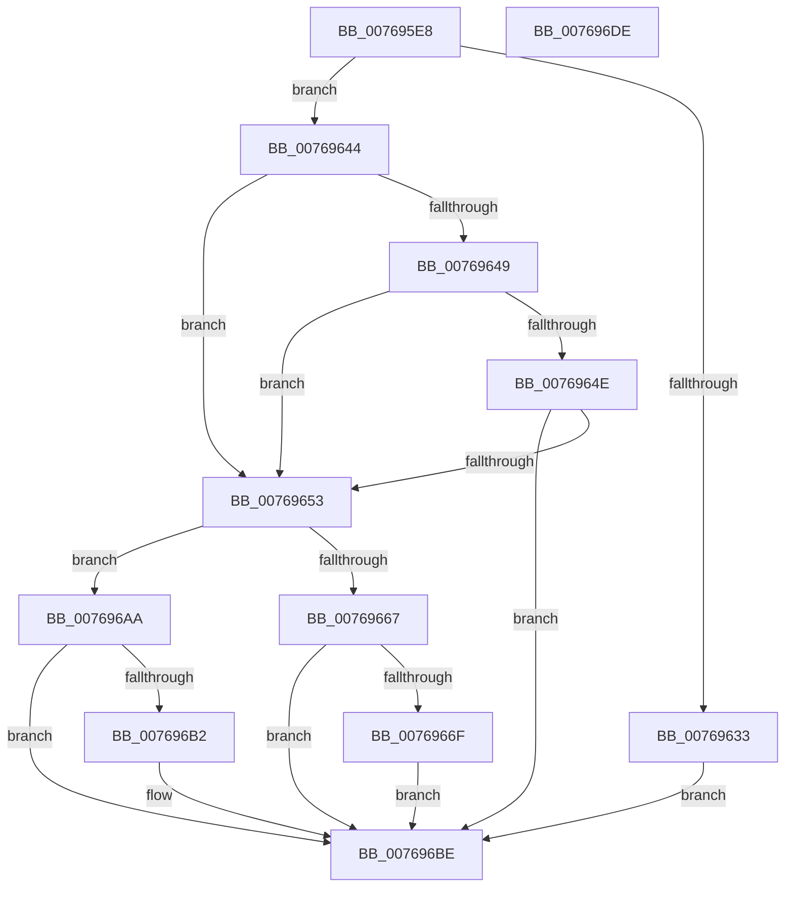

# PoTtmInitiatePowerStateTransition

- RVA: `0x007695E8`–`0x007696DF` (길이 `247` bytes)
- VA: `0x00000001407695E8`
- 실행 섹션: `PAGE`
- PDB 이름 있음: `예`; PDB Function 태그: `아니요`
- unwind 정보 RVA: `0x000CD0FC`
- 디코드: `65`개 명령, `247/247` bytes 표시
- 미해석 바이트: `0` (있으면 어셈블리에 `.byte`로 보존)

> 이 문서는 커널 이미지의 기계어와 PDB 기호를 분석해 생성했습니다. 4번과 5번은 함수 원형과 자료형을 바이너리 사용 방식에서 추정한 C 해석이며 원본 소스 복구 결과는 아닙니다.

## 1. Dependencies

- 직접 호출 지점: **6**; 고유 호출 대상: **6**
- 직접 호출자로 확인된 함수: **1**
- RIP 상대 이미지 참조: **3**

### Outgoing calls
- `0x00769612` → [memset](../../text/6C/memset_function_006C6C40.md) (function, `0x006C6C40`)
- `0x00769617` → [PopAcquirePolicyLock](../../pagelk/B7/PopAcquirePolicyLock_function_00B783C0.md) (function, `0x00B783C0`)
- `0x00769627` → [PopFilterCapabilities](../91/PopFilterCapabilities_function_0091141C.md) (function, `0x0091141C`)
- `0x0076963B` → [PopTriggerMonitorPowerEvent](../91/PopTriggerMonitorPowerEvent_function_0091446C.md) (function, `0x0091446C`)
- `0x007696A3` → [PopExecutePowerAction](../75/PopExecutePowerAction_function_0075E6B4.md) (function, `0x0075E6B4`)
- `0x007696BE` → [PopReleasePolicyLock](../../pagelk/B7/PopReleasePolicyLock_function_00B78410.md) (function, `0x00B78410`)

### Direct callers
- [TtmpInitiateModernStandbyTransition](../77/TtmpInitiateModernStandbyTransition_function_00777A18.md) at `0x00777A59`

### Static image references
- `0x00769620` → RVA `0x00F0CEC0` (`.data`; read)
- `0x00769667` → RVA `0x00F0D101` (`.data`; read)
- `0x007696B2` → RVA `0x00F0D100` (`.data`; write)

## 2. Other-region calls and transfers

- 다른 실행 섹션으로 향하는 call: **3**
  - `0x00769612` → [memset](../../text/6C/memset_function_006C6C40.md) (`PAGE` → `.text`)
  - `0x00769617` → [PopAcquirePolicyLock](../../pagelk/B7/PopAcquirePolicyLock_function_00B783C0.md) (`PAGE` → `PAGELK`)
  - `0x007696BE` → [PopReleasePolicyLock](../../pagelk/B7/PopReleasePolicyLock_function_00B78410.md) (`PAGE` → `PAGELK`)
- 별도 외부 분기/꼬리 이동을 확인하지 못했습니다.

## 3. Assembly (complete function range)

```asm
007695E8  48 8B C4                        mov rax, rsp
007695EB  48 89 58 08                     mov qword ptr [rax + 8], rbx
007695EF  48 89 70 10                     mov qword ptr [rax + 0x10], rsi
007695F3  48 89 78 18                     mov qword ptr [rax + 0x18], rdi
007695F7  55                              push rbp
007695F8  48 8D 68 A1                     lea rbp, [rax - 0x5f]
007695FC  48 81 EC B0 00 00 00            sub rsp, 0xb0
00769603  8B F2                           mov esi, edx
00769605  40 8A F9                        mov dil, cl
00769608  33 D2                           xor edx, edx
0076960A  48 8D 4D 07                     lea rcx, [rbp + 7]
0076960E  44 8D 42 4C                     lea r8d, [rdx + 0x4c]
00769612  E8 29 D6 F5 FF                  call 0x1406c6c40
00769617  E8 A4 ED 40 00                  call 0x140b783c0
0076961C  48 8D 55 07                     lea rdx, [rbp + 7]
00769620  48 8D 0D 99 38 7A 00            lea rcx, [rip + 0x7a3899]
00769627  E8 F0 7D 1A 00                  call 0x14091141c
0076962C  33 DB                           xor ebx, ebx
0076962E  38 5D 1B                        cmp byte ptr [rbp + 0x1b], bl
00769631  74 11                           je 0x140769644
00769633  40 84 FF                        test dil, dil
00769636  8B D6                           mov edx, esi
00769638  0F 94 C1                        sete cl
0076963B  E8 2C AE 1A 00                  call 0x14091446c
00769640  8B D8                           mov ebx, eax
00769642  EB 7A                           jmp 0x1407696be
00769644  38 5D 0A                        cmp byte ptr [rbp + 0xa], bl
00769647  75 0A                           jne 0x140769653
00769649  38 5D 0B                        cmp byte ptr [rbp + 0xb], bl
0076964C  75 05                           jne 0x140769653
0076964E  38 5D 0C                        cmp byte ptr [rbp + 0xc], bl
00769651  74 6B                           je 0x1407696be
00769653  89 5D DF                        mov dword ptr [rbp - 0x21], ebx
00769656  0F 57 C0                        xorps xmm0, xmm0
00769659  48 89 5D FF                     mov qword ptr [rbp - 1], rbx
0076965D  F3 0F 7F 45 EF                  movdqu xmmword ptr [rbp - 0x11], xmm0
00769662  40 84 FF                        test dil, dil
00769665  74 43                           je 0x1407696aa
00769667  38 1D 94 3A 7A 00               cmp byte ptr [rip + 0x7a3a94], bl
0076966D  75 4F                           jne 0x1407696be
0076966F  41 B9 04 00 00 00               mov r9d, 4
00769675  C7 45 E7 05 00 00 00            mov dword ptr [rbp - 0x19], 5
0076967C  4C 8D 45 D7                     lea r8, [rbp - 0x29]
00769680  C7 45 EB 80 00 00 00            mov dword ptr [rbp - 0x15], 0x80
00769687  33 D2                           xor edx, edx
00769689  C7 45 D7 02 00 00 00            mov dword ptr [rbp - 0x29], 2
00769690  48 8D 4D E7                     lea rcx, [rbp - 0x19]
00769694  C7 45 DB 01 00 00 00            mov dword ptr [rbp - 0x25], 1
0076969B  C7 44 24 20 01 00 00 00         mov dword ptr [rsp + 0x20], 1
007696A3  E8 0C 50 FF FF                  call 0x14075e6b4
007696A8  EB 14                           jmp 0x1407696be
007696AA  38 1D 51 3A 7A 00               cmp byte ptr [rip + 0x7a3a51], bl
007696B0  74 0C                           je 0x1407696be
007696B2  C6 05 47 3A 7A 00 01            mov byte ptr [rip + 0x7a3a47], 1
007696B9  BB 03 01 00 00                  mov ebx, 0x103
007696BE  E8 4D ED 40 00                  call 0x140b78410
007696C3  4C 8D 9C 24 B0 00 00 00         lea r11, [rsp + 0xb0]
007696CB  8B C3                           mov eax, ebx
007696CD  49 8B 5B 10                     mov rbx, qword ptr [r11 + 0x10]
007696D1  49 8B 73 18                     mov rsi, qword ptr [r11 + 0x18]
007696D5  49 8B 7B 20                     mov rdi, qword ptr [r11 + 0x20]
007696D9  49 8B E3                        mov rsp, r11
007696DC  5D                              pop rbp
007696DD  C3                              ret
007696DE  CC                              int3
```

## 4. C-style interpretation (structured pseudocode)

```c
__int64 __fastcall PoTtmInitiatePowerStateTransition(unsigned __int8 a1, int a2)
{
    __int64 result;
    __int64 v_rbx;
    __int64 v_rsp;
    unsigned __int64 v_stack_m8;
    unsigned int v_stack_m98;

    *(unsigned __int64 *)(v_rsp + 8) = v_rbx;
    *(unsigned __int64 *)(v_rsp + 16) = v_rsi;
    *(unsigned __int64 *)(v_rsp + 24) = v_rdi;
    v_rsp = (v_rsp) - (176);
    a2 = 0;
    result = memset(v_rsp - 95 + 7, a2, a2 + 76, a4);
    result = PopAcquirePolicyLock(v_rsp - 95 + 7, a2, a2 + 76, a4);
    result = PopFilterCapabilities(v_rip + 8009881, v_rsp - 95 + 7, a2 + 76, a4);
    v_rbx = 0;
    if ((*(unsigned __int8 *)(v_rsp - 95 + 27)) == 0) goto loc_00769644;
    a1 = (a1 == 0) ? 1 : 0;
    result = PopTriggerMonitorPowerEvent(a1, (unsigned int)((unsigned int)((unsigned int)(a2))), a2 + 76, a4);
    goto loc_007696BE;
loc_00769644:
    if ((*(unsigned __int8 *)(v_rsp - 95 + 10)) != ((unsigned __int8)((unsigned int)((unsigned int)(result))))) goto loc_00769653;
    if ((*(unsigned __int8 *)(v_rsp - 95 + 11)) != ((unsigned __int8)((unsigned int)((unsigned int)(result))))) goto loc_00769653;
    if ((*(unsigned __int8 *)(v_rsp - 95 + 12)) == ((unsigned __int8)((unsigned int)((unsigned int)(result))))) goto loc_007696BE;
loc_00769653:
    *(unsigned int *)(v_rsp - 95 - 33) = (unsigned int)((unsigned int)((unsigned int)(result)));
    *(unsigned __int64 *)(v_rsp - 95 - 1) = (unsigned int)((unsigned int)(result));
    *(unsigned __int64 *)(v_rsp - 95 - 17) = v_xmm0;
    if (a1 == 0) goto loc_007696AA;
    if ((*(unsigned __int8 *)(v_rip + 8010388)) != ((unsigned __int8)((unsigned int)((unsigned int)(result))))) goto loc_007696BE;
    *(unsigned int *)(v_rsp - 95 - 25) = 5;
    *(unsigned int *)(v_rsp - 95 - 21) = 128;
    a2 = 0;
    *(unsigned int *)(v_rsp - 95 - 41) = 2;
    *(unsigned int *)(v_rsp - 95 - 37) = 1;
    v_stack_m98 = 1;
    result = PopExecutePowerAction(v_rsp - 95 - 25, a2, v_rsp - 95 - 41, 4);
    goto loc_007696BE;
loc_007696AA:
    v_rbx = (unsigned int)((unsigned int)(result));
    if ((*(unsigned __int8 *)(v_rip + 8010321)) != ((unsigned __int8)((unsigned int)((unsigned int)(result))))) {
        *(unsigned __int8 *)(v_rip + 8010311) = 1;
        v_rbx = 259;
    }
    result = PopReleasePolicyLock(v_rsp - 95 - 25, a2, v_rsp - 95 - 41, 4);
    return (unsigned int)((unsigned int)(v_rbx));
}
```

## 5. (Beta) C Style

```c
int64_t PoTtmInitiatePowerStateTransition(uint8_t Arg1, int32_t Arg2)
{
    int64_t result;
    int64_t local_rbx;
    int64_t local_rsp;
    uint64_t v_stack_m8;
    uint32_t v_stack_m98;

    *(uint64_t *)(local_rsp + 0x8) = local_rbx;
    *(uint64_t *)(local_rsp + 0x10) = local_rsi;
    *(uint64_t *)(local_rsp + 0x18) = local_rdi;
    local_rsp = (local_rsp) - (176);
    Arg2 = 0;
    result = memset(local_rsp - 95 + 7, Arg2, Arg2 + 76, a4);
    result = PopAcquirePolicyLock(local_rsp - 95 + 7, Arg2, Arg2 + 76, a4);
    result = PopFilterCapabilities(v_rip + 8009881, local_rsp - 95 + 7, Arg2 + 76, a4);
    local_rbx = 0;
    if ((*(uint8_t *)(local_rsp - 0x5F + 0x1B)) == 0) goto loc_00769644;
    Arg1 = (Arg1 == 0) ? 1 : 0;
    result = PopTriggerMonitorPowerEvent(Arg1, (uint32_t)((uint32_t)((uint32_t)(Arg2))), Arg2 + 76, a4);
    goto loc_007696BE;
loc_00769644:
    if ((*(uint8_t *)(local_rsp - 0x5F + 0xA)) != ((uint8_t)((uint32_t)((uint32_t)(result))))) goto loc_00769653;
    if ((*(uint8_t *)(local_rsp - 0x5F + 0xB)) != ((uint8_t)((uint32_t)((uint32_t)(result))))) goto loc_00769653;
    if ((*(uint8_t *)(local_rsp - 0x5F + 0xC)) == ((uint8_t)((uint32_t)((uint32_t)(result))))) goto loc_007696BE;
loc_00769653:
    *(uint32_t *)(local_rsp - 0x5F - 0x21) = (uint32_t)((uint32_t)((uint32_t)(result)));
    *(uint64_t *)(local_rsp - 0x5F - 0x1) = (uint32_t)((uint32_t)(result));
    *(uint64_t *)(local_rsp - 0x5F - 0x11) = v_xmm0;
    if (Arg1 == 0) goto loc_007696AA;
    if ((*(uint8_t *)(v_rip + 0x7A3A94)) != ((uint8_t)((uint32_t)((uint32_t)(result))))) goto loc_007696BE;
    *(uint32_t *)(local_rsp - 0x5F - 0x19) = 5;
    *(uint32_t *)(local_rsp - 0x5F - 0x15) = 128;
    Arg2 = 0;
    *(uint32_t *)(local_rsp - 0x5F - 0x29) = 2;
    *(uint32_t *)(local_rsp - 0x5F - 0x25) = 1;
    v_stack_m98 = 1;
    result = PopExecutePowerAction(local_rsp - 95 - 25, Arg2, local_rsp - 95 - 41, 4);
    goto loc_007696BE;
loc_007696AA:
    local_rbx = (uint32_t)((uint32_t)(result));
    if ((*(uint8_t *)(v_rip + 0x7A3A51)) != ((uint8_t)((uint32_t)((uint32_t)(result))))) {
        *(uint8_t *)(v_rip + 0x7A3A47) = 1;
        local_rbx = 259;
    }
    result = PopReleasePolicyLock(local_rsp - 95 - 25, Arg2, local_rsp - 95 - 41, 4);
    return (uint32_t)((uint32_t)(local_rbx));
}
```

## 6. Execution-region graph

[열기: 2D/3D 그래프와 함수 탐색 컨트롤 패널](../../../control-panel.html?section=page&rva=0x007695E8&view=graph)

- 2D 그래프는 위에서 아래로 흐르고, 3D 그래프는 빈 공간을 드래그해 회전합니다. Shift+드래그는 이동, 휠은 확대·축소, 함수 노드 선택은 대상 보고서 이동입니다.

### Static fallback


