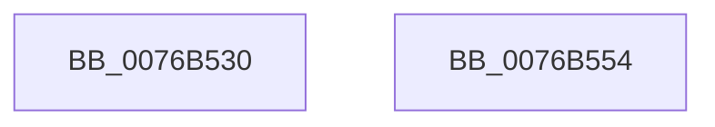

# PopActiveLockScreenPowerRequest

- RVA: `0x0076B530`–`0x0076B555` (길이 `37` bytes)
- VA: `0x000000014076B530`
- 실행 섹션: `PAGE`
- PDB 이름 있음: `예`; PDB Function 태그: `아니요`
- unwind 정보 RVA: `0x0005CF00`
- 디코드: `12`개 명령, `37/37` bytes 표시
- 미해석 바이트: `0` (있으면 어셈블리에 `.byte`로 보존)

> 이 문서는 커널 이미지의 기계어와 PDB 기호를 분석해 생성했습니다. 4번과 5번은 함수 원형과 자료형을 바이너리 사용 방식에서 추정한 C 해석이며 원본 소스 복구 결과는 아닙니다.

## 1. Dependencies

- 직접 호출 지점: **2**; 고유 호출 대상: **2**
- 직접 호출자로 확인된 함수: **0**
- RIP 상대 이미지 참조: **1**

### Outgoing calls
- `0x0076B53B` → [PopAcquireAdaptiveLock](../A3/PopAcquireAdaptiveLock_function_00A3B0E8.md) (function, `0x00A3B0E8`)
- `0x0076B549` → [PopReleaseAdaptiveLock](../91/PopReleaseAdaptiveLock_function_009137DC.md) (function, `0x009137DC`)

### Direct callers
- 이 함수 시작 RVA로 연결되는 직접 call은 확인되지 않았습니다. 간접 호출은 완전히 역산할 수 없습니다.

### Static image references
- `0x0076B542` → RVA `0x00F08222` (`.data`; write)

## 2. Other-region calls and transfers

- 다른 실행 섹션으로 향하는 call: **0**
- 별도 외부 분기/꼬리 이동을 확인하지 못했습니다.

## 3. Assembly (complete function range)

```asm
0076B530  40 53                           push rbx
0076B532  48 83 EC 20                     sub rsp, 0x20
0076B536  33 C9                           xor ecx, ecx
0076B538  41 8A D8                        mov bl, r8b
0076B53B  E8 A8 FB 2C 00                  call 0x140a3b0e8
0076B540  84 DB                           test bl, bl
0076B542  0F 95 05 D9 CC 79 00            setne byte ptr [rip + 0x79ccd9]
0076B549  E8 8E 82 1A 00                  call 0x1409137dc
0076B54E  48 83 C4 20                     add rsp, 0x20
0076B552  5B                              pop rbx
0076B553  C3                              ret
0076B554  CC                              int3
```

## 4. C-style interpretation (structured pseudocode)

```c
__int64 __fastcall PopActiveLockScreenPowerRequest(int a1, __int64 a2, unsigned __int8 a3)
{
    __int64 result;
    __int64 v_rsp;

    v_rsp = (v_rsp) - (32);
    a1 = 0;
    result = PopAcquireAdaptiveLock(a1, a2, a3, a4);
    result = PopReleaseAdaptiveLock(a1, a2, a3, a4);
    v_rsp = (v_rsp) + (32);
    return result;
}
```

## 5. (Beta) C Style

```c
int64_t PopActiveLockScreenPowerRequest(int32_t Arg1, int64_t Arg2, uint8_t Arg3)
{
    int64_t result;
    int64_t local_rsp;

    local_rsp = (local_rsp) - (32);
    Arg1 = 0;
    result = PopAcquireAdaptiveLock(Arg1, Arg2, Arg3, a4);
    result = PopReleaseAdaptiveLock(Arg1, Arg2, Arg3, a4);
    local_rsp = (local_rsp) + (32);
    return result;
}
```

## 6. Execution-region graph

[열기: 2D/3D 그래프와 함수 탐색 컨트롤 패널](../../../control-panel.html?section=page&rva=0x0076B530&view=graph)

- 2D 그래프는 위에서 아래로 흐르고, 3D 그래프는 빈 공간을 드래그해 회전합니다. Shift+드래그는 이동, 휠은 확대·축소, 함수 노드 선택은 대상 보고서 이동입니다.

### Static fallback


