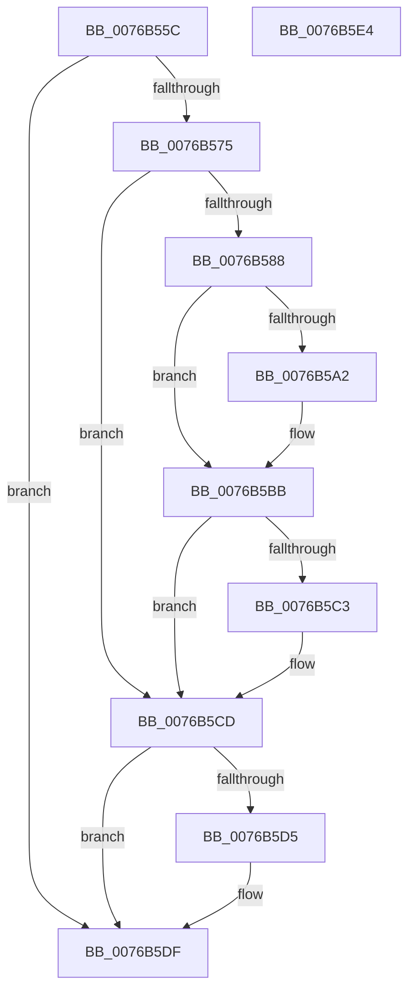

# PopAdaptiveClearInitialSystemPowerState

- RVA: `0x0076B55C`–`0x0076B5E5` (길이 `137` bytes)
- VA: `0x000000014076B55C`
- 실행 섹션: `PAGE`
- PDB 이름 있음: `예`; PDB Function 태그: `아니요`
- unwind 정보 RVA: `0x0005C788`
- 디코드: `32`개 명령, `137/137` bytes 표시
- 미해석 바이트: `0` (있으면 어셈블리에 `.byte`로 보존)

> 이 문서는 커널 이미지의 기계어와 PDB 기호를 분석해 생성했습니다. 4번과 5번은 함수 원형과 자료형을 바이너리 사용 방식에서 추정한 C 해석이며 원본 소스 복구 결과는 아닙니다.

## 1. Dependencies

- 직접 호출 지점: **6**; 고유 호출 대상: **6**
- 직접 호출자로 확인된 함수: **1**
- RIP 상대 이미지 참조: **2**

### Outgoing calls
- `0x0076B57F` → [BcdOpenStore](../A4/BcdOpenStore_function_00A4116C.md) (function, `0x00A4116C`)
- `0x0076B599` → [BcdOpenObject](../91/BcdOpenObject_function_00916704.md) (function, `0x00916704`)
- `0x0076B5AC` → [BiDeleteElement](../A3/BiDeleteElement_function_00A3E0F8.md) (function, `0x00A3E0F8`)
- `0x0076B5B6` → [BcdFlushStore](../82/BcdFlushStore_function_00823294.md) (function, `0x00823294`)
- `0x0076B5C8` → [BcdCloseObject](../A3/BcdCloseObject_function_00A3FB08.md) (function, `0x00A3FB08`)
- `0x0076B5DA` → [BcdCloseStore](../A3/BcdCloseStore_function_00A3C68C.md) (function, `0x00A3C68C`)

### Direct callers
- [PoInitHiberServices](../75/PoInitHiberServices_function_007537C4.md) at `0x00753899`

### Static image references
- `0x0076B56C` → RVA `0x00FD81F1` (`PAGEDATA`; read)
- `0x0076B592` → RVA `0x0001A4A0` (`.rdata`; read)

## 2. Other-region calls and transfers

- 다른 실행 섹션으로 향하는 call: **0**
- 별도 외부 분기/꼬리 이동을 확인하지 못했습니다.

## 3. Assembly (complete function range)

```asm
0076B55C  48 83 EC 28                     sub rsp, 0x28
0076B560  48 83 4C 24 30 FF               or qword ptr [rsp + 0x30], 0xffffffffffffffff
0076B566  48 83 4C 24 38 FF               or qword ptr [rsp + 0x38], 0xffffffffffffffff
0076B56C  80 3D 7E CC 86 00 00            cmp byte ptr [rip + 0x86cc7e], 0
0076B573  74 6A                           je 0x14076b5df
0076B575  4C 8D 44 24 30                  lea r8, [rsp + 0x30]
0076B57A  BA 02 00 00 00                  mov edx, 2
0076B57F  E8 E8 5B 2D 00                  call 0x140a4116c
0076B584  85 C0                           test eax, eax
0076B586  78 45                           js 0x14076b5cd
0076B588  48 8B 4C 24 30                  mov rcx, qword ptr [rsp + 0x30]
0076B58D  4C 8D 44 24 38                  lea r8, [rsp + 0x38]
0076B592  48 8D 15 07 EF 8A FF            lea rdx, [rip - 0x7510f9]
0076B599  E8 66 B1 1A 00                  call 0x140916704
0076B59E  85 C0                           test eax, eax
0076B5A0  78 19                           js 0x14076b5bb
0076B5A2  48 8B 4C 24 38                  mov rcx, qword ptr [rsp + 0x38]
0076B5A7  BA 5A 01 00 25                  mov edx, 0x2500015a
0076B5AC  E8 47 2B 2D 00                  call 0x140a3e0f8
0076B5B1  48 8B 4C 24 30                  mov rcx, qword ptr [rsp + 0x30]
0076B5B6  E8 D9 7C 0B 00                  call 0x140823294
0076B5BB  48 83 7C 24 38 FF               cmp qword ptr [rsp + 0x38], -1
0076B5C1  74 0A                           je 0x14076b5cd
0076B5C3  48 8B 4C 24 38                  mov rcx, qword ptr [rsp + 0x38]
0076B5C8  E8 3B 45 2D 00                  call 0x140a3fb08
0076B5CD  48 83 7C 24 30 FF               cmp qword ptr [rsp + 0x30], -1
0076B5D3  74 0A                           je 0x14076b5df
0076B5D5  48 8B 4C 24 30                  mov rcx, qword ptr [rsp + 0x30]
0076B5DA  E8 AD 10 2D 00                  call 0x140a3c68c
0076B5DF  48 83 C4 28                     add rsp, 0x28
0076B5E3  C3                              ret
0076B5E4  CC                              int3
```

## 4. C-style interpretation (structured pseudocode)

```c
__int64 __fastcall PopAdaptiveClearInitialSystemPowerState(void)
{
    __int64 result;
    __int64 v_rsp;
    unsigned __int64 v_stack_p10;
    unsigned __int64 v_stack_p8;

    v_rsp = (v_rsp) - (40);
    if ((*(unsigned __int8 *)(v_rip + 8834174)) == 0) goto loc_0076B5DF;
    result = BcdOpenStore(a1, 2, v_stack_p8, a4);
    if (sign_flag) goto loc_0076B5CD;
    result = BcdOpenObject(v_stack_p8, v_rip - 7672057, v_stack_p10, a4);
    if (!(sign_flag)) {
        a1 = v_stack_p10;
        a2 = 0x2500015AULL;
        result = BiDeleteElement(a1, a2, v_stack_p10, a4);
        a1 = v_stack_p8;
        result = BcdFlushStore(a1, a2, v_stack_p10, a4);
    }
    if (v_stack_p10 != -1) {
        a1 = v_stack_p10;
        result = BcdCloseObject(a1, a2, v_stack_p10, a4);
    }
    if (v_stack_p8 != -1) {
        a1 = v_stack_p8;
        result = BcdCloseStore(a1, a2, v_stack_p10, a4);
    }
    v_rsp = (v_rsp) + (40);
    return result;
}
```

## 5. (Beta) C Style

```c
void PopAdaptiveClearInitialSystemPowerState(void)
{
    int64_t result;
    int64_t local_rsp;
    uint64_t v_stack_p10;
    uint64_t v_stack_p8;

    local_rsp = (local_rsp) - (40);
    if ((*(uint8_t *)(v_rip + 0x86CC7E)) == 0) goto loc_0076B5DF;
    result = BcdOpenStore(a1, 2, v_stack_p8, a4);
    if (sign_flag) goto loc_0076B5CD;
    result = BcdOpenObject(v_stack_p8, v_rip - 7672057, v_stack_p10, a4);
    if (!(sign_flag)) {
        a1 = v_stack_p10;
        a2 = 0x2500015AULL;
        result = BiDeleteElement(a1, a2, v_stack_p10, a4);
        a1 = v_stack_p8;
        result = BcdFlushStore(a1, a2, v_stack_p10, a4);
    }
    if (v_stack_p10 != -1) {
        a1 = v_stack_p10;
        result = BcdCloseObject(a1, a2, v_stack_p10, a4);
    }
    if (v_stack_p8 != -1) {
        a1 = v_stack_p8;
        result = BcdCloseStore(a1, a2, v_stack_p10, a4);
    }
    local_rsp = (local_rsp) + (40);
    return result;
}
```

## 6. Execution-region graph

[열기: 2D/3D 그래프와 함수 탐색 컨트롤 패널](../../../control-panel.html?section=page&rva=0x0076B55C&view=graph)

- 2D 그래프는 위에서 아래로 흐르고, 3D 그래프는 빈 공간을 드래그해 회전합니다. Shift+드래그는 이동, 휠은 확대·축소, 함수 노드 선택은 대상 보고서 이동입니다.

### Static fallback


